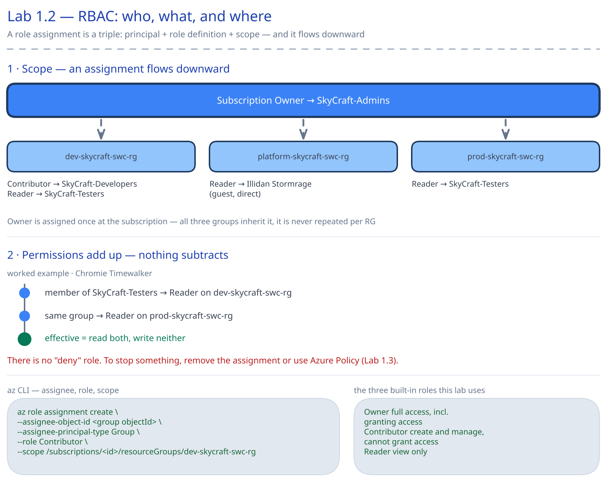
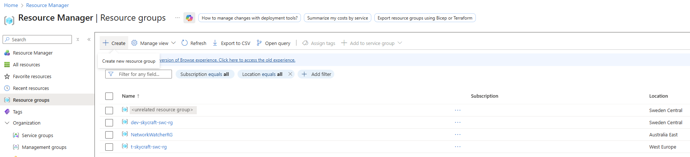

# Lab 1.2: Manage Access to Azure Resources (RBAC) (2 hours)

## 🎯 Lab Objectives

By completing this lab, you will:

- Understand Azure RBAC (Role-Based Access Control) fundamentals
- Assign built-in Azure roles at different scopes
- Configure role assignments for users and groups
- Interpret and verify access assignments
- Implement least-privilege access principles for the SkyCraft team

---

## 🏗️ Architecture Overview

You will configure the following Resource Groups and Role Assignments:

<picture>
  <source media="(prefers-color-scheme: dark)" srcset="images/lab-1.2-architecture.dark.svg">
  <source media="(prefers-color-scheme: light)" srcset="images/lab-1.2-architecture.svg">
  
</picture>

## 📋 Real-World Scenario

**Situation**: You've created the SkyCraft team (Lab 1.1), but they currently have no permissions to manage Azure resources. You need to grant appropriate access levels:

- **Malfurion Stormrage** (Admin) → Full control over all SkyCraft resources
- **SkyCraft-Developers group** → Can create and manage VMs and storage in the development resource group, but cannot grant access to anyone
- **SkyCraft-Testers group** → Read-only access to monitor resources
- **Illidan Stormrage** (External Partner) → Read-only access to a specific resource group only

**Your Task**: Assign appropriate RBAC roles at the correct scopes to enable the team to work effectively while maintaining security.

---

## ⏱️ Estimated Time: 2 hours

- **Section 1**: Understand RBAC concepts and scopes (20 min)
- **Section 2**: Create resource groups for SkyCraft (15 min)
- **Section 3**: Assign roles at subscription scope (25 min)
- **Section 4**: Assign roles at resource group scope (30 min)
- **Section 5**: Verify and test access (20 min)
- **Section 6**: Understand role assignment properties (10 min)

---

## ✅ Prerequisites

Before starting this lab:

- [ ] Completed Lab 1.1 (users and groups created)
- [ ] Azure subscription with Owner or User Access Administrator role, assigned without a condition that keeps you from assigning Owner (Troubleshooting, Issue 1, shows how to check)
- [ ] Understanding of resource groups concept
- [ ] Azure Portal access
- [ ] Only for the scripts in `scripts/` and the checklist commands (the Portal steps need none): PowerShell 7 with `Az.Accounts` and `Az.Resources`, and, for `New-LabRoleAssignment.ps1`, the Microsoft Graph modules `Microsoft.Graph.Authentication`, `Microsoft.Graph.Identity.DirectoryManagement`, `Microsoft.Graph.Users` and `Microsoft.Graph.Groups`. Install them for your account:

  ```powershell
  Install-Module Az.Accounts, Az.Resources -Scope CurrentUser
  Install-Module Microsoft.Graph.Authentication, Microsoft.Graph.Identity.DirectoryManagement, Microsoft.Graph.Users, Microsoft.Graph.Groups -Scope CurrentUser
  ```

  In Azure Cloud Shell (PowerShell) all of them are preinstalled except `Microsoft.Graph.Users`. Install it before `New-LabRoleAssignment.ps1`, at the version of the preinstalled Graph modules: the script loads its Graph modules at one version only.

  ```powershell
  $graphVersion = (Get-Module -ListAvailable Microsoft.Graph.Authentication | Sort-Object Version -Descending | Select-Object -First 1).Version
  Install-Module Microsoft.Graph.Users -RequiredVersion $graphVersion -Scope CurrentUser
  ```

  When a module is missing, or not installed at the version the other Graph modules share, `New-LabRoleAssignment.ps1` stops before it signs in and prints the `Install-Module` command with the version to install. A Cloud Shell session without a storage account can run the other scripts of this lab, which need only preinstalled modules. It can run `New-LabRoleAssignment.ps1` only if this install works there, which Microsoft Learn does not document; if it fails, mount a storage account or run the script in PowerShell 7 on your own machine. An ephemeral session also deletes the clone of the repository and the module when it ends, so install the module again in each new session. Details and sources: [Module 1 prerequisites](../README.md#-prerequisites).

**Verify Lab 1.1 completion**: Confirm these exist:

- Users: Malfurion Stormrage, Khadgar Archmage, Chromie Timewalker, and the guest Illidan Stormrage
- Groups: SkyCraft-Admins, SkyCraft-Developers, SkyCraft-Testers

### Portal, PowerShell and Bicep: three ways to the same result

Every step that changes Azure in this lab has a Bicep counterpart in the lab's `bicep/` folder, deployed by `scripts/Deploy-Bicep.ps1`; the role assignments also have an Az PowerShell one. The steps that only look at what is there, and the optional sign-in test, are Portal-only. `scripts/Test-Lab.ps1` checks the three resource groups, the five role assignments and that Malfurion Stormrage's Owner assignment has no condition, whichever way you built them.

| Guide step | What it changes | PowerShell (`scripts/`) | Bicep (`bicep/`) |
| --- | --- | --- | --- |
| 1.2.1-1.2.3 | Three resource groups in Sweden Central, with four tags | None of its own: both paths of the checklist's Automation section create the groups with `Deploy-Bicep.ps1` | `resource-groups.bicep`, deployed by `Deploy-Bicep.ps1` |
| 1.2.4 | Owner for Malfurion Stormrage on the subscription, without a condition | `New-LabRoleAssignment.ps1` | `role-assignments.bicep`, deployed by `Deploy-Bicep.ps1 -IncludeRoleAssignments` |
| 1.2.6-1.2.9 | Contributor and three Reader assignments on the resource groups | `New-LabRoleAssignment.ps1` | `role-assignments.bicep`, deployed by `Deploy-Bicep.ps1 -IncludeRoleAssignments` |
| 1.2.5, 1.2.10-1.2.12 | Nothing (they read the assignments) | Portal-only; the checklist's validation commands read the same assignments | none |
| 1.2.13 (optional) | Nothing (a sign-in test as Khadgar Archmage) | Portal-only | none |

The Portal steps and `resource-groups.bicep` give each resource group the same four tags (`Project`, `Environment`, `CostCenter`, `Owner`), so every path leaves the same groups behind. `scripts/New-LabResourceGroup.ps1` creates the same three groups with the same four tags, but it is not one of this lab's paths. The role-assignment paths can be mixed: `Deploy-Bicep.ps1 -IncludeRoleAssignments` keeps the assignments the Portal or the script already created and deploys only the missing ones, and `New-LabRoleAssignment.ps1` skips the ones that exist (see the checklist's Automation section).

---

## 📖 Section 1: Understanding Azure RBAC (20 minutes)

### What is Azure RBAC?

**Azure RBAC** (Role-Based Access Control) is an authorization system that helps you manage **who** has access to Azure resources, **what** they can do with those resources, and **where** they have access.

### The Three Core Components

1. **Security Principal** (WHO)

   - User (e.g., Malfurion Stormrage)
   - Group (e.g., SkyCraft-Developers)
   - Service Principal
   - Managed Identity

2. **Role Definition** (WHAT)

   - Collection of permissions
   - Examples: Owner, Contributor, Reader
   - Built-in or Custom roles

3. **Scope** (WHERE)
   - Management Group
   - Subscription
   - Resource Group
   - Individual Resource

### Common Built-in Roles

| Role                            | Description                                      | Use Case                            |
| ------------------------------- | ------------------------------------------------ | ----------------------------------- |
| **Owner**                       | Full access including role assignments           | Admins managing entire environments |
| **Contributor**                 | Can create/manage resources but not grant access | Developers deploying infrastructure |
| **Reader**                      | View-only access                                 | Auditors, monitoring teams, testers |
| **Virtual Machine Contributor** | Manage VMs but not networking/storage            | Specialized VM administrators       |
| **Storage Account Contributor** | Manage storage accounts                          | Storage specialists                 |

### Understanding Scope Hierarchy

```
Management Group (broadest)
└── Subscription
    └── Resource Group
        └── Resource (most specific)
```

**Key Concept**: Permissions are **inherited** down the hierarchy. A role assigned at subscription level applies to all resource groups and resources within that subscription.

### Best Practices

1. **Principle of Least Privilege** → Grant minimum permissions needed
2. **Assign roles to groups, not individual users** → Easier management
3. **Use built-in roles when possible** → Custom roles add complexity
4. **Assign at appropriate scope** → Subscription for broad access, resource group for specific projects

---

## 📖 Section 2: Create Resource Groups (15 minutes)

Before assigning roles, create resource groups for the SkyCraft project.

All three groups go to **Sweden Central**: the `swc` in their names stands for it, and the scripts and the Bicep create them there. The wizard's **Region** list may open on another region, so set it on every group. Each group also gets four tags on the wizard's **Tags** tab, the ones the Bicep sets and Lab 1.3 checks in Steps 1.3.1-1.3.3: there, **Apply** then stays greyed out, because the tags are already in place.

### Step 1.2.1: Create Development Resource Group

1. In **Azure Portal**, search for **"Resource groups"**
2. Click **+ Create**
3. On the **Basics** tab, fill in:

| Field          | Value               |
| -------------- | ------------------- |
| Subscription   | [Your subscription] |
| Resource group | dev-skycraft-swc-rg |
| Region         | Sweden Central      |

4. Click the **Tags** tab and add:

| Name        | Value       |
| ----------- | ----------- |
| Environment | Development |
| Project     | SkyCraft    |
| CostCenter  | MSDN        |
| Owner       | mbiszczanik |

5. Click **Review + create**, then **Create**

**Expected Result**: Resource group `dev-skycraft-swc-rg` appears in the list.



### Step 1.2.2: Create Production Resource Group

1. Click **+ Create** again
2. On the **Basics** tab, fill in:

| Field          | Value                |
| -------------- | -------------------- |
| Subscription   | [Your subscription]  |
| Resource group | prod-skycraft-swc-rg |
| Region         | Sweden Central       |

3. Click the **Tags** tab and add:

| Name        | Value       |
| ----------- | ----------- |
| Environment | Production  |
| Project     | SkyCraft    |
| CostCenter  | MSDN        |
| Owner       | mbiszczanik |

4. Click **Review + create**, then **Create**

**Expected Result**: Resource group `prod-skycraft-swc-rg` appears in the list.

### Step 1.2.3: Create Shared Services Resource Group

1. Click **+ Create**
2. On the **Basics** tab, fill in:

| Field          | Value                    |
| -------------- | ------------------------ |
| Subscription   | [Your subscription]      |
| Resource group | platform-skycraft-swc-rg |
| Region         | Sweden Central           |

3. Click the **Tags** tab and add:

| Name        | Value       |
| ----------- | ----------- |
| Environment | Platform    |
| Project     | SkyCraft    |
| CostCenter  | MSDN        |
| Owner       | mbiszczanik |

4. Click **Review + create**, then **Create**

**Expected Result**: Three resource groups created:

- `dev-skycraft-swc-rg` (for development/testing)
- `prod-skycraft-swc-rg` (for production deployment)
- `platform-skycraft-swc-rg` (for shared resources like monitoring)

---

## 📖 Section 3: Assign Roles at Subscription Scope (25 minutes)

### How the Add role assignment wizard looks today

Every role assignment in this lab goes through the same **Add role assignment** wizard (Microsoft Learn, [Assign Azure roles using the Azure portal](https://learn.microsoft.com/azure/role-based-access-control/role-assignments-portal)). What it shows depends on the role you pick:

- The **Role** tab has two lists. **Job function roles** opens first and holds roles such as Reader. **Privileged administrator roles** holds five roles: Owner, Contributor, Access Review Operator Service Role, Role Based Access Control Administrator and User Access Administrator. Owner and Contributor are not on the first list.
- The tab strip shows a **Conditions** tab after **Members**. For **Owner** it is active, so **Next** on the **Members** tab opens **Conditions**, not **Review + assign**. For Contributor and Reader it stays in the strip, greyed out, and **Next** on the **Members** tab skips it.
- In a tenant with a Microsoft Entra ID P2 or Microsoft Entra ID Governance licence, the wizard also has an **Assignment type** tab before **Review + assign**. This lab's assignments are **Active** and **Permanent**, as the scripts and the Bicep create them: an **Eligible** assignment gives no access until the user activates it. Without such a licence the tab is not there: skip the two fields the steps list under "Only if the wizard shows an Assignment type tab". Each step then opens the **Review + assign** tab by its name, so it works with the tab and without it.

### Step 1.2.4: Assign Owner Role to Admin User

1. In Azure Portal, search for **Subscriptions**
2. Click your subscription's name
3. In the left menu, click **Access control (IAM)**
4. Click **+ Add** → **Add role assignment**
5. On the **Role** tab:

   - Click **Privileged administrator roles**
   - Search for **"Owner"**
   - Click **Owner**
   - Click **Next**

6. On the **Members** tab:

   - **Assign access to**: User, group, or service principal
   - Click **+ Select members**
   - Search for **"Malfurion Stormrage"**
   - Click **Malfurion Stormrage**
   - Click **Select**
   - Click **Next**

**Note**: Malfurion Stormrage is a user, not a group: after **Select** he is listed under **Members** as a user. Because Owner can assign roles to others, **Next** opens the **Conditions** tab, not **Review + assign**.

7. On the **Conditions** tab, under **What user can do**, select **Allow user to assign all roles (highly privileged)**

**Note**: The **Conditions** tab decides which roles Malfurion may assign to others. It offers three options:

| Option | Malfurion can assign |
| --- | --- |
| Allow user to assign all roles except privileged administrator roles Owner, UAA, RBAC (Recommended) | Every role except Owner, User Access Administrator and Role Based Access Control Administrator |
| Allow user to only assign selected roles to selected principals (fewer privileges) | Only the roles, to only the users and groups, that you pick under **Select roles and principals** |
| Allow user to assign all roles (highly privileged) | Every role, Owner included |

Select the last option whichever one is selected when the tab opens. The scenario gives the SkyCraft administrator full control, and it is the only option that adds no condition to the assignment, which is what `New-LabRoleAssignment.ps1` and `role-assignments.bicep` create and what Step 1.2.5 expects. It opens access as wide as it goes: in a real subscription, prefer the recommended option or a constrained one (Microsoft Learn, [Assign a user as an administrator of an Azure subscription with conditions](https://learn.microsoft.com/azure/role-based-access-control/role-assignments-portal-subscription-admin)).

8. Click **Next**
9. Only if the wizard shows an Assignment type tab (see above):

   - **Assignment type**: Active
   - **Assignment duration**: Permanent

10. Click the **Review + assign** tab, then click **Review + assign**

**Expected Result**: A notification reports that the role assignment was added. Step 1.2.5 finds it in the subscription's list.

### Step 1.2.5: Verify Role Assignment

You are still on the subscription's **Access control (IAM)** page.

1. Click the **Role assignments** tab
2. Search for **"Malfurion Stormrage"**

**Expected Result**: Under **Owner**, the list shows the assignment with these details:

- Name: Malfurion Stormrage
- Type: User
- Role: Owner
- Scope: This resource (the subscription you opened)
- Condition: **Add** (a link to add a condition: the assignment has none)

At a resource group, rows inherited from the subscription show **None** in the same column (Step 1.2.12). **Add** and **None** both mean no condition. If **Condition** shows **View/Edit**, the assignment has a condition: see Troubleshooting, Issue 6.

---

## 📖 Section 4: Assign Roles at Resource Group Scope (30 minutes)

Now assign more specific roles at resource group level for the development team. Contributor is on the **Privileged administrator roles** list and Reader on **Job function roles**. For both, the **Conditions** tab stays in the tab strip, greyed out, and **Next** on the **Members** tab opens **Review + assign** (or **Assignment type**, where your tenant has it).

### Step 1.2.6: Assign Contributor Role to Developers Group (Dev Environment)

1. In Azure Portal, search for **Resource groups**
2. Click **dev-skycraft-swc-rg**
3. In the left menu, click **Access control (IAM)**
4. Click **+ Add** → **Add role assignment**
5. On the **Role** tab:

   - Click **Privileged administrator roles**
   - Search for **"Contributor"**
   - Click **Contributor**
   - Click **Next**

6. On the **Members** tab:

   - **Assign access to**: User, group, or service principal
   - Click **+ Select members**
   - Search for **"SkyCraft-Developers"**
   - Click **SkyCraft-Developers** (the group, not its members)
   - Click **Select**
   - Click **Next**

7. Only if the wizard shows an Assignment type tab:

   - **Assignment type**: Active
   - **Assignment duration**: Permanent

8. Click the **Review + assign** tab, then click **Review + assign**

**Expected Result**: A notification reports that the role assignment was added. Step 1.2.12 finds it in the list of `dev-skycraft-swc-rg`.

**Note**: Contributor lets the members of SkyCraft-Developers create and manage resources in `dev-skycraft-swc-rg`, but not grant access to anyone.

### Step 1.2.7: Assign Reader Role to Testers Group (Dev Environment)

You are still on the **Access control (IAM)** page of `dev-skycraft-swc-rg`.

1. Click **+ Add** → **Add role assignment**
2. On the **Role** tab:

   - Click **Job function roles**
   - Search for **"Reader"**
   - Click **Reader** (the role named exactly Reader; the search also lists roles such as Backup Reader)
   - Click **Next**

3. On the **Members** tab:

   - **Assign access to**: User, group, or service principal
   - Click **+ Select members**
   - Search for **"SkyCraft-Testers"**
   - Click **SkyCraft-Testers**
   - Click **Select**
   - Click **Next**

4. Only if the wizard shows an Assignment type tab:

   - **Assignment type**: Active
   - **Assignment duration**: Permanent

5. Click the **Review + assign** tab, then click **Review + assign**

**Expected Result**: A notification reports that the role assignment was added. Step 1.2.12 finds it in the list of `dev-skycraft-swc-rg`.

**Note**: Reader lets the members of SkyCraft-Testers view the resources in `dev-skycraft-swc-rg`, but not change them.

### Step 1.2.8: Assign Reader Role to Testers (Production Environment)

1. In Azure Portal, search for **Resource groups**
2. Click **prod-skycraft-swc-rg**
3. In the left menu, click **Access control (IAM)**
4. Click **+ Add** → **Add role assignment**
5. On the **Role** tab:

   - Click **Job function roles**
   - Search for **"Reader"**
   - Click **Reader**
   - Click **Next**

6. On the **Members** tab:

   - **Assign access to**: User, group, or service principal
   - Click **+ Select members**
   - Search for **"SkyCraft-Testers"**
   - Click **SkyCraft-Testers**
   - Click **Select**
   - Click **Next**

7. Only if the wizard shows an Assignment type tab:

   - **Assignment type**: Active
   - **Assignment duration**: Permanent

8. Click the **Review + assign** tab, then click **Review + assign**

**Expected Result**: A notification reports that the role assignment was added. Step 1.2.11 checks it from `prod-skycraft-swc-rg`.

**Note**: The testers can now view the production resources, but not change them.

### Step 1.2.9: Assign Limited Access to External Partner

For the external partner, grant access only to the shared services resource group:

1. In Azure Portal, search for **Resource groups**
2. Click **platform-skycraft-swc-rg**
3. In the left menu, click **Access control (IAM)**
4. Click **+ Add** → **Add role assignment**
5. On the **Role** tab:

   - Click **Job function roles**
   - Search for **"Reader"**
   - Click **Reader**
   - Click **Next**

6. On the **Members** tab:

   - **Assign access to**: User, group, or service principal
   - Click **+ Select members**
   - Search for **"Illidan Stormrage"**
   - Click **Illidan Stormrage** (the guest user from Lab 1.1)
   - Click **Select**
   - Click **Next**

7. Only if the wizard shows an Assignment type tab:

   - **Assignment type**: Active
   - **Assignment duration**: Permanent

8. Click the **Review + assign** tab, then click **Review + assign**

**Expected Result**: A notification reports that the role assignment was added.

**Note**: The external partner can now view `platform-skycraft-swc-rg`, and has no access to the dev and prod groups.

---

## 📖 Section 5: Verify and Test Access (20 minutes)

A new role assignment can take a few minutes to take effect; in this course's Portal passes it took about five. **Check access** shows the access a user has at the scope you open and the access inherited from above it (the subscription). It does not show access in other resource groups (Microsoft Learn, [Check access for a user to a single Azure resource](https://learn.microsoft.com/azure/role-based-access-control/check-access)).

### Step 1.2.10: Check Access for Developer

1. Wait about five minutes after Step 1.2.9, so that the new role assignments have taken effect
2. In Azure Portal, search for **Resource groups**
3. Click **dev-skycraft-swc-rg**
4. In the left menu, click **Access control (IAM)**
5. Click the **Check access** tab
6. Click the **Check access** button
7. Select **User, group, or service principal**
8. Search for **"Khadgar Archmage"**
9. Click **Khadgar Archmage**

**Expected Result**: A pane with Khadgar Archmage's assignments opens. Its role assignments list shows the user has:

- **Contributor** (inherited from SkyCraft-Developers group)
- Scope: This resource (`dev-skycraft-swc-rg`)

**Analysis**: The user doesn't have the role directly: they inherit it through group membership. This confirms best practice (assign to groups, not users).

### Step 1.2.11: Check Access for Tester

1. Click **Close** at the top right of Khadgar Archmage's assignments pane
2. Click the **Check access** button
3. Select **User, group, or service principal**
4. Search for **"Chromie Timewalker"**
5. Click **Chromie Timewalker**

**Note**: This pane shows Chromie's Reader at `dev-skycraft-swc-rg` only. Her Reader at `prod-skycraft-swc-rg` sits on a resource group beside this one, not above it, so Check access lists it only when you open it from that group, which the next items do.

6. Click **Close** at the top right of Chromie Timewalker's assignments pane
7. In Azure Portal, search for **Resource groups**
8. Click **prod-skycraft-swc-rg**
9. In the left menu, click **Access control (IAM)**
10. Click the **Check access** tab
11. Click the **Check access** button
12. Select **User, group, or service principal**
13. Search for **"Chromie Timewalker"**
14. Click **Chromie Timewalker**

**Expected Result**: Both panes show:

- **Reader** role (inherited from SkyCraft-Testers group)
- Scope: This resource, which is `dev-skycraft-swc-rg` in the first pane and `prod-skycraft-swc-rg` in the second

### Step 1.2.12: View All Role Assignments

1. In Azure Portal, search for **Resource groups**
2. Click **dev-skycraft-swc-rg**
3. In the left menu, click **Access control (IAM)**
4. Click the **Role assignments** tab

**Expected Result**: The list shows the two assignments made on this resource group and the ones it inherits from the subscription.

| Name | Type | Role | Scope |
|------|------|------|-------|
| SkyCraft-Developers | Group | Contributor | This resource |
| SkyCraft-Testers | Group | Reader | This resource |
| Malfurion Stormrage | User | Owner | Subscription (Inherited) |

Your own account, and any other assignment made on the subscription, is listed with the scope Subscription (Inherited) as well.

In the **Condition** column, Malfurion Stormrage's inherited row shows **None**: the assignment has no condition.

### Step 1.2.13: Test Effective Permissions (Optional but Recommended)

To see the permissions from Khadgar's side, sign in as him. This step changes nothing in Azure. Its first and last items happen outside the Portal, in your browser.

1. Open a private browser window and sign in to the Azure portal as Khadgar Archmage (the user name and password from Lab 1.1)
2. In Azure Portal, search for **Resource groups**
3. Click **dev-skycraft-swc-rg**
4. In the left menu, click **Access control (IAM)**
5. Click **+ Add**
6. Close the private window

**Expected Result**: In the private window, the list of resource groups showed `dev-skycraft-swc-rg` only, the one group where Khadgar has a role, and under + Add the Add role assignment item was greyed out, because Contributor cannot grant access.

**Note**: Do not test the role by deleting the resource group. Contributor on a resource group can delete that group, and everything in it would be gone. For lab purposes, checking access in IAM is sufficient verification.

---

## 📖 Section 6: Understanding Role Assignment Properties (10 minutes)

### View Assignment Details

1. In any resource group, go to **Access control (IAM)** → **Role assignments**
2. Click on any assignment to view details

**Key Properties**:

- **Principal ID**: Unique identifier for user/group
- **Role Definition ID**: Unique identifier for the role
- **Scope**: Exact resource path where role applies
- **Condition**: An extra check on the assignment, such as which roles an Owner may assign to others (none on any assignment in this lab, so the **Condition** column shows **Add** or **None**, never **View/Edit**: Step 1.2.4 chooses the option without one)

### Understand Inheritance

```
Subscription (Malfurion Stormrage = Owner)
└── dev-skycraft-swc-rg (Developers = Contributor, Testers = Reader)
    └── [Future VM] (inherits all above permissions)
```

**Key Concept**: When you create a VM in `dev-skycraft-swc-rg`:

- Malfurion Stormrage can manage it (Owner at subscription)
- Developers can manage it (Contributor at RG)
- Testers can view it (Reader at RG)

---

## ✅ Lab Checklist

Complete this checklist to verify successful lab completion:

### Resource Groups Created

- [ ] `dev-skycraft-swc-rg` exists
- [ ] `prod-skycraft-swc-rg` exists
- [ ] `platform-skycraft-swc-rg` exists

### Subscription-Level Role Assignments

- [ ] Malfurion Stormrage has **Owner** role at subscription scope, with no condition (**Condition** shows **Add**, not **View/Edit**)

### Resource Group-Level Assignments (dev-skycraft-swc-rg)

- [ ] SkyCraft-Developers group has **Contributor** role
- [ ] SkyCraft-Testers group has **Reader** role

### Resource Group-Level Assignments (prod-skycraft-swc-rg)

- [ ] SkyCraft-Testers group has **Reader** role

### Resource Group-Level Assignments (platform-skycraft-swc-rg)

- [ ] Illidan Stormrage has **Reader** role

### Verification Completed

- [ ] Checked access for Khadgar Archmage on `dev-skycraft-swc-rg` (shows Contributor via group)
- [ ] Checked access for Chromie Timewalker on `dev-skycraft-swc-rg` and on `prod-skycraft-swc-rg` (shows Reader via group in each)
- [ ] Reviewed the role assignments of `dev-skycraft-swc-rg`, including those inherited from the subscription
- [ ] Understand the difference between subscription and resource group scope

**For detailed verification**, see [lab-checklist-1.2.md](lab-checklist-1.2.md)

---

## 🔧 Troubleshooting

### Issue 1: "You do not have permission to add role assignment"

**Symptom**: Error when trying to assign roles

**Causes**:

- You don't have Owner or User Access Administrator role
- Your own Owner assignment has a condition. The option Microsoft recommends on the **Conditions** tab keeps you from assigning Owner (Step 1.2.4); a condition that allows only selected roles can also keep you from assigning Contributor (Step 1.2.6) or Reader (Steps 1.2.7-1.2.9)

**Solutions**:

1. Verify your own role: open your subscription, then **Access control (IAM)** → **Check access** tab → **View my access**. The pane lists your role assignments; a **Condition** that shows **View/Edit** (not **Add** or **None**) limits the roles you can assign. In a tenant with a Microsoft Entra ID P2 or Microsoft Entra ID Governance licence there is no **View my access** button: the **Check access** tab lists your role assignments itself (Microsoft Learn, [Check access for a user to a single Azure resource](https://learn.microsoft.com/azure/role-based-access-control/check-access), step 2)
2. You need Owner or User Access Administrator, without a condition that excludes the roles of this lab, to assign roles
3. Contact your subscription administrator

### Issue 2: Cannot find user/group when adding members

**Symptom**: User or group doesn't appear in search

**Solutions**:

1. Wait 5 minutes after creating users/groups (synchronization delay)
2. Search by exact name: "SkyCraft-Developers"
3. Refresh the browser (F5)
4. Verify the user/group exists: **Entra ID** → **Users** or **Groups**

### Issue 3: Role assignment doesn't show in "Check access"

**Symptom**: Just assigned a role but it doesn't appear

**Solutions**:

1. Wait about five minutes (propagation delay; it can take up to ten)
2. Refresh the page
3. Check the correct scope: Check access lists the scope you opened and the scopes above it, so Chromie's Reader on `prod-skycraft-swc-rg` shows only when you open Check access from that group
4. Verify assignment in **Role assignments** tab

### Issue 4: User can't perform actions despite having Contributor role

**Symptom**: Developer reports "Access Denied" errors

**Solutions**:

1. Verify role assignment scope matches where they're working
2. Confirm they're members of the correct group
3. Ask them to sign out and sign back in (token refresh)
4. Wait up to 5 minutes for permissions to propagate

### Issue 5: Owner or Contributor is not in the list of roles

**Symptom**: On the **Role** tab of **Add role assignment**, searching for Owner or Contributor finds nothing

**Root Cause**: The tab opens on **Job function roles**. Owner and Contributor are on the **Privileged administrator roles** list, with Access Review Operator Service Role, Role Based Access Control Administrator and User Access Administrator.

**Solution**: Click **Privileged administrator roles**, then search again.

### Issue 6: Malfurion's Owner assignment shows a condition

**Symptom**: In Step 1.2.5, the **Condition** column of Malfurion Stormrage's Owner assignment shows **View/Edit** instead of **Add**. **Add** is a link to add a condition and means the assignment has none; **View/Edit** opens the condition it has

**Root Cause**: On the **Conditions** tab of Step 1.2.4, another option than **Allow user to assign all roles (highly privileged)** was selected. The assignment works, but it is not the one the scripts and the Bicep create, and `scripts/Test-Lab.ps1` fails it.

**Solution**:

1. On the subscription's **Access control (IAM)** page, click the **Role assignments** tab
2. Check the box of Malfurion Stormrage's Owner assignment
3. Click **Delete**, then **Yes**
4. Wait a minute, so that the deletion has taken effect before you assign the same role to the same user again
5. Repeat Step 1.2.4

---

## 🎓 Knowledge Check

Test your understanding with these questions:

1. **What's the difference between Owner and Contributor roles?**

   <details>
     <summary>**Click to see the answer**</summary>

   **Answer**: Owner can do everything Contributor can do, PLUS assign roles to others. Contributor cannot grant access to anyone else.
   </details>

2. **Why assign roles to groups instead of individual users?**

   <details>
     <summary>**Click to see the answer**</summary>

   **Answer**: Groups are easier to manage: add/remove users from groups without changing role assignments. Also helps minimize role assignment count (4000 limit per subscription).
   </details>

3. **If Khadgar Archmage has Contributor at resource group level, can they create a new resource group?**

   <details>
     <summary>**Click to see the answer**</summary>

   **Answer**: No. Creating resource groups requires permissions at the subscription level.
   </details>

4. **A user has Reader at subscription level and Contributor at resource group level. What can they do in that resource group?**

   <details>
     <summary>**Click to see the answer**</summary>

   **Answer**: Contributor permissions apply (most permissive wins). They can create and manage resources in that RG.
   </details>

5. **What happens to role assignments when you delete a resource group?**

   <details>
     <summary>**Click to see the answer**</summary>

   **Answer**: Role assignments scoped to that resource group are automatically deleted.
   </details>

---

## 📚 Additional Resources

- [Azure built-in roles documentation](https://learn.microsoft.com/en-us/azure/role-based-access-control/built-in-roles)
- [Steps to assign an Azure role](https://learn.microsoft.com/en-us/azure/role-based-access-control/role-assignments-steps)
- [Best practices for Azure RBAC](https://learn.microsoft.com/en-us/azure/role-based-access-control/best-practices)
- [Understand scope for Azure RBAC](https://learn.microsoft.com/en-us/azure/role-based-access-control/scope-overview)

---

## 📦 What This Lab Leaves Behind

| What | Used by | Daily cost |
| --- | --- | --- |
| `dev-skycraft-swc-rg`, `prod-skycraft-swc-rg` and `platform-skycraft-swc-rg` in Sweden Central, each with the tags `Environment`, `Project`, `CostCenter` and `Owner` | Lab 1.3 (tags, policies, locks and budgets on them) and every later lab, which deploys its resources into them | None: an empty resource group costs nothing |
| Owner for Malfurion Stormrage on the subscription, without a condition | No later lab | None |
| Contributor for SkyCraft-Developers and Reader for SkyCraft-Testers on `dev-skycraft-swc-rg`, Reader for SkyCraft-Testers on `prod-skycraft-swc-rg`, Reader for Illidan Stormrage on `platform-skycraft-swc-rg` | No later lab | None |

Nothing in this lab costs money or deletes data. The Owner assignment gives Malfurion Stormrage, and anyone who signs in as him, full control of the subscription, including the right to grant any role: remove it when you no longer need it. `scripts/Remove-LabResource.ps1` removes it and deletes the three resource groups, which removes the four assignments on them.

**Warning**: Deleting the resource groups cannot be undone, and by the end of the course they hold every later lab's resources. Run `scripts/Remove-LabResource.ps1` only when you are done with the whole course, and run Lab 1.3's `scripts/Remove-LabResource.ps1` first: Lab 1.3 puts delete locks on `prod-skycraft-swc-rg` and `platform-skycraft-swc-rg`, and a locked group cannot be deleted.

---

## 🔗 What's Next

You've successfully implemented RBAC for the SkyCraft team! Key accomplishments:

- ✅ Created organized resource group structure
- ✅ Assigned appropriate roles at correct scopes
- ✅ Implemented least-privilege access
- ✅ Used groups for better management

**Next Lab**: Lab 1.3 - Azure Governance and Policies

- You'll add policies to enforce naming conventions
- Configure resource locks to prevent accidental deletion
- Set up cost management and budgets

---

## 📝 Lab Summary

**What You Accomplished**:

- ✅ Created 3 resource groups (dev, prod, shared)
- ✅ Assigned Owner role at subscription level
- ✅ Assigned Contributor and Reader roles at resource group level
- ✅ Followed best practices (groups, least privilege, appropriate scope)
- ✅ Verified access assignments

**Time Spent**: ~2 hours

**Roles Assigned**:

- 1 subscription-level assignment (Owner)
- 4 resource group-level assignments (Contributor × 1, Reader × 3)

---

---

## 📌 Module Navigation

- [← Lab 1.1: Manage Entra Users & Groups](../1.1-entra-users-groups/lab-guide-1.1.md)
- [← Back to Module 1 Index](../README.md)
- [Lab 1.3: Governance & Policies →](../1.3-governance/lab-guide-1.3.md)
