# Lab 1.3: Manage Azure Subscriptions and Governance (4 hours)

## 🎯 Lab Objectives

By completing this lab, you will:

- Implement Azure Policy to enforce organizational standards
- Configure resource locks to prevent accidental deletion
- Apply and manage tags for resource organization and cost tracking
- Configure Azure budgets and cost alerts
- Use Azure Advisor for optimization recommendations
- Understand management groups and subscription governance

---

## 🏗️ Architecture Overview

You will implement the following governance controls:

<picture>
  <source media="(prefers-color-scheme: dark)" srcset="images/lab-1.3-architecture.dark.svg">
  <source media="(prefers-color-scheme: light)" srcset="images/lab-1.3-architecture.svg">
  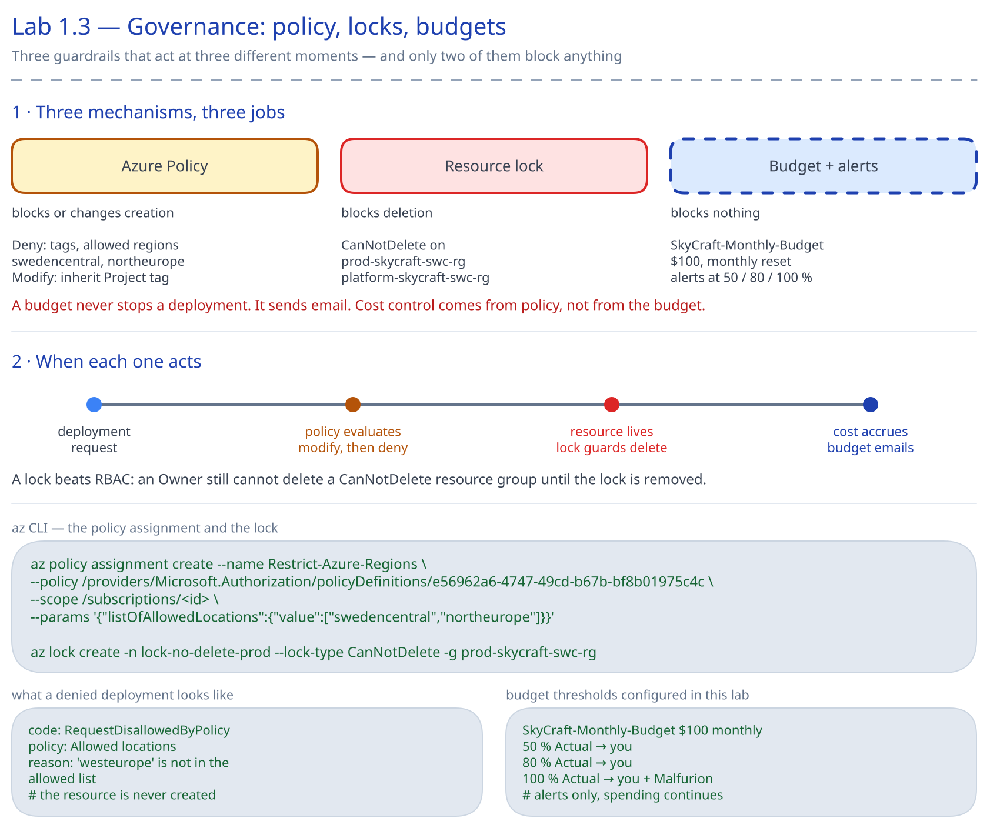
</picture>

## 📋 Real-World Scenario

**Situation**: The SkyCraft infrastructure now has proper identity management (Lab 1.1) and RBAC roles (Lab 1.2). However, there's still risk:

- Developers might accidentally delete production resources
- Resources are created without proper naming conventions
- No visibility into spending patterns
- Resources lack proper tagging for cost allocation

**Your Task**: Implement governance controls to:

1. Enforce naming conventions with Azure Policy
2. Prevent accidental deletion with resource locks
3. Tag all resources for cost tracking
4. Set up budgets and alerts to control spending
5. Use Azure Advisor recommendations

---

## ⏱️ Estimated Time: 4 hours

- **Section 1**: Apply and manage tags (30 min)
- **Section 2**: Implement Azure Policy (60 min)
- **Section 3**: Configure resource locks (30 min)
- **Section 4**: Manage costs with budgets and alerts (45 min)
- **Section 5**: Use Azure Advisor (30 min)
- **Section 6**: Understand management groups (15 min)
- **Hands-on Practice**: Governance framework implementation (30 min)

---

## ✅ Prerequisites

Before starting this lab:

- [ ] Completed Lab 1.1 (users and groups)
- [ ] Completed Lab 1.2 (RBAC and resource groups)
- [ ] Three resource groups exist: dev-skycraft-swc-rg, prod-skycraft-swc-rg, platform-skycraft-swc-rg
- [ ] Owner or Contributor role at subscription level
- [ ] Understanding of compliance and governance concepts

## 📖 Section 1: Apply and Manage Tags (30 minutes)

### What are Azure Tags?

**Tags** are name-value pairs that help you organize and categorize Azure resources. Tags enable:

- **Cost tracking** - Identify spending by project, environment, or department
- **Resource management** - Filter and group resources
- **Automation** - Target resources for automated operations
- **Compliance** - Track resource ownership and purpose

### Tag Limitations

- Maximum 50 tags per resource
- Tag name: 512 characters (storage accounts: 128 characters)
- Tag value: 256 characters
- Tags are not inherited from parent scopes (need Azure Policy for inheritance)

### Step 1.3.1: Apply Tags to Resource Groups

> [!IMPORTANT] > **Prerequisite**: The resource groups (`platform-skycraft-swc-rg`, `dev-skycraft-swc-rg`, `prod-skycraft-swc-rg`) must already exist. If you haven't created them, complete [Lab 1.2: Manage Access to Azure Resources (RBAC)](../../module-1-identities-governance/1.2-rbac/lab-guide-1.2.md#-section-2-create-resource-groups-15-minutes) first.

1. In Azure Portal, search for **Resource groups**
2. Click on **dev-skycraft-swc-rg**
3. In the left menu, click **Tags**
4. Add the following tags:

| Name        | Value       |
| ----------- | ----------- |
| Environment | Development |
| Project     | SkyCraft    |
| CostCenter  | MSDN        |
| Owner       | mbiszczanik |

5. Click **Apply**

**Note**: If the group already carries these four tags with these values (Lab 1.2's Bicep path creates the groups with them), **Apply** stays greyed out: there is nothing to change. Check the values against the table and go on.

**Expected Result**: Tags are saved and visible in the Tags blade.

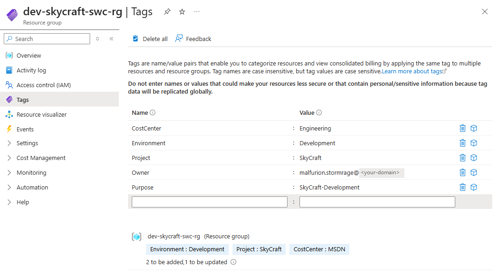

### Step 1.3.2: Tag Production Resource Group

1. Navigate to **prod-skycraft-swc-rg**
2. Click **Tags**
3. Add these tags:

| Name        | Value       |
| ----------- | ----------- |
| Environment | Production  |
| Project     | SkyCraft    |
| CostCenter  | MSDN        |
| Owner       | mbiszczanik |

4. Click **Apply**

**Note**: If the tags are already there with these values, **Apply** stays greyed out and there is nothing to do (as in Step 1.3.1).

### Step 1.3.3: Tag Platform Services Resource Group

1. Navigate to **platform-skycraft-swc-rg**
2. Click **Tags**
3. Add tags:

| Name        | Value       |
| ----------- | ----------- |
| Environment | Platform    |
| Project     | SkyCraft    |
| CostCenter  | MSDN        |
| Owner       | mbiszczanik |

4. Click **Apply**

**Note**: If the tags are already there with these values, **Apply** stays greyed out and there is nothing to do (as in Step 1.3.1).

### Step 1.3.4: View Resources by Tag

1. In Azure Portal, search for **Tags**
2. In the list of tags, click **Project : SkyCraft**

The **Tags** service lists every tag in your subscription as one name : value pair per line (`CostCenter : MSDN`, `Environment : Development`, `Project : SkyCraft`, ...).

**Expected Result**: **Resources with tag Project : SkyCraft** lists the three resource groups, and any resource that already carries the tag (for example from Lab 1.2's deployment).

**Best Practice**: Standardize tag names and values across your organization to ensure consistency.

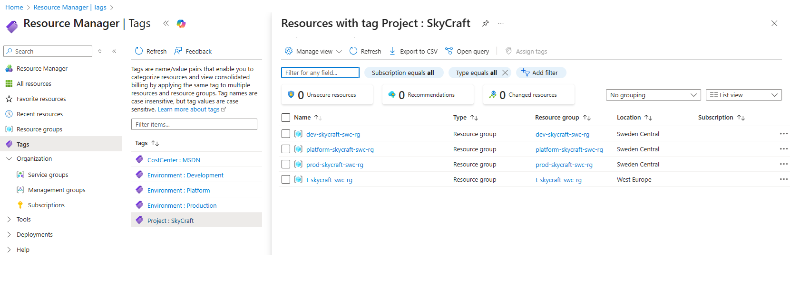

---

## 📖 Section 2: Implement Azure Policy (60 minutes)

### What is Azure Policy?

**Azure Policy** helps enforce organizational standards and assess compliance at scale. Policies can:

- **Audit** resources that don't meet requirements
- **Deny** creation of non-compliant resources
- **Modify** resources to meet requirements (e.g., add tags)
- **Deploy** resources automatically (DeployIfNotExists)

### Built-in vs. Custom Policies

- **Built-in policies** - Pre-defined by Microsoft (500+ available)
- **Custom policies** - Created by your organization for specific needs
- **Policy initiatives** - Groups of policies (also called policy sets)

### Step 1.3.5: Assign a Built-in Policy (Require Tag on Resource Groups)

1. In Azure Portal, search for **Policy**
2. In the left menu, under **Authoring**, click **Assignments**
3. Click **Assign policy**

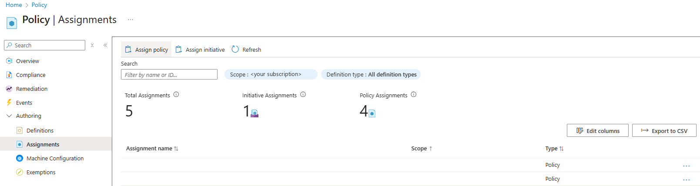

4. On the **Basics** tab, fill in:

- Scope: leave it as it is. The wizard fills in your subscription already (its "..." button opens a pane with Subscription showing All selected, which is your subscription)
- Click the "..." button at the end of **Policy definition**
  - Search for **Require a tag on resource groups**
  - Select **Require a tag on resource groups**, then click **Add**
- **Assignment name**: `Require-Environment-Tag-RG`
- **Description**: `All resource groups must have an Environment tag`
- **Policy enforcement**: Default (enforcement)

**Note**: Once you add the definition, the wizard fills **Assignment name** with the definition's own name (`Require a tag on resource groups`). Replace it with `Require-Environment-Tag-RG`: the lab's scripts (`Test-Lab.ps1`, `Remove-LabResource.ps1`) look for an assignment of this definition with that name. In the Portal, **Assignment name** sets the assignment's display name; Azure names the assignment resource itself with a generated id. The wizard also shows a **Version** field (`1.*.*`): leave it as it is.

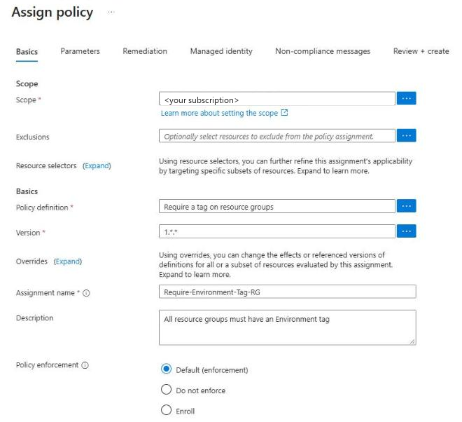

5. Click the **Parameters** tab and set:

- **Tag Name**: `Environment`

6. Click the **Non-compliance messages** tab and set:

- **Non-compliance message**: `Resource group must have an Environment tag (Development, Production, or Platform)`

The **Remediation** and **Managed identity** tabs stay as they are: this policy denies, it does not change resources.

7. Click **Review + create**, then **Create**

**Expected Result**: Policy is assigned and will evaluate new resource groups. **Assignments** lists `Require-Environment-Tag-RG`.

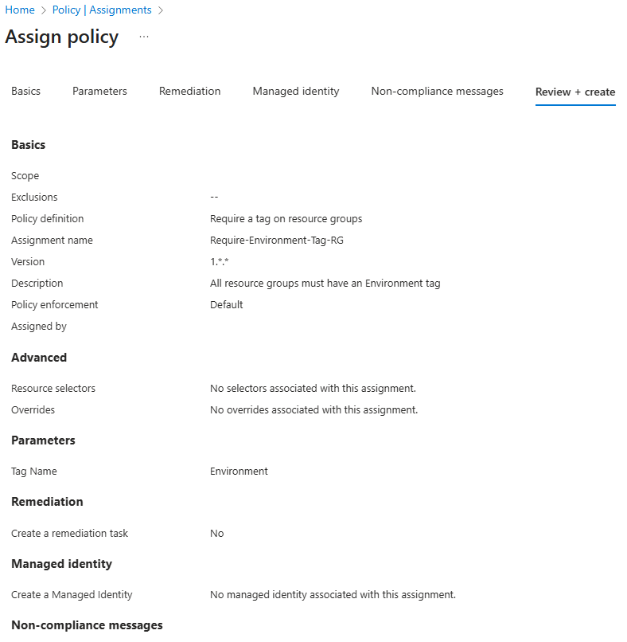

### Step 1.3.6: Test the Policy

First, try to create a resource group **WITHOUT** the "Environment" tag:

1. In Azure Portal, search for **Resource groups**
2. Click **+ Create**
3. On the **Basics** tab, fill in (leave the Tags tab empty):

| Field               | Value          |
| ------------------- | -------------- |
| Resource group name | rg-test-no-tag |
| Region              | Sweden Central |

4. Click **Review + create**
5. If the review page opens without an error, click **Create**, then click the notification **Failed to create the resource group** to open the error details

**Expected Result**: Creation is **denied** by `Require-Environment-Tag-RG`, so `rg-test-no-tag` is not created. The Portal shows the denial in one of two places (both were seen on the same day): either **Review + create** fails with "Validation failed. Required information is missing or not valid.", the **Tags** tab is marked with an error showing the non-compliance message from Step 1.3.5 and a **Policy details** link, and **Create** stays greyed out; or the review page opens without an error and the denial comes after **Create**, where the error details show the error code `RequestDisallowedByPolicy`, the policy `Require-Environment-Tag-RG` with a **Policy link**, and the same message. A policy evaluates every new create or update request. What it does not do is change resources that already exist: a resource group created before the assignment stays without the tag and is reported as non-compliant instead (Step 1.3.10). From the CLI or a template, the same denial comes back with the same error code.

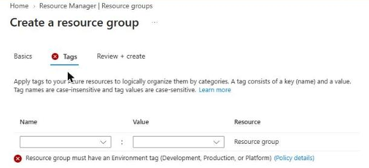

Now create one with the tag:

6. Close the error details, or the form if the Tags tab showed the error, and click **+ Create** again
7. On the **Basics** tab, fill in:

| Field               | Value            |
| ------------------- | ---------------- |
| Resource group name | rg-test-with-tag |
| Region              | Sweden Central   |

8. Click the **Tags** tab and add:

| Name        | Value |
| ----------- | ----- |
| Environment | Test  |

9. Click **Review + create**, then **Create**

**Expected Result**: Creation succeeds because the required tag is present.

**Note**: If `rg-test-no-tag` was created as well, the assignment was not in effect yet: see Troubleshooting, Issue 2.

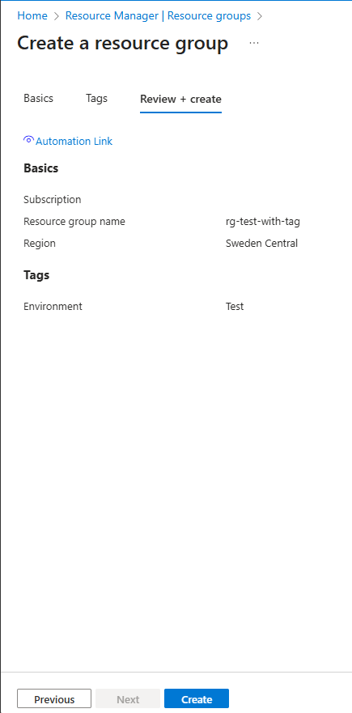

Finally, delete the test resource group `rg-test-with-tag` (the policy denied `rg-test-no-tag`, so it does not exist):

10. Click **Refresh**, then click **rg-test-with-tag**
11. Click **Delete resource group**
12. Fill in the confirmation field:

- **Enter resource group name to confirm deletion**: `rg-test-with-tag`

13. Click outside the field, then click **Delete**
14. In the **Delete confirmation** dialog, click **Delete**

**Note**: The **Delete** button stays greyed out until the name is typed and the field loses focus. That is why you click outside the field first.

After a refresh, `rg-test-with-tag` is no longer listed in **Resource groups**.

### Step 1.3.7: Configure Advisor Alerts

> [!IMPORTANT]
> This step belongs to Section 5 (Azure Advisor), but you do it here, before the next policy step. Step 1.3.8 assigns `Enforce-Project-Tag`, which refuses every new resource without the tag `Project` = `SkyCraft`. The **Create Advisor Alerts** form has no tags, so once that assignment is in place the Portal cannot create the alert.

1. In Azure Portal, search for **Advisor**
2. In the left menu, under **Monitoring** (expand it if it is collapsed), click **Alerts (Preview)**
3. Click **New Advisor Alert**
4. Fill in the top of the form:

- **Subscription**: Your subscription
- **Category**: Cost

5. Under **Action groups**, click **Create new**
6. On the **Basics** tab of the new action group, fill in:

| Field             | Value                |
| ----------------- | -------------------- |
| Resource group    | prod-skycraft-swc-rg |
| Region            | Sweden Central       |
| Action group name | skycraft-advisor-ag  |
| Display name      | SkyAdvisor           |

**Note**: **Region** starts at **(US) East US**. Change it to Sweden Central: Step 1.3.9 will allow only Sweden Central and North Europe, and once that policy is in place an action group in East US is refused (the Portal then shows the refusal only under the notification bell and leaves the form as it was). **Display name** takes at most 12 characters.

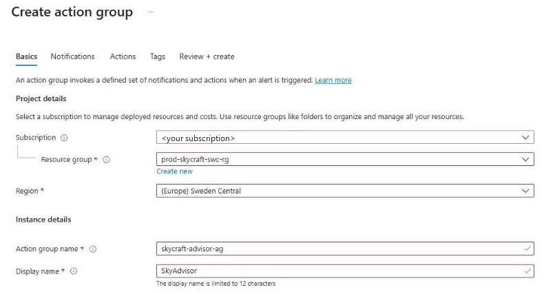

7. Click the **Tags** tab and add:

| Name        | Value       |
| ----------- | ----------- |
| Environment | Production  |
| Project     | SkyCraft    |
| CostCenter  | MSDN        |
| Owner       | mbiszczanik |

8. Click **Review + create**, then **Create**

Back in **Create Advisor Alerts**, the new action group `skycraft-advisor-ag` is listed under **Action groups**.

9. Under **Alert details**, fill in:

- **Alert rule name**: `Advisor-Cost-Recommendations`
- **Description**: `Alert when new cost recommendations are available`
- **Select existing resource group**: `prod-skycraft-swc-rg`

10. Click **Create alert**

**Expected Result**: The Portal confirms with the notification **Successfully created alert** ("Successfully created alert for Azure Advisor"), and **Alerts (Preview)** lists `Advisor-Cost-Recommendations`. From now on, you'll receive alerts when Advisor identifies new cost-saving opportunities.

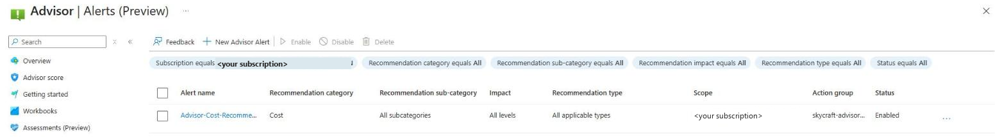

**Note**: **Alerts (Preview)** lists the rule even when its creation failed. If the Portal says **Failed to create alert** ("An error occurred while trying to create alert"), the alert does not exist: see Troubleshooting, Issue 6.

### Step 1.3.8: Assign Policy for Resource Naming Convention

1. In Azure Portal, search for **Policy**
2. In the left menu, under **Authoring**, click **Assignments**
3. Click **Assign policy**
4. On the **Basics** tab, fill in:

- **Scope**: Your subscription
- Click the "..." button at the end of **Policy definition**
  - Search for **Require a tag and its value on resources**
  - Select **Require a tag and its value on resources**, then click **Add**
- **Assignment name**: `Enforce-Project-Tag`
- **Description**: `All resources must have Project tag set to SkyCraft`

**Note**: As in Step 1.3.5, replace the definition's name that the wizard fills into **Assignment name**.

5. Click the **Parameters** tab and set:

- **Tag Name**: `Project`
- **Tag Value**: `SkyCraft`

6. Click the **Non-compliance messages** tab and set:

- **Non-compliance message**: `All resources must be tagged with Project=SkyCraft`

7. Click **Review + create**, then **Create**

**Note**: From now on, the Portal refuses every new resource in this subscription that does not carry the tag `Project` = `SkyCraft`. Resource groups are not resources in this sense: the definition checks resources only.

### Step 1.3.9: Assign Policy to Enforce Allowed Locations

Prevent resource creation in unintended regions:

1. In the left menu, under **Authoring**, click **Assignments**
2. Click **Assign policy**
3. On the **Basics** tab, fill in:

- **Scope**: Your subscription
- Click the "..." button at the end of **Policy definition**
  - Search for **Allowed locations**
  - Select **Allowed locations**, then click **Add**
- **Assignment name**: `Restrict-Azure-Regions`
- **Description**: `Resources can only be created in Sweden Central and North Europe`

**Note**: The search returns three definitions: Azure Cosmos DB allowed locations, Allowed locations, and Allowed locations for resource groups. Take the one named exactly Allowed locations. As in Step 1.3.5, replace the definition's name that the wizard fills into **Assignment name**.

4. Click the **Parameters** tab and set:

- Open the **Allowed locations** list and tick **Sweden Central** and **North Europe**

The list is a multi-select with a filter box; with both regions ticked, the field shows "2 selected".

5. Click the **Non-compliance messages** tab and set:

- **Non-compliance message**: `Resources must be deployed to Sweden Central or North Europe regions only`

6. Click **Review + create**, then **Create**

### Step 1.3.10: View Policy Compliance

1. In **Policy** service, click **Compliance** in left menu
2. Review the compliance dashboard

**Expected View**:

- **Overall compliance percentage** (likely <100% initially)
- List of assigned policies
- Compliance state: Compliant, Non-compliant, Not started

3. Click on **Require-Environment-Tag-RG** policy
4. View which resource groups are compliant

**Note**: Existing resources created before policy assignment may show as non-compliant. This is expected.

**Note**: A new assignment appears in Compliance only after its first evaluation, which can take up to 30 minutes after you assign it. If `Require-Environment-Tag-RG` is not listed yet, come back to this step after Section 3.

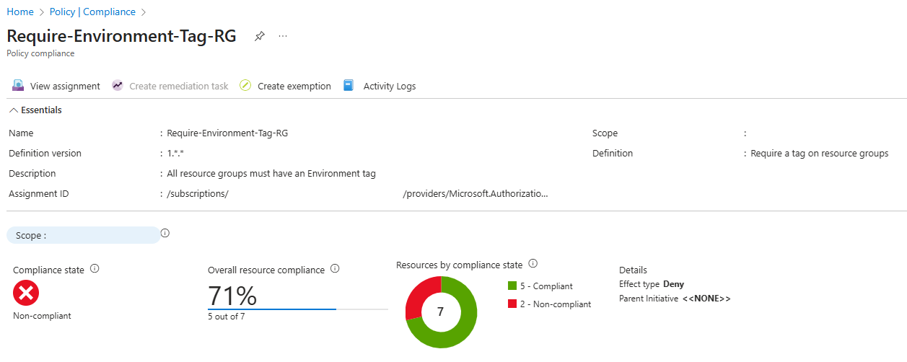

---

## 📖 Section 3: Configure Resource Locks (30 minutes)

### What are Resource Locks?

**Resource locks** prevent accidental deletion or modification of critical resources. Two types:

- **CanNotDelete** - Users can read and modify but cannot delete
- **ReadOnly** - Users can read but cannot modify or delete (very restrictive)

### Lock Inheritance

Locks applied at parent scope (subscription/resource group) are inherited by child resources.

### Step 1.3.11: Apply CanNotDelete Lock to Production Resource Group

1. In Azure Portal, search for **Resource groups**
2. Click **prod-skycraft-swc-rg**
3. In the left menu, under **Settings** (expand it if it is collapsed), click **Locks**
4. Click **+ Add**
5. Fill in:

| Field     | Value                                                |
| --------- | ---------------------------------------------------- |
| Lock name | lock-no-delete-prod                                  |
| Lock type | Delete                                               |
| Notes     | Cannot delete resource or child resources.           |

> The Bicep path applies both locks through the AVM resource-group module, which sets this notes text itself; the notes are not configurable through the module. If you create the locks in the portal, use the same text so your locks match the checklist. `Test-Lab.ps1` does not read the notes: it checks that each group carries, on the group itself, a lock with the name given in step 1.3.11 or 1.3.13 and the **Delete** (`CanNotDelete`) type.

**Note**: **Lock type** starts at **Read-only**. Change it to **Delete**: a read-only lock on the group would block every change to it and its resources, not only deletion.

6. Click **OK**

**Expected Result**: Lock is created and shows in the Locks list.

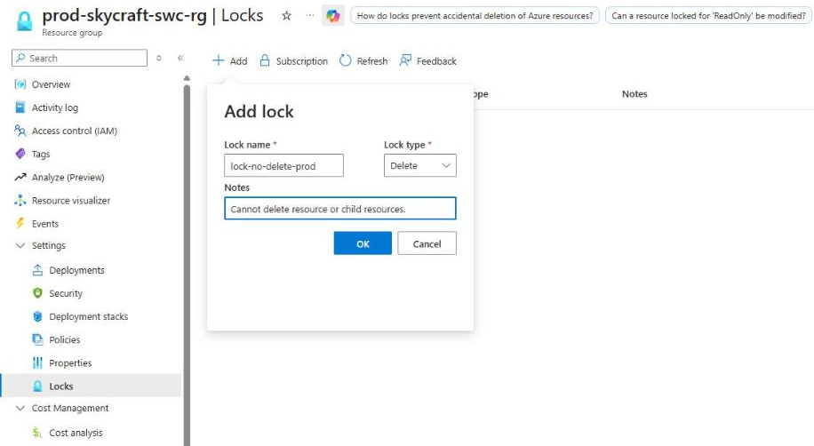

### Step 1.3.12: Test the Lock

> [!WARNING]
> This step really asks the Portal to delete the production resource group. The lock from Step 1.3.11 is what stops it. Do not start the step unless **Locks** lists `lock-no-delete-prod` with the lock type Delete: without the lock, the group and everything in it are deleted.

1. Still in `prod-skycraft-swc-rg`, in the left menu, under **Settings** (expand it if it is collapsed), click **Locks** and verify:
   - `lock-no-delete-prod` is listed, with the lock type Delete
2. In the left menu, click **Overview**
3. Click **Delete resource group**
4. Fill in the confirmation field:

- **Enter resource group name to confirm deletion**: `prod-skycraft-swc-rg`

5. Click outside the field, then click **Delete**
6. In the **Delete confirmation** dialog, click **Delete**

**Expected Result**: The Portal refuses before it deletes anything. A notification **Failed to delete resource group prod-skycraft-swc-rg** (open the notification bell if it is not on screen) says: "Resource group prod-skycraft-swc-rg has locks applied. Remove the locks before deleting." The resource group and everything in it stay.

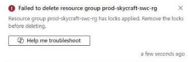

**Note**: The pane opened by **Delete resource group** shows no lock warning, and the **Delete** button stays greyed out until the name is typed and the field loses focus. The refusal comes only after you confirm. From the CLI or a template, Azure Resource Manager refuses the same delete with the error code `ScopeLocked`.

**Key Learning**: Even with Owner role, you cannot delete a locked resource until the lock is removed.

### Step 1.3.13: Apply CanNotDelete Lock to Platform Resource Group

1. Navigate to **platform-skycraft-swc-rg**
2. In the left menu, under **Settings** (expand it if it is collapsed), click **Locks** → **+ Add**
3. Create lock:
   - Lock name: `lock-no-delete-platform`
   - Lock type: **Delete**
   - Notes: `Cannot delete resource or child resources.`

**Note**: As in Step 1.3.11, **Lock type** starts at **Read-only**: change it to **Delete**.

4. Click **OK**

### Step 1.3.14: Understand Lock Hierarchy

**Important Concepts**:

- Locks at **subscription** level protect all resource groups and resources
- Locks at **resource group** level protect all resources within
- Locks at **resource** level protect only that specific resource

**Best Practice**:

- Use **CanNotDelete** on production resource groups
- Use **ReadOnly** very carefully (can break automation)
- Document all locks with clear notes

---

## 📖 Section 4: Manage Costs with Budgets and Alerts (45 minutes)

### What are Azure Budgets?

**Budgets** help you plan for and control costs by:

- Setting spending thresholds
- Triggering alerts when thresholds are reached
- Tracking cost trends over time

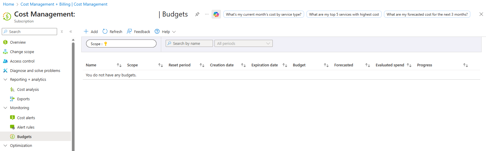

### Step 1.3.15: Create a Subscription Budget

1. In Azure Portal, search for **Cost Management + Billing**
2. In the left menu, click **Cost Management**
3. In the left menu, under **Monitoring**, click **Budgets**
4. Click **+ Add**

**Note**: Cost Management + Billing opens on **Billing scopes**. **Cost Management** then opens at a scope the Portal picks for you (sometimes a **Scope automatically selected** popover says so) and names it at the top of the page, after **Scope**. It should be your subscription; if it is another scope, click **Change scope** in the left menu and pick your subscription before you continue.

5. On the **Create a budget** step, fill in:

| Field           | Value                                               |
| --------------- | --------------------------------------------------- |
| Name            | SkyCraft-Monthly-Budget                             |
| Reset period    | Monthly                                             |
| Creation date   | [The current month; the day is fixed to the 1st]    |
| Expiration date | [Leave the default, two years from now]             |
| Amount          | 100 (in your billing currency; adjust to your needs) |

**Note**: **Reset period** starts at **Billing month**. Pick **Monthly**, which the list shows under **Calendar months**. The **Amount** field is labelled with your billing currency (for example **Amount (€)**).

6. Click **Next >**

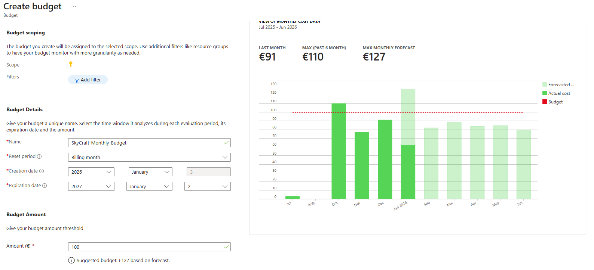

### Step 1.3.16: Configure Budget Alerts

On the **Set alerts** step, every alert is one row under **Alert conditions**. A new empty row appears below each row you fill in.

1. Fill in three rows under **Alert conditions** (leave the Action group column at None):

| Type        | % of budget |
| ----------- | ----------- |
| Actual cost | 50          |
| Actual cost | 80          |
| Actual cost | 100         |

2. Fill in the recipients:

- **Alert recipients (email)**: [your email address]

**Note**: **Alert recipients (email)** is one list for all the rows: every recipient gets every alert of this budget. To add a second address, type it in the empty row that appears below the first. **Languages** can stay at Default.

3. Click **Create**

**Expected Result**: Budget is created and **Budgets** lists `SkyCraft-Monthly-Budget`. The recipients may also receive a confirmation email.

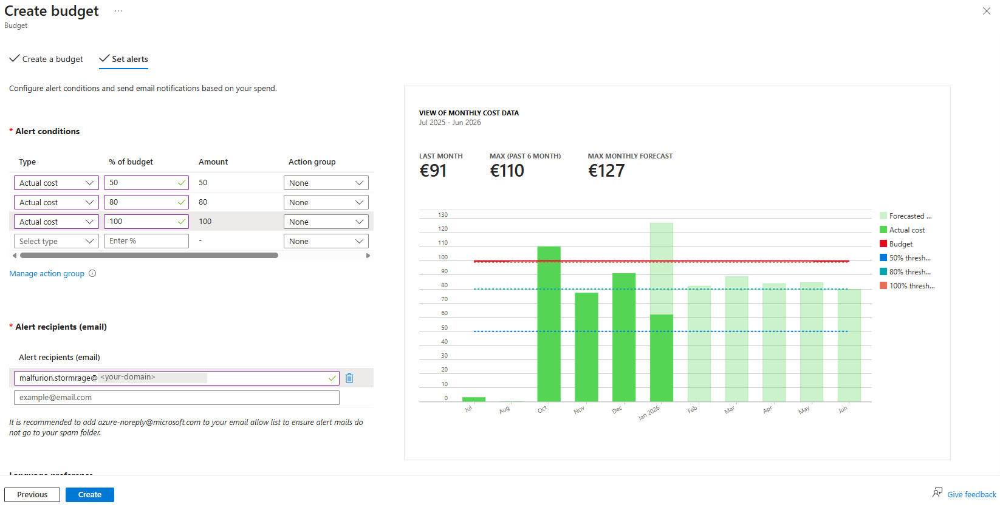

### Step 1.3.17: Create Resource Group Budget

Create a more specific budget for the production environment. A budget belongs to the scope it is created at, so you create this one from the resource group itself:

1. In Azure Portal, search for **Resource groups**
2. Click **prod-skycraft-swc-rg**
3. In the left menu, under **Cost Management** (expand it if it is collapsed), click **Budgets**
4. Click **+ Add**

**Note**: In **Create budget**, **Scope** is plain text and shows `prod-skycraft-swc-rg`: it cannot be changed there. Do not use **Add filter** to pick the group: that creates a subscription budget with a filter, not a budget of the resource group.

5. On the **Create a budget** step, fill in:

| Field        | Value                         |
| ------------ | ----------------------------- |
| Name         | SkyCraft-Prod-Monthly         |
| Reset period | Monthly                       |
| Amount       | 50 (in your billing currency) |

6. Click **Next >**
7. On the **Set alerts** step, fill in three rows under **Alert conditions**:

| Type        | % of budget |
| ----------- | ----------- |
| Actual cost | 60          |
| Actual cost | 85          |
| Actual cost | 100         |

8. Fill in the recipients:

- **Alert recipients (email)**: [your email address]

9. Click **Create**

**Expected Result**: The resource group's **Budgets** lists `SkyCraft-Prod-Monthly`.

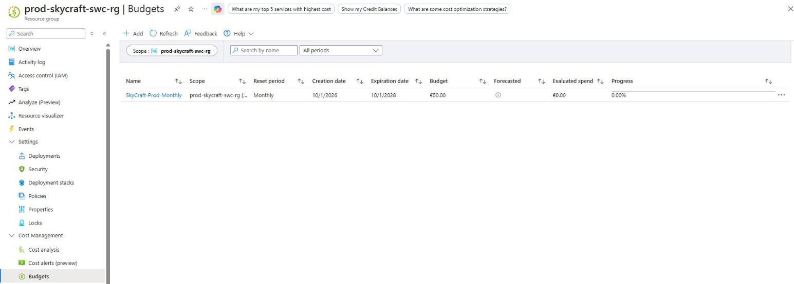

### Step 1.3.18: View Cost Analysis

1. In Azure Portal, search for **Subscriptions**
2. Click your subscription
3. Under **Cost Management** click **Cost analysis**
4. Open the **VIEW** menu and, under **Built-in views**, explore:
   - **Cost by resource** - See spending per resource
   - **Cost by service** - See spending per Azure service
   - **Daily costs** - Trend over time

**Note**: Open Cost analysis from the subscription, as here. **Cost Management + Billing** has no **Cost analysis** of its own, and its **Go to subscription** link opens the scope you used last (after Step 1.3.17, the production resource group).

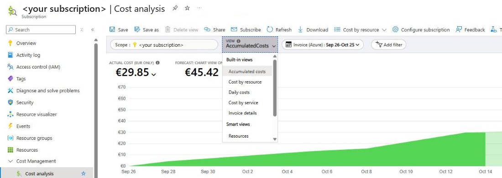

5. Click the date range button (it shows the current period) and, under **Relative dates**, click **Last 30 days**
6. Click **Add filter**, choose **Tag**, then pick the tag `project` with the value `skycraft` (Cost analysis shows tag names and values in lower case), and click the green check mark next to the filter to apply it
7. Click **Add filter** again, choose **Resource group name**, pick `prod-skycraft-swc-rg` and click the green check mark

**Expected Result**: Visual charts showing cost breakdown (likely very low since we haven't deployed resources yet).

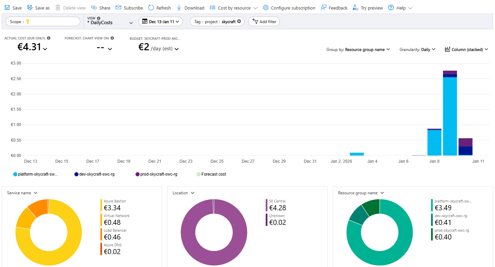

---

## 📖 Section 5: Use Azure Advisor (30 minutes)

### What is Azure Advisor?

**Azure Advisor** provides personalized recommendations to:

- Improve reliability (High Availability)
- Enhance security
- Optimize performance
- Reduce costs
- Achieve operational excellence

### Step 1.3.19: Access Azure Advisor

1. In Azure Portal, search for **Advisor**
2. Review the **Overview** page
3. In the left menu, click **Advisor score**

**Overview shows** one card per category (Cost, Security, Reliability, Operational excellence, Performance), each with:

- Its own score ("Score --%" until Advisor has assessed the category)
- The number of active recommendations
- The number of impacted resources

The overall score (0-100%) is on the separate **Advisor score** page.

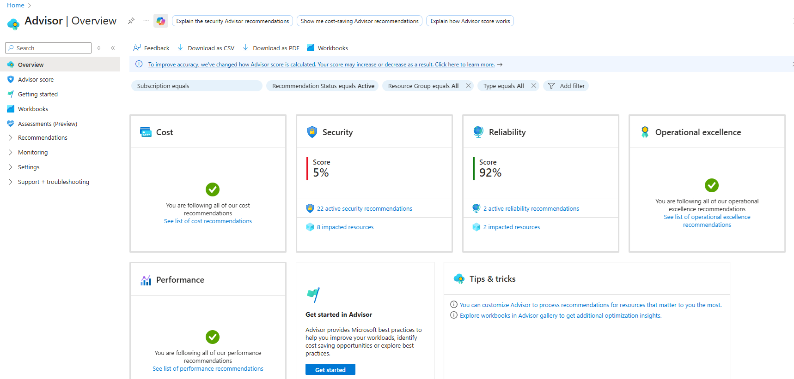

### Step 1.3.20: Review Cost Recommendations

1. In the left menu, under **Recommendations**, click **Cost**
2. Review recommendations (may be none if newly created)

**Common recommendations**:

- Right-size underutilized virtual machines
- Delete unused resources
- Consider reserved instances for predictable workloads
- Use Azure Hybrid Benefit if you have Windows Server licenses

3. If recommendations exist, click one to view details

### Step 1.3.21: Review Security Recommendations

1. In the left menu, under **Recommendations**, click **Security**
2. Review recommendations

**Common recommendations**:

- Enable Microsoft Defender for Cloud
- Configure diagnostic logs
- Enable encryption
- Configure backup

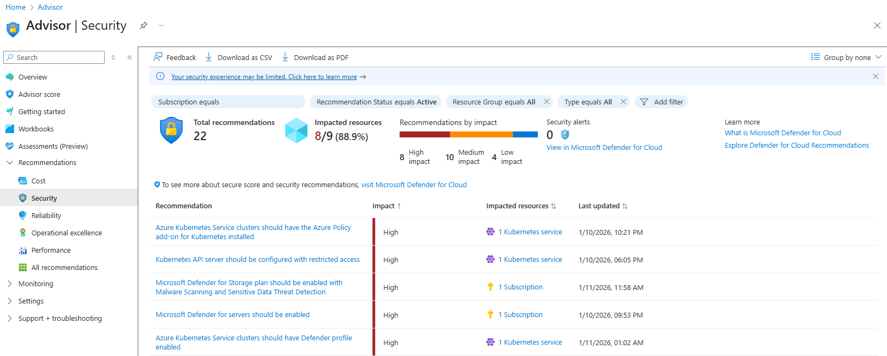

**Advisor alerts**: you created the Advisor alert for cost recommendations in [Step 1.3.7](#step-137-configure-advisor-alerts), in Section 2, before the tag policy of Step 1.3.8 could refuse it. To see it, open **Alerts (Preview)** under **Monitoring** in Advisor's left menu.

---

# 📖 Section 6: Understand Management Groups (15 minutes)

### What are Management Groups?

**Management groups** provide:

- Hierarchical organization above subscriptions
- Policy and access control inheritance
- Enterprise-scale governance

### Structure Example

```
Tenant Root Group
├── Production Management Group
│   └── SkyCraft-Prod Subscription
├── Development Management Group
│   └── SkyCraft-Dev Subscription
└── Shared Services Management Group
    └── SkyCraft-Shared Subscription
```

(This is ideal structure as creation Subscription does not incur any cost)

### Step 1.3.22: View Management Groups

1. In Azure Portal, search for **Management groups**
2. Click **Management groups** service
3. You'll see the **Tenant Root Group**

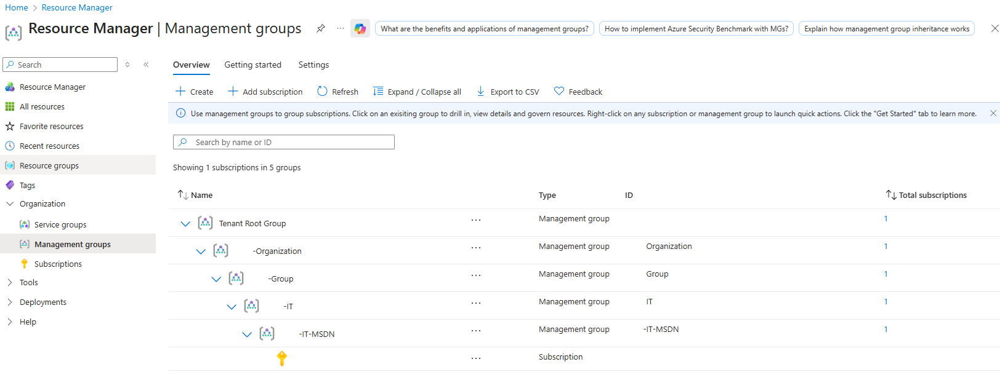

**Note**: Creating management groups requires specific permissions. For this lab, understanding the concept is sufficient.

### When to Use Management Groups

- **Multiple subscriptions** - Organize and govern at scale
- **Inherited policies** - Apply governance across many subscriptions
- **Delegated administration** - Grant RBAC at management group level
- **Enterprise structure** - Mirror your organizational hierarchy

---

# ✅ Lab Checklist

### Tags Applied

- [ ] dev-skycraft-swc-rg has 4 tags (Environment, Project, CostCenter, Owner)
- [ ] prod-skycraft-swc-rg has 4 tags
- [ ] platform-skycraft-swc-rg has 4 tags
- [ ] Can view resources grouped by "Project" tag

### Azure Policies Assigned

- [ ] Policy: Require Environment tag on resource groups
- [ ] Policy: Require Project=SkyCraft on all resources
- [ ] Policy: Restrict resources to Sweden Central and North Europe
- [ ] Policy compliance dashboard shows all three policies
- [ ] Tested policy enforcement (tried creating resource without tag)

### Resource Locks Configured

- [ ] CanNotDelete lock on prod-skycraft-swc-rg
- [ ] CanNotDelete lock on platform-skycraft-swc-rg
- [ ] Tested lock (attempted to delete locked resource group)
- [ ] Lock notes documented

### Cost Management

- [ ] Created subscription-level budget (100 per month, in your billing currency)
- [ ] Configured 3 alert thresholds (50%, 80%, 100%)
- [ ] Created resource group-specific budget (prod-skycraft-swc-rg, 50 per month)
- [ ] Explored Cost Analysis with filters
- [ ] Understand daily cost trends

### Azure Advisor

- [ ] Accessed Advisor dashboard
- [ ] Reviewed recommendations by category
- [ ] Configured Advisor alert for cost recommendations (Step 1.3.7, before Step 1.3.8)
- [ ] Understand how to act on recommendations

### Management Groups

- [ ] Viewed Management Groups in portal
- [ ] Understand hierarchy and inheritance
- [ ] Know when to use management groups

**For detailed verification**, see [lab-checklist-1.3.md](lab-checklist-1.3.md)

---

## 🔧 Troubleshooting

### Issue 1: Cannot assign policy - insufficient permissions

**Symptom**: Error when creating policy assignment

**Solution**:

- Need Owner, Contributor, or Resource Policy Contributor role
- Check permissions: **Subscription** → **Access control (IAM)** → **Check access**

### Issue 2: Policy doesn't show as enforced

**Symptom**: Created resource without required tag but no error

**Solutions**:

- A new assignment takes about five minutes to take effect, sometimes longer. If Step 1.3.6 created `rg-test-no-tag`, delete it the way the step deletes `rg-test-with-tag`, wait a few minutes and try again
- Policy may be in "Audit" mode instead of "Deny" mode
- Check **Policy enforcement** is set to "Default (enforcement)", not "Do not enforce"
- Review policy effect (should be "Deny" for enforcement)

### Issue 3: Cannot delete resource despite Owner role

**Symptom**: "Cannot delete" error even with Owner permissions

**Solution**:

- Check for resource locks: **Resource** → **Locks**
- Remove lock temporarily (document why)
- Delete resource
- Re-apply lock if needed

### Issue 4: Budget alert not received

**Symptom**: Budget threshold reached but no email

**Solutions**:

- Check email spam/junk folder
- Verify email address in budget alert configuration
- Alerts can take 6-8 hours to trigger
- Actual costs must exceed threshold (forecasted costs don't trigger alerts)

### Issue 5: Tag not showing in Cost Analysis

**Symptom**: Applied tags but don't appear in cost breakdown

**Solutions**:

- Cost data can take 24 hours to populate
- Tags must be applied before resources are created
- Use "Cost by tag" view in Cost Analysis
- Ensure tag is applied to actual resources, not just resource group

### Issue 6: Advisor alert or its action group is refused

**Symptom**: In Step 1.3.7, the Portal says "Failed to create alert - An error occurred while trying to create alert", or the action group's **Create** does nothing and the notification bell shows "Failed to create action group"

**Solutions**:

- Action group: set **Region** to Sweden Central. `Restrict-Azure-Regions` (Step 1.3.9) refuses the default East US
- Alert: `Enforce-Project-Tag` (Step 1.3.8) is already assigned in your subscription, for example from an earlier run of this lab or its Bicep path. The **Create Advisor Alerts** form has no tags, so the policy refuses the alert. **Alerts (Preview)** may still list it, but it does not exist. Create the alert before Step 1.3.8, as the guide orders it; `Test-Lab.ps1` does not check the alert

---

## 🎓 Knowledge Check

Test your understanding with these questions:

1. **What's the difference between Azure Policy and RBAC?**

   <details>
     <summary>**Click to see the answer**</summary>

   **Answer**: RBAC controls **who** can do **what** (identity and permissions). Policy controls **what** can be done **regardless of who** does it (compliance and standards).
   </details>

2. **When should you use CanNotDelete vs. ReadOnly lock?**

   <details>
     <summary>**Click to see the answer**</summary>

   **Answer**: Use **CanNotDelete** for production resources (allows operations but prevents deletion). Use **ReadOnly** sparingly (prevents all modifications, can break automation).
   </details>

3. **Are tags inherited from resource groups to resources?**

   <details>
     <summary>**Click to see the answer**</summary>

   **Answer**: No, tags are NOT automatically inherited. You must use Azure Policy with "Modify" effect to inherit tags, or apply tags directly to resources.
   </details>

4. **What happens when a budget threshold is reached?**

   <details>
     <summary>**Click to see the answer**</summary>

   **Answer**: An **alert email** is sent. Budgets do NOT automatically stop resource creation or shut down resources—they only notify.
   </details>

5. **Can you remove a lock if you have Owner role?**

   <details>
     <summary>**Click to see the answer**</summary>

   **Answer**: Yes, Owner can remove locks. However, the lock prevents deletion even for Owners until it's removed.
   </details>

---

## 📚 Additional Resources

- [Azure Policy overview](https://learn.microsoft.com/en-us/azure/governance/policy/overview)
- [Azure Policy built-in definitions](https://learn.microsoft.com/en-us/azure/governance/policy/samples/built-in-policies)
- [Lock resources to prevent changes](https://learn.microsoft.com/en-us/azure/azure-resource-manager/management/lock-resources)
- [Create and manage budgets](https://learn.microsoft.com/en-us/azure/cost-management-billing/costs/tutorial-acm-create-budgets)
- [Azure Advisor documentation](https://learn.microsoft.com/en-us/azure/advisor/)
- [Organize resources with management groups](https://learn.microsoft.com/en-us/azure/governance/management-groups/overview)

---

## 🔗 What's Next

Congratulations! You've completed **Module 1: Manage Azure Identities and Governance**!

**What You've Accomplished**:

- ✅ Created identity structure (users, groups)
- ✅ Implemented RBAC (role assignments at appropriate scopes)
- ✅ Applied tags for organization and cost tracking
- ✅ Enforced standards with Azure Policy
- ✅ Protected resources with locks
- ✅ Configured cost management and budgets
- ✅ Used Azure Advisor for recommendations

**Your SkyCraft infrastructure now has**:

- Secure identity and access management
- Proper governance and compliance controls
- Cost visibility and control
- Protection against accidental changes

**Next Module**: Module 2 - Implement and Manage Virtual Networking

- Design and deploy virtual networks
- Configure network security groups
- Implement Azure Bastion for secure access
- Configure load balancing and DNS

---

## 📝 Lab Summary

**Time Spent**: ~4 hours

**Governance Components Implemented**:

- 3 Azure Policy assignments
- 2 resource locks
- 12 tags across resource groups (4 canonical tags per resource group)
- 2 budgets with multiple alert thresholds
- Azure Advisor recommendations configured

**Compliance Level**: Production-ready governance framework ✅

---

---

## 📌 Module Navigation

- [← Lab 1.2: Manage Access & RBAC](../1.2-rbac/lab-guide-1.2.md)
- [← Back to Module 1 Index](../README.md)
- [Module 2: Virtual Networking →](../../module-2-networking/README.md)
