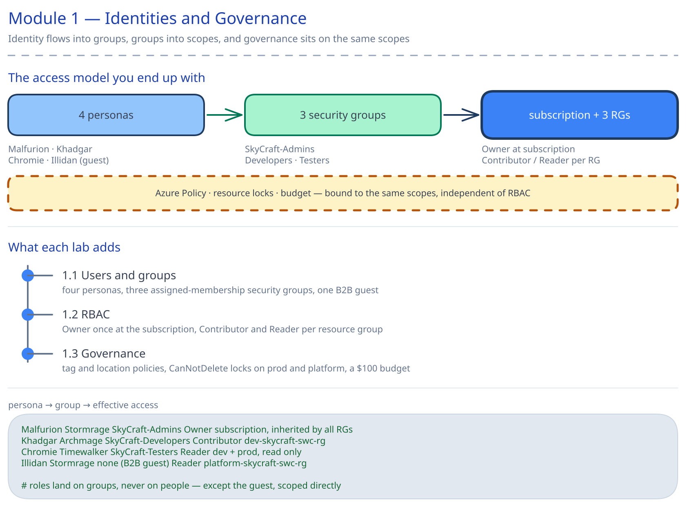

# Module 1: Manage Azure Identities and Governance (9 hours)

## 📚 Module Overview

In this module, you'll establish the **foundational security layer** for the SkyCraft deployment.
You'll create the identity structure, implement role-based access control, and configure governance policies
that protect your infrastructure and enforce organizational standards.

**Real-world Context**: Before deploying any infrastructure, you must control _who_ can access resources,
_what_ they can do, and _enforce_ compliance standards—exactly what we'll do here for the SkyCraft team.

---

## 🎯 Learning Objectives

By completing this module, you will be able to:

- **Create and manage** Microsoft Entra users and groups for team collaboration
- **Implement role-based access control (RBAC)** at subscription, resource group, and resource levels
- **Configure Azure Policy** to enforce organizational standards and naming conventions
- **Apply resource locks** to prevent accidental deletion of critical infrastructure
- **Manage costs** through budgets, alerts, and Azure Advisor recommendations
- **Apply tags** for resource organization and cost tracking
- **Create a governance framework** suitable for production game server infrastructure

---

## 📋 Module Sections

| Section | Duration | Topic                                     | Exam Weight |
| ------- | -------- | ----------------------------------------- | ----------- |
| 1.1     | 3 hours  | Manage Microsoft Entra Users and Groups   | ~8-10%      |
| 1.2     | 2 hours  | Manage Access to Azure Resources (RBAC)   | ~5-7%       |
| 1.3     | 4 hours  | Manage Azure Subscriptions and Governance | ~7-10%      |

**Total Module Time**: 9 hours

---

## 🏗️ Architecture Overview

This module establishes the identity and governance layer that every subsequent module depends on. Entra ID users are placed into security groups, the groups are bound to built-in Azure roles via RBAC, and Azure Policy / locks / budgets are applied to the three SkyCraft resource groups at the subscription level.

<picture>
  <source media="(prefers-color-scheme: dark)" srcset="images/module-1-architecture.dark.svg">
  <source media="(prefers-color-scheme: light)" srcset="images/module-1-architecture.svg">
  
</picture>

---

## ✅ Prerequisites

Before starting, ensure you have:

- [ ] Active Azure subscription (with at least $50 credit available)
- [ ] On a subscription created for this course: the `Microsoft.Insights` resource provider registered before Lab 1.3 (Lab 1.3, Prerequisites, shows how)
- [ ] Azure Portal access (https://portal.azure.com)
- [ ] Azure CLI installed locally (or use Cloud Shell)
- [ ] PowerShell 7+ installed (Windows, macOS, or Linux), or Azure Cloud Shell (PowerShell)
- [ ] The PowerShell modules below, if you run the labs' scripts or checklist commands (the Portal steps need none of them)
- [ ] Basic understanding of cloud computing concepts
- [ ] Text editor (VS Code recommended)

### PowerShell modules for the scripts

| Module | Used by | In Azure Cloud Shell |
| --- | --- | --- |
| `Microsoft.Graph.Authentication` | Lab 1.1 scripts, Lab 1.2 `New-LabRoleAssignment.ps1` | Preinstalled |
| `Microsoft.Graph.Users` | Lab 1.1 scripts, Lab 1.2 `New-LabRoleAssignment.ps1` | **Not installed**: install it |
| `Microsoft.Graph.Groups` | Lab 1.1 scripts, Lab 1.2 `New-LabRoleAssignment.ps1` | Preinstalled |
| `Microsoft.Graph.Identity.DirectoryManagement` | Lab 1.1 scripts, Lab 1.2 `New-LabRoleAssignment.ps1` | Preinstalled |
| `Microsoft.Graph.Identity.SignIns` | Lab 1.1 `New-LabUser.ps1` | Preinstalled |
| `Az.Accounts`, `Az.Resources` | Lab 1.2 and Lab 1.3 scripts | Preinstalled |
| `Az.Billing` | Lab 1.3 `Test-Lab.ps1` and `Remove-LabResource.ps1` | Preinstalled |
| `Az.Monitor` | Lab 1.3 `Remove-LabResource.ps1` | Preinstalled |
| `Az.PolicyInsights` | Lab 1.3 checklist (`Get-AzPolicyStateSummary`) | Preinstalled |

On your own machine, install them for your account (no administrator rights needed). If PowerShell asks whether to trust the PSGallery repository, answer `Y`:

```powershell
Install-Module Microsoft.Graph.Authentication, Microsoft.Graph.Users, Microsoft.Graph.Groups, Microsoft.Graph.Identity.DirectoryManagement, Microsoft.Graph.Identity.SignIns -Scope CurrentUser
Install-Module Az.Accounts, Az.Resources, Az.Billing, Az.Monitor, Az.PolicyInsights -Scope CurrentUser
```

In Azure Cloud Shell (PowerShell), Azure PowerShell and a basic set of Microsoft Graph modules are preinstalled, but `Microsoft.Graph.Users` is not ([Features & tools for Azure Cloud Shell](https://learn.microsoft.com/azure/cloud-shell/features#other-microsoft-services)). The Microsoft Graph modules a script loads must all be one version, because each one requires `Microsoft.Graph.Authentication` at exactly its own version and a session loads only one. So install `Microsoft.Graph.Users` at the version of the preinstalled Graph modules before you run a Lab 1.1 or Lab 1.2 script:

```powershell
$graphVersion = (Get-Module -ListAvailable Microsoft.Graph.Authentication | Sort-Object Version -Descending | Select-Object -First 1).Version
Install-Module Microsoft.Graph.Users -RequiredVersion $graphVersion -Scope CurrentUser
```

Without `-RequiredVersion`, `Install-Module` takes the newest version from the PowerShell Gallery, which can be newer than the preinstalled modules. When a module is missing, or is not installed at the version the other Graph modules share, the Lab 1.1 scripts and Lab 1.2's `New-LabRoleAssignment.ps1` stop before they sign in, name the module and print the `Install-Module` command for it, with the version to install.

**Cloud Shell without a storage account.** Choosing **No storage account required** (or _Continue without storage_) starts an _ephemeral session_. You can write files to your `$HOME` folder there, so you can clone the repository, but everything you saved, the clone and any module you installed included, is deleted when the session ends ([Get started with Azure Cloud Shell ephemeral sessions](https://learn.microsoft.com/azure/cloud-shell/get-started/ephemeral), [Cloud Shell FAQ](https://learn.microsoft.com/azure/cloud-shell/faq-troubleshooting)). A session ends after 20 minutes without interaction. A session without a storage account can run the Lab 1.3 scripts, which need only preinstalled modules. It can run the Lab 1.1 and Lab 1.2 scripts only if the `Install-Module` above works there: Microsoft Learn documents installing your own PowerShell modules only for sessions with a storage account ([Installing your own tools](https://learn.microsoft.com/azure/cloud-shell/features#installing-your-own-tools)). If the install fails, mount a storage account (**Settings** > **Reset User Settings**, then choose a storage account) or run the scripts in PowerShell 7 on your own machine. If it works, run the two commands above again in each new session, after you clone the repository again. With a storage account, your `$HOME` folder, and the modules installed in it, stays across sessions ([Persist files in Azure Cloud Shell](https://learn.microsoft.com/azure/cloud-shell/persisting-shell-storage)).

**Signing in to Microsoft Graph in Cloud Shell.** Cloud Shell has no browser for an interactive sign-in, and a tenant with security defaults on (the default for tenants created from 2026-07-01) refuses a device code sign-in. So in Cloud Shell the Lab 1.1 scripts and Lab 1.2's `New-LabRoleAssignment.ps1` sign in with Cloud Shell's own sign-in, without a prompt. Its permissions let them create and read users and groups, but not delete users: run Lab 1.1's `Remove-LabResource.ps1` on your own machine, or delete the lab users in the Portal ([TROUBLESHOOTING.md](../TROUBLESHOOTING.md#lab-11-and-lab-12-scripts-in-azure-cloud-shell)).

---

## 🚀 Getting Started

1. **Complete prerequisites check** above
2. **Start with Lab 1.1** - Create Entra users and groups
3. **Progress to Lab 1.2** - Configure RBAC roles
4. **Complete Lab 1.3** - Set up governance policies
5. **Take the module assessment** to validate learning
6. **Proceed to Module 2** - Virtual Networking

---

## 📖 How to Use This Module

Each lab includes:

- **Lab Guide** - Step-by-step instructions with screenshots
- **Lab Checklist** - Verification steps to confirm success
- **Scripts** - PowerShell and Bash automation scripts
- **Bicep Templates** - Infrastructure as Code for deployment
- **Solutions** - Complete answers and expected outcomes
- **Troubleshooting** - Common issues and fixes

**Recommended approach**:

1. Read the lab guide completely before starting
2. Follow steps manually first (to understand the process)
3. Use scripts to automate repetitive tasks
4. Verify each step using the checklist
5. Reference solutions if stuck

---

## 🎓 AZ-104 Exam Alignment

This module covers **20-25%** of the AZ-104 exam. Key exam topics include:

- Managing Microsoft Entra users and groups
- Creating and managing roles
- Managing subscription and governance features
- Implementing and managing Azure Policy
- Managing resources and resource groups
- Managing subscriptions

---

## ⏱️ Time Management

- **Total module time**: 9 hours
- **Recommended pace**: 3 hours per day for 3 days (or 1.5 hours × 6 days)
- **Lab 1.1**: 3 hours (most time-intensive)
- **Lab 1.2**: 2 hours (moderate complexity)
- **Lab 1.3**: 3 hours (combines multiple concepts)
- **Assessment**: 1 hour

---

## 🔗 Useful Resources

- [Microsoft Entra ID Documentation](https://learn.microsoft.com/en-us/entra/identity/)
- [Azure RBAC Guide](https://learn.microsoft.com/en-us/azure/role-based-access-control/overview)
- [Azure Policy Documentation](https://learn.microsoft.com/en-us/azure/governance/policy/overview)
- [Azure Learn - Manage Azure Identities and Governance](https://learn.microsoft.com/en-us/training/paths/manage-identity-and-access/)

---

## 📞 Getting Help

- **Lab issues**: Check `lab-guide/troubleshooting` in each lab folder
- **Azure errors**: Search Azure documentation or Microsoft Learn
- **General issues/questions**: Create an issue

---

## ✨ What's Next After This Module?

Once complete, you'll have:

- ✅ Identity structure for the SkyCraft team
- ✅ Proper access controls in place
- ✅ Cost governance framework established
- ✅ Foundation for Modules 2-5

**Next Module**: Module 2 - Implement and Manage Virtual Networking

---

## 📌 Module Navigation

- [← Back to Course Home](/README.md)
- [Lab 1.1: Manage Entra Users & Groups →](1.1-entra-users-groups/lab-guide-1.1.md)
- [Lab 1.2: Manage Access & RBAC →](1.2-rbac/lab-guide-1.2.md)
- [Lab 1.3: Governance & Policies →](1.3-governance/lab-guide-1.3.md)
