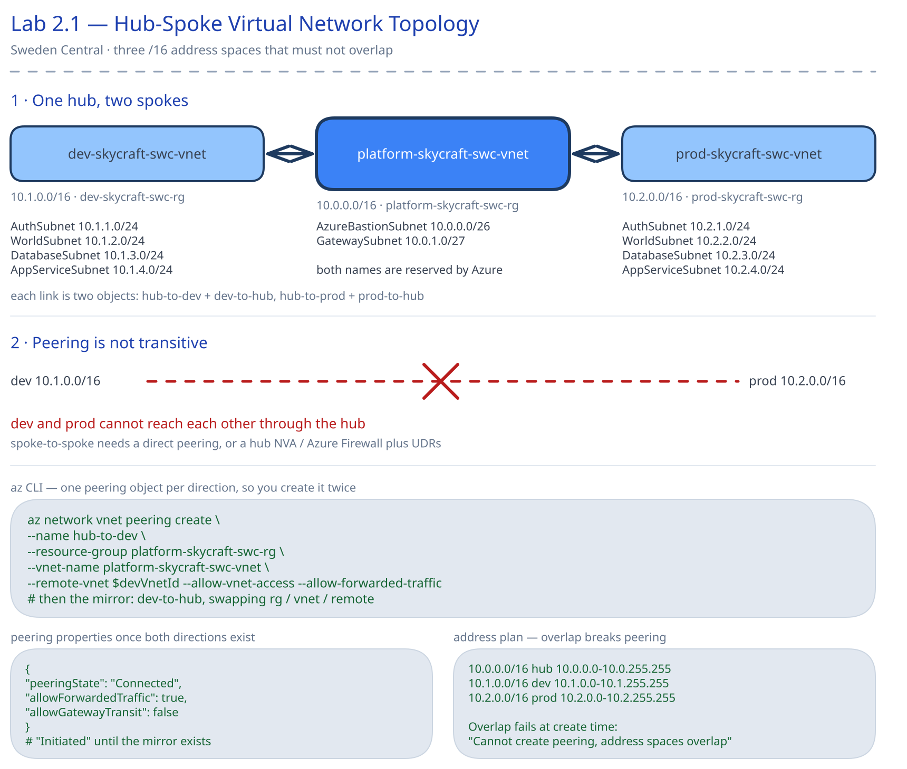
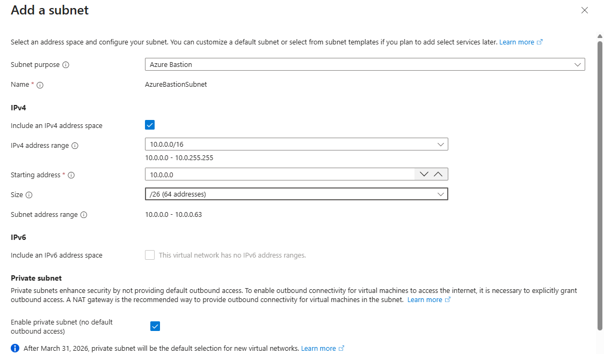
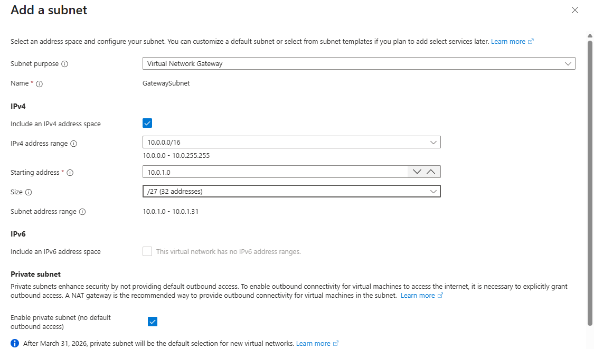
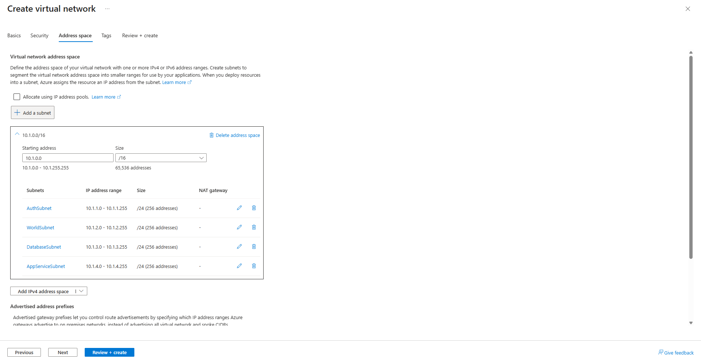
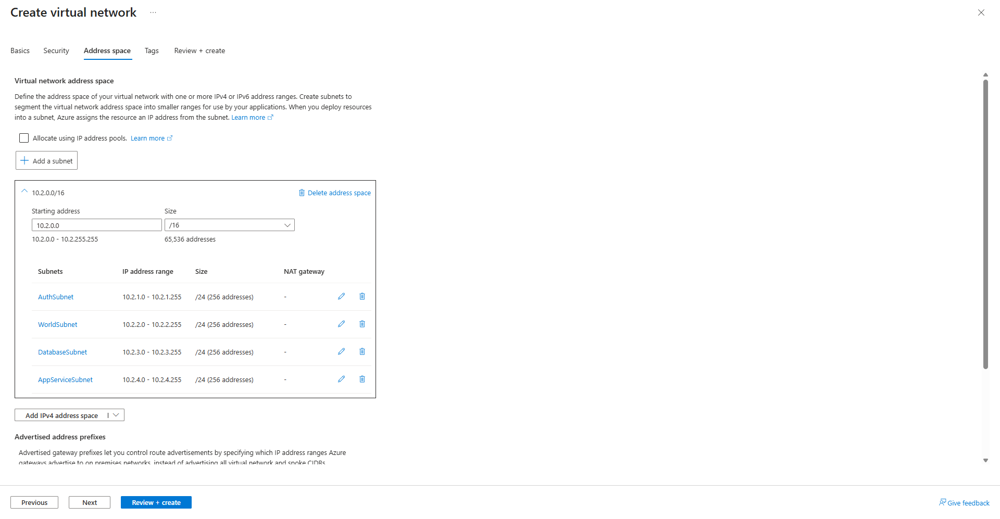
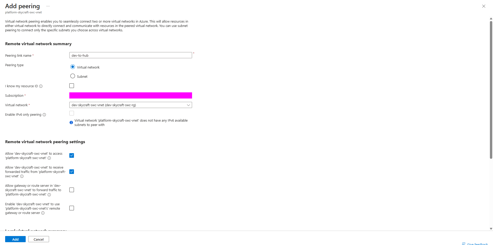
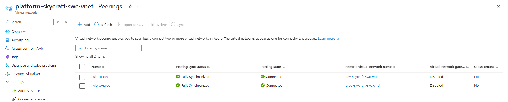
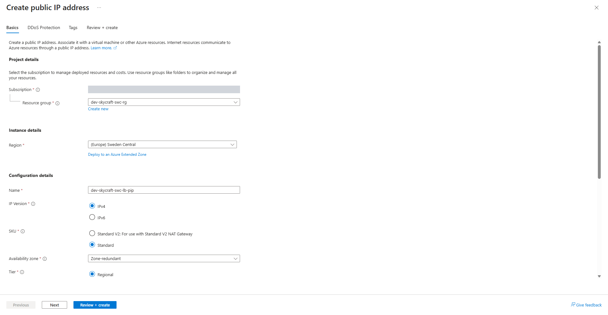
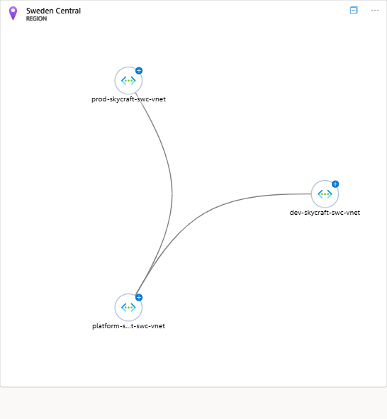

# Lab 2.1: Configure and Manage Virtual Networks (3 hours)

## 🎯 Learning Objectives

By completing this lab, you will:

- Design and deploy hub-spoke virtual network topology
- Create virtual networks with multiple subnets using CIDR notation
- Configure VNet peering between hub and spoke networks
- Implement user-defined routes for traffic control
- Configure public and private IP addresses
- Troubleshoot network connectivity issues

---

## 🏗️ Architecture Overview

You'll deploy this three-VNet hub-spoke architecture:

<picture>
  <source media="(prefers-color-scheme: dark)" srcset="images/lab-2.1-architecture.dark.svg">
  <source media="(prefers-color-scheme: light)" srcset="images/lab-2.1-architecture.svg">
  
</picture>

---

## 📋 Real-World Scenario

**Situation**: The SkyCraft AzerothCore deployment requires isolated network environments for development and production. You need a centralized hub for shared services (Bastion, future VPN gateway) and separate spoke networks for each environment. Development teams should not have direct network access to production resources.

**Your Task**: Design and deploy a hub-spoke network topology that:

- Isolates dev and prod environments
- Centralizes administrative access through Azure Bastion in the hub
- Allows controlled communication between hub and spokes
- Supports future VPN/ExpressRoute connectivity
- Uses proper IP address planning to avoid conflicts

---

## ⏱️ Estimated Time: 3 hours

- **Section 1**: Understand hub-spoke topology and IP planning (20 min)
- **Section 2**: Create hub virtual network with subnets (30 min)
- **Section 3**: Create spoke virtual networks (dev and prod) (40 min)
- **Section 4**: Configure VNet peering between hub and spokes (30 min)
- **Section 5**: Configure public IP addresses (20 min)
- **Section 6**: Test and verify connectivity (30 min)
- **Practice**: Recreate from CLI commands (10 min)

---

## 🛠️ Portal, PowerShell and Bicep Paths

You can build this lab in the Portal by following this guide, with the Az PowerShell blocks under the steps, or with Bicep. The three paths end in the same state, and `scripts/Test-Lab.ps1` accepts it whichever path built it:

| Path | What it creates |
| ---- | --------------- |
| Portal (this guide) | Everything in the steps below |
| Az PowerShell (the blocks under Steps 2.1.4, 2.1.7-2.1.10, 2.1.12 and 2.1.14) | The three VNets with their subnets, the four peerings, the two public IPs, and the Network Watcher with its resource group |
| `scripts/Deploy-Bicep.ps1` (Bicep, `bicep/main.bicep`) | The same as the blocks, except the Network Watcher and its resource group (Azure or Step 2.1.14 creates those) |

The end state on every path:

- `platform-skycraft-swc-vnet` (10.0.0.0/16) with `AzureBastionSubnet` (10.0.0.0/26) and `GatewaySubnet` (10.0.1.0/27); `dev-skycraft-swc-vnet` (10.1.0.0/16) and `prod-skycraft-swc-vnet` (10.2.0.0/16), each with `AuthSubnet` (.1.0/24), `WorldSubnet` (.2.0/24), `DatabaseSubnet` (.3.0/24) and `AppServiceSubnet` (.4.0/24, delegated to `Microsoft.Web/serverFarms`).
- Every subnet private (no default outbound access).
- Four peerings, `hub-to-dev`, `dev-to-hub`, `hub-to-prod` and `prod-to-hub`, connected, with virtual network access and forwarded traffic allowed and no gateway transit.
- `dev-skycraft-swc-lb-pip` and `prod-skycraft-swc-lb-pip`: Standard, static, zone-redundant.
- The four SkyCraft tags on all of them, with `Environment` = `Platform`, `Development` or `Production` to match the resource group.

Run each PowerShell block once, in the order of the steps, in one `pwsh` session signed in to your subscription (`Connect-AzAccount`). They create resources and are not meant to be re-run: `New-AzVirtualNetwork` on an existing VNet replaces its settings. Steps 2.1.11, 2.1.13 and 2.1.15 only read or explain, and the topology view in Step 2.1.14 exists only in the Portal.

---

## 📖 Section 1: Understanding Hub-Spoke Topology (20 minutes)

### What is Hub-Spoke Network Topology?

**Hub-spoke** is a network design pattern where:

- **Hub VNet** contains shared services (Bastion, VPN Gateway, Firewall)
- **Spoke VNets** contain workload-specific resources (application tiers)
- Spokes connect to the hub via **VNet peering**
- Spokes do NOT directly peer with each other (traffic routes through hub)

### Benefits for SkyCraft

| Benefit                    | Description                                                  |
| -------------------------- | ------------------------------------------------------------ |
| **Isolation**              | Dev and prod environments are network-isolated               |
| **Centralized Management** | Single Bastion for all administrative access                 |
| **Cost Efficiency**        | Shared services reduce duplicate resources                   |
| **Scalability**            | Easy to add new spoke networks for staging, QA, etc.         |
| **Security**               | Hub can host firewall/NVA for centralized traffic inspection |

### IP Address Planning

**Important**: Proper IP planning prevents address conflicts and allows future growth.

| VNet                                 | CIDR Range  | Total IPs | Purpose                              |
| ------------------------------------ | ----------- | --------- | ------------------------------------ |
| **platform-skycraft-swc-vnet** (Hub) | 10.0.0.0/16 | 65,536    | Shared services                      |
| └─ AzureBastionSubnet                | 10.0.0.0/26 | 64        | Azure Bastion (minimum /26 required) |
| └─ GatewaySubnet                     | 10.0.1.0/27 | 32        | Future VPN/ExpressRoute gateway      |
| **dev-skycraft-swc-vnet** (Spoke 1)  | 10.1.0.0/16 | 65,536    | Development environment              |
| └─ AuthSubnet                        | 10.1.1.0/24 | 256       | Authentication server VMs            |
| └─ WorldSubnet                       | 10.1.2.0/24 | 256       | World server VMs                     |
| └─ DatabaseSubnet                    | 10.1.3.0/24 | 256       | Database servers                     |
| └─ AppServiceSubnet                  | 10.1.4.0/24 | 256       | App Service instances                |
| **prod-skycraft-swc-vnet** (Spoke 2) | 10.2.0.0/16 | 65,536    | Production environment               |
| └─ AuthSubnet                        | 10.2.1.0/24 | 256       | Authentication server VMs            |
| └─ WorldSubnet                       | 10.2.2.0/24 | 256       | World server VMs                     |
| └─ DatabaseSubnet                    | 10.2.3.0/24 | 256       | Database servers                     |
| └─ AppServiceSubnet                  | 10.2.4.0/24 | 256       | App Service instances                |

**Key Concepts**:

- Azure reserves **5 IP addresses** in each subnet (first 4 and last 1)
- Usable IPs = Total IPs - 5
- Example: /24 subnet has 256 IPs, but only 251 are usable

---

## 📖 Section 2: Create Hub Virtual Network (30 minutes)

> [!IMPORTANT] > **Prerequisite**: The resource groups (`platform-skycraft-swc-rg`, `dev-skycraft-swc-rg`, `prod-skycraft-swc-rg`) must already exist. If you haven't created them, complete [Lab 1.2: Manage Access to Azure Resources (RBAC)](../../module-1-identities-governance/1.2-rbac/lab-guide-1.2.md#-section-2-create-resource-groups-15-minutes) first.

### Step 2.1.1: Create Hub Virtual Network

> **Note**: Lab 1.3's policies are in force from here on. `Restrict-Azure-Regions` refuses a resource outside Sweden Central and North Europe, and `Enforce-Project-Tag` refuses a resource without `Project` = `SkyCraft`. That is why every create form in this lab names the region and the four SkyCraft tags.

1. In the search box at the top of the Azure Portal, type **Virtual network** and click the result **Virtual network** (service **Network foundation**). The page **Network foundation | Virtual networks** opens.
2. Click **+ Create**.
3. On the **Basics** tab, fill in:

| Field                      | Value                        |
| -------------------------- | ---------------------------- |
| **Subscription**           | Your subscription            |
| **Resource group**         | `platform-skycraft-swc-rg`   |
| **Virtual network name**   | `platform-skycraft-swc-vnet` |
| **Region**                 | **Sweden Central**           |

> **Note**: The **Resource group** box is pre-filled with the group you used last (for example `dev-skycraft-swc-rg`). Open the list and pick `platform-skycraft-swc-rg`.

4. Click **Next** to open the **Security** tab. Leave **Virtual network encryption**, **Enable Azure Bastion**, **Enable Azure Firewall** and **Enable Azure DDoS Network Protection** unticked (Lab 2.2 configures security).

> **Warning**: **Enable Azure Bastion**, **Enable Azure Firewall** and **Enable Azure DDoS Network Protection** each create a resource that is billed for every hour it exists. All four boxes are unticked by default; leave them that way.

5. Click **Next** to open the **Address space** tab. It proposes `10.0.0.0/16` with one subnet named `default`. The lab does not use `default`, and deleting the address space removes the subnet with it: click **Delete address space**.
6. Click **Add IPv4 address space**. The Portal adds `10.0.0.0/16` at once (the notification says "Added address prefix 10.0.0.0/16 to the virtual network"); there is no text box and no **Add** button. For the hub this range is the one you want, so leave **Starting address** at `10.0.0.0` and **Size** at `/16`.

Leave the **Advertised address prefixes** section and **Allocate using IP address pools** unchanged.

**Expected Result**: The **Address space** tab lists `10.0.0.0/16` and no subnet (provides 65,536 IP addresses).

The Az PowerShell block for this step is under Step 2.1.4, because the Portal creates the VNet and its subnets in one deployment.

### Step 2.1.2: Create AzureBastionSubnet

1. Still on the **Address space** tab, click **+ Add a subnet**. The **Add a subnet** pane opens on the right.
2. Fill in:

| Field                                                | Value                    |
| ---------------------------------------------------- | ------------------------ |
| **Subnet purpose**                                   | **Azure Bastion**        |
| **Name**                                             | `AzureBastionSubnet`     |
| **Starting address**                                 | `10.0.0.0`               |
| **Size**                                             | `/26` (64 addresses)     |
| **Enable private subnet (no default outbound access)** | Ticked (leave as it is) |

Set **Subnet purpose** first. The list offers **Default**, **Azure Bastion**, **Azure Firewall**, **Firewall Management (forced tunneling)**, **Virtual Network Gateway** and **Route Server**. The name `AzureBastionSubnet` is reserved for the **Azure Bastion** purpose: with **Default** left in place, typing the name gives "Please select 'Azure Bastion' in Subnet purpose dropdown to use the name 'AzureBastionSubnet'." and **Add** stays greyed out. After you pick **Azure Bastion**, the name fills in and cannot be edited.

> **Warning**: The pane starts with a **Size** of `/24`. Pick `/26` (64 addresses, the minimum Bastion accepts). A `/24` starting at `10.0.0.0` also covers `10.0.1.0`, where the next step puts `GatewaySubnet`, and the two subnets would overlap.

**Note**: The pane ticks **Enable private subnet (no default outbound access)** by default. Leave it ticked, here and on every subnet of this lab. A private subnet has no implicit outbound internet access, and the lab's checks (`Test-Lab.ps1`, the Bicep and the PowerShell script) expect every subnet to be private. Lab 2.3 gives the Module 3 VMs an explicit outbound path through load balancer outbound rules.

3. Click **Add**.



**Expected Result**: Subnet `AzureBastionSubnet` appears in the subnet list with range 10.0.0.0/26.

### Step 2.1.3: Create GatewaySubnet

1. Click **+ Add a subnet**.
2. Fill in:

| Field                                                | Value                    |
| ---------------------------------------------------- | ------------------------ |
| **Subnet purpose**                                   | **Virtual Network Gateway** |
| **Name**                                             | `GatewaySubnet`          |
| **Starting address**                                 | `10.0.1.0`               |
| **Size**                                             | `/27` (32 addresses)     |
| **Enable private subnet (no default outbound access)** | Ticked (leave as it is) |

The name `GatewaySubnet` (for the future VPN gateway) is reserved for the **Virtual Network Gateway** purpose: with **Default** in place the pane says "Please select 'Virtual Network Gateway' in Subnet purpose dropdown to use the name 'GatewaySubnet'." and **Add** stays greyed out. After you pick the purpose, the name fixes itself and **Starting address** shows `10.0.1.0`; if it shows another address, type `10.0.1.0`.

> **Warning**: **Size** starts at `/24`. Pick `/27`, the size this lab plans for the gateway. A larger subnet would not fit the address plan in Section 1.

Leave **Enable private subnet (no default outbound access)** ticked.

3. Click **Add**.

**Expected Result**: Subnet `GatewaySubnet` appears with range 10.0.1.0/27.



### Step 2.1.4: Complete Hub VNet Creation

1. Click **Next** to open the **Tags** tab. If the Portal shows "Click here to set required tags", click it: it adds the tag that Lab 1.3's policy requires. Then add the rest by hand.
2. Add the tags:

| Name        | Value       |
| ----------- | ----------- |
| Project     | SkyCraft    |
| Environment | Platform    |
| CostCenter  | MSDN        |
| Owner       | mbiszczanik |

3. Click **Review + create**.
4. On the review page check the address space and the two subnets. Each subnet shows **Private subnet**: **Enabled**. (The tags may be listed several times on this page; that is cosmetic.)
5. Click **Create**.

**Expected Result**:

- Deployment completes successfully. The deployment page can keep saying "Deployment is in progress" after the notification reports success; open **Virtual networks** and refresh the list instead.
- Hub VNet `platform-skycraft-swc-vnet` exists with:
  - Address space: 10.0.0.0/16
  - 2 subnets: AzureBastionSubnet, GatewaySubnet

**With Az PowerShell** (instead of Steps 2.1.1 to 2.1.4):

```powershell
$tags = @{ Project = 'SkyCraft'; Environment = 'Platform'; CostCenter = 'MSDN'; Owner = 'mbiszczanik' }
$subnets = @(
    New-AzVirtualNetworkSubnetConfig -Name 'AzureBastionSubnet' -AddressPrefix '10.0.0.0/26' -DefaultOutboundAccess $false
    New-AzVirtualNetworkSubnetConfig -Name 'GatewaySubnet' -AddressPrefix '10.0.1.0/27' -DefaultOutboundAccess $false
)
New-AzVirtualNetwork -ResourceGroupName 'platform-skycraft-swc-rg' -Name 'platform-skycraft-swc-vnet' `
    -Location 'swedencentral' -AddressPrefix '10.0.0.0/16' -Subnet $subnets -Tag $tags |
    Select-Object Name, ProvisioningState
```

---

## 📖 Section 3: Create Spoke Virtual Networks (40 minutes)

### Step 2.1.5: Create Development Virtual Network

1. Open **Network foundation | Virtual networks** again (search **Virtual network**) and click **+ Create**.
2. On the **Basics** tab, fill in:

| Field                      | Value                   |
| -------------------------- | ----------------------- |
| **Subscription**           | Your subscription       |
| **Resource group**         | `dev-skycraft-swc-rg`   |
| **Virtual network name**   | `dev-skycraft-swc-vnet` |
| **Region**                 | **Sweden Central**      |

3. Click **Next** to open the **Security** tab and leave all four boxes unticked, as in Step 2.1.1.
4. Click **Next** to open the **Address space** tab and click **Delete address space** (this removes the range and the `default` subnet).
5. Click **Add IPv4 address space**. The Portal proposes `10.0.0.0/16` again and warns "This address prefix overlaps with virtual network 'platform-skycraft-swc-vnet'. If you intend to peer these virtual networks, change the address space." Change **Starting address** to `10.1.0.0` and leave **Size** at `/16`.

**Expected Result**: The **Address space** tab lists `10.1.0.0/16` and no subnet.

The Az PowerShell block for Steps 2.1.5 to 2.1.7 is under Step 2.1.7.

### Step 2.1.6: Create Dev Subnets

Create four subnets for the development environment. For each one, click **+ Add a subnet**, leave **Subnet purpose** at **Default**, fill in the fields below, leave **Enable private subnet (no default outbound access)** ticked, and click **Add**.

**Subnet 1: AuthSubnet**

| Field                | Value        |
| -------------------- | ------------ |
| **Name**             | `AuthSubnet` |
| **Starting address** | `10.1.1.0`   |
| **Size**             | `/24` (256 addresses) |

**Subnet 2: WorldSubnet**

| Field                | Value         |
| -------------------- | ------------- |
| **Name**             | `WorldSubnet` |
| **Starting address** | `10.1.2.0`    |
| **Size**             | `/24`         |

**Subnet 3: DatabaseSubnet**

| Field                | Value            |
| -------------------- | ---------------- |
| **Name**             | `DatabaseSubnet` |
| **Starting address** | `10.1.3.0`       |
| **Size**             | `/24`            |

**Subnet 4: AppServiceSubnet**

| Field                        | Value                       |
| ---------------------------- | --------------------------- |
| **Name**                     | `AppServiceSubnet`          |
| **Starting address**         | `10.1.4.0`                  |
| **Size**                     | `/24`                       |
| **Delegate subnet to a service** | `Microsoft.Web/serverFarms` |

**Delegate subnet to a service** is in the **Subnet Delegation** section at the bottom of the pane: scroll down, open the list, type `serverFarms` in its filter box and pick `Microsoft.Web/serverFarms`. The delegation reserves the subnet for App Service: Lab 3.4 connects the web app to it (VNet integration), and the lab's Bicep template creates the subnet the same way. Leave **Network Policy for Private Endpoints** at **Disabled** and the **Service Endpoints** section empty.

**Note**: Every one of the four subnets keeps **Enable private subnet (no default outbound access)** ticked (see Step 2.1.2).

**Expected Result**: Four subnets created in dev VNet:

- AuthSubnet: 10.1.1.0/24
- WorldSubnet: 10.1.2.0/24
- DatabaseSubnet: 10.1.3.0/24
- AppServiceSubnet: 10.1.4.0/24, delegated to `Microsoft.Web/serverFarms`



### Step 2.1.7: Complete Dev VNet Creation

1. Click **Next** to open the **Tags** tab (use "Click here to set required tags" again if it is shown).
2. Add the tags:

| Name        | Value       |
| ----------- | ----------- |
| Project     | SkyCraft    |
| Environment | Development |
| CostCenter  | MSDN        |
| Owner       | mbiszczanik |

3. Click **Review + create**. Check that each of the four subnets shows **Private subnet**: **Enabled**.
4. Click **Create**.

**Expected Result**: Dev VNet `dev-skycraft-swc-vnet` deployed successfully with 4 subnets.

**With Az PowerShell** (instead of Steps 2.1.5 to 2.1.7):

```powershell
$tags = @{ Project = 'SkyCraft'; Environment = 'Development'; CostCenter = 'MSDN'; Owner = 'mbiszczanik' }
$delegation = New-AzDelegation -Name 'Microsoft.Web/serverFarms' -ServiceName 'Microsoft.Web/serverFarms'
$subnets = @(
    New-AzVirtualNetworkSubnetConfig -Name 'AuthSubnet' -AddressPrefix '10.1.1.0/24' -DefaultOutboundAccess $false
    New-AzVirtualNetworkSubnetConfig -Name 'WorldSubnet' -AddressPrefix '10.1.2.0/24' -DefaultOutboundAccess $false
    New-AzVirtualNetworkSubnetConfig -Name 'DatabaseSubnet' -AddressPrefix '10.1.3.0/24' -DefaultOutboundAccess $false
    New-AzVirtualNetworkSubnetConfig -Name 'AppServiceSubnet' -AddressPrefix '10.1.4.0/24' -Delegation $delegation -DefaultOutboundAccess $false
)
New-AzVirtualNetwork -ResourceGroupName 'dev-skycraft-swc-rg' -Name 'dev-skycraft-swc-vnet' `
    -Location 'swedencentral' -AddressPrefix '10.1.0.0/16' -Subnet $subnets -Tag $tags |
    Select-Object Name, ProvisioningState
```

### Step 2.1.8: Create Production Virtual Network

Repeat the process for production:

1. Open **Network foundation | Virtual networks** and click **+ Create**.
2. On the **Basics** tab, fill in:

| Field                      | Value                    |
| -------------------------- | ------------------------ |
| **Subscription**           | Your subscription        |
| **Resource group**         | `prod-skycraft-swc-rg`   |
| **Virtual network name**   | `prod-skycraft-swc-vnet` |
| **Region**                 | **Sweden Central**       |

> **Warning**: **Resource group** is pre-filled with the group you used last, which is now `dev-skycraft-swc-rg`. Change it to `prod-skycraft-swc-rg`. A production network in the dev group means deleting it and building it again, and `Test-Lab.ps1` would not find it.

3. **Security** tab: leave all four boxes unticked.
4. **Address space** tab: click **Delete address space**, then **Add IPv4 address space**. The Portal proposes `10.0.0.0/16` and warns that it overlaps `platform-skycraft-swc-vnet`; change **Starting address** to `10.2.0.0` and leave **Size** at `/16`.
5. Add four subnets with **+ Add a subnet**, **Subnet purpose** **Default**, and **Enable private subnet (no default outbound access)** ticked on every one:

| Subnet Name      | Starting Address | Size |
| ---------------- | ---------------- | ---- |
| AuthSubnet       | 10.2.1.0         | /24  |
| WorldSubnet      | 10.2.2.0         | /24  |
| DatabaseSubnet   | 10.2.3.0         | /24  |
| AppServiceSubnet | 10.2.4.0         | /24  |

For `AppServiceSubnet`, also set **Delegate subnet to a service** to `Microsoft.Web/serverFarms` (**Subnet Delegation**, bottom of the pane), as in Step 2.1.6.



6. **Tags** tab: add the tags:

| Name        | Value       |
| ----------- | ----------- |
| Project     | SkyCraft    |
| Environment | Production  |
| CostCenter  | MSDN        |
| Owner       | mbiszczanik |

7. Click **Review + create**. Check that all four subnets show **Private subnet**: **Enabled**.
8. Click **Create**.

**Expected Result**: Production VNet `prod-skycraft-swc-vnet` created in `prod-skycraft-swc-rg` with 4 subnets.

**With Az PowerShell** (instead of items 1-8):

```powershell
$tags = @{ Project = 'SkyCraft'; Environment = 'Production'; CostCenter = 'MSDN'; Owner = 'mbiszczanik' }
$delegation = New-AzDelegation -Name 'Microsoft.Web/serverFarms' -ServiceName 'Microsoft.Web/serverFarms'
$subnets = @(
    New-AzVirtualNetworkSubnetConfig -Name 'AuthSubnet' -AddressPrefix '10.2.1.0/24' -DefaultOutboundAccess $false
    New-AzVirtualNetworkSubnetConfig -Name 'WorldSubnet' -AddressPrefix '10.2.2.0/24' -DefaultOutboundAccess $false
    New-AzVirtualNetworkSubnetConfig -Name 'DatabaseSubnet' -AddressPrefix '10.2.3.0/24' -DefaultOutboundAccess $false
    New-AzVirtualNetworkSubnetConfig -Name 'AppServiceSubnet' -AddressPrefix '10.2.4.0/24' -Delegation $delegation -DefaultOutboundAccess $false
)
New-AzVirtualNetwork -ResourceGroupName 'prod-skycraft-swc-rg' -Name 'prod-skycraft-swc-vnet' `
    -Location 'swedencentral' -AddressPrefix '10.2.0.0/16' -Subnet $subnets -Tag $tags |
    Select-Object Name, ProvisioningState
```

---

## 📖 Section 4: Configure VNet Peering (30 minutes)

### What is VNet Peering?

**VNet Peering** connects two Azure virtual networks, allowing resources to communicate using private IP addresses. Peering is:

- **Low latency**: Traffic stays on Microsoft backbone
- **Non-transitive**: If A peers with B, and B peers with C, A cannot reach C
- **Bidirectional**: Requires configuration on both sides

### Step 2.1.9: Peer Hub to Dev (Hub Side)

1. Navigate to **Virtual networks**.
2. Click **platform-skycraft-swc-vnet**.
3. In the left menu, under **Settings** (expand it if it is collapsed), click **Peerings**.
4. Click **+ Add**. The **Add peering** page has four sections, and one **Add** click creates both peering links (the one on the hub and the one on the spoke).

**Remote virtual network summary** (the spoke):

| Field                          | Value                   |
| ------------------------------ | ----------------------- |
| **Peering link name**          | `dev-to-hub`            |
| **Peering type**               | **Virtual network**     |
| **I know my resource ID**      | Unticked                |
| **Subscription**               | Your subscription       |
| **Virtual network**            | `dev-skycraft-swc-vnet` |
| **Enable IPv6 only peering**   | Unticked                |

**Remote virtual network peering settings**:

| Box                                                                                     | Value                                                    |
| --------------------------------------------------------------------------------------- | -------------------------------------------------------- |
| **Allow 'dev-skycraft-swc-vnet' to access 'platform-skycraft-swc-vnet'**                | Ticked (default)                                         |
| **Allow 'dev-skycraft-swc-vnet' to receive forwarded traffic from 'platform-skycraft-swc-vnet'** | **Tick it** (not ticked by default)            |
| The gateway and route server boxes                                                      | Leave clear                                              |

**Local virtual network summary** (the hub):

| Field                 | Value        |
| --------------------- | ------------ |
| **Peering link name** | `hub-to-dev` |

**Local virtual network peering settings** (the same four boxes, with the two names swapped):

| Box                                                                                     | Value                                                    |
| --------------------------------------------------------------------------------------- | -------------------------------------------------------- |
| **Allow 'platform-skycraft-swc-vnet' to access 'dev-skycraft-swc-vnet'**                | Ticked (default)                                         |
| **Allow 'platform-skycraft-swc-vnet' to receive forwarded traffic from 'dev-skycraft-swc-vnet'** | **Tick it** (not ticked by default)            |
| The gateway and route server boxes                                                      | Leave clear                                              |

> **Warning**: The "receive forwarded traffic" box is **not** ticked by default, in either settings section. Tick it in both. The Portal, the lab's PowerShell script and its Bicep must leave the same peerings, and `Test-Lab.ps1` fails a peering whose forwarded traffic is off ("AllowForwardedTraffic is False"). Forwarded traffic is what lets the hub later pass traffic between a spoke and a firewall or gateway. Leave the gateway and route server boxes clear: this lab has no gateway.

The page may show the line "Virtual network 'platform-skycraft-swc-vnet' does not have any IPv6 available subnets to peer with." It is only information.



5. Click **Add**. The notifications read "Adding virtual network peering" and then "Added virtual network peering".

**Expected Result**:

- Both `hub-to-dev` and `dev-to-hub` show **Peering state** "Connected" (it can show "Updating" for a moment; click **Refresh**).

**With Az PowerShell** (instead of items 1-5):

```powershell
$hub = Get-AzVirtualNetwork -ResourceGroupName 'platform-skycraft-swc-rg' -Name 'platform-skycraft-swc-vnet'
$dev = Get-AzVirtualNetwork -ResourceGroupName 'dev-skycraft-swc-rg' -Name 'dev-skycraft-swc-vnet'
Add-AzVirtualNetworkPeering -Name 'hub-to-dev' -VirtualNetwork $hub -RemoteVirtualNetworkId $dev.Id -AllowForwardedTraffic |
    Select-Object Name, PeeringState
Add-AzVirtualNetworkPeering -Name 'dev-to-hub' -VirtualNetwork $dev -RemoteVirtualNetworkId $hub.Id -AllowForwardedTraffic |
    Select-Object Name, PeeringState
```

### Step 2.1.10: Peer Hub to Prod (Hub Side)

1. Still in **platform-skycraft-swc-vnet**, under **Settings**, click **Peerings**.
2. Click **+ Add**.

Fill in the same four sections as in Step 2.1.9, with these values:

| Section                                    | Field or box                                                                                      | Value                    |
| ------------------------------------------ | ------------------------------------------------------------------------------------------------- | ------------------------ |
| Remote virtual network summary             | **Peering link name**                                                                             | `prod-to-hub`            |
| Remote virtual network summary             | **Virtual network**                                                                               | `prod-skycraft-swc-vnet` |
| Remote virtual network peering settings    | **Allow 'prod-skycraft-swc-vnet' to access 'platform-skycraft-swc-vnet'**                         | Ticked (default)         |
| Remote virtual network peering settings    | **Allow 'prod-skycraft-swc-vnet' to receive forwarded traffic from 'platform-skycraft-swc-vnet'** | **Tick it**              |
| Local virtual network summary              | **Peering link name**                                                                             | `hub-to-prod`            |
| Local virtual network peering settings     | **Allow 'platform-skycraft-swc-vnet' to access 'prod-skycraft-swc-vnet'**                         | Ticked (default)         |
| Local virtual network peering settings     | **Allow 'platform-skycraft-swc-vnet' to receive forwarded traffic from 'prod-skycraft-swc-vnet'** | **Tick it**              |

Leave **Peering type** at **Virtual network**, the IPv6 box unticked, and the gateway and route server boxes clear. The warning in Step 2.1.9 about the forwarded traffic box applies here too.

3. Click **Add**.

**Expected Result**:

- Peering `hub-to-prod` shows **Peering state** "Connected"
- Peering `prod-to-hub` shows **Peering state** "Connected"

**With Az PowerShell** (instead of items 1-3):

```powershell
$hub = Get-AzVirtualNetwork -ResourceGroupName 'platform-skycraft-swc-rg' -Name 'platform-skycraft-swc-vnet'
$prod = Get-AzVirtualNetwork -ResourceGroupName 'prod-skycraft-swc-rg' -Name 'prod-skycraft-swc-vnet'
Add-AzVirtualNetworkPeering -Name 'hub-to-prod' -VirtualNetwork $hub -RemoteVirtualNetworkId $prod.Id -AllowForwardedTraffic |
    Select-Object Name, PeeringState
Add-AzVirtualNetworkPeering -Name 'prod-to-hub' -VirtualNetwork $prod -RemoteVirtualNetworkId $hub.Id -AllowForwardedTraffic |
    Select-Object Name, PeeringState
```

### Step 2.1.11: Verify Peering Configuration

1. Navigate to **platform-skycraft-swc-vnet**, then under **Settings** click **Peerings**. A new peering can be missing from the list until you click **Refresh**.
2. Verify both peerings are listed (columns **Name**, **Peering sync status**, **Peering state**, **Remote virtual network name**, **Virtual network gateway**, **Cross-tenant**):

| Peering Name | Peering sync status | Peering state | Remote virtual network name |
| ------------ | ------------------- | ------------- | --------------------------- |
| hub-to-dev   | Fully Synchronized  | Connected     | dev-skycraft-swc-vnet       |
| hub-to-prod  | Fully Synchronized  | Connected     | prod-skycraft-swc-vnet      |



3. Navigate to **dev-skycraft-swc-vnet** → **Settings** → **Peerings**.
4. Verify peering exists:

| Peering Name | Peering sync status | Peering state | Remote virtual network name |
| ------------ | ------------------- | ------------- | --------------------------- |
| dev-to-hub   | Fully Synchronized  | Connected     | platform-skycraft-swc-vnet  |

5. Navigate to **prod-skycraft-swc-vnet** → **Settings** → **Peerings**.
6. Verify peering exists:

| Peering Name | Peering sync status | Peering state | Remote virtual network name |
| ------------ | ------------------- | ------------- | --------------------------- |
| prod-to-hub  | Fully Synchronized  | Connected     | platform-skycraft-swc-vnet  |

**Expected Result**: All peering connections show "Connected" state. Hub has 2 peerings, each spoke has 1 peering.

---

## 📖 Section 5: Configure Public IP Addresses (20 minutes)

### Step 2.1.12: Reserve Public IPs for Load Balancers

Create public IPs for future load balancers (used in Lab 2.3).

**Dev Load Balancer Public IP**:

1. In the search box at the top, type **Public IP address** and click the result **Public IP address** (it is listed second, after **Subscriptions**).
2. Click **+ Create**. The tabs are **Basics**, **DDoS Protection**, **Tags** and **Review + create**.
3. On the **Basics** tab, fill in:

| Field                      | Value                           |
| -------------------------- | ------------------------------- |
| **Subscription**           | Your subscription               |
| **Resource group**         | `dev-skycraft-swc-rg`           |
| **Region**                 | **Sweden Central**              |
| **Name**                   | `dev-skycraft-swc-lb-pip`       |
| **SKU**                    | **Standard**                    |
| **Availability zone**      | **Zone-redundant** (default)    |
| **Tier**                   | **Regional**                    |
| **IP address assignment**  | Static (fixed text, not a choice) |
| **Routing preference**     | **Microsoft network**           |

Leave **Idle timeout (minutes)** at `4` and **DNS name label** empty.

> **Warning**: **SKU** offers **Standard V2** (meant for a Standard V2 NAT Gateway) and **Standard**. Pick **Standard**, the SKU the load balancers of Lab 2.3 use.

> **Warning**: Keep **Availability zone** at **Zone-redundant**. The zone setting of a public IP cannot be changed after it is created, and the lab's Bicep and PowerShell script create zone-redundant IPs; a zonal or non-zonal one breaks a later re-run of the Bicep.

> **Warning**: A Standard static IPv4 address costs about 0.0044 EUR per hour, about 3.21 EUR per month for each of the two addresses (retail price of 2026-10-22, Sweden Central), for as long as it exists, attached or not. Delete both when you finish the course (see What This Lab Leaves Behind).

4. Click **Next** to open the **DDoS Protection** tab. Leave **Protection type** at **Network** (the default; it costs nothing without a DDoS protection plan). Do not pick **IP**: it is billed per protected address.
5. Click **Next** to open the **Tags** tab (use "Click here to set required tags" if it is shown) and add the tags:

| Name        | Value       |
| ----------- | ----------- |
| Project     | SkyCraft    |
| Environment | Development |
| CostCenter  | MSDN        |
| Owner       | mbiszczanik |

6. Click **Review + create**, then **Create**.



**Prod Load Balancer Public IP**:

1. Repeat items 1 to 6 with these differences:

| Field                      | Value                      |
| -------------------------- | -------------------------- |
| **Resource group**         | `prod-skycraft-swc-rg`     |
| **Region**                 | **Sweden Central**         |
| **Name**                   | `prod-skycraft-swc-lb-pip` |
| Tag **Environment**        | Production                 |

> **Warning**: **Resource group** is pre-filled with the group you used last (`dev-skycraft-swc-rg`). Change it to `prod-skycraft-swc-rg`.

**Expected Result**: Two public IPs created, both **Standard**, **Static**, zone-redundant:

- `dev-skycraft-swc-lb-pip` (for dev load balancer)
- `prod-skycraft-swc-lb-pip` (for prod load balancer)

**With Az PowerShell** (instead of both sets of items):

```powershell
$tagsDev = @{ Project = 'SkyCraft'; Environment = 'Development'; CostCenter = 'MSDN'; Owner = 'mbiszczanik' }
$tagsProd = @{ Project = 'SkyCraft'; Environment = 'Production'; CostCenter = 'MSDN'; Owner = 'mbiszczanik' }
New-AzPublicIpAddress -Name 'dev-skycraft-swc-lb-pip' -ResourceGroupName 'dev-skycraft-swc-rg' `
    -Location 'swedencentral' -Sku Standard -AllocationMethod Static -Zone 1, 2, 3 -Tag $tagsDev |
    Select-Object Name, ProvisioningState
New-AzPublicIpAddress -Name 'prod-skycraft-swc-lb-pip' -ResourceGroupName 'prod-skycraft-swc-rg' `
    -Location 'swedencentral' -Sku Standard -AllocationMethod Static -Zone 1, 2, 3 -Tag $tagsProd |
    Select-Object Name, ProvisioningState
```

---

## 📖 Section 6: Test and Verify Connectivity (30 minutes)

### Step 2.1.13: Verify VNet Configuration

1. Navigate to **Virtual networks**
2. Click **platform-skycraft-swc-vnet**
3. Click **Overview**
4. Verify:
   - Address space: 10.0.0.0/16
   - Subnets: "2 subnets" (AzureBastionSubnet, GatewaySubnet)
   - Peerings: open the **Capabilities** tab, which shows "Peerings - 2 peerings" (hub-to-dev, hub-to-prod)

5. Repeat verification for:
   - `dev-skycraft-swc-vnet` (Address: 10.1.0.0/16, Subnets: 4, Peerings: 1)
   - `prod-skycraft-swc-vnet` (Address: 10.2.0.0/16, Subnets: 4, Peerings: 1)

**Expected Result**: All VNets configured correctly with proper address spaces, subnets, and peering connections.

### Step 2.1.14: Use Azure Network Watcher Topology

1. In the search box at the top, type **Network Watcher** and click the result. The page **Networking monitoring & management | Network Watcher** opens.
2. Look for a network watcher in **Sweden Central**. When Azure creates a virtual network in a region with no watcher, it tries to create `NetworkWatcher_swedencentral` in the resource group `NetworkWatcherRG` on its own. Lab 1.3's `Require-Environment-Tag-RG` refuses that, because Azure creates the group without tags, so the list shows "No network watchers to display". Your VNets are not affected; only the watcher is missing.

> **Warning**: Do not try **+ Create** → **Add network watcher** yet. It has no resource group field, so it would create `NetworkWatcherRG` untagged, and the Portal answers: "Failed to start deployment ... Resource 'NetworkWatcherRG' was disallowed by policy. Reasons: 'Resource group must have an Environment tag (Development, Production, or Platform)'." (the message appears under the notification bell). Create the group yourself first, with its tags (next item).

3. Create the resource group the watcher lives in. Search **Resource groups**, click **+ Create**, and fill in:

| Field                | Value                 |
| -------------------- | --------------------- |
| **Subscription**     | Your subscription     |
| **Resource group**   | `NetworkWatcherRG`    |
| **Region**           | **Sweden Central**    |

   On the **Tags** tab add the tags, then click **Review + create** and **Create**:

| Name        | Value       |
| ----------- | ----------- |
| Project     | SkyCraft    |
| Environment | Platform    |
| CostCenter  | MSDN        |
| Owner       | mbiszczanik |

   If `NetworkWatcherRG` already exists without tags, open it, click **Tags**, and add the four tags there instead.

4. Back in **Network Watcher**, click **+ Create** → **Add network watcher**. Select your subscription and **Sweden Central** (the form has no resource group field), and confirm. `NetworkWatcher_swedencentral` appears in the list.

**With Az PowerShell** (instead of items 3 and 4):

```powershell
$tags = @{ Project = 'SkyCraft'; Environment = 'Platform'; CostCenter = 'MSDN'; Owner = 'mbiszczanik' }
if (Get-AzResourceGroup -Name 'NetworkWatcherRG' -ErrorAction SilentlyContinue) {
    Set-AzResourceGroup -Name 'NetworkWatcherRG' -Tag $tags | Out-Null
}
else {
    New-AzResourceGroup -Name 'NetworkWatcherRG' -Location 'swedencentral' -Tag $tags | Out-Null
}
if (-not (Get-AzNetworkWatcher -Location 'swedencentral' -ErrorAction SilentlyContinue)) {
    New-AzNetworkWatcher -Name 'NetworkWatcher_swedencentral' -ResourceGroupName 'NetworkWatcherRG' `
        -Location 'swedencentral' -Tag $tags | Select-Object Name, ProvisioningState
}
```

5. In the left menu, under **Monitoring** (expand it if it is collapsed), click **Topology**.
6. The map can open scrolled to the Americas. Click the fit to view button on the map; it shows Sweden Central. Double-click the Sweden Central region card (a single click opens an **Insights** pane instead) and press **Expand**:



**Expected View**: Visual diagram showing hub VNet with peering connections to spoke VNets.

7. To look at one resource group, click the **Scope** chip → **Select Scope** → **Resource Groups**, pick `dev-skycraft-swc-rg`, and click **Save**. The map folds back to the geo map: expand Sweden Central as in item 6.
8. Do the same for `prod-skycraft-swc-rg`.

**Expected Result**: Topology diagram displays your hub-spoke architecture visually.

### Step 2.1.15: Test Connectivity (Conceptual)

Since we haven't deployed VMs yet, document the expected connectivity:

| Source                 | Destination             | Expected Result                          |
| ---------------------- | ----------------------- | ---------------------------------------- |
| Hub VNet (10.0.0.0/16) | Dev VNet (10.1.0.0/16)  | ✅ Allowed (via peering)                 |
| Hub VNet (10.0.0.0/16) | Prod VNet (10.2.0.0/16) | ✅ Allowed (via peering)                 |
| Dev VNet (10.1.0.0/16) | Prod VNet (10.2.0.0/16) | ❌ Blocked (no direct peering)           |
| Internet               | Any VNet private IP     | ❌ Blocked (no public access configured) |

**Note**: In Lab 3, we'll deploy VMs and test actual connectivity using ping and SSH.

---

## ✅ Lab Checklist

Complete this checklist to verify successful lab completion:

### Resource Groups

- [ ] `platform-skycraft-swc-rg` exists in Sweden Central
- [ ] `dev-skycraft-swc-rg` exists in Sweden Central
- [ ] `prod-skycraft-swc-rg` exists in Sweden Central
- [ ] All resource groups have proper tags (Project, Environment, CostCenter, Owner)

### Hub VNet (platform-skycraft-swc-vnet)

- [ ] Address space: 10.0.0.0/16
- [ ] Subnet: AzureBastionSubnet (10.0.0.0/26)
- [ ] Subnet: GatewaySubnet (10.0.1.0/27)
- [ ] Both subnets private (**Private subnet**: Enabled)
- [ ] 2 peering connections configured (hub-to-dev, hub-to-prod)
- [ ] Peering state: Connected, forwarded traffic allowed

### Dev VNet (dev-skycraft-swc-vnet)

- [ ] Address space: 10.1.0.0/16
- [ ] Subnet: AuthSubnet (10.1.1.0/24)
- [ ] Subnet: WorldSubnet (10.1.2.0/24)
- [ ] Subnet: DatabaseSubnet (10.1.3.0/24)
- [ ] Subnet: AppServiceSubnet (10.1.4.0/24), delegated to `Microsoft.Web/serverFarms`
- [ ] All four subnets private (**Private subnet**: Enabled)
- [ ] 1 peering connection (dev-to-hub)
- [ ] Peering state: Connected, forwarded traffic allowed

### Prod VNet (prod-skycraft-swc-vnet)

- [ ] Address space: 10.2.0.0/16
- [ ] Subnet: AuthSubnet (10.2.1.0/24)
- [ ] Subnet: WorldSubnet (10.2.2.0/24)
- [ ] Subnet: DatabaseSubnet (10.2.3.0/24)
- [ ] Subnet: AppServiceSubnet (10.2.4.0/24), delegated to `Microsoft.Web/serverFarms`
- [ ] All four subnets private (**Private subnet**: Enabled)
- [ ] 1 peering connection (prod-to-hub)
- [ ] Peering state: Connected, forwarded traffic allowed

### Public IP Addresses

- [ ] `dev-skycraft-swc-lb-pip` created (Standard SKU, Static, zone-redundant)
- [ ] `prod-skycraft-swc-lb-pip` created (Standard SKU, Static, zone-redundant)
- [ ] All public IPs have proper tags

### Network Topology Verification

- [ ] `NetworkWatcherRG` exists in Sweden Central with the four tags
- [ ] Network Watcher `NetworkWatcher_swedencentral` enabled for Sweden Central
- [ ] Topology view shows hub-spoke architecture
- [ ] No overlapping IP address ranges
- [ ] All VNets in same Azure region (Sweden Central)

**For detailed verification**, see [lab-checklist-2.1.md](lab-checklist-2.1.md)

---

## 🎓 Knowledge Check

Test your understanding with these questions:

1. **Why do we use a hub-spoke topology instead of full mesh peering?**

   <details>
     <summary>**Click to see the answer**</summary>

   **Answer**: Hub-spoke provides:
   - **Centralized management**: Shared services (Bastion, VPN Gateway) in one location
   - **Cost efficiency**: Fewer peering connections (3 peerings vs. 6 for full mesh with 3 VNets)
   - **Security**: Controlled inter-spoke communication through hub (firewall/NVA can be added)
   - **Scalability**: Easy to add new spokes without reconfiguring existing ones

   In full mesh, every VNet peers with every other VNet, creating exponential complexity as you scale.
   </details>

2. **What is the minimum subnet size for AzureBastionSubnet?**

   <details>
     <summary>**Click to see the answer**</summary>

   **Answer**: **/26** (64 IP addresses)

   Azure Bastion requires a dedicated subnet named exactly `AzureBastionSubnet` with minimum size /26. Smaller subnets (/27, /28, etc.) will cause deployment failures. The subnet name is case-sensitive and must match exactly.
   </details>

3. **Can resources in dev-skycraft-swc-vnet directly communicate with resources in prod-skycraft-swc-vnet?**

   <details>
     <summary>**Click to see the answer**</summary>

   **Answer**: **No**, not by default.

   VNet peering is **non-transitive**. Dev peers with Hub, and Prod peers with Hub, but Dev does NOT peer with Prod. Traffic between dev and prod would need to:
   - Route through hub VNet (requires user-defined routes and a firewall/NVA)
   - Or establish direct peering between dev-to-prod (not recommended for isolation)

   This isolation is intentional: production should be protected from development environments.
   </details>

4. **What happens to Azure's reserved 5 IP addresses in each subnet?**

   <details>
     <summary>**Click to see the answer**</summary>

   **Answer**: Azure reserves 5 IPs in every subnet:
   - **x.x.x.0**: Network address
   - **x.x.x.1**: Default gateway
   - **x.x.x.2 & x.x.x.3**: Azure DNS
   - **x.x.x.255**: Broadcast address

   Example: In 10.1.1.0/24 (256 IPs):
   - Reserved: 10.1.1.0, 10.1.1.1, 10.1.1.2, 10.1.1.3, 10.1.1.255
   - Usable: 10.1.1.4 through 10.1.1.254 (251 IPs)
   </details>

5. **Why did we choose 10.0.0.0/16 address ranges instead of 172.16.0.0/12 or 192.168.0.0/16?**

   <details>
     <summary>**Click to see the answer**</summary>

   **Answer**: While all three are private IP ranges (RFC 1918), **10.0.0.0/8** provides:
   - **Largest address space**: 16.7 million addresses (vs. 1 million for 172.16.0.0/12)
   - **Easy to remember**: Simple numbering (10.0.x.x, 10.1.x.x, 10.2.x.x)
   - **Less conflict**: 192.168.0.0/16 often used by home routers/VPNs

   Using /16 per VNet (65,536 IPs) allows massive growth without redesigning IP scheme.
   </details>

---

## 📦 What This Lab Leaves Behind

The networks are the base of Module 2 and of every compute lab, so leave them in place until you have finished the course. Only the two public IPs cost money. The monthly cost below is the retail price of 2026-10-22 for Sweden Central; check the [Azure pricing calculator](https://azure.microsoft.com/pricing/calculator/) for your own.

| Left behind | Where | Monthly cost | What it does in later labs |
| --- | --- | --- | --- |
| `platform-skycraft-swc-vnet` with `AzureBastionSubnet` and `GatewaySubnet` | `platform-skycraft-swc-rg` | 0 | Lab 2.2 puts Azure Bastion in `AzureBastionSubnet`; `GatewaySubnet` stays empty |
| `dev-skycraft-swc-vnet` and `prod-skycraft-swc-vnet` with their eight subnets | `dev-skycraft-swc-rg`, `prod-skycraft-swc-rg` | 0 | Lab 2.2 attaches the network security groups to the subnets; Lab 2.3 links the private DNS zone to the VNets; Module 3 places its VMs in `AuthSubnet` and `WorldSubnet`; Lab 3.4 connects the web app to `AppServiceSubnet`; Lab 5.3 monitors the prod VNet |
| Four peerings | The hub and the two spokes | 0, but traffic between peered networks is billed per GB | Carry the traffic between the hub and the spokes |
| `dev-skycraft-swc-lb-pip`, `prod-skycraft-swc-lb-pip` (Standard, static) | `dev-skycraft-swc-rg`, `prod-skycraft-swc-rg` | about 3.21 EUR each (0.0044 EUR per hour), whether in use or not | Lab 2.3 uses them as the front-end addresses of the load balancers |
| `NetworkWatcherRG` and `NetworkWatcher_swedencentral` | Subscription | 0 | Lab 5.3 creates its flow log and connection monitor under the watcher. `Remove-LabResource.ps1` leaves them |

To remove what this lab created, run the lab's cleanup from the lab folder:

```powershell
./scripts/Remove-LabResource.ps1
```

It asks before each delete (`-WhatIf` lists them without deleting anything; `-Force` skips the questions). It removes the peerings first, then the three VNets, then the two public IPs. In the Portal, delete in the same order: the four peerings (**Settings** → **Peerings** on each VNet), then the VNets (a VNet that still holds a network interface, a private endpoint or a gateway cannot be deleted: remove those first, the resources of later labs before those of earlier ones), then the public IPs (a public IP still used by a load balancer cannot be deleted: remove the load balancer of Lab 2.3 first). Delete `NetworkWatcherRG` yourself only after Lab 5.3, if you want it gone.

---

## 🔧 Troubleshooting

### Issue 1: Cannot create VNet - permission denied

**Symptom**: Error message: "The client does not have authorization to perform action"

**Solution**:

- Verify you have **Contributor** or **Owner** role at subscription or resource group level
- Check permissions: **Subscription** → **Access control (IAM)** → **Check access**
- Wait 10-15 minutes after role assignment for permissions to propagate

### Issue 2: Subnet creation fails - address range conflict

**Symptom**: Error: "Address range overlaps with existing subnet"

**Solution**:

- Verify subnet ranges don't overlap
- Check IP calculator: 10.0.0.0/26 ends at 10.0.0.63
- Next subnet should start at 10.0.0.64 or higher
- Use non-overlapping ranges: 10.0.0.0/26, then 10.0.1.0/27

### Issue 3: VNet peering shows "Initiated" instead of "Connected"

**Symptom**: Peering status stuck in "Initiated" or "Updating"

**Solution**:

- Click **Refresh** above the peering list (a new peering does not appear on its own), or press F5
- Wait 2-3 minutes for peering to complete
- Verify both sides of peering are configured
- Check if both VNets are in same Azure tenant

### Issue 4: Cannot create AzureBastionSubnet - name error

**Symptom**: The **Add a subnet** pane says "Please select 'Azure Bastion' in Subnet purpose dropdown to use the name 'AzureBastionSubnet'." (or, for `GatewaySubnet`, "Please select 'Virtual Network Gateway' in Subnet purpose dropdown to use the name 'GatewaySubnet'.") and **Add** stays greyed out

**Solution**:

- Set **Subnet purpose** to **Azure Bastion** (or **Virtual Network Gateway**) before you type the name; the name then fills in by itself
- Check **Size** afterwards: it starts at `/24`, and the lab needs `/26` for Bastion and `/27` for the gateway
- Subnet name is **case-sensitive**
- Must be exactly: `AzureBastionSubnet` (capital A, capital B, capital S)
- Cannot use: `azurebastionsubnet`, `Azure-Bastion-Subnet`, or variations

### Issue 5: Public IP creation fails - SKU mismatch

**Symptom**: Error when associating public IP with Bastion

**Solution**:

- Azure Bastion requires **Standard SKU** public IP
- Cannot use Basic SKU
- Verify: **Public IP** → **Configuration** → **SKU** shows "Standard"
- Recreate public IP if wrong SKU was selected

### Issue 6: Network Watcher not available

**Symptom**: Network Watcher features grayed out or unavailable

**Solution**:

Lab 1.3's `Require-Environment-Tag-RG` refuses the `NetworkWatcherRG` group that Azure creates on its own, because the group has no `Environment` tag, so the list shows "No network watchers to display". Create the group yourself with the four tags and then the watcher, as in Step 2.1.14 (items 3 and 4), or run this block:

```powershell
$tags = @{ Project = 'SkyCraft'; Environment = 'Platform'; CostCenter = 'MSDN'; Owner = 'mbiszczanik' }
# Check whether a Network Watcher already exists for the region
Get-AzNetworkWatcher -Location swedencentral -ErrorAction SilentlyContinue

# If none is returned, create one. Unlike `az network watcher configure`, the
# cmdlet does not create the resource group implicitly, so make it first,
# with the tags Lab 1.3's policies require.
New-AzResourceGroup -Name NetworkWatcherRG -Location swedencentral -Tag $tags -Force
New-AzNetworkWatcher `
  -Name NetworkWatcher_swedencentral `
  -ResourceGroupName NetworkWatcherRG `
  -Location swedencentral `
  -Tag $tags
```

Wait 2-3 minutes, then refresh Azure Portal.

---

## 📚 Additional Resources

- [Azure Virtual Network Documentation](https://learn.microsoft.com/en-us/azure/virtual-network/)
- [Hub-spoke network topology in Azure](https://learn.microsoft.com/en-us/azure/architecture/reference-architectures/hybrid-networking/hub-spoke)
- [Virtual network peering](https://learn.microsoft.com/en-us/azure/virtual-network/virtual-network-peering-overview)
- [IP addressing for Azure Virtual Network](https://learn.microsoft.com/en-us/azure/virtual-network/ip-services/virtual-network-ip-addresses-overview-arm)
- [CIDR notation explained](https://learn.microsoft.com/en-us/azure/virtual-network/virtual-networks-faq#what-address-ranges-can-i-use-in-my-vnets)

---

## 📌 Module Navigation

- [← Back to Module 2 Index](../README.md)
- [Next Lab: 2.2 Secure Access →](../2.2-secure-access/lab-guide-2.2.md)

---

## 📝 Lab Summary

**What You Accomplished**:

- ✅ Designed and deployed hub-spoke network topology
- ✅ Created 3 virtual networks with proper IP address planning
- ✅ Configured 10 subnets across hub and spoke VNets
- ✅ Established VNet peering (hub-to-dev, hub-to-prod)
- ✅ Reserved 2 public IP addresses for future use
- ✅ Verified network topology with Network Watcher

**Time Spent**: ~3 hours

**Ready for Lab 2.2?** Next, you'll implement security controls with NSGs, Azure Bastion, and private endpoints.
