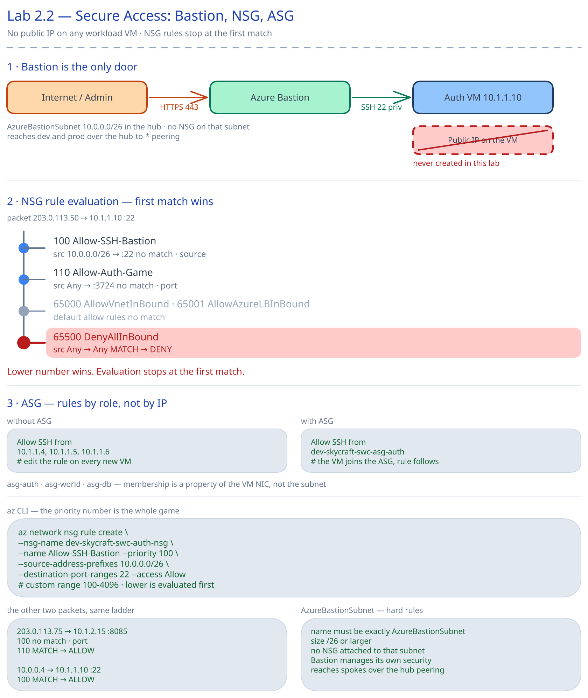
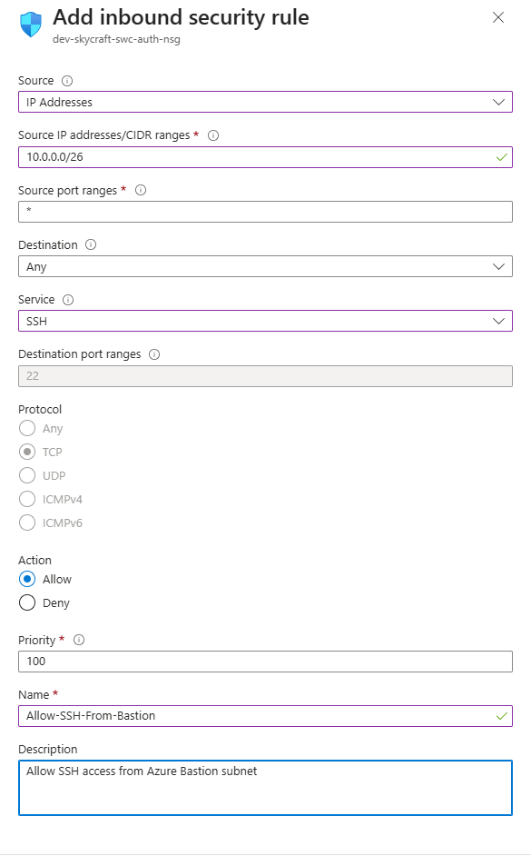
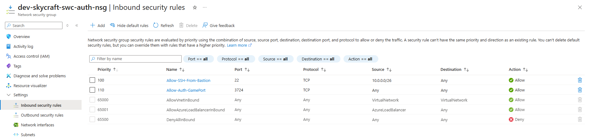
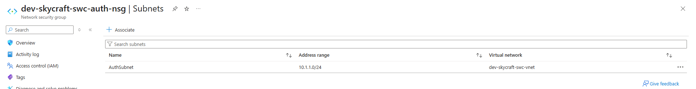
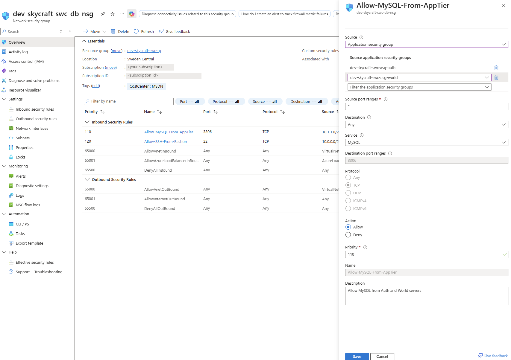
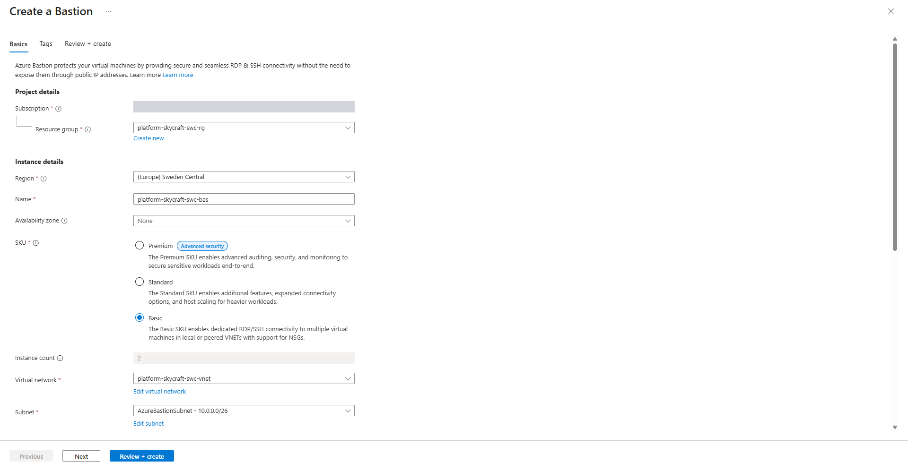
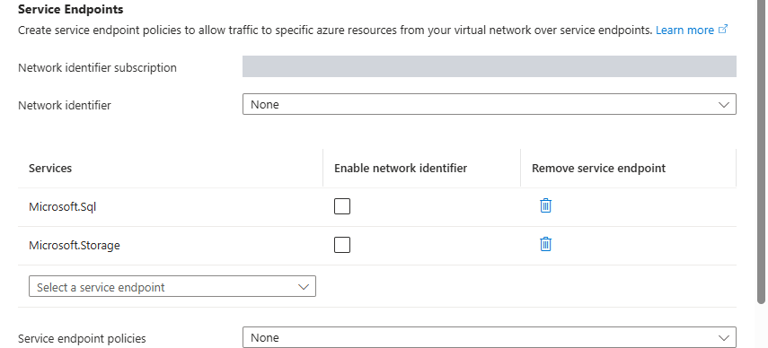

# Lab 2.2: Configure Secure Access to Virtual Networks (2.5 hours)

## 🎯 Learning Objectives

By completing this lab, you will:

- Create and configure Network Security Groups (NSGs) to control traffic flow
- Implement Application Security Groups (ASGs) for role-based network security
- Deploy Azure Bastion for secure administrative access without public IPs
- Read the default rules of an NSG and know where **Effective security rules** is read (with the VMs of Module 3)
- Configure service endpoints for Azure PaaS services
- Implement private endpoints for fully private connectivity
- Understand the difference between service and private endpoints

---

## 🏗️ Architecture Overview

You'll implement comprehensive network security on the existing hub-spoke topology:

<picture>
  <source media="(prefers-color-scheme: dark)" srcset="images/lab-2.2-architecture.dark.svg">
  <source media="(prefers-color-scheme: light)" srcset="images/lab-2.2-architecture.svg">
  
</picture>

---

## 📋 Real-World Scenario

**Situation**: The SkyCraft network infrastructure is deployed, but all resources are currently unprotected. Virtual machines will be exposed to the internet without proper security controls. The development team needs secure SSH access for administration, game servers need to accept player connections, and databases must only accept traffic from application servers, all without exposing unnecessary services.

**Your Task**: Implement defense-in-depth security by:

- Deploying Network Security Groups to control traffic at subnet level
- Using Application Security Groups to simplify management of server roles
- Deploying Azure Bastion for secure administrative access (no public IPs on VMs)
- Configuring private endpoints to keep Azure SQL traffic on Microsoft backbone
- Testing and verifying effective security rules

---

## ⏱️ Estimated Time: 2.5 hours

- **Section 1**: Understanding network security concepts (15 min)
- **Section 2**: Create and configure NSGs for dev environment (30 min)
- **Section 3**: Create Application Security Groups (20 min)
- **Section 4**: Deploy Azure Bastion (25 min)
- **Section 5**: Configure NSGs for production environment (20 min)
- **Section 6**: Configure service and private endpoints (20 min)
- **Section 7**: Test and verify security rules (20 min)

---

## ✅ Prerequisites

Before starting this lab:

- [ ] Completed Lab 2.1 (Virtual Networks and Peering)
- [ ] Three VNets exist: platform-skycraft-swc-vnet, dev-skycraft-swc-vnet, prod-skycraft-swc-vnet - `bicep/main.bicep` attaches the NSGs to their subnets and Bastion to the hub's `AzureBastionSubnet`, so all three must be in place
- [ ] VNet peering connections operational (hub-to-dev, hub-to-prod)
- [ ] Decide on Bastion before running `scripts/Deploy-Bicep.ps1`: it asks `Do you want to deploy Azure Bastion? (y/N)` and defaults to **no**, because Bastion is the one resource in the course with a standing hourly cost. Section 4 is optional for the automation path; the portal steps deploy it explicitly
- [ ] Owner or Contributor role at subscription level
- [ ] Understanding of TCP/IP ports and network security concepts

If you completed Lab 1.3, its policies are still assigned to your subscription and apply to every create in this lab: `Restrict-Azure-Regions` refuses a resource outside **Sweden Central** and **North Europe**, and `Enforce-Project-Tag` refuses a resource without `Project` = `SkyCraft`. Every create step below names the region and the four SkyCraft tags (Project, Environment, CostCenter, Owner).

Check the prerequisites with Az PowerShell (signed in with `Connect-AzAccount` to the subscription you use for the course):

```powershell
Get-AzVirtualNetwork |
    Where-Object Name -in 'platform-skycraft-swc-vnet', 'dev-skycraft-swc-vnet', 'prod-skycraft-swc-vnet' |
    Select-Object Name, ResourceGroupName, Location, @{ N = 'Subnets'; E = { $_.Subnets.Name -join ', ' } }
```

**Expected Result**: Three virtual networks in `swedencentral`. The hub's subnets include `AzureBastionSubnet`; each spoke's include `AuthSubnet`, `WorldSubnet` and `DatabaseSubnet`.

## 🛠️ Portal, PowerShell and Bicep Paths

You can build this lab in the Portal by following this guide, with the Az PowerShell blocks under each step, or with Bicep. The paths end in the same state, and `scripts/Test-Lab.ps1` accepts it whichever path built it:

| Path | What it creates |
| ---- | --------------- |
| Portal (this guide) | Everything in the steps below |
| Az PowerShell (the blocks under Steps 2.2.1-2.2.10, 2.2.12, 2.2.14 and 2.2.15; `scripts/Deploy-Security.ps1` does the same for the whole lab) | The six NSGs with their rules and subnet associations, the three dev ASGs, the service endpoints and, in Step 2.2.10, Bastion |
| `scripts/Deploy-Bicep.ps1` (`bicep/main.bicep`) | The same, except that Bastion is optional: the script asks, and the default is **no** |

The end state on every path:

- Six NSGs, each associated with its subnet, each with two custom inbound rules (priority 100 `Allow-SSH-From-Bastion` from `10.0.0.0/26`, priority 110 for the tier's port: 3724, 8085, or MySQL 3306 from the two application subnets).
- Three ASGs in `dev-skycraft-swc-rg`.
- `Microsoft.Storage` on both `WorldSubnet`s, `Microsoft.Sql` and `Microsoft.Storage` on both `DatabaseSubnet`s.
- When you deploy it: Bastion `platform-skycraft-swc-bas` (Basic) with the Standard, static public IP `platform-skycraft-swc-bas-pip`.
- The four SkyCraft tags on every resource (Environment Development, Production or Platform).

Differences that are meant: Step 2.2.9 is a Portal-only demonstration. It shows the ASG picker without saving, so the database rule keeps the two subnet prefixes used by Bicep and `Deploy-Security.ps1`. Steps 2.2.11, 2.2.13 and 2.2.16-2.2.21 only read or explain, and have no block.

---

## 📖 Section 1: Understanding Network Security Concepts (15 minutes)

### What are Network Security Groups (NSGs)?

**Network Security Groups** filter network traffic to and from Azure resources using security rules. Think of NSGs as stateful firewalls that:

- Control **inbound** and **outbound** traffic
- Apply at **subnet** or **network interface** level
- Evaluate rules by **priority** (100-4096, lower = higher priority)
- Are **stateful** (return traffic is automatically allowed)

### NSG vs Firewall vs Application Security Groups

| Feature      | NSG                     | Azure Firewall                      | ASG                       |
| ------------ | ----------------------- | ----------------------------------- | ------------------------- |
| **Purpose**  | Basic traffic filtering | Advanced network security           | Logical grouping          |
| **Scope**    | Subnet or NIC           | Entire VNet or subscription         | Tag for use in NSG rules  |
| **Cost**     | Free                    | ~$1.25/hour                         | Free                      |
| **Features** | 5-tuple rules           | FQDN filtering, threat intelligence | Simplifies NSG management |
| **Use Case** | Standard protection     | Enterprise security                 | Group VMs by role         |

### Service Endpoints vs Private Endpoints

| Aspect           | Service Endpoint                          | Private Endpoint                        |
| ---------------- | ----------------------------------------- | --------------------------------------- |
| **Traffic Path** | Microsoft backbone (still uses public IP) | Fully private (private IP in your VNet) |
| **DNS**          | Public DNS unchanged                      | Private DNS zone required               |
| **Cost**         | Free                                      | ~$7.50/month per endpoint               |
| **Security**     | Service-level filtering                   | Network-level isolation                 |
| **Use Case**     | Cost-effective for trusted services       | Maximum security for sensitive data     |

### Defense-in-Depth Strategy for SkyCraft

```
Layer 1: Azure Bastion (secure entry point)
Layer 2: NSG on subnets (broad traffic control)
Layer 3: ASG grouping (role-based rules)
Layer 4: Private Endpoints (PaaS isolation)
Layer 5: VM-level firewalls (OS-level protection)
```

---

## 📖 Section 2: Create and Configure NSGs for Dev Environment (30 minutes)

### Step 2.2.1: Create NSG for Auth Subnet

1. In the **Azure Portal**, search for **Network security groups** and pick **Network security group** from the results (it can be listed third, after the two **Flow log** results). It opens **Network foundation | Network security groups**.
2. Click **+ Create**.
3. On the **Basics** tab, fill in:

| Field          | Value                       |
| -------------- | --------------------------- |
| Subscription   | [Your subscription]         |
| Resource group | `dev-skycraft-swc-rg`       |
| Name           | `dev-skycraft-swc-auth-nsg` |
| Region         | **Sweden Central**          |

> **Note**: **Resource group** is empty when the form opens: pick `dev-skycraft-swc-rg`. Lab 1.3's policies refuse a resource outside **Sweden Central** and **North Europe**, and a resource without the tag `Project` = `SkyCraft`, so the **Region** and the tags below are not optional.

4. Click **Next : Tags >**.
5. Type the four tags into the **Name** and **Value** boxes (they are plain text boxes, not drop-down lists):

| Name        | Value       |
| ----------- | ----------- |
| Project     | SkyCraft    |
| Environment | Development |
| CostCenter  | MSDN        |
| Owner       | mbiszczanik |

6. Click **Review + create**, then **Create**.

**Expected Result**: The notification bell shows **Deployment succeeded**, and NSG `dev-skycraft-swc-auth-nsg` is listed in `dev-skycraft-swc-rg`. If the new NSG's page still says the deployment is in progress, click **Refresh**.

**With Az PowerShell** (instead of items 1-6):

```powershell
$tags = @{ Project = 'SkyCraft'; Environment = 'Development'; CostCenter = 'MSDN'; Owner = 'mbiszczanik' }
New-AzNetworkSecurityGroup -ResourceGroupName 'dev-skycraft-swc-rg' -Name 'dev-skycraft-swc-auth-nsg' `
    -Location 'swedencentral' -Tag $tags |
    Select-Object Name, Location, ProvisioningState
```

### Step 2.2.2: Configure Inbound Security Rules for Auth NSG

1. Navigate to the newly created NSG: **dev-skycraft-swc-auth-nsg**.
2. In the left menu, under **Settings** (expand it if it is collapsed), click **Inbound security rules**.
3. Note the default rules (`DenyAllInBound` is priority 65500).

**Create Rule 1: Allow SSH from Bastion**

4. Click **+ Add**.
5. Configure:

| Field                           | Value                                        |
| ------------------------------- | -------------------------------------------- |
| Source                          | IP Addresses                                 |
| Source IP addresses/CIDR ranges | `10.0.0.0/26` (Bastion subnet)               |
| Source port ranges              | `*`                                          |
| Destination                     | Any                                          |
| Service                         | SSH                                          |
| Destination port ranges         | 22                                           |
| Protocol                        | TCP                                          |
| Action                          | **Allow**                                    |
| Priority                        | `100`                                        |
| Name                            | `Allow-SSH-From-Bastion`                     |
| Description                     | `Allow SSH access from Azure Bastion subnet` |

> **Warning**: The **Add inbound security rule** pane opens with **Source** = **Any**, **Destination port ranges** = **8080**, **Protocol** = **Any** and **Action** = **Allow**. Saved as it is, that rule lets any host on any protocol reach port 8080. Change every field as the table says and check the pane before you click **Add**; never save the defaults. Choosing **SSH** as **Service** fills port 22 and TCP and greys them out.



6. Click **Add**.

**Create Rule 2: Allow Game Auth Port**

7. Click **+ Add** again.
8. Configure:

| Field                   | Value                                           |
| ----------------------- | ----------------------------------------------- |
| Source                  | Any                                             |
| Source port ranges      | `*`                                             |
| Destination             | Any                                             |
| Service                 | Custom                                          |
| Destination port ranges | `3724`                                          |
| Protocol                | TCP                                             |
| Action                  | **Allow**                                       |
| Priority                | `110`                                           |
| Name                    | `Allow-Auth-GamePort`                           |
| Description             | `Allow game authentication traffic (port 3724)` |

> **Warning**: Here the default **Destination port ranges** (8080) and **Protocol** (Any) are wrong for this rule too. Set them to `3724` and **TCP**.

9. Click **Add**.

**Expected Result**: Two custom inbound rules are listed with priorities 100 and 110, above the three default rules.



**With Az PowerShell** (instead of items 4-9):

```powershell
$nsg = Get-AzNetworkSecurityGroup -ResourceGroupName 'dev-skycraft-swc-rg' -Name 'dev-skycraft-swc-auth-nsg'
$nsg | Add-AzNetworkSecurityRuleConfig -Name 'Allow-SSH-From-Bastion' `
    -Description 'Allow SSH access from Azure Bastion subnet' -Access Allow -Protocol Tcp -Direction Inbound `
    -Priority 100 -SourceAddressPrefix '10.0.0.0/26' -SourcePortRange '*' `
    -DestinationAddressPrefix '*' -DestinationPortRange '22' | Out-Null
$nsg | Add-AzNetworkSecurityRuleConfig -Name 'Allow-Auth-GamePort' `
    -Description 'Allow game authentication traffic (port 3724)' -Access Allow -Protocol Tcp -Direction Inbound `
    -Priority 110 -SourceAddressPrefix '*' -SourcePortRange '*' `
    -DestinationAddressPrefix '*' -DestinationPortRange '3724' | Out-Null
$nsg | Set-AzNetworkSecurityGroup | Select-Object Name, ProvisioningState
```

### Step 2.2.3: Associate NSG with Auth Subnet

1. Still in **dev-skycraft-swc-auth-nsg**, under **Settings** (expand it if it is collapsed), click **Subnets**.
2. Click **+ Associate**.
3. Configure:

| Field           | Value                   |
| --------------- | ----------------------- |
| Virtual network | `dev-skycraft-swc-vnet` |
| Subnet          | `AuthSubnet`            |

> **Warning**: **Associate subnet** opens with a virtual network and the first free subnet already selected, which are not always the ones you want: check both boxes. The **Subnet** list also offers subnets that already have an NSG, and picking one replaces that NSG without a question.

4. Click **OK**.

**Expected Result**: NSG is now associated with AuthSubnet (10.1.1.0/24). All traffic to/from this subnet will be evaluated by NSG rules.



**With Az PowerShell** (instead of items 1-4):

```powershell
$nsg = Get-AzNetworkSecurityGroup -ResourceGroupName 'dev-skycraft-swc-rg' -Name 'dev-skycraft-swc-auth-nsg'
$vnet = Get-AzVirtualNetwork -ResourceGroupName 'dev-skycraft-swc-rg' -Name 'dev-skycraft-swc-vnet'
$subnet = $vnet.Subnets | Where-Object Name -eq 'AuthSubnet'
$subnet.NetworkSecurityGroup = $nsg
$vnet | Set-AzVirtualNetwork | Select-Object Name, ProvisioningState
```

### Step 2.2.4: Create NSG for World Subnet

1. Search for **Network security groups** and click **+ Create**.
2. On the **Basics** tab, fill in:

| Field          | Value                        |
| -------------- | ---------------------------- |
| Resource group | `dev-skycraft-swc-rg`        |
| Name           | `dev-skycraft-swc-world-nsg` |
| Region         | **Sweden Central**           |

3. Click **Next : Tags >** and type the four tags of Step 2.2.1 (Project SkyCraft, Environment Development, CostCenter MSDN, Owner mbiszczanik).
4. Click **Review + create**, then **Create**.

**Configure Inbound Rules**:

5. Open **dev-skycraft-swc-world-nsg**. Under **Settings** (expand it if it is collapsed), click **Inbound security rules**.

**Rule 1: Allow SSH from Bastion**

6. Click **+ Add** and configure:

| Field                           | Value                                        |
| ------------------------------- | -------------------------------------------- |
| Source                          | IP Addresses                                 |
| Source IP addresses/CIDR ranges | `10.0.0.0/26`                                |
| Source port ranges              | `*`                                          |
| Destination                     | Any                                          |
| Service                         | SSH                                          |
| Destination port ranges         | 22                                           |
| Protocol                        | TCP                                          |
| Action                          | **Allow**                                    |
| Priority                        | `100`                                        |
| Name                            | `Allow-SSH-From-Bastion`                     |
| Description                     | `Allow SSH access from Azure Bastion subnet` |

**Rule 2: Allow World Server Port**

7. Click **+ Add** again and configure:

| Field                   | Value                                        |
| ----------------------- | -------------------------------------------- |
| Source                  | Any                                          |
| Source port ranges      | `*`                                          |
| Destination             | Any                                          |
| Service                 | Custom                                       |
| Destination port ranges | `8085`                                       |
| Protocol                | TCP                                          |
| Action                  | **Allow**                                    |
| Priority                | `110`                                        |
| Name                    | `Allow-World-GamePort`                       |
| Description             | `Allow world server connections (port 8085)` |

> **Warning**: As in Step 2.2.2, the pane opens with **Source** = **Any**, **Destination port ranges** = **8080** and **Protocol** = **Any**. Change every field as the tables say before you click **Add**.

**Associate with Subnet**:

8. Under **Settings** (expand it if it is collapsed), click **Subnets**, then **+ Associate**.
9. Select **Virtual network** `dev-skycraft-swc-vnet` and **Subnet** `WorldSubnet` (check both: the dialog opens with other values, and its subnet list also offers subnets that already have an NSG, as in Step 2.2.3).
10. Click **OK**.

**Expected Result**: World subnet protected with NSG allowing SSH (from Bastion) and game port 8085.

**With Az PowerShell** (instead of items 1-10):

```powershell
$tags = @{ Project = 'SkyCraft'; Environment = 'Development'; CostCenter = 'MSDN'; Owner = 'mbiszczanik' }
$nsg = New-AzNetworkSecurityGroup -ResourceGroupName 'dev-skycraft-swc-rg' -Name 'dev-skycraft-swc-world-nsg' `
    -Location 'swedencentral' -Tag $tags
$nsg | Add-AzNetworkSecurityRuleConfig -Name 'Allow-SSH-From-Bastion' `
    -Description 'Allow SSH access from Azure Bastion subnet' -Access Allow -Protocol Tcp -Direction Inbound `
    -Priority 100 -SourceAddressPrefix '10.0.0.0/26' -SourcePortRange '*' `
    -DestinationAddressPrefix '*' -DestinationPortRange '22' | Out-Null
$nsg | Add-AzNetworkSecurityRuleConfig -Name 'Allow-World-GamePort' `
    -Description 'Allow world server connections (port 8085)' -Access Allow -Protocol Tcp -Direction Inbound `
    -Priority 110 -SourceAddressPrefix '*' -SourcePortRange '*' `
    -DestinationAddressPrefix '*' -DestinationPortRange '8085' | Out-Null
$nsg = $nsg | Set-AzNetworkSecurityGroup

$vnet = Get-AzVirtualNetwork -ResourceGroupName 'dev-skycraft-swc-rg' -Name 'dev-skycraft-swc-vnet'
$subnet = $vnet.Subnets | Where-Object Name -eq 'WorldSubnet'
$subnet.NetworkSecurityGroup = $nsg
$vnet | Set-AzVirtualNetwork | Select-Object Name, ProvisioningState
```

### Step 2.2.5: Create NSG for Database Subnet

1. Search for **Network security groups**, click **+ Create**, and create `dev-skycraft-swc-db-nsg` in `dev-skycraft-swc-rg` with **Region** **Sweden Central**.
2. On the **Tags** tab, type the four tags of Step 2.2.1 (Environment Development), then click **Review + create** and **Create**.

**Configure Inbound Rules**:

3. Open **dev-skycraft-swc-db-nsg**. Under **Settings** (expand it if it is collapsed), click **Inbound security rules**.

**Rule 1: Allow SSH from Bastion**

4. Click **+ Add** and add the rule of Step 2.2.4, Rule 1 (priority `100`, name `Allow-SSH-From-Bastion`, source `10.0.0.0/26`, service SSH, port 22, TCP, **Allow**).

**Rule 2: Allow MySQL from Application Subnets**

5. Click **+ Add** and configure:

| Field                           | Value                                     |
| ------------------------------- | ----------------------------------------- |
| Source                          | IP Addresses                              |
| Source IP addresses/CIDR ranges | `10.1.1.0/24,10.1.2.0/24`                 |
| Source port ranges              | `*`                                       |
| Destination                     | Any                                       |
| Service                         | Custom                                    |
| Destination port ranges         | `3306`                                    |
| Protocol                        | TCP                                       |
| Action                          | **Allow**                                 |
| Priority                        | `110`                                     |
| Name                            | `Allow-MySQL-From-AppTier`                |
| Description                     | `Allow MySQL from Auth and World servers` |

The source is the Auth and World subnets; the box accepts two CIDR ranges separated by a comma. Reopening the rule later shows **Service** **MySQL**.

> **Warning**: Change the pane's defaults here too (**Destination port ranges** 8080, **Protocol** Any), as in Step 2.2.2. A rule that allows every protocol from the application subnets would also open SSH from them.

**Associate with Subnet**:

6. Under **Settings** (expand it if it is collapsed), click **Subnets**, then **+ Associate**.
7. Select **Virtual network** `dev-skycraft-swc-vnet` and **Subnet** `DatabaseSubnet` (check both, as in Step 2.2.4), then click **OK**.

**Expected Result**: Database subnet only accepts MySQL traffic from application tiers and SSH from Bastion.

**With Az PowerShell** (instead of items 1-7):

```powershell
$tags = @{ Project = 'SkyCraft'; Environment = 'Development'; CostCenter = 'MSDN'; Owner = 'mbiszczanik' }
$nsg = New-AzNetworkSecurityGroup -ResourceGroupName 'dev-skycraft-swc-rg' -Name 'dev-skycraft-swc-db-nsg' `
    -Location 'swedencentral' -Tag $tags
$nsg | Add-AzNetworkSecurityRuleConfig -Name 'Allow-SSH-From-Bastion' `
    -Description 'Allow SSH access from Azure Bastion subnet' -Access Allow -Protocol Tcp -Direction Inbound `
    -Priority 100 -SourceAddressPrefix '10.0.0.0/26' -SourcePortRange '*' `
    -DestinationAddressPrefix '*' -DestinationPortRange '22' | Out-Null
$nsg | Add-AzNetworkSecurityRuleConfig -Name 'Allow-MySQL-From-AppTier' `
    -Description 'Allow MySQL from Auth and World servers' -Access Allow -Protocol Tcp -Direction Inbound `
    -Priority 110 -SourceAddressPrefix '10.1.1.0/24', '10.1.2.0/24' -SourcePortRange '*' `
    -DestinationAddressPrefix '*' -DestinationPortRange '3306' | Out-Null
$nsg = $nsg | Set-AzNetworkSecurityGroup

$vnet = Get-AzVirtualNetwork -ResourceGroupName 'dev-skycraft-swc-rg' -Name 'dev-skycraft-swc-vnet'
$subnet = $vnet.Subnets | Where-Object Name -eq 'DatabaseSubnet'
$subnet.NetworkSecurityGroup = $nsg
$vnet | Set-AzVirtualNetwork | Select-Object Name, ProvisioningState
```

---

## 📖 Section 3: Create Application Security Groups (20 minutes)

### What are Application Security Groups?

**Application Security Groups (ASGs)** let you group virtual machines by role, then reference those groups in NSG rules. This simplifies security management:

**Without ASG**:

```
Allow SSH from 10.1.1.4, 10.1.1.5, 10.1.1.6 (must update rule when adding VMs)
```

**With ASG**:

```
Allow SSH from ASG "AuthServers" (VMs automatically get rule when added to ASG)
```

### Step 2.2.6: Create ASG for Auth Servers

1. In the Azure Portal, search for **Application security groups** and pick **Application security group** from the results.
2. Click **+ Create**.
3. On the **Basics** tab, fill in:

| Field          | Value                       |
| -------------- | --------------------------- |
| Subscription   | [Your subscription]         |
| Resource group | `dev-skycraft-swc-rg`       |
| Name           | `dev-skycraft-swc-asg-auth` |
| Region         | **Sweden Central**          |

> **Note**: As on the NSG form, **Resource group** is empty when the form opens.

4. Click **Next : Tags >**.
5. Type the four tags (Project SkyCraft, Environment Development, CostCenter MSDN, Owner mbiszczanik) into the plain text boxes.
6. Click **Review + create**, then **Create**.

**Expected Result**: ASG `dev-skycraft-swc-asg-auth` created. The review page does not list the tags you typed, but the ASG carries them.

**With Az PowerShell** (instead of items 1-6):

```powershell
$tags = @{ Project = 'SkyCraft'; Environment = 'Development'; CostCenter = 'MSDN'; Owner = 'mbiszczanik' }
New-AzApplicationSecurityGroup -ResourceGroupName 'dev-skycraft-swc-rg' -Name 'dev-skycraft-swc-asg-auth' `
    -Location 'swedencentral' -Tag $tags | Select-Object Name, Location, ProvisioningState
```

### Step 2.2.7: Create ASG for World Servers

1. Repeat Step 2.2.6 with these values:

   - Name: `dev-skycraft-swc-asg-world`
   - Resource group: `dev-skycraft-swc-rg`
   - Region: **Sweden Central**
   - The four tags (Environment Development)

2. Click **Review + create**, then **Create**.

**With Az PowerShell** (instead of items 1-2):

```powershell
$tags = @{ Project = 'SkyCraft'; Environment = 'Development'; CostCenter = 'MSDN'; Owner = 'mbiszczanik' }
New-AzApplicationSecurityGroup -ResourceGroupName 'dev-skycraft-swc-rg' -Name 'dev-skycraft-swc-asg-world' `
    -Location 'swedencentral' -Tag $tags | Select-Object Name, Location, ProvisioningState
```

### Step 2.2.8: Create ASG for Database Servers

1. Create the third ASG with these values:

   - Name: `dev-skycraft-swc-asg-db`
   - Resource group: `dev-skycraft-swc-rg`
   - Region: **Sweden Central**
   - The four tags (Environment Development)

2. Click **Review + create**, then **Create**.

**Expected Result**: Three ASGs created for role-based grouping (auth, world, database).

**With Az PowerShell** (instead of items 1-2):

```powershell
$tags = @{ Project = 'SkyCraft'; Environment = 'Development'; CostCenter = 'MSDN'; Owner = 'mbiszczanik' }
New-AzApplicationSecurityGroup -ResourceGroupName 'dev-skycraft-swc-rg' -Name 'dev-skycraft-swc-asg-db' `
    -Location 'swedencentral' -Tag $tags | Select-Object Name, Location, ProvisioningState
```

### Step 2.2.9: Update NSG Rule to Use ASG (Optional Demonstration)

To demonstrate the ASG picker without changing the final rule, open the database NSG rule:

1. Navigate to **dev-skycraft-swc-db-nsg**. Under **Settings** (expand it if it is collapsed), click **Inbound security rules**.
2. Click on the rule **Allow-MySQL-From-AppTier**.
3. Change **Source** to **Application security group**.
4. In **Source application security groups**, pick `dev-skycraft-swc-asg-auth`. The picker is grouped by resource group, and each pick adds a row and a new empty picker. Pick `dev-skycraft-swc-asg-world` in the new one.
5. Click **Cancel**. The rule keeps the two application-subnet prefixes. Lab 3.2 uses ASGs for real when VM network interfaces exist.



**Expected Result**: The picker showed the two dev ASGs. After **Cancel**, the saved rule still uses `10.1.1.0/24` and `10.1.2.0/24` as its source.

This step makes no change, so it has no PowerShell block. ASGs group VM network interfaces; Lab 3.2 provides the hands-on practice (#353).

---

## 📖 Section 4: Deploy Azure Bastion (25 minutes)

### What is Azure Bastion?

**Azure Bastion** provides secure RDP and SSH connectivity to virtual machines directly through the Azure Portal, without:

- Exposing VMs with public IP addresses
- Managing jump box VMs
- Opening RDP/SSH ports to the internet
- Requiring VPN connections

### Step 2.2.10: Deploy Azure Bastion

> **Warning**: Azure Bastion is the one resource of this course that bills by the hour for as long as it exists, used or not. Basic costs about 0.1672 EUR per hour (about 122 EUR per month), and its public IP address about 3.21 EUR per month (Azure retail prices of 2026-10-22, Sweden Central). The create form defaults to the **Premium** SKU, which costs more. Pick **Basic**, and delete the Bastion and its public IP when you finish (What This Lab Leaves Behind).

1. In the Azure Portal, search for **Bastions**.
2. Click **+ Create**.
3. On the **Basics** tab, fill in:

| Field                  | Value                                                                  |
| ---------------------- | ---------------------------------------------------------------------- |
| Subscription           | [Your subscription]                                                    |
| Resource group         | `platform-skycraft-swc-rg`                                             |
| Name                   | `platform-skycraft-swc-bas`                                            |
| Region                 | **Sweden Central**                                                     |
| SKU                    | **Basic**                                                              |
| Availability zone      | **None** (the form sets it when you pick **Basic**)                    |
| Instance count         | 2 (greyed out for **Basic**)                                           |
| Virtual network        | `platform-skycraft-swc-vnet`                                           |
| Subnet                 | `AzureBastionSubnet (10.0.0.0/26)` (fills in after you pick the VNet)  |
| Public IP address      | Create new                                                             |
| Public IP address name | `platform-skycraft-swc-bas-pip`                                        |

> **Warning**: **SKU** defaults to **Premium**, and **Availability zone** to **Zones 1, 2, 3**. Pick **Basic** first: it switches **Availability zone** to **None** and greys out **Instance count**.

> **Warning**: **Resource group** opens with the group you used last (probably `dev-skycraft-swc-rg`), and **Virtual network** opens with a new network, `(new) vnet-swedencentral-1`. Change both. Leaving the pre-filled network creates a second, empty VNet next to the hub; after you pick `platform-skycraft-swc-vnet`, the **Subnet** field fills in `AzureBastionSubnet`.

4. Next to **Public IP address**, click **Create new**. In the pane, set the name `platform-skycraft-swc-bas-pip` and keep **SKU** **Standard**, **Assignment** **Static** and **Tier** **Regional**. Set **Availability zone** to **Zone-redundant**, then click **OK**.

> **Warning**: The pane's **Availability zone** defaults to **No Zone**. Validation passes, but the deployment fails with "The zone(s) 'None' for resource 'Microsoft.Network/publicIPAddresses/platform-skycraft-swc-bas-pip' is not supported. The supported zones for location 'swedencentral' are '1,2,3'". Pick **Zone-redundant**. If you already hit the error, nothing was created: start the form again. The `bicep/main.bicep` path creates the same zone-redundant address.

> **Note**: The form may show a red message such as "1 public IP address is needed for this configuration, but 0 (of 3) remain in your subscription". It does not stop **Create**; only if the deployment itself fails with a quota error, see Troubleshooting, Issue 1.



5. Click **Next : Tags >** and type the four tags (the Portal also gives them to the new public IP address):

| Name        | Value       |
| ----------- | ----------- |
| Project     | SkyCraft    |
| Environment | Platform    |
| CostCenter  | MSDN        |
| Owner       | mbiszczanik |

6. Click **Review + create** and review the configuration. The tabs are **Basics**, **Tags** and **Review + create**; there is no **Advanced** tab.
7. Click **Create**.

**Expected Result**:

- Deployment takes about 10 minutes, and you can leave the page: the deployment continues in Azure.
- When the notification bell shows **Deployment succeeded**, Azure Bastion is deployed to AzureBastionSubnet in the hub VNet. If the deployment page still says the deployment is in progress, click **Refresh**.

If the deployment fails, see Troubleshooting, Issue 1.

**With Az PowerShell** (instead of items 1-7):

```powershell
$tags = @{ Project = 'SkyCraft'; Environment = 'Platform'; CostCenter = 'MSDN'; Owner = 'mbiszczanik' }
# Zone-redundant, as in the Portal steps and in bicep/main.bicep.
$pip = New-AzPublicIpAddress -ResourceGroupName 'platform-skycraft-swc-rg' -Name 'platform-skycraft-swc-bas-pip' `
    -Location 'swedencentral' -Sku Standard -AllocationMethod Static -Zone '1', '2', '3' -Tag $tags
$vnet = Get-AzVirtualNetwork -ResourceGroupName 'platform-skycraft-swc-rg' -Name 'platform-skycraft-swc-vnet'
# Takes about 10 minutes.
New-AzBastion -ResourceGroupName 'platform-skycraft-swc-rg' -Name 'platform-skycraft-swc-bas' `
    -PublicIpAddress $pip -VirtualNetwork $vnet -Sku Basic -Tag $tags |
    Select-Object Name, ProvisioningState
```

### Step 2.2.11: Verify Bastion Deployment

1. Once deployment completes, navigate to **Bastions**.
2. Click **platform-skycraft-swc-bas**.
3. Verify:
   - Provisioning state: **Succeeded**
   - Virtual network/subnet: `platform-skycraft-swc-vnet/AzureBastionSubnet`
   - Public IPv4 address: `platform-skycraft-swc-bas-pip`
   - Tier: **Basic**

**Expected Result**: Bastion is operational and ready to provide secure connectivity to VMs in all peered VNets.

---

## 📖 Section 5: Configure NSGs for Production Environment (20 minutes)

### Step 2.2.12: Create Production NSGs

Create three NSGs for production environment (following same pattern as dev, Steps 2.2.1 to 2.2.5):

| NSG name                      | Subnet           | Rule 1 (priority 100)                                | Rule 2 (priority 110)                                    |
| ----------------------------- | ---------------- | ---------------------------------------------------- | -------------------------------------------------------- |
| `prod-skycraft-swc-auth-nsg`  | `AuthSubnet`     | `Allow-SSH-From-Bastion`: SSH (22) from `10.0.0.0/26` | `Allow-Auth-GamePort`: TCP 3724 from Any                 |
| `prod-skycraft-swc-world-nsg` | `WorldSubnet`    | `Allow-SSH-From-Bastion`: SSH (22) from `10.0.0.0/26` | `Allow-World-GamePort`: TCP 8085 from Any                |
| `prod-skycraft-swc-db-nsg`    | `DatabaseSubnet` | `Allow-SSH-From-Bastion`: SSH (22) from `10.0.0.0/26` | `Allow-MySQL-From-AppTier`: TCP 3306 from `10.2.1.0/24,10.2.2.0/24` |

For each of the three rows:

1. Search for **Network security groups**, click **+ Create**, and fill in **Resource group** `prod-skycraft-swc-rg`, **Name** from the table and **Region** **Sweden Central**.
2. On the **Tags** tab, type the four tags: Project SkyCraft, Environment Production, CostCenter MSDN, Owner mbiszczanik. Click **Review + create**, then **Create**.
3. Open the NSG. Under **Settings** (expand it if it is collapsed), click **Inbound security rules**, and add the two rules of the table with **+ Add**. Use the field values of Step 2.2.2 (Rule 1 and Rule 2), with the descriptions of Steps 2.2.2, 2.2.4 and 2.2.5.

> **Warning**: Every new rule pane opens with **Destination port ranges** 8080, **Protocol** Any and **Source** Any. Change every field, as in Step 2.2.2.

4. Under **Settings** (expand it if it is collapsed), click **Subnets**, then **+ Associate**. Set **Virtual network** to `prod-skycraft-swc-vnet` and **Subnet** to the subnet of the table, then click **OK**.

> **Warning**: **Associate subnet** opens with `dev-skycraft-swc-vnet` selected, because the list is alphabetical. Switch **Virtual network** to `prod-skycraft-swc-vnet` before you pick the subnet, even if you have not built the dev environment: the subnet list also offers subnets that already have an NSG, and picking one replaces that NSG without a question.

**Expected Result**: Production environment has identical security posture to development, with NSGs protecting all subnets.

**With Az PowerShell** (instead of items 1-4, for all three NSGs):

```powershell
$tags = @{ Project = 'SkyCraft'; Environment = 'Production'; CostCenter = 'MSDN'; Owner = 'mbiszczanik' }
$vnet = Get-AzVirtualNetwork -ResourceGroupName 'prod-skycraft-swc-rg' -Name 'prod-skycraft-swc-vnet'
$plan = @(
    @{ Name = 'prod-skycraft-swc-auth-nsg'; Subnet = 'AuthSubnet'; Rule = 'Allow-Auth-GamePort'
       Description = 'Allow game authentication traffic (port 3724)'; Port = '3724'; Source = @('*') }
    @{ Name = 'prod-skycraft-swc-world-nsg'; Subnet = 'WorldSubnet'; Rule = 'Allow-World-GamePort'
       Description = 'Allow world server connections (port 8085)'; Port = '8085'; Source = @('*') }
    @{ Name = 'prod-skycraft-swc-db-nsg'; Subnet = 'DatabaseSubnet'; Rule = 'Allow-MySQL-From-AppTier'
       Description = 'Allow MySQL from Auth and World servers'; Port = '3306'; Source = @('10.2.1.0/24', '10.2.2.0/24') }
)
foreach ($item in $plan) {
    $nsg = New-AzNetworkSecurityGroup -ResourceGroupName 'prod-skycraft-swc-rg' -Name $item.Name `
        -Location 'swedencentral' -Tag $tags
    $nsg | Add-AzNetworkSecurityRuleConfig -Name 'Allow-SSH-From-Bastion' `
        -Description 'Allow SSH access from Azure Bastion subnet' -Access Allow -Protocol Tcp -Direction Inbound `
        -Priority 100 -SourceAddressPrefix '10.0.0.0/26' -SourcePortRange '*' `
        -DestinationAddressPrefix '*' -DestinationPortRange '22' | Out-Null
    $nsg | Add-AzNetworkSecurityRuleConfig -Name $item.Rule -Description $item.Description `
        -Access Allow -Protocol Tcp -Direction Inbound -Priority 110 -SourceAddressPrefix $item.Source `
        -SourcePortRange '*' -DestinationAddressPrefix '*' -DestinationPortRange $item.Port | Out-Null
    $nsg = $nsg | Set-AzNetworkSecurityGroup
    ($vnet.Subnets | Where-Object Name -eq $item.Subnet).NetworkSecurityGroup = $nsg
}
$vnet | Set-AzVirtualNetwork | Select-Object Name, ProvisioningState
```

### Step 2.2.13: Review Effective Security Rules

1. Navigate to any NSG (e.g., `prod-skycraft-swc-db-nsg`).
2. Under **Settings** (expand it if it is collapsed), click **Inbound security rules**.
3. Below your two custom rules, read the three default rules: `AllowVnetInBound` (priority 65000), `AllowAzureLoadBalancerInBound` (65001) and `DenyAllInBound` (65500).
4. Under **Settings**, click **Outbound security rules** and read its three default rules: `AllowVnetOutBound` (65000), `AllowInternetOutBound` (65001) and `DenyAllOutBound` (65500).
5. Review rule evaluation order:
   - Custom rules (priority 100-4096)
   - Default allow rules (65000-65001)
   - Default deny rules (65500)

> **Note**: **Effective security rules** (under **Help** in the NSG's left menu, expand it if it is collapsed) shows nothing yet. It asks for a virtual machine or a network interface, and none exists until Module 3. You use it there, once a VM sits behind these NSGs.

**Expected Result**: Understanding how Azure evaluates rules from lowest to highest priority, stopping at first match, and where the default rules (65000, 65001, 65500) sit behind your custom ones.

---

## 📖 Section 6: Configure Service and Private Endpoints (20 minutes)

### Step 2.2.14: Enable Service Endpoints on the Dev Subnets

**Service endpoints** route traffic to Azure PaaS services (Storage, SQL, Key Vault) over the Azure backbone, avoiding the public internet.

1. Navigate to **Virtual networks** → **dev-skycraft-swc-vnet**.
2. Under **Settings** (expand it if it is collapsed), click **Subnets**.
3. Click on **DatabaseSubnet**. The **Edit subnet** pane opens.
4. In the **Service endpoints** section, leave **Network identifier subscription** and **Network identifier** as they are. Under **Services**, click **Select a service endpoint** and pick **Microsoft.Sql** (for Azure SQL Database). The picker takes one service per pick, and a new empty picker appears below it.
5. Click the new **Select a service endpoint** and pick **Microsoft.Storage** (for Azure Storage).
6. Click **Save** at the bottom of the pane.
7. Back in the **Subnets** list, click on **WorldSubnet**.
8. In **Service endpoints**, click **Select a service endpoint** and pick **Microsoft.Storage**.
9. Click **Save**.

> **Note**: Leave the other fields of **Edit subnet** and the **Service endpoint policies** row (**None**) as they are. The pane's **Enable network identifier** box and the delete icon on each service row are not part of this lab.



> [!IMPORTANT]
> **`WorldSubnet` needs `Microsoft.Storage` too, and it is not optional.**
> Lab 4.4 locks the storage account down to a virtual network rule for `WorldSubnet`, and
> Azure rejects that rule for a subnet without the endpoint. Skip this and Lab 4.4 fails
> with an error that points at storage rather than at this step.

**Expected Result**:

- `Microsoft.Sql` and `Microsoft.Storage` on DatabaseSubnet, `Microsoft.Storage` on WorldSubnet
- Traffic to Azure SQL and Storage now uses Microsoft backbone
- Still uses public IP addresses but never traverses public internet

**With Az PowerShell** (instead of items 1-9):

```powershell
$vnet = Get-AzVirtualNetwork -ResourceGroupName 'dev-skycraft-swc-rg' -Name 'dev-skycraft-swc-vnet'
$endpoints = @{ DatabaseSubnet = 'Microsoft.Sql', 'Microsoft.Storage'; WorldSubnet = 'Microsoft.Storage' }
foreach ($name in $endpoints.Keys) {
    $subnet = $vnet.Subnets | Where-Object Name -eq $name
    $subnet.ServiceEndpoints = @($endpoints[$name] | ForEach-Object { @{ Service = $_ } })
}
$vnet | Set-AzVirtualNetwork | Select-Object Name, ProvisioningState
```

### Step 2.2.15: Enable Service Endpoints on the Production Subnets

1. Navigate to **prod-skycraft-swc-vnet**. Under **Settings** (expand it if it is collapsed), click **Subnets**, then click **DatabaseSubnet**.
2. In **Service endpoints**, add the services one at a time with **Select a service endpoint**:
   - **Microsoft.Sql**
   - **Microsoft.Storage**
3. Click **Save**.
4. Back in the **Subnets** list, click **WorldSubnet** and add **Microsoft.Storage**.
5. Click **Save**.

> **Note**: On a subnet whose **Network identifier subscription** box is empty, **Save** stays greyed out until you have picked a service. Pick the service first.

**Expected Result**: Both dev and prod can securely access Azure PaaS services, and both `WorldSubnet`s are ready for the Lab 4.4 storage firewall.

**With Az PowerShell** (instead of items 1-5):

```powershell
$vnet = Get-AzVirtualNetwork -ResourceGroupName 'prod-skycraft-swc-rg' -Name 'prod-skycraft-swc-vnet'
$endpoints = @{ DatabaseSubnet = 'Microsoft.Sql', 'Microsoft.Storage'; WorldSubnet = 'Microsoft.Storage' }
foreach ($name in $endpoints.Keys) {
    $subnet = $vnet.Subnets | Where-Object Name -eq $name
    $subnet.ServiceEndpoints = @($endpoints[$name] | ForEach-Object { @{ Service = $_ } })
}
$vnet | Set-AzVirtualNetwork | Select-Object Name, ProvisioningState
```

### Step 2.2.16: Understand Private Endpoint Concepts

**Private Endpoints** go further than service endpoints by:

- Assigning a **private IP** from your VNet to the Azure service
- Making the service **fully private** (no public IP involved)
- Requiring **Private DNS zones** for name resolution

**When to use Private Endpoints**:

- Maximum security for sensitive data (compliance requirements)
- Need to access PaaS services over VPN/ExpressRoute from on-premises
- Want to completely disable public access to Azure services

**Cost consideration**: ~$7.50/month per private endpoint

### Step 2.2.17: Create Private Endpoint (Conceptual)

**Note**: We will use a **Storage Account** for this conceptual step, as it is a lighter resource if you choose to provision it for testing.

To create a private endpoint for an Azure Storage Account:

1. Navigate to **Private Link** in Azure Portal
2. Click **Private endpoints** → **+ Create**
3. Configure:

| Field               | Value                     |
| ------------------- | ------------------------- |
| Resource group      | `prod-skycraft-swc-rg`    |
| Name                | `prod-skycraft-swc-st-pe` |
| Region              | **Sweden Central**        |
| Target sub-resource | `blob`                    |
| Virtual network     | `prod-skycraft-swc-vnet`  |
| Subnet              | `DatabaseSubnet`          |

4. Private DNS integration:

   - Create new private DNS zone: `privatelink.blob.core.windows.net`
   - Link to VNet: `prod-skycraft-swc-vnet`

5. Tags and create

**Expected Result** (if Storage Account exists):

- Private endpoint gets IP like 10.2.3.10
- DNS resolves `yourstorage.blob.core.windows.net` to 10.2.3.10
- No public internet access needed (if public access disabled)

**For this lab**: Understand the concept; we'll implement this pattern in later modules for various PaaS services.

---

## 📖 Section 7: Test and Verify Security Rules (20 minutes)

### Step 2.2.18: Verify NSG Associations

1. Navigate to **Network security groups**
2. For each NSG, verify:
   - **Subnets** (under **Settings**, expand it if it is collapsed) shows the correct subnet association
   - **Inbound security rules** shows custom rules (priority 100, 110, etc.)
   - **Outbound security rules** shows default rules

**Verification Table**:

| NSG Name                    | Associated Subnet                     | Inbound Rules Count  |
| --------------------------- | ------------------------------------- | -------------------- |
| dev-skycraft-swc-auth-nsg   | dev-skycraft-swc-vnet/AuthSubnet      | 2 custom + 3 default |
| dev-skycraft-swc-world-nsg  | dev-skycraft-swc-vnet/WorldSubnet     | 2 custom + 3 default |
| dev-skycraft-swc-db-nsg     | dev-skycraft-swc-vnet/DatabaseSubnet  | 2 custom + 3 default |
| prod-skycraft-swc-auth-nsg  | prod-skycraft-swc-vnet/AuthSubnet     | 2 custom + 3 default |
| prod-skycraft-swc-world-nsg | prod-skycraft-swc-vnet/WorldSubnet    | 2 custom + 3 default |
| prod-skycraft-swc-db-nsg    | prod-skycraft-swc-vnet/DatabaseSubnet | 2 custom + 3 default |

### Step 2.2.19: Test NSG Rule Logic (Conceptual)

**Scenario 1**: SSH from Bastion to Auth Server

```
Source: 10.0.0.5 (Bastion)
Destination: 10.1.1.10 (Auth Server)
Port: 22 (SSH)

Evaluation:
✅ Rule 100 (Allow-SSH-From-Bastion): MATCH - ALLOW
   (Does not check remaining rules)
```

**Scenario 2**: SSH from Internet to Auth Server

```
Source: 203.0.113.50 (Internet)
Destination: 10.1.1.10 (Auth Server)
Port: 22 (SSH)

Evaluation:
❌ Rule 100: No match (source not 10.0.0.0/26)
❌ Rule 110: No match (port 3724, not 22)
❌ Default allow rules: No match
❌ Rule 65500 (DenyAllInbound): MATCH - DENY
```

**Scenario 3**: Game client connecting to World Server

```
Source: 203.0.113.75 (Player)
Destination: 10.1.2.15 (World Server)
Port: 8085

Evaluation:
❌ Rule 100: No match (port 22, not 8085)
✅ Rule 110 (Allow-World-GamePort): MATCH - ALLOW
```

### Step 2.2.20: Verify Azure Bastion Connectivity

1. Navigate to **Bastions** → **platform-skycraft-swc-bas**
2. On the **Overview** page, verify that **Provisioning state** is **Succeeded**
3. Note the architecture:
   - Bastion in hub VNet (10.0.0.0/26)
   - Can connect to VMs in dev VNet (via hub-to-dev peering)
   - Can connect to VMs in prod VNet (via hub-to-prod peering)

**Expected Result**: Bastion is ready to connect to any VM deployed in dev or prod VNets (will test with actual VMs in Module 3).

### Step 2.2.21: Verify Service Endpoints

> **Note**: Clicking a subnet opens its **Edit subnet** pane, and its **Service endpoints** section lists the services. Close the pane with **Cancel** after you have read it; there is nothing to save.

1. Navigate to **dev-skycraft-swc-vnet** → **Subnets** → **DatabaseSubnet**
2. Confirm **Service endpoints** shows:

   - Microsoft.Sql
   - Microsoft.Storage

3. Navigate to **Subnets** → **WorldSubnet**
4. Confirm **Service endpoints** shows:

   - Microsoft.Storage

5. Navigate to **prod-skycraft-swc-vnet** → **Subnets** → **DatabaseSubnet**
6. Confirm **Service endpoints** shows:

   - Microsoft.Sql
   - Microsoft.Storage

7. Navigate to **Subnets** → **WorldSubnet**
8. Confirm **Service endpoints** shows:

   - Microsoft.Storage

**Expected Result**: Database subnets can access Azure SQL and Storage over Microsoft backbone (private routing), and both `WorldSubnet`s carry `Microsoft.Storage` for Lab 4.4.

---

## ✅ Lab Checklist

Quick verification before proceeding:

### Azure Bastion

Optional: it costs about 4 EUR per day while it exists.

- [ ] `platform-skycraft-swc-bas` deployed successfully
- [ ] Associated with `AzureBastionSubnet` in hub VNet
- [ ] Public IP: `platform-skycraft-swc-bas-pip` attached
- [ ] Provisioning state: Succeeded, Tier: Basic

### Network Security Groups (Dev)

- [ ] `dev-skycraft-swc-auth-nsg` created and associated with AuthSubnet
- [ ] `dev-skycraft-swc-world-nsg` created and associated with WorldSubnet
- [ ] `dev-skycraft-swc-db-nsg` created and associated with DatabaseSubnet
- [ ] All NSGs have custom inbound rules (SSH from Bastion + service port)

### Network Security Groups (Prod)

- [ ] `prod-skycraft-swc-auth-nsg` created and associated with AuthSubnet
- [ ] `prod-skycraft-swc-world-nsg` created and associated with WorldSubnet
- [ ] `prod-skycraft-swc-db-nsg` created and associated with DatabaseSubnet
- [ ] All NSGs have proper tags (Project, Environment, CostCenter, Owner)

### Application Security Groups

- [ ] `dev-skycraft-swc-asg-auth` created
- [ ] `dev-skycraft-swc-asg-world` created
- [ ] `dev-skycraft-swc-asg-db` created

### Service Endpoints

- [ ] Service endpoints enabled on dev DatabaseSubnet (Microsoft.Sql, Microsoft.Storage)
- [ ] Service endpoint enabled on dev WorldSubnet (Microsoft.Storage) - required by Lab 4.4
- [ ] Service endpoints enabled on prod DatabaseSubnet (Microsoft.Sql, Microsoft.Storage)
- [ ] Service endpoint enabled on prod WorldSubnet (Microsoft.Storage) - required by Lab 4.4

**For detailed verification**, see [lab-checklist-2.2.md](lab-checklist-2.2.md)

---

## 🎓 Knowledge Check

Test your understanding with these questions:

1. **What is the difference between Network Security Groups (NSGs) and Azure Firewall?**

   <details>
     <summary>**Click to see the answer**</summary>

   **Answer**:

   **Network Security Groups (NSGs)**:

   - Basic stateful firewall functionality
   - Free (no additional cost)
   - Filters traffic based on 5-tuple (source IP, source port, destination IP, destination port, protocol)
   - Applied at subnet or NIC level
   - Good for: Standard micro-segmentation

   **Azure Firewall**:

   - Advanced network security service
   - ~$1.25/hour + data processing costs
   - FQDN filtering, threat intelligence, central logging
   - Applied at VNet or subscription level
   - Good for: Enterprise security, central policy management, logging

   **For SkyCraft**: NSGs are sufficient for game server protection. Azure Firewall would be overkill unless managing dozens of VNets or need advanced threat detection.
   </details>

2. **Why must Azure Bastion subnet be named exactly "AzureBastionSubnet"?**

   <details>
     <summary>**Click to see the answer**</summary>

   **Answer**: Azure Bastion is a **platform service** that searches for a subnet with this exact, hardcoded name. This is similar to `GatewaySubnet` for VPN Gateway.

   **Requirements**:

   - Name: `AzureBastionSubnet` (case-sensitive)
   - Minimum size: /26 (64 IP addresses)
   - No NSG should be associated (Bastion manages its own security)
   - Must exist before deploying Bastion

   If you use `Bastion-Subnet`, `azurebastionsubnet`, or any variation, deployment will fail with error: "Subnet AzureBastionSubnet not found".
   </details>

3. **How do Application Security Groups (ASGs) simplify security management?**

   <details>
     <summary>**Click to see the answer**</summary>

   **Answer**: ASGs provide **logical grouping** of VMs by role, eliminating the need to manage IP addresses in NSG rules.

   **Without ASG** (IP-based):

   ```
   Allow MySQL from 10.1.1.4, 10.1.1.5, 10.1.1.6, 10.1.2.10, 10.1.2.11
   ```

   Problem: Must update rule every time you add/remove application servers.

   **With ASG** (role-based):

   ```
   Allow MySQL from ASG "ApplicationServers"
   ```

   Benefit: VMs automatically inherit rules when assigned to ASG. No rule updates needed.

   **Real-world impact**: In SkyCraft, when you scale from 3 to 10 world servers, with ASGs you just assign new VMs to the ASG. Without ASGs, you'd need to update multiple NSG rules.
   </details>

4. **What is the difference between service endpoints and private endpoints?**

   <details>
     <summary>**Click to see the answer**</summary>

   **Answer**:

   | Aspect                  | Service Endpoint                  | Private Endpoint                     |
   | ----------------------- | --------------------------------- | ------------------------------------ |
   | **IP addressing**       | Service keeps public IP           | Service gets private IP in your VNet |
   | **Traffic path**        | Microsoft backbone (not internet) | Fully private (your VNet)            |
   | **DNS**                 | Public DNS unchanged              | Requires private DNS zone            |
   | **Security**            | Service-level firewall rules      | Network-level isolation              |
   | **Cost**                | Free                              | ~$7.50/month per endpoint            |
   | **Access from on-prem** | No (public IP)                    | Yes (via VPN/ExpressRoute)           |

   **Use service endpoints when**: Cost is a concern, traffic stays within Azure

   **Use private endpoints when**: Maximum security needed, compliance requires no public IPs, accessing from on-premises
   </details>

5. **If two NSG rules have the same priority, which one takes precedence?**

   <details>
     <summary>**Click to see the answer**</summary>

   **Answer**: **You cannot have two rules with the same priority in the same NSG.**

   Azure enforces unique priorities within each NSG. If you try to create a rule with an existing priority, deployment fails with error: "Priority X is already used by another rule."

   **Rule evaluation order**:

   1. Custom rules evaluated lowest to highest priority (100 → 4096)
   2. Stops at **first match** (allow or deny)
   3. If no custom rules match, default rules are evaluated (65000+)

   **Best practice**: Space priorities by 10s (100, 110, 120...) to allow inserting rules later without renumbering everything.
   </details>

6. **Can Azure Bastion connect to VMs in peered VNets?**

   <details>
     <summary>**Click to see the answer**</summary>

   **Answer**: **Yes**, Azure Bastion can connect to VMs in directly peered VNets.

   In the SkyCraft architecture:

   - Bastion deployed in **hub VNet** (platform-skycraft-swc-vnet)
   - Dev VNet **peers** with hub (hub-to-dev peering)
   - Prod VNet **peers** with hub (hub-to-prod peering)

   **Result**: Bastion can connect to any VM in dev or prod spoke VNets through the peering connections.

   **Limitation**: Bastion cannot connect through **transitive peering**. If VNet A peers with B, and B peers with C, Bastion in A cannot reach VMs in C (unless A also peers with C directly).

   **Benefit**: Single Bastion in hub serves all spoke environments, reducing cost and complexity.
   </details>

7. **What happens if you associate an NSG with AzureBastionSubnet?**

   <details>
     <summary>**Click to see the answer**</summary>

   **Answer**: **Bastion deployment may fail or connectivity will break.**

   Azure Bastion manages its own security and requires specific ports:

   - Inbound 443 (HTTPS from internet)
   - Outbound 443, 22, 3389 (to VMs)
   - Azure platform communications

   **If you apply an NSG**:

   - Must allow all required ports (complex to maintain)
   - Risk of blocking platform management traffic
   - Microsoft recommends **no NSG on AzureBastionSubnet**

   **Best practice**: Let Bastion manage its own security. Use NSGs on VM subnets to control which IPs can connect from Bastion.
   </details>

---

## 📦 What This Lab Leaves Behind

Azure Bastion costs money every hour it exists; the rest of this lab is free. The costs below are approximate Azure retail prices for Sweden Central of 2026-10-22; check the [Azure pricing calculator](https://azure.microsoft.com/pricing/calculator/) for your own.

| Left behind | Where | Cost | What it does in later labs |
| --- | --- | --- | --- |
| `platform-skycraft-swc-bas` (Basic) and `platform-skycraft-swc-bas-pip` | `platform-skycraft-swc-rg` | about 0.1672 EUR per hour for Bastion (about 4 EUR per day, about 122 EUR per month) plus about 3.21 EUR per month for the public IP | Lab 3.2 uses it for the SSH sessions into the VMs; nothing else does |
| Six NSGs, associated with `AuthSubnet`, `WorldSubnet` and `DatabaseSubnet` of both spokes | `dev-skycraft-swc-rg`, `prod-skycraft-swc-rg` | Free | Module 3: the VMs sit in these subnets and are reached through these rules |
| Three ASGs `dev-skycraft-swc-asg-auth`, `-world`, `-db` | `dev-skycraft-swc-rg` | Free | Nothing yet; the VM network interfaces join them in Module 3 |
| `Microsoft.Storage` on both `WorldSubnet`s, `Microsoft.Sql` and `Microsoft.Storage` on both `DatabaseSubnet`s | the spoke VNets (a setting of the subnets, which Lab 2.1 created) | Free | Lab 4.4 needs `Microsoft.Storage` on `WorldSubnet` |

Delete Bastion as soon as you no longer need it. If you go on to Lab 3.2 straight away, keep it for the SSH sessions and delete it afterwards; if not, delete it now and create it again with Step 2.2.10 when you reach Lab 3.2. Nothing else in this lab needs removing before the later labs.

To remove the lab's resources with the script, run it from the lab folder:

```powershell
./scripts/Remove-LabResource.ps1 -RemoveBastion
```

`-RemoveBastion` deletes only Bastion and its public IP. Without a switch the script removes everything of the lab (`-RemoveAll`): the NSGs (it dissociates them from the subnets first) and the ASGs. It asks before each delete (`-Force` skips the questions, `-WhatIf` lists what it would do). It does not remove the service endpoints.

In the Portal, delete in this order:

1. **Bastions** → `platform-skycraft-swc-bas` → **Delete**. Wait until it is gone.
2. **Public IP addresses** → `platform-skycraft-swc-bas-pip` → **Delete**. A public IP in use by Bastion cannot be deleted.
3. For each of the six NSGs, under **Settings** (expand it if it is collapsed), click **Subnets**, select the subnet and click **Dissociate**; then delete the NSG. An NSG that is still associated cannot be deleted.
4. The three ASGs → **Delete**.
5. Only if you leave the course here: on each subnet's **Edit subnet** pane, remove the service endpoints (the **Remove service endpoint** column) and click **Save**.

---

## 🔧 Troubleshooting

### Issue 1: Azure Bastion deployment fails

**Symptom**: Error: "Subnet AzureBastionSubnet not found" or "Subnet must be at least /26"

**Solution**:

- Verify subnet name is exactly `AzureBastionSubnet` (case-sensitive)
- Confirm subnet size is /26 or larger (/25, /24, etc.)
- Check subnet exists in the selected VNet
- Ensure no NSG is associated with AzureBastionSubnet

**Symptom**: The deployment fails with "The zone(s) 'None' for resource 'Microsoft.Network/publicIPAddresses/platform-skycraft-swc-bas-pip' is not supported. The supported zones for location 'swedencentral' are '1,2,3'".

**Solution**: The public IP was created with **Availability zone** **No Zone**. Nothing was created. Start Step 2.2.10 again and pick **Zone-redundant** for the public IP.

**Symptom**: The form shows "1 public IP address is needed for this configuration, but 0 (of 3) remain in your subscription".

**Solution**: The message can appear while the subscription still has free addresses, and it does not block **Create**. Only a deployment that really fails with a quota error means the quota is used up.

### Issue 2: Cannot associate NSG with subnet

**Symptom**: Error: "Subnet already has an NSG associated"

**Solution**:

- Each subnet can only have one NSG
- The **Associate subnet** dialog also lists subnets that already have an NSG, and picking one replaces that NSG without an error. Open the NSG that lost its subnet, check **Subnets**, and associate it again
- To move a subnet deliberately: open the current NSG → under **Settings** (expand it if it is collapsed) **Subnets** → select the subnet → **Dissociate**
- Then associate new NSG with the subnet

### Issue 3: NSG rule not working as expected

**Symptom**: Traffic is allowed/blocked contrary to expectations

**Solution**:

- Check rule priority (lower number = higher priority)
- Verify source/destination IP ranges don't have typos
- Remember rules are stateful (return traffic automatically allowed)
- Read the default rules under **Inbound security rules** and **Outbound security rules**; in Module 3, once a VM exists, use **Effective security rules** (under **Help**) to see the actual rule evaluation
- Check both subnet NSG and NIC NSG (if VM has both)

### Issue 4: Service endpoint shows "Provisioning" for long time

**Symptom**: Service endpoint status stuck on "Provisioning"

**Solution**:

- Refresh Azure Portal (F5)
- Wait 5-10 minutes for backend provisioning
- If still stuck after 15 minutes, remove and re-add service endpoint (**Edit subnet**, **Remove service endpoint**, then pick the service again)
- Check Azure Service Health for regional issues

### Issue 5: Bastion shows "Connecting..." but never connects

**Symptom**: Bastion connection dialog shows "Connecting" indefinitely

**Solution**:

- Verify VNet peering status is "Connected" (if connecting to spoke VNet VM)
- Check NSG on target VM's subnet allows SSH (22) or RDP (3389) from Bastion subnet (10.0.0.0/26)
- Confirm VM is running (not stopped or deallocated)
- Verify VM has working network interface
- Try connecting to different VM to isolate issue

### Issue 6: Application Security Group option grayed out in NSG rule

**Symptom**: Cannot select ASG when creating NSG rule

**Solution**:

- ASG must be in same region as NSG
- Verify ASG created successfully (check resource exists)
- ASG and NSG must be in same subscription
- Try refreshing Azure Portal (F5)

### Issue 7: A create is refused by policy

**Symptom**: Validation fails, or the notification bell shows `RequestDisallowedByPolicy` with "All resources must be tagged with Project=SkyCraft" or "Resources must be deployed to Sweden Central or North Europe regions only".

**Solution**:

- Lab 1.3's policies are in effect. Type the four tags of the step on the **Tags** tab and choose **Sweden Central** as the **Region**
- If the Bastion deployment is refused because of its public IP address, which the form gives no **Tags** box of its own, create the address first under **Public IP addresses** (name `platform-skycraft-swc-bas-pip`, **Sweden Central**, SKU **Standard**, **Static**, zone-redundant, the four tags with Environment Platform) and pick it under **Public IP address** in the Bastion form

---

## 📚 Additional Resources

- [Network Security Groups Overview](https://learn.microsoft.com/en-us/azure/virtual-network/network-security-groups-overview)
- [Application Security Groups](https://learn.microsoft.com/en-us/azure/virtual-network/application-security-groups)
- [Azure Bastion Documentation](https://learn.microsoft.com/en-us/azure/bastion/)
- [Virtual Network Service Endpoints](https://learn.microsoft.com/en-us/azure/virtual-network/virtual-network-service-endpoints-overview)
- [Azure Private Link and Private Endpoints](https://learn.microsoft.com/en-us/azure/private-link/private-endpoint-overview)
- [Troubleshoot NSG issues](https://learn.microsoft.com/en-us/azure/virtual-network/diagnose-network-traffic-filter-problem)

---

## 📌 Module Navigation

- [← Back to Module 2 Index](../README.md)
- [← Previous Lab: 2.1 Virtual Networks](../2.1-virtual-networks/lab-guide-2.1.md)
- [Next Lab: 2.3 DNS & Load Balancing →](../2.3-name-resolution/lab-guide-2.3.md)

---

## 📝 Lab Summary

**What You Accomplished**:

- ✅ Deployed Azure Bastion for secure administrative access (no VMs need public IPs); delete it when you no longer need it
- ✅ Created 6 Network Security Groups (3 for dev, 3 for prod) with custom rules
- ✅ Implemented Application Security Groups for role-based security
- ✅ Configured service endpoints on database subnets for secure PaaS access
- ✅ Understand the difference between service and private endpoints
- ✅ Implemented defense-in-depth security for the SkyCraft infrastructure

**Security Posture**:

- 🔒 All subnets protected by NSGs with least-privilege rules
- 🔒 Administrative access only through Azure Bastion (no SSH/RDP from internet)
- 🔒 Database subnets only accept traffic from application tiers
- 🔒 Game servers only expose required ports (3724, 8085)
- 🔒 Azure PaaS services accessed over Microsoft backbone (service endpoints)

**Time Spent**: ~2.5 hours

**Ready for Lab 2.3?** Next, you'll configure Azure DNS for custom domain resolution and deploy Azure Load Balancer for high-availability game server distribution.
