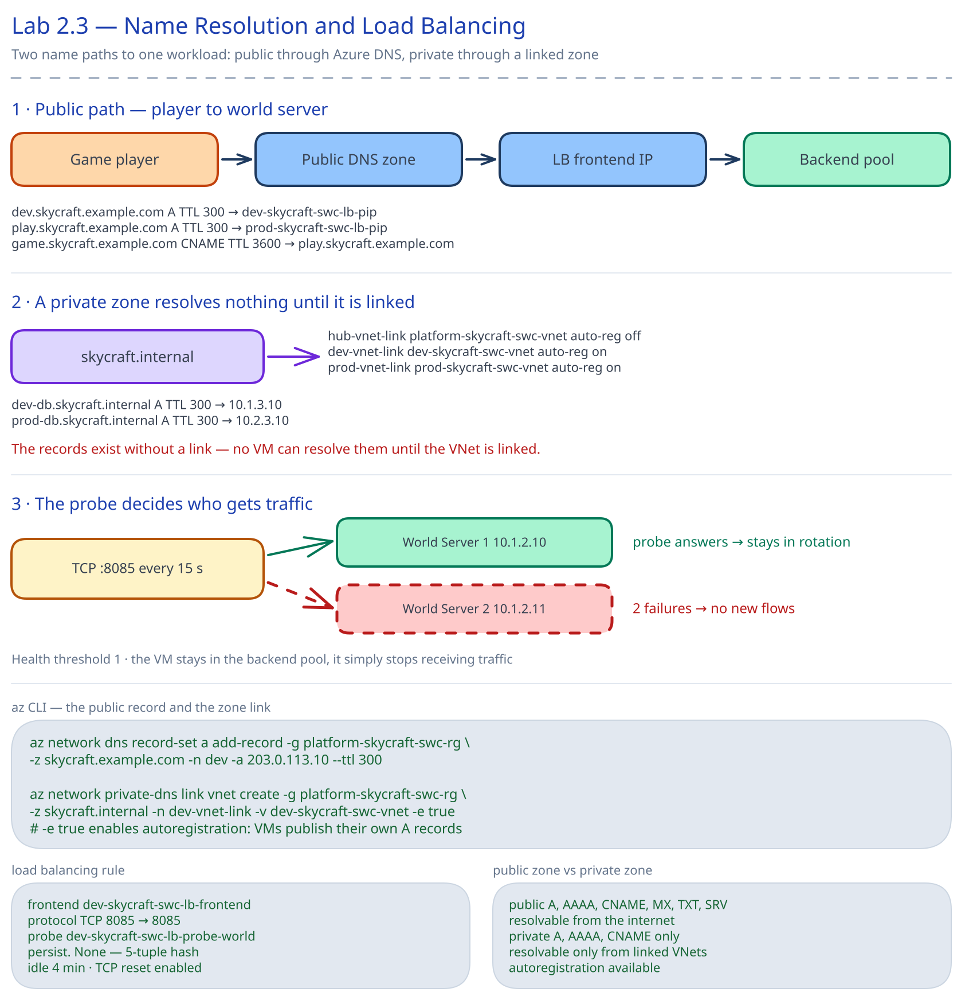
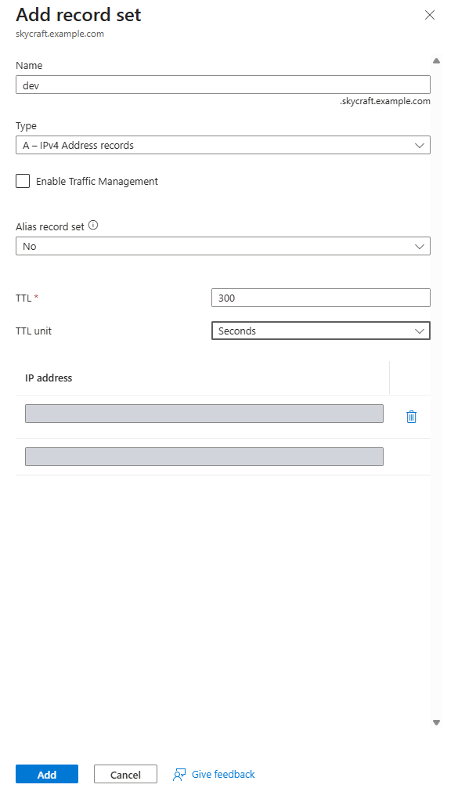
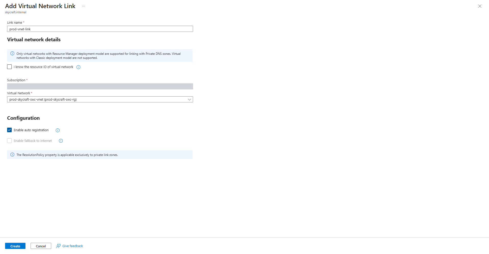
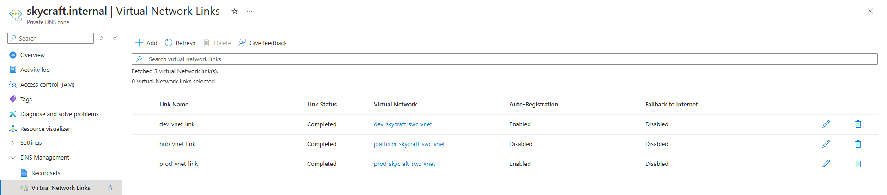
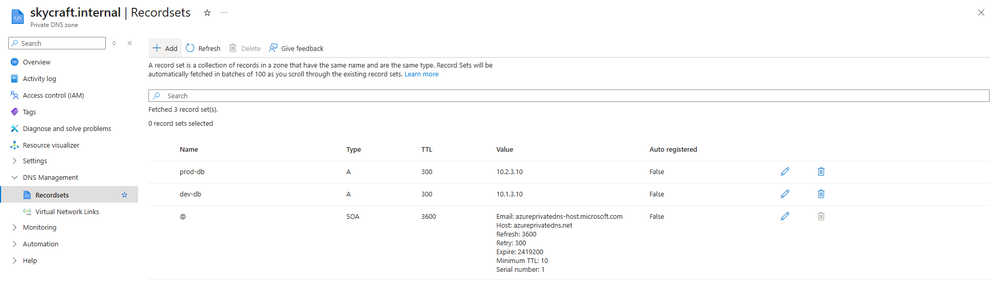
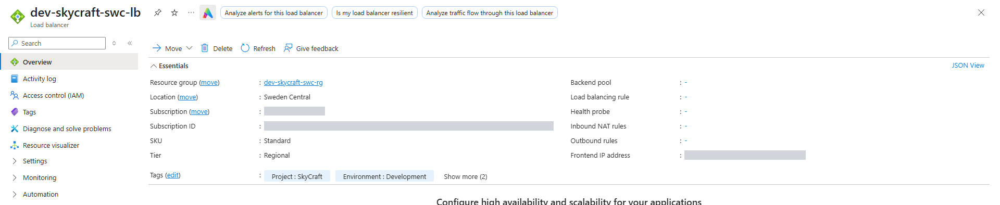
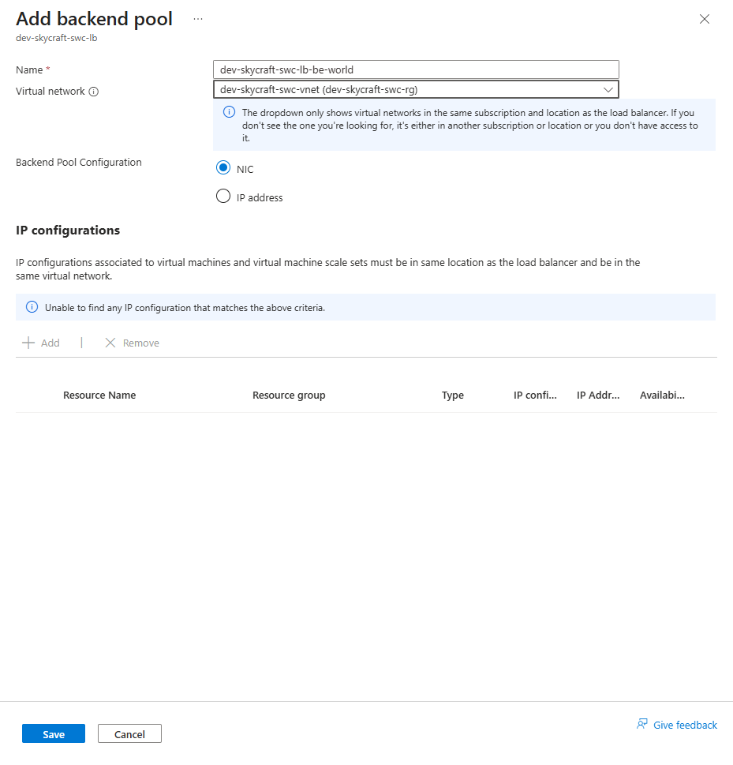
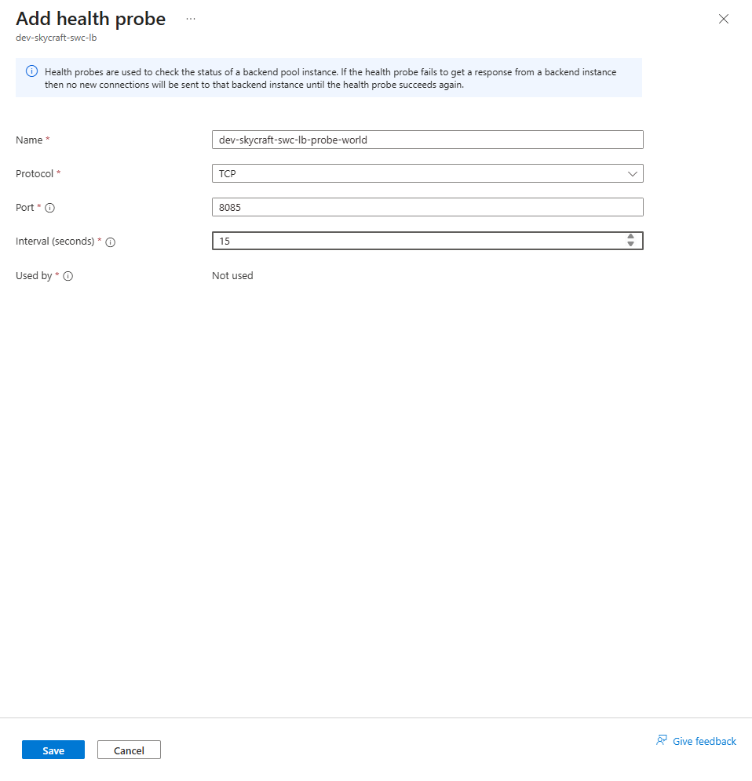
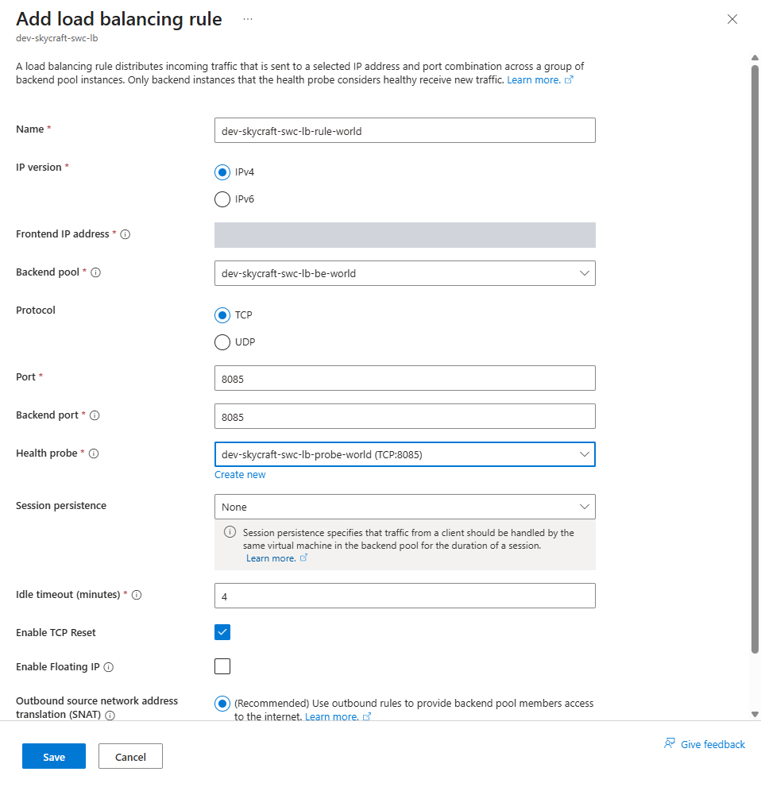

# Lab 2.3: Configure DNS and Load Balancing (2.5 hours)

## 🎯 Learning Objectives

By completing this lab, you will:

- Create and configure Azure DNS zones for custom domain name resolution
- Implement Azure Private DNS zones for internal name resolution
- Deploy Azure Standard Load Balancer for high availability
- Configure load balancing rules and health probes
- Create backend pools for distributing traffic across multiple servers
- Test DNS resolution and load balancer functionality
- Understand the difference between public and private DNS zones

---

## 🏗️ Architecture Overview

You'll implement DNS and load balancing for the SkyCraft infrastructure:

<picture>
  <source media="(prefers-color-scheme: dark)" srcset="images/lab-2.3-architecture.dark.svg">
  <source media="(prefers-color-scheme: light)" srcset="images/lab-2.3-architecture.svg">
  
</picture>

---

## 📋 Real-World Scenario

**Situation**: SkyCraft game servers need to be highly available and accessible via friendly domain names. Players shouldn't need to remember IP addresses (203.0.113.10), and if one world server fails, traffic should automatically route to healthy servers. Additionally, internal services (databases, monitoring) need DNS resolution within the Azure VNets without exposing names to the public internet.

**Your Task**: Implement DNS and load balancing by:

- Creating Azure DNS zones for public domain resolution (skycraft.example.com)
- Deploying Azure Load Balancers to distribute player connections across multiple world servers
- Configuring health probes to detect server failures
- Setting up Private DNS zones for internal service discovery
- Testing DNS resolution and load balancing functionality

---

## ⏱️ Estimated Time: 2.5 hours

- **Section 1**: Understanding DNS and Load Balancing concepts (15 min)
- **Section 2**: Create Azure Public DNS zone (20 min)
- **Section 3**: Create Azure Private DNS zone (20 min)
- **Section 4**: Deploy Azure Load Balancer for dev environment (30 min)
- **Section 5**: Configure load balancing rules and health probes (25 min)
- **Section 6**: Deploy Azure Load Balancer for prod environment (20 min)
- **Section 7**: Test DNS resolution and load balancer (20 min)

---

## ✅ Prerequisites

Before starting this lab:

- [ ] Completed Lab 2.1 (Virtual Networks and Peering)
- [ ] Completed Lab 2.2 (Network Security)
- [ ] Three VNets exist: platform, dev, prod
- [ ] Public IPs exist: dev-skycraft-swc-lb-pip, prod-skycraft-swc-lb-pip
- [ ] Owner or Contributor role at subscription level
- [ ] Understanding of DNS concepts (A records, CNAME, zones)
- [ ] Understanding of load balancing concepts (health probes, backend pools)
- [ ] PowerShell 7+ and the `Az` module (Az.Accounts, Az.Dns, Az.PrivateDns, Az.Network), only if you use the Az PowerShell blocks under the steps

If you completed Lab 1.3, its policies are still assigned to your subscription and apply to every create in this lab:

- `Enforce-Project-Tag` refuses a resource without `Project` = `SkyCraft`. Every create step below sets the four SkyCraft tags (Project, Environment, CostCenter, Owner) on its **Tags** tab, and names the region.
- `Restrict-Azure-Regions` refuses a resource outside **Sweden Central** and **North Europe**. Every create step below names **Sweden Central**.

Check the prerequisites with Az PowerShell (signed in with `Connect-AzAccount` to the subscription you use for the course):

```powershell
Get-AzVirtualNetwork | Where-Object Name -like '*-skycraft-swc-vnet' | Select-Object Name, ResourceGroupName
Get-AzPublicIpAddress | Where-Object Name -like '*-skycraft-swc-lb-pip' | Select-Object Name, ResourceGroupName, IpAddress
```

**Expected Result**: Three virtual networks (platform, dev, prod) and two public IP addresses (dev and prod load balancer), each with an IP address.

## 🛠️ Portal, PowerShell and Bicep Paths

You can build this lab in the Portal by following this guide, with the Az PowerShell blocks under each step, with the lab's Az PowerShell scripts (`scripts/Deploy-DNS.ps1` and `scripts/Deploy-LoadBalancer.ps1`), or with Bicep (`scripts/Deploy-Bicep.ps1`). All paths end in the state `scripts/Test-Lab.ps1` checks. Two settings differ by path, and are meant to:

- **Health probe failures**: the Portal's **Add health probe** pane has no field for the number of failed probes (the unhealthy threshold) and creates every probe with a threshold of 1 (Step 2.3.10). The Az PowerShell blocks below, the two Az PowerShell scripts and the Bicep set 2 (`-ProbeCount 2`, `numberOfProbes`).
- **Tags on the private DNS virtual network links**: the Portal's **Add Virtual Network Link** page has no tags, so a link created in the Portal has none. The Az PowerShell blocks, scripts and the Bicep tag each link with the four SkyCraft tags. `Test-Lab.ps1` does not check tags on the links.

---

## 📖 Section 1: Understanding DNS and Load Balancing Concepts (15 minutes)

### What is Azure DNS?

**Azure DNS** provides name resolution using Microsoft's global DNS infrastructure. It offers:

- **High availability**: 100% uptime SLA
- **Global coverage**: Anycast network (query answered by nearest DNS server)
- **Security**: RBAC, activity logs, resource locking
- **Integration**: Managed alongside other Azure resources

### Public DNS vs Private DNS Zones

| Feature          | Public DNS Zone                     | Private DNS Zone                      |
| ---------------- | ----------------------------------- | ------------------------------------- |
| **Visibility**   | Internet-accessible                 | VNet-internal only                    |
| **Use Case**     | External domains (skycraft.com)     | Internal services (database.internal) |
| **Records**      | Standard DNS records (A, CNAME, MX) | A, AAAA, CNAME only                   |
| **Registration** | Can use registered domains          | Any name (no registration needed)     |
| **Cost**         | $0.50/zone/month + queries          | $0.10/zone/month (no query charges)   |

### Azure Load Balancer Overview

**Azure Load Balancer** distributes inbound traffic across multiple backend resources. Key concepts:

| Component               | Purpose                                           |
| ----------------------- | ------------------------------------------------- |
| **Frontend IP**         | Public or private IP that receives traffic        |
| **Backend Pool**        | Group of VMs/instances that handle requests       |
| **Health Probe**        | Checks if backend resources are healthy           |
| **Load Balancing Rule** | Defines how traffic is distributed                |
| **Inbound NAT Rule**    | Maps specific port to specific backend (optional) |

### Load Balancer SKUs

| Feature                | Basic           | Standard                         |
| ---------------------- | --------------- | -------------------------------- |
| **Backend pool size**  | Up to 300       | Up to 1,000                      |
| **Health probe**       | HTTP, TCP       | HTTP, HTTPS, TCP                 |
| **Availability Zones** | No              | Yes                              |
| **SLA**                | None            | 99.99%                           |
| **Security**           | Open by default | Closed by default (requires NSG) |
| **Cost**               | Free            | ~$18/month + data processing     |

**For SkyCraft**: Standard SKU required for production workloads and zone redundancy.

### Load Distribution Modes

| Mode                             | Description                              | Use Case                                   |
| -------------------------------- | ---------------------------------------- | ------------------------------------------ |
| **Hash-based (5-tuple)**         | Source IP, port, dest IP, port, protocol | Default, good distribution                 |
| **Source IP affinity (2-tuple)** | Source IP + dest IP only                 | Session persistence needed                 |
| **Source IP affinity (3-tuple)** | Source IP, dest IP + protocol            | Balance between persistence & distribution |

---

## 📖 Section 2: Create Azure Public DNS Zone (20 minutes)

### Step 2.3.1: Create Public DNS Zone

**Note**: For this lab, we'll use a placeholder domain. In production, you'd register a real domain (e.g., godaddy.com, namecheap.com) and delegate DNS to Azure.

1. In the **Azure Portal**, search for **DNS zones**. The search lists two results with that name; open the one that shows the page "Network foundation | Public DNS zones", not "Private DNS zones".
2. Click **+ Create**. The page "Create a DNS Zone" has the tabs Basics, DNS Zone Editor, Tags and Review + Create.
3. On the **Basics** tab, fill in:

| Field                       | Value                                                  |
| --------------------------- | ------------------------------------------------------ |
| **Subscription**            | Your subscription                                      |
| **Resource group**          | `platform-skycraft-swc-rg`                             |
| **Name**                    | `skycraft.example.com`                                 |
| **Resource group location** | **Sweden Central** (greyed out, it follows the group)  |

> **Warning**: **Resource group** is pre-filled with the group you used last (in the 2026-10-22 Portal pass, `dev-skycraft-swc-rg`). Change it to `platform-skycraft-swc-rg`. The zone carries the tag `Environment` = `Platform`, so a zone in the dev group looks wrong in every cost and tag report, and a pre-filled group without SkyCraft tags (for example `NetworkWatcherRG`) makes Lab 1.3's `Enforce-Project-Tag` refuse the create.

Leave the box **This zone is a child of an existing zone already hosted in Azure DNS** unchecked, and leave the **DNS Zone Editor** tab empty: you add the records in Steps 2.3.2-2.3.4.

**Important**: The DNS zone name should be your actual registered domain (or a domain you'll register). For this lab, we use `example.com` as a placeholder.

4. Click the **Tags** tab and add:

| Name        | Value       |
| ----------- | ----------- |
| Project     | SkyCraft    |
| Environment | Platform    |
| CostCenter  | MSDN        |
| Owner       | mbiszczanik |

5. Click **Review + Create**, check that the tags are listed, then click **Create**.

**Expected Result**:

- DNS zone `skycraft.example.com` created
- The zone's **Overview** shows 4 name servers (e.g., ns1-01.azure-dns.com)
- In production, you'd update your domain registrar to use these name servers

**With Az PowerShell** (instead of items 1-5):

```powershell
$tags = @{ Project = 'SkyCraft'; Environment = 'Platform'; CostCenter = 'MSDN'; Owner = 'mbiszczanik' }
New-AzDnsZone -ResourceGroupName 'platform-skycraft-swc-rg' -Name 'skycraft.example.com' -Tag $tags
```

### Step 2.3.2: Create DNS A Records for Dev Environment

1. In the Azure Portal, search for **Public IP addresses** and open **dev-skycraft-swc-lb-pip**. On its Overview page, copy the IP address (e.g., 20.240.50.10).
2. Navigate to **DNS zones** → **skycraft.example.com**.
3. In the toolbar, click **Record sets**. The Recordsets page opens.
4. Click **+ Add**.
5. In the **Add record set** pane, fill in the record for the dev load balancer (leave the Traffic Management and alias options off):

| Field          | Value                           |
| -------------- | ------------------------------- |
| **Name**       | `dev`                           |
| **Type**       | A                               |
| **TTL**        | 300                             |
| **TTL unit**   | **Seconds**                     |
| **IP address** | [IP of dev-skycraft-swc-lb-pip] |

> **Warning**: **TTL unit** starts at **Hours**. With **TTL** 300 left on **Hours**, resolvers cache the record for 300 hours (12.5 days), and a later change of the IP address takes that long to reach them. Set **TTL unit** to **Seconds**.

6. Click **Add**.



**Expected Result**: A record `dev.skycraft.example.com` points to dev load balancer public IP, with a TTL of 300 seconds.

**With Az PowerShell** (instead of items 1-6):

```powershell
$pip = Get-AzPublicIpAddress -ResourceGroupName 'dev-skycraft-swc-rg' -Name 'dev-skycraft-swc-lb-pip'
New-AzDnsRecordSet -ResourceGroupName 'platform-skycraft-swc-rg' -ZoneName 'skycraft.example.com' `
    -Name 'dev' -RecordType A -Ttl 300 -DnsRecords (New-AzDnsRecordConfig -Ipv4Address $pip.IpAddress)
```

### Step 2.3.3: Create DNS A Record for Prod Environment

1. Navigate to **Public IP addresses** → **prod-skycraft-swc-lb-pip** and, on its Overview page, copy the IP address.
2. Navigate to **DNS zones** → **skycraft.example.com**.
3. In the toolbar, click **Record sets**, then **+ Add**.
4. In the **Add record set** pane, fill in the record for the prod load balancer:

| Field          | Value                            |
| -------------- | -------------------------------- |
| **Name**       | `play`                           |
| **Type**       | A                                |
| **TTL**        | 300                              |
| **TTL unit**   | **Seconds**                      |
| **IP address** | [IP of prod-skycraft-swc-lb-pip] |

As in Step 2.3.2, **TTL unit** must be **Seconds**, not the default **Hours**.

5. Click **Add**.

**Expected Result**: A record `play.skycraft.example.com` points to production load balancer, with a TTL of 300 seconds.

**With Az PowerShell** (instead of items 1-5):

```powershell
$pip = Get-AzPublicIpAddress -ResourceGroupName 'prod-skycraft-swc-rg' -Name 'prod-skycraft-swc-lb-pip'
New-AzDnsRecordSet -ResourceGroupName 'platform-skycraft-swc-rg' -ZoneName 'skycraft.example.com' `
    -Name 'play' -RecordType A -Ttl 300 -DnsRecords (New-AzDnsRecordConfig -Ipv4Address $pip.IpAddress)
```

### Step 2.3.4: Create CNAME Record (Optional)

Create a user-friendly alias. The record is optional for the load balancers, but Step 2.3.18 and `Test-Lab.ps1` expect it, so create it.

1. In the zone `skycraft.example.com`, click **Record sets** → **+ Add**.
2. In the **Add record set** pane, fill in:

| Field        | Value                       |
| ------------ | --------------------------- |
| **Name**     | `game`                      |
| **Type**     | CNAME                       |
| **TTL**      | 1                           |
| **TTL unit** | **Hours**                   |
| **Alias**    | `play.skycraft.example.com` |

The pane starts at **TTL** 1 and **TTL unit** **Hours**, which is 3600 seconds, the value this record needs. Leave both as they are.

3. Click **Add**.

**Expected Result**: `game.skycraft.example.com` is an alias for `play.skycraft.example.com`, with a TTL of 3600 seconds (1 hour).

**With Az PowerShell** (instead of items 1-3):

```powershell
New-AzDnsRecordSet -ResourceGroupName 'platform-skycraft-swc-rg' -ZoneName 'skycraft.example.com' `
    -Name 'game' -RecordType CNAME -Ttl 3600 -DnsRecords (New-AzDnsRecordConfig -Cname 'play.skycraft.example.com')
```

---

## 📖 Section 3: Create Azure Private DNS Zone (20 minutes)

### Step 2.3.5: Create Private DNS Zone

1. In the Azure Portal, search for **Private DNS zones**.
2. Click **+ Create**. The page has the tabs Basics, Private DNS Zone Editor, Virtual Network Links, Tags and Review + Create.
3. On the **Basics** tab, fill in:

| Field                       | Value                                                 |
| --------------------------- | ----------------------------------------------------- |
| **Subscription**            | Your subscription                                     |
| **Resource group**          | `platform-skycraft-swc-rg`                            |
| **Name**                    | `skycraft.internal`                                   |
| **Resource group location** | **Sweden Central** (greyed out, it follows the group) |

> **Warning**: **Resource group** is pre-filled with the group you used last, as in Step 2.3.1. Change it to `platform-skycraft-swc-rg`.

**Important**: Private DNS zone names can be anything (no domain registration needed). Common patterns: `internal`, `local`, `private`, or `company.internal`.

Leave the **Private DNS Zone Editor** and **Virtual Network Links** tabs empty. The wizard could add the links right here, but Step 2.3.6 adds them one at a time so you see each setting.

4. Click the **Tags** tab and add:

| Name        | Value       |
| ----------- | ----------- |
| Project     | SkyCraft    |
| Environment | Platform    |
| CostCenter  | MSDN        |
| Owner       | mbiszczanik |

5. Click **Review + Create**, then **Create**.

**Expected Result**: Private DNS zone `skycraft.internal` created for internal name resolution.

**With Az PowerShell** (instead of items 1-5):

```powershell
$tags = @{ Project = 'SkyCraft'; Environment = 'Platform'; CostCenter = 'MSDN'; Owner = 'mbiszczanik' }
New-AzPrivateDnsZone -ResourceGroupName 'platform-skycraft-swc-rg' -Name 'skycraft.internal' -Tag $tags
```

### Step 2.3.6: Link Private DNS Zone to VNets

Private DNS zones must be linked to VNets for name resolution to work.

**Link to Hub VNet**:

1. Navigate to **Private DNS zones** → **skycraft.internal**.
2. In the left menu, under **DNS Management** (expand it if it is collapsed), click **Virtual Network Links**.
3. Click **+ Add**. The full page **Add Virtual Network Link** opens.
4. Fill in:

| Field                            | Value                                      |
| -------------------------------- | ------------------------------------------ |
| **Link name**                    | `hub-vnet-link`                            |
| **Subscription**                 | Your subscription                          |
| **Virtual Network**              | `platform-skycraft-swc-vnet`               |
| **Enable auto registration**     | Unchecked (no VMs in hub)                  |

Leave **I know the resource ID** unchecked. The **Virtual Network** list groups the networks by region; pick the one under Sweden Central. **Enable fallback to internet** is greyed out; leave it as it is. The page has no tags (see the note below).

5. Click **Create**. The list of links can take a moment to show the new link.

**Link to Dev VNet**:

6. Click **+ Add** again and fill in:

| Field                        | Value                                  |
| ---------------------------- | -------------------------------------- |
| **Link name**                | `dev-vnet-link`                        |
| **Virtual Network**          | `dev-skycraft-swc-vnet`                |
| **Enable auto registration** | **Checked** (VMs will auto-register)   |

7. Click **Create**.

**Link to Prod VNet**:

8. Click **+ Add** and fill in:

| Field                        | Value                    |
| ---------------------------- | ------------------------ |
| **Link name**                | `prod-vnet-link`         |
| **Virtual Network**          | `prod-skycraft-swc-vnet` |
| **Enable auto registration** | **Checked**              |



9. Click **Create**.

> **Note**: The **Add Virtual Network Link** page has no **Tags** field, so a link made in the Portal has no tags. The Az PowerShell block below, `scripts/Deploy-DNS.ps1` and the Bicep give each link the four SkyCraft tags. The links are not checked for tags by `Test-Lab.ps1`.

**Expected Result**:

- Private DNS zone linked to all three VNets
- Dev and prod VNets have auto-registration enabled
- Future VMs in dev/prod will automatically create DNS records



**With Az PowerShell** (instead of items 1-9; it also tags the links, which the Portal cannot):

```powershell
$tags = @{ Project = 'SkyCraft'; Environment = 'Platform'; CostCenter = 'MSDN'; Owner = 'mbiszczanik' }
$links = @(
    @{ Name = 'hub-vnet-link';  VnetRg = 'platform-skycraft-swc-rg'; Vnet = 'platform-skycraft-swc-vnet'; Register = $false }
    @{ Name = 'dev-vnet-link';  VnetRg = 'dev-skycraft-swc-rg';      Vnet = 'dev-skycraft-swc-vnet';      Register = $true }
    @{ Name = 'prod-vnet-link'; VnetRg = 'prod-skycraft-swc-rg';     Vnet = 'prod-skycraft-swc-vnet';     Register = $true }
)
foreach ($link in $links) {
    $vnet = Get-AzVirtualNetwork -ResourceGroupName $link.VnetRg -Name $link.Vnet
    New-AzPrivateDnsVirtualNetworkLink -ResourceGroupName 'platform-skycraft-swc-rg' -ZoneName 'skycraft.internal' `
        -Name $link.Name -VirtualNetworkId $vnet.Id -EnableRegistration:$link.Register -Tag $tags
}
```

### Step 2.3.7: Create Manual DNS Records in Private Zone

Create DNS records for future database servers:

1. Still in **skycraft.internal**, open the record sets: in the left menu, under **DNS Management** (expand it if it is collapsed), click **Recordsets**, then click **+ Add**.
2. In the **Add record set** pane, fill in the record for the dev database:

| Field          | Value                                   |
| -------------- | --------------------------------------- |
| **Name**       | `dev-db`                                |
| **Type**       | A                                       |
| **TTL**        | 300                                     |
| **TTL unit**   | **Seconds**                             |
| **IP address** | `10.1.3.10` (future database server IP) |

> **Warning**: As in Step 2.3.2, **TTL unit** starts at **Hours**; set it to **Seconds**.

3. Click **Add**.
4. Click **+ Add** again and fill in the record for the prod database:

| Field          | Value                                   |
| -------------- | --------------------------------------- |
| **Name**       | `prod-db`                               |
| **Type**       | A                                       |
| **TTL**        | 300                                     |
| **TTL unit**   | **Seconds**                             |
| **IP address** | `10.2.3.10` (future database server IP) |

5. Click **Add**.

**Expected Result**: Internal DNS records created:

- `dev-db.skycraft.internal` → 10.1.3.10
- `prod-db.skycraft.internal` → 10.2.3.10



**With Az PowerShell** (instead of items 1-5):

```powershell
New-AzPrivateDnsRecordSet -ResourceGroupName 'platform-skycraft-swc-rg' -ZoneName 'skycraft.internal' `
    -Name 'dev-db' -RecordType A -Ttl 300 -PrivateDnsRecord (New-AzPrivateDnsRecordConfig -Ipv4Address '10.1.3.10')
New-AzPrivateDnsRecordSet -ResourceGroupName 'platform-skycraft-swc-rg' -ZoneName 'skycraft.internal' `
    -Name 'prod-db' -RecordType A -Ttl 300 -PrivateDnsRecord (New-AzPrivateDnsRecordConfig -Ipv4Address '10.2.3.10')
```

---

## 📖 Section 4: Deploy Azure Load Balancer for Dev Environment (30 minutes)

### Step 2.3.8: Create Standard Load Balancer

1. In the Azure Portal, search for **Load balancer** and select it in the results.
2. Click **+ Create**. It is a menu: choose **Standard Load balancer** (the other entry is **Gateway Load balancer**).
3. On the **Basics** tab, fill in:

| Field              | Value                 |
| ------------------ | --------------------- |
| **Subscription**   | Your subscription     |
| **Resource group** | `dev-skycraft-swc-rg` |
| **Name**           | `dev-skycraft-swc-lb` |
| **Region**         | **Sweden Central**    |
| **SKU**            | **Standard**          |
| **Type**           | **Public**            |
| **Tier**           | **Regional**          |

> **Warning**: **Type** starts at **Internal**. Pick **Public**: an internal load balancer has no public IP, and the type cannot be changed after the load balancer is created, so the only fix is to delete it and start again. **Resource group** is empty; pick `dev-skycraft-swc-rg`.

4. Click **Next: Frontend IP configuration**. The later tabs stay locked until you click **Next** on the one before.
5. Click **+ Add a frontend IP configuration**, and in the pane fill in:

| Field                 | Value                                    |
| --------------------- | ---------------------------------------- |
| **Name**              | `dev-skycraft-swc-lb-frontend`           |
| **IP version**        | IPv4                                     |
| **IP type**           | IP address                               |
| **Public IP address** | `dev-skycraft-swc-lb-pip` (use existing) |

The **Public IP address** list groups the addresses into "Can be associated with this load balancer" and "Cannot be associated"; pick `dev-skycraft-swc-lb-pip` from the first group.

6. Click **Save**.
7. Click **Next: Backend pools** (skip for now, we'll create them later).
8. Click **Next: Inbound rules** (skip, we'll create the rules after deployment).
9. Click **Next: Outbound rules** (leave default).
10. Click **Next: Tags** and add:

| Name        | Value       |
| ----------- | ----------- |
| Project     | SkyCraft    |
| Environment | Development |
| CostCenter  | MSDN        |
| Owner       | mbiszczanik |

11. Click **Review + create**, review the configuration, then click **Create**.

**Expected Result**:

- Deployment takes 1-2 minutes
- Load balancer `dev-skycraft-swc-lb` created
- Frontend IP configured with public IP



**Cost**: A Standard load balancer costs about 0.60 USD per day (about 18 USD a month for up to five rules, plus data processed) for as long as it exists. Delete it when you finish the module (see What This Lab Leaves Behind).

**With Az PowerShell** (instead of items 1-11):

```powershell
$tags = @{ Project = 'SkyCraft'; Environment = 'Development'; CostCenter = 'MSDN'; Owner = 'mbiszczanik' }
$pip = Get-AzPublicIpAddress -ResourceGroupName 'dev-skycraft-swc-rg' -Name 'dev-skycraft-swc-lb-pip'
$frontend = New-AzLoadBalancerFrontendIpConfig -Name 'dev-skycraft-swc-lb-frontend' -PublicIpAddress $pip
New-AzLoadBalancer -ResourceGroupName 'dev-skycraft-swc-rg' -Name 'dev-skycraft-swc-lb' -Location 'swedencentral' `
    -Sku 'Standard' -Tier 'Regional' -FrontendIpConfiguration $frontend -Tag $tags | Out-Null
```

### Step 2.3.9: Create Backend Pool

1. Navigate to **Load balancers** → **dev-skycraft-swc-lb**.
2. In the left menu, under **Settings** (expand it if it is collapsed), click **Backend pools**.
3. Click **+ Add**. The full page **Add backend pool** opens.
4. Fill in:

| Field                          | Value                          |
| ------------------------------ | ------------------------------ |
| **Name**                       | `dev-skycraft-swc-lb-be-world` |
| **Virtual network**            | `dev-skycraft-swc-vnet`        |
| **Backend Pool Configuration** | **NIC**                        |

After you pick the virtual network, the page shows **Backend Pool Configuration** and an **IP configurations** section that says "Unable to find any IP configuration that matches the above criteria", with **+ Add** greyed out.

**Important**: That message is expected: there are no VMs until Module 3. We'll add them in Module 3. For now, create an empty backend pool.

5. Click **Save**.

**Expected Result**: Backend pool `dev-skycraft-swc-lb-be-world` created (empty, ready for VMs).



**With Az PowerShell** (instead of items 1-5):

```powershell
$lb = Get-AzLoadBalancer -ResourceGroupName 'dev-skycraft-swc-rg' -Name 'dev-skycraft-swc-lb'
$lb | Add-AzLoadBalancerBackendAddressPoolConfig -Name 'dev-skycraft-swc-lb-be-world' | Out-Null
$lb | Set-AzLoadBalancer | Out-Null
```

The cmdlet has no virtual network parameter: a NIC-based pool takes its members from NICs, and the **Virtual network** box only filters the NICs the Portal offers.

---

## 📖 Section 5: Configure Load Balancing Rules and Health Probes (25 minutes)

### Step 2.3.10: Create Health Probe

Health probes check if backend VMs are healthy before sending traffic.

1. Still in **dev-skycraft-swc-lb**, under **Settings** (expand it if it is collapsed), click **Health probes**.
2. Click **+ Add**.
3. In the **Add health probe** pane, fill in:

| Field        | Value                                  |
| ------------ | -------------------------------------- |
| **Name**     | `dev-skycraft-swc-lb-probe-world`      |
| **Protocol** | **TCP**                                |
| **Port**     | `8085` (AzerothCore world server port) |
| **Interval** | 15 (seconds between probes)            |

The pane starts at port 80 and an interval of 5. **Used by** is read-only and stays empty until a rule uses the probe.

> **Note**: The pane has no field for the number of failed probes (the unhealthy threshold) and saves every probe with a threshold of 1. The Az PowerShell block below, the lab's scripts and the Bicep set 2 (`-ProbeCount 2`, `numberOfProbes`), which PowerShell and Bicep can do and the Portal pane cannot.

4. Click **Save**.

**Expected Result**: Health probe created. Will check TCP port 8085 every 15 seconds.



**With Az PowerShell** (instead of items 1-4):

```powershell
$lb = Get-AzLoadBalancer -ResourceGroupName 'dev-skycraft-swc-rg' -Name 'dev-skycraft-swc-lb'
$lb | Add-AzLoadBalancerProbeConfig -Name 'dev-skycraft-swc-lb-probe-world' -Protocol Tcp -Port 8085 `
    -IntervalInSeconds 15 -ProbeCount 2 | Out-Null
$lb | Set-AzLoadBalancer | Out-Null
```

PowerShell may print a warning that `-ProbeThreshold` is in preview. The block does not use that parameter; ignore the warning.

### Step 2.3.11: Create Load Balancing Rule

1. In the left menu, under **Settings**, click **Load balancing rules**.
2. Click **+ Add**.
3. In the **Add load balancing rule** pane, fill in:

| Field                      | Value                                |
| -------------------------- | ------------------------------------ |
| **Name**                   | `dev-skycraft-swc-lb-rule-world`     |
| **IP Version**             | IPv4                                 |
| **Frontend IP address**    | `dev-skycraft-swc-lb-frontend`       |
| **Protocol**               | TCP                                  |
| **Port**                   | `8085`                               |
| **Backend port**           | `8085`                               |
| **Backend pool**           | `dev-skycraft-swc-lb-be-world`       |
| **Health probe**           | `dev-skycraft-swc-lb-probe-world`    |
| **Session persistence**    | **None** (5-tuple hash distribution) |
| **Idle timeout (minutes)** | 4                                    |
| **Floating IP**            | Disabled                             |

4. Check **Enable TCP Reset**.
5. Under **Outbound source network address translation (SNAT)**, leave the default **(Recommended) Use outbound rules to provide backend pool members access to the internet.** The backend VMs get their outbound access from the outbound rule you create in Step 2.3.12, because the VNet subnets are private (Lab 2.1) and give them none of their own.
6. Click **Save**.

> **Note**: **Enable TCP Reset** is unchecked by default, and the Bicep and the lab's scripts set it on every load balancing rule. Check it on every rule you create in this lab (Steps 2.3.11, 2.3.12 and 2.3.16).

**Expected Result**: Load balancing rule created. Traffic to port 8085 on frontend IP will distribute to backend pool VMs.



**With Az PowerShell** (instead of items 1-6):

```powershell
$lb = Get-AzLoadBalancer -ResourceGroupName 'dev-skycraft-swc-rg' -Name 'dev-skycraft-swc-lb'
$frontend = Get-AzLoadBalancerFrontendIpConfig -LoadBalancer $lb -Name 'dev-skycraft-swc-lb-frontend'
$pool     = Get-AzLoadBalancerBackendAddressPoolConfig -LoadBalancer $lb -Name 'dev-skycraft-swc-lb-be-world'
$probe    = Get-AzLoadBalancerProbeConfig -LoadBalancer $lb -Name 'dev-skycraft-swc-lb-probe-world'
$lb | Add-AzLoadBalancerRuleConfig -Name 'dev-skycraft-swc-lb-rule-world' -FrontendIpConfiguration $frontend `
    -BackendAddressPool $pool -Probe $probe -Protocol Tcp -FrontendPort 8085 -BackendPort 8085 `
    -LoadDistribution Default -IdleTimeoutInMinutes 4 -EnableTcpReset -DisableOutboundSNAT | Out-Null
$lb | Set-AzLoadBalancer | Out-Null
```

`-DisableOutboundSNAT` is the Portal's recommended SNAT option: the rule does not do its own outbound translation.

### Step 2.3.12: Create Additional Rules for Auth Server

Create health probe and rule for authentication servers:

**Health Probe**:

1. Under **Settings**, click **Health probes** → **+ Add**.
2. Fill in:

| Field        | Value                            |
| ------------ | -------------------------------- |
| **Name**     | `dev-skycraft-swc-lb-probe-auth` |
| **Protocol** | TCP                              |
| **Port**     | `3724` (Auth server port)        |
| **Interval** | 15                               |

3. Click **Save**.

**Backend Pool**:

4. Click **Backend pools** → **+ Add**.
5. Fill in:

| Field                          | Value                         |
| ------------------------------ | ----------------------------- |
| **Name**                       | `dev-skycraft-swc-lb-be-auth` |
| **Virtual network**            | `dev-skycraft-swc-vnet`       |
| **Backend Pool Configuration** | NIC                           |

6. Click **Save**.

**Load Balancing Rule**:

7. Click **Load balancing rules** → **+ Add**.
8. Fill in:

| Field                      | Value                            |
| -------------------------- | -------------------------------- |
| **Name**                   | `dev-skycraft-swc-lb-rule-auth`  |
| **IP Version**             | IPv4                             |
| **Frontend IP address**    | `dev-skycraft-swc-lb-frontend`   |
| **Protocol**               | TCP                              |
| **Port**                   | `3724`                           |
| **Backend port**           | `3724`                           |
| **Backend pool**           | `dev-skycraft-swc-lb-be-auth`    |
| **Health probe**           | `dev-skycraft-swc-lb-probe-auth` |
| **Session persistence**    | None                             |
| **Idle timeout (minutes)** | 4                                |
| **Floating IP**            | Disabled                         |

9. Check **Enable TCP Reset**.
10. Under **Outbound source network address translation (SNAT)**, leave the default **(Recommended) Use outbound rules to provide backend pool members access to the internet.** (as in Step 2.3.11)
11. Click **Save**.

**Expected Result**: Dev load balancer now has two sets of rules (auth port 3724, world port 8085).

**With Az PowerShell** (instead of items 1-11):

```powershell
$lb = Get-AzLoadBalancer -ResourceGroupName 'dev-skycraft-swc-rg' -Name 'dev-skycraft-swc-lb'
$lb | Add-AzLoadBalancerProbeConfig -Name 'dev-skycraft-swc-lb-probe-auth' -Protocol Tcp -Port 3724 `
    -IntervalInSeconds 15 -ProbeCount 2 | Out-Null
$lb | Add-AzLoadBalancerBackendAddressPoolConfig -Name 'dev-skycraft-swc-lb-be-auth' | Out-Null
$lb | Set-AzLoadBalancer | Out-Null

$lb = Get-AzLoadBalancer -ResourceGroupName 'dev-skycraft-swc-rg' -Name 'dev-skycraft-swc-lb'
$frontend = Get-AzLoadBalancerFrontendIpConfig -LoadBalancer $lb -Name 'dev-skycraft-swc-lb-frontend'
$pool     = Get-AzLoadBalancerBackendAddressPoolConfig -LoadBalancer $lb -Name 'dev-skycraft-swc-lb-be-auth'
$probe    = Get-AzLoadBalancerProbeConfig -LoadBalancer $lb -Name 'dev-skycraft-swc-lb-probe-auth'
$lb | Add-AzLoadBalancerRuleConfig -Name 'dev-skycraft-swc-lb-rule-auth' -FrontendIpConfiguration $frontend `
    -BackendAddressPool $pool -Probe $probe -Protocol Tcp -FrontendPort 3724 -BackendPort 3724 `
    -LoadDistribution Default -IdleTimeoutInMinutes 4 -EnableTcpReset -DisableOutboundSNAT | Out-Null
$lb | Set-AzLoadBalancer | Out-Null
```

#### Outbound Pool and Outbound Rule

The load balancing rules do not give the backend VMs outbound access, and the VNet subnets are private, so a Module 3 VM reaches the internet (package installs, VM extensions) only through an outbound rule. One frontend IP can carry only one outbound rule, so the VMs do not get a rule per role pool: they share one egress pool, `dev-skycraft-swc-lb-be-outbound`, which Lab 3.2 puts both VMs into besides their role pools.

12. Click **Backend pools** → **+ Add**.
13. Fill in:

| Field                          | Value                             |
| ------------------------------ | --------------------------------- |
| **Name**                       | `dev-skycraft-swc-lb-be-outbound` |
| **Virtual network**            | `dev-skycraft-swc-vnet`           |
| **Backend Pool Configuration** | **NIC**                           |

14. Click **Save** (leave the pool empty: Lab 3.2 adds both VMs).
15. Under **Settings**, click **Outbound rules**.
16. Click **+ Add**.
17. Fill in:

| Field                                                | Value                                       |
| ---------------------------------------------------- | ------------------------------------------- |
| **Name**                                             | `dev-skycraft-swc-lb-outbound`              |
| **IP version**                                       | IPv4                                        |
| **Frontend IP address**                              | `dev-skycraft-swc-lb-frontend`              |
| **Protocol**                                         | **All**                                     |
| **Idle timeout (minutes)**                           | 4                                           |
| **Enable TCP Reset**                                 | checked                                     |
| **Backend pool**                                     | `dev-skycraft-swc-lb-be-outbound`           |
| **Enable default port allocation (not recommended)** | unchecked                                   |
| **Choose by**                                        | **Allocated outbound ports (per instance)** |
| **Allocated outbound ports (per instance)**          | `8000`                                      |

The **Choose by** option and the port fields are in the **Outbound ports** section, which also shows **Available frontend ports** and **Maximum number of backend instances** (read-only).

18. Click **Save**.

> **SkyCraft Choice**: We chose **8000 ports per instance**. The frontend IP offers 63,984 ports to its outbound rule (**Available frontend ports**), so 8000 admits 7 instances (**Maximum number of backend instances**: 7). Module 3 puts 2 VMs into this pool, and even the prod scale set of Lab 3.2 (up to 4 instances) would fit beside them. 8000 is a multiple of 8, as Azure requires, and a fixed number per instance means a VM added later does not shrink the ports of the others.

**Expected Result**: Dev load balancer has the empty backend pool `dev-skycraft-swc-lb-be-outbound` and one outbound rule, `dev-skycraft-swc-lb-outbound`, that serves it with 8000 ports per instance. In Lab 3.2 both VMs join this pool and reach the internet through `dev-skycraft-swc-lb-pip`.

**With Az PowerShell** (instead of items 12-18):

```powershell
$lb = Get-AzLoadBalancer -ResourceGroupName 'dev-skycraft-swc-rg' -Name 'dev-skycraft-swc-lb'
$lb | Add-AzLoadBalancerBackendAddressPoolConfig -Name 'dev-skycraft-swc-lb-be-outbound' | Out-Null
$lb | Set-AzLoadBalancer | Out-Null

$lb = Get-AzLoadBalancer -ResourceGroupName 'dev-skycraft-swc-rg' -Name 'dev-skycraft-swc-lb'
$frontend = Get-AzLoadBalancerFrontendIpConfig -LoadBalancer $lb -Name 'dev-skycraft-swc-lb-frontend'
$pool     = Get-AzLoadBalancerBackendAddressPoolConfig -LoadBalancer $lb -Name 'dev-skycraft-swc-lb-be-outbound'
$lb | Add-AzLoadBalancerOutboundRuleConfig -Name 'dev-skycraft-swc-lb-outbound' -Protocol All `
    -FrontendIpConfiguration $frontend -BackendAddressPool $pool -IdleTimeoutInMinutes 4 `
    -EnableTcpReset -AllocatedOutboundPort 8000 | Out-Null
$lb | Set-AzLoadBalancer | Out-Null
```

---

## 📖 Section 6: Deploy Azure Load Balancer for Prod Environment (20 minutes)

### Step 2.3.13: Create Production Load Balancer

Repeat the load balancer creation process for production:

1. In the Azure Portal, search for **Load balancer**, select it in the results, click **+ Create** and choose **Standard Load balancer**.
2. On the **Basics** tab, fill in:

| Field              | Value                  |
| ------------------ | ---------------------- |
| **Subscription**   | Your subscription      |
| **Resource group** | `prod-skycraft-swc-rg` |
| **Name**           | `prod-skycraft-swc-lb` |
| **Region**         | **Sweden Central**     |
| **SKU**            | **Standard**           |
| **Type**           | **Public**             |
| **Tier**           | **Regional**           |

> **Warning**: **Type** starts at **Internal** and **Resource group** is empty, as in Step 2.3.8. Pick **Public** and `prod-skycraft-swc-rg`; the type cannot be changed later.

3. Click **Next: Frontend IP configuration**, then **+ Add a frontend IP configuration**, and fill in:

| Field                 | Value                                     |
| --------------------- | ----------------------------------------- |
| **Name**              | `prod-skycraft-swc-lb-frontend`           |
| **IP version**        | IPv4                                      |
| **IP type**           | IP address                                |
| **Public IP address** | `prod-skycraft-swc-lb-pip` (use existing) |

4. Click **Save**.
5. Click **Next: Backend pools**, **Next: Inbound rules**, **Next: Outbound rules** (skip all three: you create them after deployment), then **Next: Tags**, and add:

| Name        | Value       |
| ----------- | ----------- |
| Project     | SkyCraft    |
| Environment | Production  |
| CostCenter  | MSDN        |
| Owner       | mbiszczanik |

6. Click **Review + create**, then **Create**.

**Expected Result**: Load balancer `prod-skycraft-swc-lb` created with the frontend `prod-skycraft-swc-lb-frontend` on `prod-skycraft-swc-lb-pip`. It costs about 0.60 USD per day, like the dev load balancer.

**With Az PowerShell** (instead of items 1-6):

```powershell
$tags = @{ Project = 'SkyCraft'; Environment = 'Production'; CostCenter = 'MSDN'; Owner = 'mbiszczanik' }
$pip = Get-AzPublicIpAddress -ResourceGroupName 'prod-skycraft-swc-rg' -Name 'prod-skycraft-swc-lb-pip'
$frontend = New-AzLoadBalancerFrontendIpConfig -Name 'prod-skycraft-swc-lb-frontend' -PublicIpAddress $pip
New-AzLoadBalancer -ResourceGroupName 'prod-skycraft-swc-rg' -Name 'prod-skycraft-swc-lb' -Location 'swedencentral' `
    -Sku 'Standard' -Tier 'Regional' -FrontendIpConfiguration $frontend -Tag $tags | Out-Null
```

### Step 2.3.14: Configure Production Backend Pools

1. Open **prod-skycraft-swc-lb**. In the left menu, under **Settings** (expand it if it is collapsed), click **Backend pools** → **+ Add**.

**Backend Pool 1** (World servers):

2. Fill in:

| Field                          | Value                           |
| ------------------------------ | ------------------------------- |
| **Name**                       | `prod-skycraft-swc-lb-be-world` |
| **Virtual network**            | `prod-skycraft-swc-vnet`        |
| **Backend Pool Configuration** | NIC                             |

3. Click **Save**.

**Backend Pool 2** (Auth servers):

4. Click **+ Add** and fill in:

| Field                          | Value                          |
| ------------------------------ | ------------------------------ |
| **Name**                       | `prod-skycraft-swc-lb-be-auth` |
| **Virtual network**            | `prod-skycraft-swc-vnet`       |
| **Backend Pool Configuration** | NIC                            |

5. Click **Save**.

**Backend Pool 3** (Outbound):

6. Click **+ Add** and fill in (the egress pool for the outbound rule in Step 2.3.16; leave it empty):

| Field                          | Value                              |
| ------------------------------ | ---------------------------------- |
| **Name**                       | `prod-skycraft-swc-lb-be-outbound` |
| **Virtual network**            | `prod-skycraft-swc-vnet`           |
| **Backend Pool Configuration** | NIC                                |

7. Click **Save**.

**Expected Result**: Three empty backend pools on `prod-skycraft-swc-lb`: world, auth and outbound.

**With Az PowerShell** (instead of items 1-7):

```powershell
$lb = Get-AzLoadBalancer -ResourceGroupName 'prod-skycraft-swc-rg' -Name 'prod-skycraft-swc-lb'
$lb | Add-AzLoadBalancerBackendAddressPoolConfig -Name 'prod-skycraft-swc-lb-be-world' | Out-Null
$lb | Add-AzLoadBalancerBackendAddressPoolConfig -Name 'prod-skycraft-swc-lb-be-auth' | Out-Null
$lb | Add-AzLoadBalancerBackendAddressPoolConfig -Name 'prod-skycraft-swc-lb-be-outbound' | Out-Null
$lb | Set-AzLoadBalancer | Out-Null
```

### Step 2.3.15: Configure Production Health Probes

1. In `prod-skycraft-swc-lb`, under **Settings**, click **Health probes** → **+ Add**.

**Probe 1** (World):

2. Fill in:

| Field        | Value                              |
| ------------ | ---------------------------------- |
| **Name**     | `prod-skycraft-swc-lb-probe-world` |
| **Protocol** | TCP                                |
| **Port**     | 8085                               |
| **Interval** | 15                                 |

3. Click **Save**.

**Probe 2** (Auth):

4. Click **+ Add** and fill in:

| Field        | Value                             |
| ------------ | --------------------------------- |
| **Name**     | `prod-skycraft-swc-lb-probe-auth` |
| **Protocol** | TCP                               |
| **Port**     | 3724                              |
| **Interval** | 15                                |

5. Click **Save**.

As in Step 2.3.10, the pane has no unhealthy threshold, and the Portal saves a threshold of 1.

**Expected Result**: Two health probes on `prod-skycraft-swc-lb`: TCP port 8085 and TCP port 3724, each every 15 seconds.

**With Az PowerShell** (instead of items 1-5):

```powershell
$lb = Get-AzLoadBalancer -ResourceGroupName 'prod-skycraft-swc-rg' -Name 'prod-skycraft-swc-lb'
$lb | Add-AzLoadBalancerProbeConfig -Name 'prod-skycraft-swc-lb-probe-world' -Protocol Tcp -Port 8085 `
    -IntervalInSeconds 15 -ProbeCount 2 | Out-Null
$lb | Add-AzLoadBalancerProbeConfig -Name 'prod-skycraft-swc-lb-probe-auth' -Protocol Tcp -Port 3724 `
    -IntervalInSeconds 15 -ProbeCount 2 | Out-Null
$lb | Set-AzLoadBalancer | Out-Null
```

### Step 2.3.16: Configure Production Load Balancing Rules

1. Under **Settings**, click **Load balancing rules** → **+ Add**.

**Rule 1** (World):

2. Fill in:

| Field                      | Value                              |
| -------------------------- | ---------------------------------- |
| **Name**                   | `prod-skycraft-swc-lb-rule-world`  |
| **IP Version**             | IPv4                               |
| **Frontend IP address**    | `prod-skycraft-swc-lb-frontend`    |
| **Protocol**               | TCP                                |
| **Port**                   | 8085                               |
| **Backend port**           | 8085                               |
| **Backend pool**           | `prod-skycraft-swc-lb-be-world`    |
| **Health probe**           | `prod-skycraft-swc-lb-probe-world` |
| **Session persistence**    | None                               |
| **Idle timeout (minutes)** | 4                                  |
| **Floating IP**            | Disabled                           |

3. Check **Enable TCP Reset**.
4. Under **Outbound source network address translation (SNAT)**, leave the default **(Recommended) Use outbound rules to provide backend pool members access to the internet.** (as in Step 2.3.11)
5. Click **Save**.

**Rule 2** (Auth):

6. Click **+ Add** and fill in:

| Field                      | Value                             |
| -------------------------- | --------------------------------- |
| **Name**                   | `prod-skycraft-swc-lb-rule-auth`  |
| **IP Version**             | IPv4                              |
| **Frontend IP address**    | `prod-skycraft-swc-lb-frontend`   |
| **Protocol**               | TCP                               |
| **Port**                   | 3724                              |
| **Backend port**           | 3724                              |
| **Backend pool**           | `prod-skycraft-swc-lb-be-auth`    |
| **Health probe**           | `prod-skycraft-swc-lb-probe-auth` |
| **Session persistence**    | None                              |
| **Idle timeout (minutes)** | 4                                 |
| **Floating IP**            | Disabled                          |

7. Check **Enable TCP Reset**.
8. Under **Outbound source network address translation (SNAT)**, leave the default **(Recommended) Use outbound rules to provide backend pool members access to the internet.** (as in Step 2.3.11)
9. Click **Save**.

**With Az PowerShell** (instead of items 1-9):

```powershell
$lb = Get-AzLoadBalancer -ResourceGroupName 'prod-skycraft-swc-rg' -Name 'prod-skycraft-swc-lb'
$frontend  = Get-AzLoadBalancerFrontendIpConfig -LoadBalancer $lb -Name 'prod-skycraft-swc-lb-frontend'
$poolWorld = Get-AzLoadBalancerBackendAddressPoolConfig -LoadBalancer $lb -Name 'prod-skycraft-swc-lb-be-world'
$poolAuth  = Get-AzLoadBalancerBackendAddressPoolConfig -LoadBalancer $lb -Name 'prod-skycraft-swc-lb-be-auth'
$probeWorld = Get-AzLoadBalancerProbeConfig -LoadBalancer $lb -Name 'prod-skycraft-swc-lb-probe-world'
$probeAuth  = Get-AzLoadBalancerProbeConfig -LoadBalancer $lb -Name 'prod-skycraft-swc-lb-probe-auth'
$lb | Add-AzLoadBalancerRuleConfig -Name 'prod-skycraft-swc-lb-rule-world' -FrontendIpConfiguration $frontend `
    -BackendAddressPool $poolWorld -Probe $probeWorld -Protocol Tcp -FrontendPort 8085 -BackendPort 8085 `
    -LoadDistribution Default -IdleTimeoutInMinutes 4 -EnableTcpReset -DisableOutboundSNAT | Out-Null
$lb | Add-AzLoadBalancerRuleConfig -Name 'prod-skycraft-swc-lb-rule-auth' -FrontendIpConfiguration $frontend `
    -BackendAddressPool $poolAuth -Probe $probeAuth -Protocol Tcp -FrontendPort 3724 -BackendPort 3724 `
    -LoadDistribution Default -IdleTimeoutInMinutes 4 -EnableTcpReset -DisableOutboundSNAT | Out-Null
$lb | Set-AzLoadBalancer | Out-Null
```

#### Production Outbound Rule

10. Under **Settings**, click **Outbound rules** → **+ Add**.
11. Fill in:

| Field                                                | Value                                       |
| ---------------------------------------------------- | ------------------------------------------- |
| **Name**                                             | `prod-skycraft-swc-lb-outbound`             |
| **IP version**                                       | IPv4                                        |
| **Frontend IP address**                              | `prod-skycraft-swc-lb-frontend`             |
| **Protocol**                                         | **All**                                     |
| **Idle timeout (minutes)**                           | 4                                           |
| **Enable TCP Reset**                                 | checked                                     |
| **Backend pool**                                     | `prod-skycraft-swc-lb-be-outbound`          |
| **Enable default port allocation (not recommended)** | unchecked                                   |
| **Choose by**                                        | **Allocated outbound ports (per instance)** |
| **Allocated outbound ports (per instance)**          | `8000`                                      |

12. Click **Save**.

**Expected Result**: Production load balancer fully configured with 3 backend pools (world, auth, outbound), 2 health probes, 2 load balancing rules and 1 outbound rule.

**With Az PowerShell** (instead of items 10-12):

```powershell
$lb = Get-AzLoadBalancer -ResourceGroupName 'prod-skycraft-swc-rg' -Name 'prod-skycraft-swc-lb'
$frontend = Get-AzLoadBalancerFrontendIpConfig -LoadBalancer $lb -Name 'prod-skycraft-swc-lb-frontend'
$pool     = Get-AzLoadBalancerBackendAddressPoolConfig -LoadBalancer $lb -Name 'prod-skycraft-swc-lb-be-outbound'
$lb | Add-AzLoadBalancerOutboundRuleConfig -Name 'prod-skycraft-swc-lb-outbound' -Protocol All `
    -FrontendIpConfiguration $frontend -BackendAddressPool $pool -IdleTimeoutInMinutes 4 `
    -EnableTcpReset -AllocatedOutboundPort 8000 | Out-Null
$lb | Set-AzLoadBalancer | Out-Null
```

---

## 📖 Section 7: Test DNS Resolution and Load Balancer (20 minutes)

### Step 2.3.17: Test Public DNS Resolution (Conceptual)

**Note**: Since we used `skycraft.example.com` (not a real registered domain), DNS queries from the internet won't work yet. This section explains the testing process.

**When you have a real domain**:

```bash
# Test DNS resolution from your laptop
nslookup dev.skycraft.example.com

# Expected output:
# Name:    dev.skycraft.example.com
# Address: 20.240.50.10 (dev load balancer public IP)

# Test production DNS
nslookup play.skycraft.example.com

# Expected output:
# Name:    play.skycraft.example.com
# Address: 20.240.60.20 (prod load balancer public IP)

# Test CNAME
nslookup game.skycraft.example.com

# Expected output:
# Name:    play.skycraft.example.com (canonical name)
# Address: 20.240.60.20
```

### Step 2.3.18: Test DNS Resolution in Azure Portal

1. Navigate to **DNS zones** → **skycraft.example.com**
2. Click **Overview** and check that the four name servers are listed.
3. In the toolbar, click **Record sets**. The Recordsets page lists the record sets (the Overview page does not).
4. Verify record sets exist:

| Name | Type  | Value                               |
| ---- | ----- | ----------------------------------- |
| @    | NS    | ns1-01.azure-dns.com (and 3 others) |
| @    | SOA   | [Azure DNS SOA record]              |
| dev  | A     | [dev-skycraft-swc-lb-pip IP]        |
| play | A     | [prod-skycraft-swc-lb-pip IP]       |
| game | CNAME | play.skycraft.example.com           |

**Expected Result**: All DNS records visible in Azure Portal.

### Step 2.3.19: Test Private DNS Zone Resolution

1. Navigate to **Private DNS zones** → **skycraft.internal**
2. Click **Overview**
3. Verify:

   - **Recordsets**: 3 (the SOA record at `@`, which the Portal counts, and the two records you created: dev-db, prod-db)
   - **Virtual Network Links**: 3 (hub, dev, prod)
   - **Virtual Network Links With Registration**: 2 (dev, prod)

4. In the left menu, under **DNS Management** (expand it if it is collapsed), click **Recordsets**
5. Verify records exist:

| Name    | Type | IP Address |
| ------- | ---- | ---------- |
| dev-db  | A    | 10.1.3.10  |
| prod-db | A    | 10.2.3.10  |

**Expected Result**: Private DNS configured for internal name resolution.

### Step 2.3.20: Verify Load Balancer Configuration

**Dev Load Balancer**:

1. Navigate to **Load balancers** → **dev-skycraft-swc-lb**
2. Click **Overview**
3. Verify:
   - Frontend IP: 1 (dev-skycraft-swc-lb-frontend with public IP)
   - Backend pools: 3 (world, auth, outbound)
   - Load balancing rules: 2 (port 8085, port 3724)
   - Health probes: 2 (world, auth)
   - Outbound rules: 1 (`dev-skycraft-swc-lb-outbound` for the outbound pool; listed under **Settings** → **Outbound rules**)

**Prod Load Balancer**:

4. Navigate to **prod-skycraft-swc-lb**
5. Verify same configuration

**Expected Result**: Both load balancers fully configured and ready to distribute traffic (VMs will be added in Module 3).

### Step 2.3.21: Test Load Balancer Health Probes (Post-VM Deployment)

**Note**: This test requires VMs (deployed in Module 3). Document the expected behavior:

**Scenario 1: All backends healthy**

```
Health Probe → VM1 (10.1.2.10:8085) → Response OK → Mark healthy
Health Probe → VM2 (10.1.2.11:8085) → Response OK → Mark healthy

Load Balancer Decision: Distribute traffic 50/50 to VM1 and VM2
```

**Scenario 2: One backend fails**

```
Health Probe → VM1 (10.1.2.10:8085) → Response OK → Mark healthy
Health Probe → VM2 (10.1.2.11:8085) → Timeout → Mark unhealthy

Load Balancer Decision: Send 100% traffic to VM1 only
```

**Scenario 3: Backend recovers**

```
After 2 consecutive successful probes (30 seconds):
VM2 marked healthy again → Load Balancer resumes 50/50 distribution
```

---

## ✅ Lab Checklist

Quick verification before proceeding:

### Azure DNS (Public Zone)

- [ ] Public DNS zone `skycraft.example.com` created
- [ ] A record `dev.skycraft.example.com` points to dev load balancer IP
- [ ] A record `play.skycraft.example.com` points to prod load balancer IP
- [ ] CNAME record `game.skycraft.example.com` aliases to play
- [ ] 4 Azure name servers assigned to zone

### Azure Private DNS Zone

- [ ] Private DNS zone `skycraft.internal` created
- [ ] Linked to hub VNet (auto-registration off)
- [ ] Linked to dev VNet (auto-registration on)
- [ ] Linked to prod VNet (auto-registration on)
- [ ] A record `dev-db.skycraft.internal` → 10.1.3.10
- [ ] A record `prod-db.skycraft.internal` → 10.2.3.10

### Dev Load Balancer

- [ ] `dev-skycraft-swc-lb` created (Standard SKU, Public)
- [ ] Frontend IP uses `dev-skycraft-swc-lb-pip`
- [ ] Backend pool: `dev-skycraft-swc-lb-be-world` created
- [ ] Backend pool: `dev-skycraft-swc-lb-be-auth` created
- [ ] Health probe: TCP port 8085 (world) configured
- [ ] Health probe: TCP port 3724 (auth) configured
- [ ] Load balancing rule: port 8085 → world backend pool
- [ ] Load balancing rule: port 3724 → auth backend pool
- [ ] **Enable TCP Reset** checked on both load balancing rules
- [ ] Backend pool: `dev-skycraft-swc-lb-be-outbound` created (empty until Lab 3.2)
- [ ] Outbound rule: `dev-skycraft-swc-lb-outbound` → outbound pool (All, 8000 ports per instance)

### Prod Load Balancer

- [ ] `prod-skycraft-swc-lb` created (Standard SKU, Public)
- [ ] Frontend IP uses `prod-skycraft-swc-lb-pip`
- [ ] Backend pools created (world, auth, outbound)
- [ ] Health probes configured (8085, 3724)
- [ ] Load balancing rules configured (8085, 3724), **Enable TCP Reset** checked on both
- [ ] Outbound rule configured for the outbound pool (8000 ports per instance)
- [ ] All resources have proper tags

Run the lab's validator from the lab folder:

```powershell
./scripts/Test-Lab.ps1
```

**Expected Result**: `Lab 2.3 validation complete. All checks passed!`, exit code 0.

**For detailed verification**, see [lab-checklist-2.3.md](lab-checklist-2.3.md)

---

## 📦 What This Lab Leaves Behind

Lab 3.2 uses the load balancers this lab creates (`tools/lab-cycle-manifest.psd1` lists Lab 2.3 as its dependency), and the VMs of Module 3 register themselves in the private DNS zone. The DNS zones are used by no later lab. The load balancers cost money every day they exist; the daily costs below are approximate list prices (a Standard load balancer is about 18 USD a month for up to five rules, plus data processed), so check the [Azure pricing calculator](https://azure.microsoft.com/pricing/calculator/) for your own.

| Left behind | Where | Daily cost | What it does in later labs |
| --- | --- | --- | --- |
| `skycraft.example.com` with `dev`, `play` and `game` | `platform-skycraft-swc-rg` | about 0.02 USD (0.50 USD a month, Section 1) plus queries | Nothing; it cannot answer from the internet until you delegate a real domain to it |
| `skycraft.internal` with `dev-db` and `prod-db` | `platform-skycraft-swc-rg` | about 0.003 USD (0.10 USD a month, Section 1) | The VMs of Lab 3.2 register their own A records here (the dev and prod links have auto registration) |
| `hub-vnet-link`, `dev-vnet-link`, `prod-vnet-link` | Child resources of `skycraft.internal` | 0 | Make the private zone resolve in the three VNets |
| `dev-skycraft-swc-lb`, `prod-skycraft-swc-lb` (Standard) | `dev-skycraft-swc-rg`, `prod-skycraft-swc-rg` | about 0.60 USD each | Lab 3.2 puts its VMs into the world and auth pools; Lab 3.1 creates the dev load balancer only if it is missing |
| `dev-skycraft-swc-lb-be-outbound`, `prod-skycraft-swc-lb-be-outbound` and the two outbound rules | The load balancers | 0 | Lab 3.2 puts every VM into the egress pool; the outbound rule is the VMs' only way to the internet |

The load balancers use the public IPs `dev-skycraft-swc-lb-pip` and `prod-skycraft-swc-lb-pip` of Lab 2.1. Deleting a load balancer leaves its public IP in place; Lab 2.1's cleanup removes it.

To remove the lab, run its cleanup from the lab folder:

```powershell
./scripts/Remove-LabResource.ps1
```

It asks before each delete and names the resource it is about to delete (`-WhatIf` lists them without deleting anything; `-Force` skips the questions). It deletes the public DNS zone, then both load balancers, then the three links of the private zone, and last the private zone. In the Portal, delete the same resources in the same order:

1. If Lab 1.3's locks `lock-no-delete-platform` and `lock-no-delete-prod` are still in place, delete them first: they block every delete in those groups.
2. Delete the public DNS zone `skycraft.example.com`.
3. Delete the load balancers `dev-skycraft-swc-lb` and `prod-skycraft-swc-lb`.
4. In `skycraft.internal`, delete the three virtual network links, wait until **Virtual Network Links** lists none, then delete the zone. A zone with links cannot be deleted.

---

## 🎓 Knowledge Check

Test your understanding with these questions:

1. **What is the difference between Public DNS zones and Private DNS zones in Azure?**

   <details>
     <summary>**Click to see the answer**</summary>

   **Answer**:

   **Public DNS Zones**:

   - Accessible from the internet
   - Used for registered domains (skycraft.com)
   - Resolves names for external clients (game players)
   - Requires domain registration and NS delegation
   - Cost: $0.50/zone/month + query charges

   **Private DNS Zones**:

   - Only accessible within linked VNets
   - Used for internal services (database.internal)
   - No domain registration needed (any name works)
   - Supports auto-registration of VM DNS records
   - Cost: $0.10/zone/month (no query charges)

   **For SkyCraft**: Public DNS for player-facing services (play.skycraft.com), Private DNS for internal communication (auth-server.skycraft.internal, database.skycraft.internal).
   </details>

2. **Why do we use Standard SKU Load Balancer instead of Basic?**

   <details>
     <summary>**Click to see the answer**</summary>

   **Answer**: Standard Load Balancer provides critical enterprise features:

   | Feature                     | Basic           | Standard                          |
   | --------------------------- | --------------- | --------------------------------- |
   | **SLA**                     | No SLA          | 99.99% uptime                     |
   | **Backend pool size**       | 300 instances   | 1,000 instances                   |
   | **Availability Zones**      | Not supported   | Zone-redundant                    |
   | **Health probes**           | HTTP, TCP       | HTTP, HTTPS, TCP                  |
   | **Security**                | Open by default | Closed (requires NSG allow rules) |
   | **Monitoring**              | Basic metrics   | Comprehensive metrics + logs      |
   | **Multi-dimension metrics** | No              | Yes                               |

   **For production workloads like SkyCraft**: Standard is required for SLA guarantees, zone redundancy, and comprehensive monitoring. Basic SKU is being deprecated.
   </details>

3. **How does the health probe determine if a backend VM is healthy?**

   <details>
     <summary>**Click to see the answer**</summary>

   **Answer**: Health probes work as follows:

   **Configuration** (our SkyCraft example):

   - Protocol: TCP
   - Port: 8085 (world server)
   - Interval: 15 seconds (how often to check)
   - Unhealthy threshold: 2 consecutive failures (the Bicep and PowerShell setting; the Portal's **Add health probe** pane has no field for it and saves 1)

   **Process**:

   1. Every 15 seconds, load balancer attempts TCP connection to port 8085
   2. **Healthy**: If TCP handshake succeeds → VM marked healthy
   3. **Unhealthy**: If connection fails/times out → increment failure counter
   4. After 2 consecutive failures (30 seconds) → VM marked unhealthy
   5. Unhealthy VM removed from load balancing rotation
   6. After 2 consecutive successes → VM marked healthy again

   **HTTP health probes** (alternative) expect 200 OK response from specified path (e.g., `/health`).

   **Best practice**: Use HTTP probes with application-level health checks when possible, as they verify the application is truly functional, not just the network port is open.
   </details>

4. **What is session persistence (session affinity) and when should you use it?**

   <details>
     <summary>**Click to see the answer**</summary>

   **Answer**:

   **Session Persistence** ensures requests from the same client always go to the same backend server.

   **Distribution Modes**:

   1. **None (5-tuple hash)** - Default

      - Hash: Source IP + Source Port + Dest IP + Dest Port + Protocol
      - Best distribution across backends
      - Use when: Stateless applications

   2. **Client IP (2-tuple hash)**

      - Hash: Source IP + Dest IP only
      - Same client → same backend
      - Use when: Sessions stored locally on server

   3. **Client IP and Protocol (3-tuple)**
      - Hash: Source IP + Dest IP + Protocol
      - Balance between persistence and distribution

   **For AzerothCore**:

   - **Auth servers**: Use **Client IP affinity** (session data exists)
   - **World servers**: Use **Client IP affinity** (player session state)
   - **Database**: Not load balanced (single primary)

   **Trade-off**: Session affinity reduces distribution efficiency but maintains session state.
   </details>

5. **Can Private DNS zones automatically register VM DNS records?**

   <details>
     <summary>**Click to see the answer**</summary>

   **Answer**: **Yes**, with **auto-registration** enabled on the VNet link.

   **How it works**:

   1. Link Private DNS zone to VNet
   2. Enable **auto-registration** checkbox
   3. When VM starts: Azure automatically creates A record
   4. When VM stops: Azure automatically deletes A record

   **Example** (our SkyCraft config):

   - Dev VNet linked to `skycraft.internal` with auto-registration
   - Deploy VM named `dev-world-01` with IP 10.1.2.10
   - Azure creates: `dev-world-01.skycraft.internal` → 10.1.2.10

   **Benefits**:

   - No manual DNS management
   - Always up-to-date records
   - Services can use names instead of IPs

   **Limitation**: Auto-registration only works for VMs, not for load balancers or other resources (create those manually).
   </details>

6. **What happens if all backend VMs in a load balancer backend pool fail health probes?**

   <details>
     <summary>**Click to see the answer**</summary>

   **Answer**: **Load balancer enters degraded state and stops accepting new connections.**

   **Behavior**:

   1. All VMs marked unhealthy (no healthy backends available)
   2. Load balancer health status → **Degraded**
   3. **New connections**: Rejected (connection refused or timeout)
   4. **Existing connections**: May continue if already established (TCP)
   5. Azure Monitor alerts fire (if configured)

   **Monitoring**:

   - Metric: **Health Probe Status** drops to 0%
   - Alert rule: "Backend Health Probe Status < 50% for 5 minutes"

   **Prevention**:

   - Deploy VMs across Availability Zones
   - Use autoscaling to replace failed instances
   - Implement application-level health checks
   - Monitor health probe metrics continuously

   **For SkyCraft**: In Module 3, we'll configure alerts to notify when backend health degrades.
   </details>

7. **How long does it take for DNS changes to propagate?**

   <details>
     <summary>**Click to see the answer**</summary>

   **Answer**: Depends on **TTL (Time To Live)** setting and DNS cache hierarchy.

   **Propagation Timeline**:

   | Change Type                 | Typical Time   | Why                               |
   | --------------------------- | -------------- | --------------------------------- |
   | **Azure DNS record update** | 60 seconds     | Azure DNS authoritative servers   |
   | **Public internet DNS**     | TTL duration   | Recursive resolvers cache records |
   | **Local computer cache**    | Up to 24 hours | OS DNS cache                      |

   **Our SkyCraft TTL**: 300 seconds (5 minutes)

   - Change A record from 20.240.50.10 to 20.240.50.20
   - Azure updates immediately
   - Public resolvers refresh after 5 minutes (max)

   **Best Practices**:

   - **Before change**: Lower TTL to 60 seconds (1 hour in advance)
   - **Make change**: Update record
   - **After change**: Wait 2× old TTL before critical operations
   - **Restore**: Increase TTL back to normal (3600-86400)

   **Force refresh** (troubleshooting):

   ```bash
   # Windows
   ipconfig /flushdns

   # Linux/Mac
   sudo systemd-resolve --flush-caches
   # or
   sudo dscacheutil -flushcache
   ```

   </details>

---

## 🔧 Troubleshooting

### Issue 1: DNS zone created but records not resolving

**Symptom**: `nslookup dev.skycraft.example.com` returns "Non-existent domain"

**Solution**:

- Verify domain delegation at registrar points to Azure NS servers
- Check record exists in Azure Portal (DNS zones → Record sets)
- Wait for TTL expiration (300 seconds in our config)
- Try querying Azure name servers directly:
  ```bash
  nslookup dev.skycraft.example.com ns1-01.azure-dns.com
  ```
- Flush local DNS cache: `ipconfig /flushdns` (Windows)

### Issue 2: Private DNS auto-registration not working

**Symptom**: VM deployed but no DNS record created in Private DNS zone

**Solution**:

- Verify VNet link has **auto-registration enabled** (checkbox)
- Confirm VM is in a linked VNet
- Check VM has started successfully (not stopped/deallocated)
- Auto-registration can take 2-3 minutes after VM starts
- Verify VM NIC is in the VNet (not secondary NIC in different VNet)

### Issue 3: Load balancer health probe always shows unhealthy

**Symptom**: Backend pool VMs show 0% health probe status

**Solution**:

- Verify VM is running (not stopped)
- Check NSG allows traffic from Azure Load Balancer service tag:
  - Source: **AzureLoadBalancer**
  - Destination port: **8085** (or your probe port)
  - Protocol: TCP
  - Action: Allow
- Confirm application is listening on probe port:
  ```bash
  # SSH to VM
  netstat -tlnp | grep 8085
  ```
- Check probe settings (correct port, protocol, interval)
- Review VM firewall rules (OS-level)

### Issue 4: Cannot create load balancer - quota exceeded

**Symptom**: Error: "Quota exceeded for resource type 'Public IP Addresses'"

**Solution**:

- Check current quota usage: **Subscriptions** → **Usage + quotas**
- Request quota increase if needed
- Verify public IP is Standard SKU (matches Standard Load Balancer requirement)
- Use existing public IPs where possible

### Issue 5: Load balancer rule creation fails

**Symptom**: Error: "Backend pool must be in same virtual network as load balancer"

**Solution**:

- Verify backend pool and load balancer are in same region
- Confirm backend pool references correct VNet
- Check if VNet has available IP addresses
- Recreate backend pool with correct VNet selection

### Issue 6: Load balancer not distributing traffic evenly

**Symptom**: One VM receiving 90% of traffic, others idle

**Solution**:

- Check session persistence setting (should be **None** for even distribution)
- Verify all VMs are healthy (Health probe status = 100%)
- Confirm load balancing rule uses correct distribution algorithm
- Review if source IPs are concentrated (few clients = uneven distribution)
- Consider using **5-tuple hash** instead of **Source IP affinity**

### Issue 7: A create is refused by policy

**Symptom**: Validation fails or the notification bell shows `RequestDisallowedByPolicy` with "All resources must be tagged with Project=SkyCraft" or "Resources must be deployed to Sweden Central or North Europe regions only"

**Solution**:

- Lab 1.3's policies are in effect. Fill in the **Tags** tab with the four tags of the step and choose **Sweden Central** as the region (the DNS zone forms take the location of their resource group)
- Check that **Resource group** is the one the step names and not the group the wizard pre-filled (Steps 2.3.1 and 2.3.5); a pre-filled group without SkyCraft tags, such as `NetworkWatcherRG`, is refused
- The **Add Virtual Network Link** page has no **Tags** field, and a link made there carries no tags; use the Az PowerShell block of Step 2.3.6 if your subscription refuses it

### Issue 8: `Test-Lab.ps1` reports outbound SNAT not disabled, or the egress pool missing

**Symptom**: `Outbound SNAT not disabled on: ...` or `Egress backend pool NOT found` for a load balancer

**Solution**:

- Open the load balancing rule (**Settings** → **Load balancing rules**) and check that **Outbound source network address translation (SNAT)** is the default **(Recommended) Use outbound rules to provide backend pool members access to the internet.**
- Check that `<environment>-skycraft-swc-lb-be-outbound` exists and that **Outbound rules** lists `<environment>-skycraft-swc-lb-outbound` for it (Steps 2.3.12 and 2.3.16)

---

## 📚 Additional Resources

- [Azure DNS Documentation](https://learn.microsoft.com/en-us/azure/dns/)
- [Azure Private DNS Documentation](https://learn.microsoft.com/en-us/azure/dns/private-dns-overview)
- [Azure Load Balancer Documentation](https://learn.microsoft.com/en-us/azure/load-balancer/)
- [Load Balancer health probes](https://learn.microsoft.com/en-us/azure/load-balancer/load-balancer-custom-probe-overview)
- [Load balancing distribution modes](https://learn.microsoft.com/en-us/azure/load-balancer/load-balancer-distribution-mode)
- [DNS best practices](https://learn.microsoft.com/en-us/azure/dns/dns-best-practices)

---

## 📌 Module Navigation

- [← Back to Module 2 Index](../README.md)
- [← Previous Lab: 2.2 Secure Access](../2.2-secure-access/lab-guide-2.2.md)
- [Module 2 Complete - Next: Module 3 Compute →](../../module-3-compute/README.md)

---

## 📝 Lab Summary

**What You Accomplished**:

- ✅ Created Azure Public DNS zone with A and CNAME records
- ✅ Deployed Azure Private DNS zone for internal name resolution
- ✅ Configured 2 Azure Standard Load Balancers (dev and prod)
- ✅ Created 6 backend pools (world, auth and egress per load balancer) for distributing game server traffic
- ✅ Implemented health probes (TCP ports 3724, 8085)
- ✅ Configured load balancing rules for auth and world servers
- ✅ Gave the Module 3 VMs outbound internet access through an egress pool and one outbound rule per load balancer
- ✅ Linked Private DNS zones to all three VNets

**Infrastructure Ready**:

- 🌐 DNS infrastructure for public and private name resolution
- ⚖️ Load balancers ready to distribute traffic across multiple game servers
- 🏥 Health probes configured to detect and remove failed servers automatically
- 🔄 High availability architecture for production game deployment

**Time Spent**: ~2.5 hours

**Module 2 Complete!** You've built a production-ready network infrastructure with:

- Hub-spoke topology (Lab 2.1)
- Network security with Bastion and NSGs (Lab 2.2)
- DNS and load balancing (Lab 2.3)

**Ready for Module 3?** Next, you'll deploy Azure Virtual Machines, configure AzerothCore game servers, and add VMs to the load balancer backend pools to enable high-availability gameplay!
