# Lab 3.2: Create and Configure Virtual Machines (4 hours)

## 🎯 Learning Objectives

By completing this lab, you will:

- Create Azure Virtual Machines (Ubuntu Linux) for SkyCraft game servers
- Configure Azure Disk Encryption on the Authserver VM, and compare it with encryption at host
- Manage virtual machine sizes and resize VMs based on workload requirements
- Add and configure managed data disks for database storage
- Deploy VMs to availability zones for high availability
- Put VM network interfaces into application security groups and read the effective security rules
- Create, scale and delete an Azure Virtual Machine Scale Set with autoscale rules
- Explain what moving a VM to another resource group involves (a concept section in Section 7, no step changes Azure)

---

## 🏗️ Architecture Overview

You'll deploy this VM infrastructure for SkyCraft game servers:

<picture>
  <source media="(prefers-color-scheme: dark)" srcset="images/lab-3.2-architecture.dark.svg">
  <source media="(prefers-color-scheme: light)" srcset="images/lab-3.2-architecture.svg">
  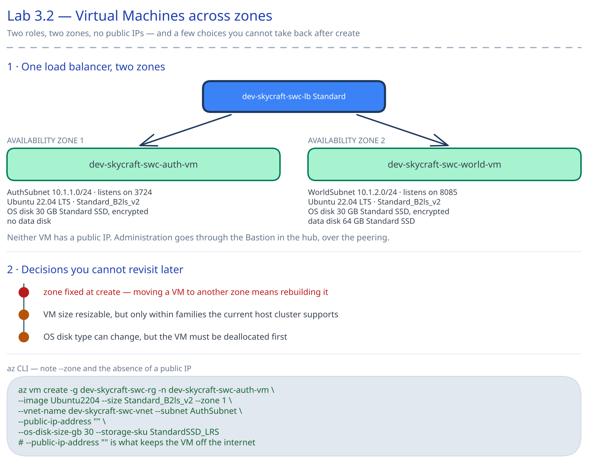
</picture>

---

## 📋 Real-World Scenario

**Situation**: Your SkyCraft infrastructure now has a complete network foundation with VNets, NSGs, and load balancers deployed via Bicep. The next step is deploying the actual game servers. You need Linux VMs to run:

- **Authserver**: Handles player authentication (login) on port 3724
- **Worldserver**: Runs the game world and handles gameplay on port 8085

**Your Task**: Deploy Azure Virtual Machines that:

- Run Ubuntu 22.04 LTS (AzerothCore's recommended OS)
- Are distributed across availability zones for high availability
- Encrypt the Authserver's disks for security compliance (the Worldserver stays unencrypted for the backup and disaster recovery exercises of Lab 5.2)
- Include additional data disks for database storage
- Are properly sized for the expected player load (starting small, can resize later)
- Connect to the existing load balancer for public access

**Business Impact**:

- Game servers become operational for player connections
- High availability ensures players can connect even if one zone fails
- Disk encryption meets security and compliance requirements
- Proper sizing optimizes costs while ensuring performance

---

## ⏱️ Estimated Time: 4 hours

- **Section 1**: Understanding Azure Virtual Machines (20 min)
- **Section 2**: Create Authserver Virtual Machine (45 min)
- **Section 3**: Create Worldserver Virtual Machine (30 min)
- **Section 4**: Configure managed data disks (30 min)
- **Section 5**: Configure Azure Disk Encryption (35 min of work; the encryption itself then runs for about 2 hours while you continue with Sections 6-8)
- **Section 6**: Deploy VMs to availability zones (25 min)
- **Section 7**: Manage VM sizes (25 min)
- **Section 8**: Create a Virtual Machine Scale Set (30 min)

---

## ✅ Prerequisites

Before starting this lab:

- [ ] Completed Lab 2.1 (Virtual Networks) **or** Lab 3.1 - either one creates `dev-skycraft-swc-rg` and `dev-skycraft-swc-vnet` with the `AuthSubnet` and `WorldSubnet` subnets
- [ ] Completed Lab 2.3 (Name Resolution) **or** Lab 3.1 - either one creates the load balancer `dev-skycraft-swc-lb` with its `dev-skycraft-swc-lb-be-auth` and `dev-skycraft-swc-lb-be-world` backend pools, which the VM NICs join
- [ ] Completed Lab 3.1 (Infrastructure as Code) - Bicep knowledge (recommended; not a resource dependency when Lab 2.3 has run)
- [ ] Completed Lab 2.2 (Secure Access) - its application security groups `dev-skycraft-swc-asg-auth` and `dev-skycraft-swc-asg-world` take the VM network interfaces in Step 3.2.13, and its NSGs filter the VM subnets
- [ ] Optional: Lab 2.2's Azure Bastion (`platform-skycraft-swc-bas`). It is only needed for the portal SSH sessions (Step 3.2.15 and Step 3.2.32) and is the one standing-cost resource in the course, so Lab 2.2's script leaves it off unless you answer `y`. Step 3.2.15 shows **Run command**, which needs no Bastion
- [ ] Contributor or Owner role on the subscription (`Deploy-Bicep.ps1` runs a subscription-scope deployment)
- [ ] SSH key from Step 3.2.1 (option A or option B). The deploy script reads the public key from `$HOME\.ssh\skycraft-dev.pub` and exits if the file is missing; with option B, export the stored key to a file and pass it with `-SshKeyPath` (Step 3.2.1 shows the commands)
- [ ] PowerShell 7+ and the `Az` module (Az.Accounts, Az.Resources, Az.Network, Az.Compute)
- [ ] Bicep CLI on `PATH` - Az PowerShell compiles `main.bicep` through it

The gates in `scripts/Deploy-Bicep.ps1` are the SSH public key at `$HOME\.ssh\skycraft-dev.pub` (`[1/5]`, override with `-SshKeyPath`) and the resource group, VNet, load balancer and, in dev, the two application security groups (`[2/5] Checking prerequisites`), each looked up by name. `tools/lab-cycle-manifest.psd1` declares this lab as depending on Labs 2.2 and 2.3.

> [!NOTE]
> **Lab 1.3's tag policies.** Three things in this lab are created without tags, because their Portal forms and commands have no tags field: the inline data disk (Step 3.2.14), the disk encryption extension (Step 3.2.19) and the scale set's autoscale setting (Step 3.2.30). Lab 1.3's `Inherit-Project-Tag` assignment copies `Project` = `SkyCraft` from `dev-skycraft-swc-rg` to them, so `Enforce-Project-Tag` lets them pass. This lab relies on that assignment. If your Lab 1.3 has `Enforce-Project-Tag` but not `Inherit-Project-Tag`, add it (Lab 1.3, Step 1.3.8) before you start. Steps 3.2.14 and 3.2.30 also give a tagged alternative; Step 3.2.19 has none and needs the assignment.

**Verify prerequisites**:

```powershell
# Check resource groups exist
(Get-AzResourceGroup -Name dev-skycraft-swc-rg).ResourceGroupName

# Check VNet exists
$vnet = Get-AzVirtualNetwork -Name dev-skycraft-swc-vnet -ResourceGroupName dev-skycraft-swc-rg
$vnet.Name

# Check subnets exist
$vnet.Subnets.Name

# Check the load balancer and its backend pools exist (Lab 2.3 or 3.1)
(Get-AzLoadBalancer -Name dev-skycraft-swc-lb -ResourceGroupName dev-skycraft-swc-rg).BackendAddressPools.Name

# Check the application security groups exist (Lab 2.2)
(Get-AzApplicationSecurityGroup -ResourceGroupName dev-skycraft-swc-rg).Name
```

---

## 📖 Section 1: Understanding Azure Virtual Machines (20 minutes)

### What are Azure Virtual Machines?

**Azure Virtual Machines (VMs)** are on-demand, scalable computing resources that run in the Azure cloud. VMs provide:

- Full control over the operating system
- Ability to run custom software (like AzerothCore game servers)
- Networking integration with Azure VNets
- Storage options for OS and data disks
- High availability through availability zones and sets

### VM Components for SkyCraft

| Component             | Purpose                       | SkyCraft Example                      |
| --------------------- | ----------------------------- | ------------------------------------- |
| **VM Size**           | CPU, memory, storage capacity | Standard_B2ls_v2 (2 vCPUs, 4 GB RAM)  |
| **OS Disk**           | Contains operating system     | Ubuntu 22.04 LTS, 30 GB Standard SSD  |
| **Data Disk**         | Additional storage for data   | 64 GB Standard SSD for MySQL database |
| **NIC**               | Network connectivity          | Connects to AuthSubnet or WorldSubnet |
| **Public IP**         | External access (optional)    | Not used - access via Bastion         |
| **Availability Zone** | Physical datacenter isolation | Zone 1 for Auth, Zone 2 for World     |

### VM Sizing for Game Servers

**AzerothCore Requirements**:

| Server Type     | Minimum           | Recommended (Dev) | Recommended (Prod) |
| --------------- | ----------------- | ----------------- | ------------------ |
| **Authserver**  | 1 vCPU, 1 GB RAM  | 2 vCPUs, 4 GB RAM | 2 vCPUs, 8 GB RAM  |
| **Worldserver** | 2 vCPUs, 4 GB RAM | 4 vCPUs, 8 GB RAM | 8 vCPUs, 16 GB RAM |
| **Database**    | 2 vCPUs, 4 GB RAM | 4 vCPUs, 8 GB RAM | 8 vCPUs, 32 GB RAM |

**Azure VM Size Mapping**:

| Size                 | vCPUs | RAM   | Use Case         |
| -------------------- | ----- | ----- | ---------------- |
| **Standard_B2ls_v2** | 2     | 4 GB  | Dev Authserver   |
| **Standard_B2s_v2**  | 2     | 8 GB  | Dev Worldserver  |
| **Standard_D2s_v3**  | 2     | 8 GB  | Prod Authserver  |
| **Standard_D4s_v3**  | 4     | 16 GB | Prod Worldserver |

**B-series vs D-series**:

- **B-series** (Burstable): Cost-effective for variable workloads, earns CPU credits during idle time
- **D-series** (General Purpose): Consistent performance for sustained workloads

For development, we'll use **Standard_B2ls_v2** (cost-effective). For production, upgrade to **D-series**.

B-series v1 (B1s, B2s, B2ms) is not available in Sweden Central on the lab subscription; the lab uses the v2 generation.

### Availability Zones

**Availability Zones** are physically separate datacenters within an Azure region:

```
Sweden Central Region
├── Zone 1 (Datacenter A) ← Authserver VM
├── Zone 2 (Datacenter B) ← Worldserver VM
└── Zone 3 (Datacenter C) ← Future expansion
```

**Benefits**:

- 99.99% SLA (vs 99.9% for single zone)
- Protection against datacenter failures
- Load balancer distributes traffic across zones

**For SkyCraft**: Deploy Authserver in Zone 1 and Worldserver in Zone 2 for fault tolerance.

---

## 📖 Section 2: Create Authserver Virtual Machine (45 minutes)

### Understanding SSH Access via Azure Bastion

Before creating VMs, it's important to understand how you'll access them securely. In Lab 2.2, you deployed **Azure Bastion** in the hub VNet (`platform-skycraft-swc-vnet`). This provides secure SSH access without exposing VMs to the internet.

**How Azure Bastion SSH Works:**

```
Your Browser → HTTPS (443) → Azure Bastion → SSH (22) → VM
(Local PC)    (Azure Portal)   (Hub VNet)    (Peered VNet)
```

1. **No public IP on VMs**: VMs only have private IPs (e.g., 10.1.1.4)
2. **Browser-based access**: SSH session runs in Azure Portal via your web browser
3. **Cross-VNet connectivity**: Bastion reaches spoke VNets through VNet peering (hub-to-dev, hub-to-prod)
4. **SSH key authentication**: You upload your private key through the Bastion portal UI when connecting

**Why This Works (Network Path):**

| Component                   | Network                           | IP Range    |
| --------------------------- | --------------------------------- | ----------- |
| Azure Bastion               | platform-skycraft-swc-vnet        | 10.0.0.0/26 |
| ↓ VNet Peering (hub-to-dev) |                                   |             |
| Authserver VM               | dev-skycraft-swc-vnet/AuthSubnet  | 10.1.1.0/24 |
| Worldserver VM              | dev-skycraft-swc-vnet/WorldSubnet | 10.1.2.0/24 |

The NSG rules created in Lab 2.2 allow SSH (port 22) from the Bastion subnet (10.0.0.0/26) to the VM subnets.

> [!IMPORTANT]
> **Prerequisite Check**: the SSH sessions in Step 3.2.15 and Step 3.2.32 need Azure Bastion (`platform-skycraft-swc-bas`) in the hub VNet. Without it, run the commands of Step 3.2.15 through **Run command** instead (a tip there shows how); Step 3.2.32 then has nothing to connect with.

### Step 3.2.1: Generate SSH Key Pair

Every VM in this lab uses SSH key authentication. **The public key is added to the VM during creation. The private key is provided through Azure Bastion's web UI when connecting.** Choose where the key pair lives:

| | Option A: local key pair (`ssh-keygen`) | Option B: SSH key stored in Azure |
| --- | --- | --- |
| Public key | `skycraft-dev.pub` on your computer | Azure resource `platform-skycraft-swc-ssh` (`Microsoft.Compute/sshPublicKeys`) in `platform-skycraft-swc-rg` |
| Private key | `skycraft-dev` on your computer | `platform-skycraft-swc-ssh.pem`, downloaded **once** when the key is created; Azure does not keep it |
| VM wizard | **Use existing public key**, paste the `.pub` contents | **Use existing key stored in Azure**, pick the key from the list |
| Works from another computer | Only if you copy the `.pub` file | Yes: any VM wizard in the subscription lists the key |
| Bicep solution | Used as is by `scripts/Deploy-Bicep.ps1` | Export the public key to a `.pub` file and pass it with `-SshKeyPath` (below) |

> **SkyCraft Choice**: The Bicep solution for this lab uses **option A**: `Deploy-Bicep.ps1` reads `$HOME\.ssh\skycraft-dev.pub` and passes it to `main.bicep` as `parSshPublicKey`. Option B fits a team or a classroom, where people deploy from different computers and nobody should need a key file just to create a VM.

#### Option A: Generate the key pair locally

**Windows (PowerShell)**:

```powershell
# Create .ssh directory if it doesn't exist
mkdir "$HOME\.ssh" -Force

# Generate SSH key pair
ssh-keygen -t rsa -b 4096 -f "$HOME\.ssh\skycraft-dev" -N ""

# Display public key (you'll need this for VM creation)
Get-Content "$HOME\.ssh\skycraft-dev.pub"
```

**Linux/macOS**:

```bash
# Generate SSH key pair
ssh-keygen -t rsa -b 4096 -f ~/.ssh/skycraft-dev -N ""

# Display public key
cat ~/.ssh/skycraft-dev.pub
```

**Expected Result**: Two files created:

- `skycraft-dev` (private key - keep secure!)
- `skycraft-dev.pub` (public key - will be added to VM)

#### Option B: Store the key in Azure

The key goes into the platform resource group because that group outlives the environment groups: deleting `dev-skycraft-swc-rg` or `prod-skycraft-swc-rg` leaves the key in place. An SSH key resource has no cost.

1. In Azure Portal, search for **SSH keys** and click **+ Create**
2. Fill in the **Basics** tab:

| Field                 | Value                                                  |
| --------------------- | ------------------------------------------------------ |
| Subscription          | [Your subscription]                                    |
| Resource group        | `platform-skycraft-swc-rg`                             |
| Region                | **Sweden Central**                                     |
| Key pair name         | `platform-skycraft-swc-ssh`                            |
| SSH public key source | **Generate new key pair**                              |
| SSH Key Type          | **RSA SSH Format**                                     |

The region is read-only: the Portal takes it from the resource group.

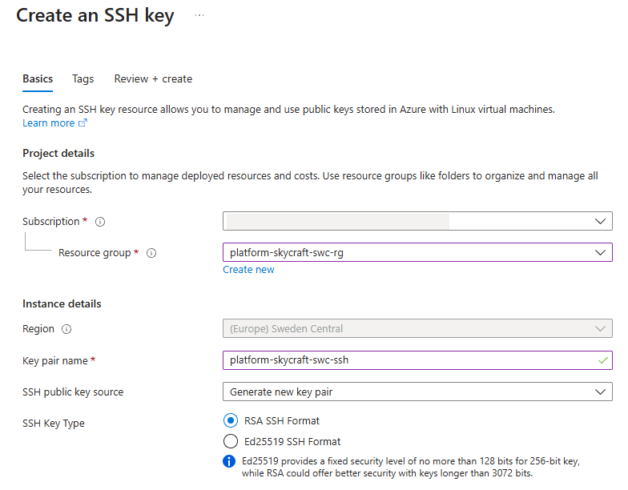

3. Click **Next: Tags** and add the platform tags. Lab 1.3's `Enforce-Project-Tag` policy denies any resource without `Project` = `SkyCraft`, and the key is a resource. Without the tags, **Review + create** stops at "Validation failed" with `RequestDisallowedByPolicy`, naming the assignment by its display name: `Enforce-Project-Tag` if you made it in the Portal in Lab 1.3, `Enforce Project Tag Value` if Lab 1.3 was deployed with Bicep or its scripts:

| Name        | Value       |
| ----------- | ----------- |
| Project     | SkyCraft    |
| Environment | Platform    |
| CostCenter  | MSDN        |
| Owner       | [Your name] |

4. Click **Review + create** → **Create**
5. In the Generate new key pair pop-up, click **Download private key and create resource**. The browser saves `platform-skycraft-swc-ssh.pem`

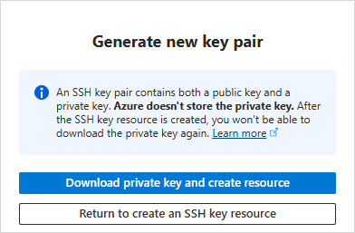

> [!IMPORTANT]
> The `.pem` file is offered for download **only once**. If you lose it, delete the key resource and create a new one. Lab 1.3 puts `lock-no-delete-platform` on `platform-skycraft-swc-rg`, so remove that lock first and put it back afterwards (Lab 1.3, Troubleshooting Issue 3). With the lock in place, the key's **Delete** box asks only **Yes** or **No**: it shows no lock warning and offers no lock override, and the lock makes the delete fail. On a shared computer, move the file to your own storage and delete it from the Downloads folder.

**To use the Bicep solution with option B**, export the stored public key to its own file and point `Deploy-Bicep.ps1` at it with `-SshKeyPath`. A separate file name keeps an option A `skycraft-dev.pub`, if you have one, intact:

```powershell
mkdir "$HOME\.ssh" -Force
(Get-AzSshKey -ResourceGroupName platform-skycraft-swc-rg -Name platform-skycraft-swc-ssh).publicKey |
    Set-Content "$HOME\.ssh\platform-skycraft-swc-ssh.pub"

.\scripts\Deploy-Bicep.ps1 -Environment dev -SshKeyPath "$HOME\.ssh\platform-skycraft-swc-ssh.pub"
```

In your own Bicep you can skip the file and read the key where it lives, with an `existing` resource (the scope below assumes a subscription-scope template such as `main.bicep`):

```bicep
resource sshKey 'Microsoft.Compute/sshPublicKeys@2024-07-01' existing = {
  name: 'platform-skycraft-swc-ssh'
  scope: resourceGroup('platform-skycraft-swc-rg')
}

// In the VM's osProfile.linuxConfiguration.ssh.publicKeys:
// keyData: sshKey.properties.publicKey
```

**Expected Result**: `platform-skycraft-swc-ssh` appears under **SSH keys** in `platform-skycraft-swc-rg`, and `platform-skycraft-swc-ssh.pem` is saved on your computer.

> [!IMPORTANT]
> Never share your private key. Store it securely and backup if needed.

> [!NOTE]
> The rest of this lab names the files from option A (`skycraft-dev`, `skycraft-dev.pub`). With option B, pick **Use existing key stored in Azure** → `platform-skycraft-swc-ssh` wherever a step asks for the public key, and use `platform-skycraft-swc-ssh.pem` wherever it asks for the private key.

### Step 3.2.2: Create Authserver VM via Azure Portal

1. In Azure Portal, search for **Virtual machines**. The search opens the Compute infrastructure hub; its list of VMs is **Virtual machines** under the **Infrastructure** group of the left menu (expand the group if it is collapsed)
2. Click **+ Create** → **Virtual machine**

> [!NOTE]
> The portal may open a preview of a new Create-VM experience (a banner at the top of the Basics tab says so). Some field names there differ from the tables below; the banner's **Click here to access the previous experience** link switches back.

> [!WARNING]
> The wizard pre-fills values this lab does not use. Each row of the tables in Steps 3.2.2-3.2.5 sets one of them; a row you skip keeps the Portal's default:
>
> | Field | Portal default | Lab value |
> | --- | --- | --- |
> | Security type | Trusted launch | Standard |
> | Size | Standard_D2s_v3 | Standard_B2ls_v2 |
> | SSH public key source | Generate new key pair | Use existing public key (or the stored key) |
> | Public inbound ports | Allow selected ports (SSH 22) | None |
> | OS disk type | Premium SSD | Standard SSD |
> | Virtual network | a new VNet `vnet-swedencentral-1` | `dev-skycraft-swc-vnet` |
> | Subnet | a new subnet | `AuthSubnet` (`WorldSubnet` for the Worldserver) |
> | Public IP | a new public IP | None |
> | Backend pool | the first pool of the load balancer | `dev-skycraft-swc-lb-be-auth` (`-be-world` for the Worldserver) |
> | System assigned managed identity | off | on |
> | Auto-shutdown | on, 7:00 PM, with your e-mail address | off |
> | Boot diagnostics | Enable with managed storage account | Disable |

> [!NOTE]
> **Image version.** The Portal wizard cannot pick a Marketplace image version: it always deploys the newest, and the newest Ubuntu 22.04 image boots a kernel (`6.8.0-1065-azure` on 2026-10-16) that Azure Site Recovery, Lab 5.2 Step 5.2.6, rejects with `ASRMobilityServiceKernelNotSupportedV2`. `Deploy-Bicep.ps1` pins image version `22.04.202506200`, which boots kernel `6.8.0-1030-azure`. If you create the VMs in the Portal, Lab 5.2 Troubleshooting (Issue 7) shows how to boot a supported kernel before replication.

**Basics tab**:

| Field                | Value                                        |
| -------------------- | -------------------------------------------- |
| Subscription         | [Your subscription]                          |
| Resource group       | `dev-skycraft-swc-rg`                        |
| Virtual machine name | `dev-skycraft-swc-auth-vm`                   |
| Region               | **Sweden Central**                           |
| Availability options | **Availability zone**                        |
| Availability zone    | **Zone 1**                                   |
| Security type        | **Standard** (the default is Trusted launch) |
| Image                | **Ubuntu Server 22.04 LTS - x64 Gen2**       |
| VM architecture      | x64                                          |
| Size                 | **Standard_B2ls_v2** (2 vCPUs, 4 GiB memory) |

3. Click **See all sizes** if B2ls_v2 is not visible, search for "B2ls_v2". Likewise, if the **Image** list offers only other Ubuntu versions, click **See all images** and pick **Ubuntu Server 22.04 LTS - x64 Gen2** from the Ubuntu 22.04 LTS offer

**Administrator account**:

| Field                 | Value                                |
| --------------------- | ------------------------------------ |
| Authentication type   | **SSH public key**                   |
| Username              | `azureuser`                          |
| SSH public key source | **Use existing public key**          |
| SSH public key        | [Paste contents of skycraft-dev.pub] |

With option B from Step 3.2.1, set **SSH public key source** to **Use existing key stored in Azure** and **Stored keys** to `platform-skycraft-swc-ssh`. The list shows every SSH key in the subscription, grouped by resource group, whatever group the VM goes to.

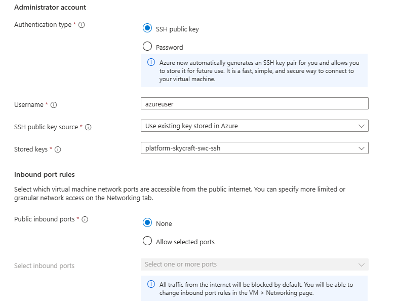

> [!WARNING]
> Do not pick **Generate new key pair** in the VM wizard. It creates a second key resource (`dev-skycraft-swc-auth-vm_key`) in the VM's resource group, which is deleted along with that group, and the VM ends up with a different key from the one in Step 3.2.1.

**Inbound port rules**:

| Field                | Value    |
| -------------------- | -------- |
| Public inbound ports | **None** |

> [!NOTE]
> We select "None" for public inbound ports because the VM will only be accessed via Azure Bastion (through the hub VNet peering) and the load balancer.

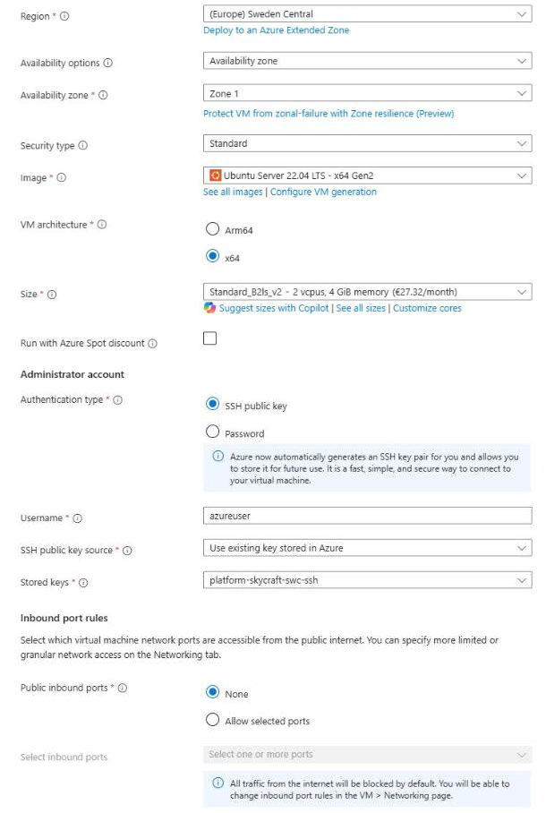

**Expected Result**: Basics tab completed with Ubuntu 22.04 and SSH key configured.

4. Click **Next: Disks**

### Step 3.2.3: Configure Authserver Disks

**Disks tab**:

| Field          | Value                                        |
| -------------- | -------------------------------------------- |
| OS disk size   | **Default (30 GiB)**                         |
| OS disk type   | **Standard SSD (locally-redundant storage)** |
| Delete with VM | ✅ Checked                                   |
| Key management | Platform-managed key                         |

Leave **Encryption at host** unchecked: it is greyed out unless the subscription registered the feature (Step 3.2.21), and this lab encrypts the Authserver with Azure Disk Encryption instead (Section 5). A VM that has encryption at host cannot get Azure Disk Encryption.

**Why Standard SSD for Development?**

- Cost-effective for non-production workloads (~50% cheaper than Premium SSD)
- Adequate performance for development and testing
- For production, consider upgrading to Premium SSD for lower latency

5. Click **Next: Networking**

### Step 3.2.4: Configure Authserver Networking

**Networking tab**:

| Field                         | Value                            |
| ----------------------------- | -------------------------------- |
| Virtual network               | `dev-skycraft-swc-vnet`          |
| Subnet                        | **AuthSubnet (10.1.1.0/24)**     |
| Public IP                     | **None**                         |
| NIC network security group    | **None** (NSG already on subnet) |
| Delete NIC when VM is deleted | ✅ Checked                       |

The wizard pre-fills a new VNet, a new subnet and a new public IP: change all three. With a public IP selected, the delete check box reads **Delete public IP and NIC when VM is deleted**.

**Load balancing options**:

| Field                  | Value                         |
| ---------------------- | ----------------------------- |
| Load balancing options | **Azure load balancer**       |
| Select a load balancer | `dev-skycraft-swc-lb`         |
| Select a backend pool  | `dev-skycraft-swc-lb-be-auth` |

6. Click **Next: Management**

**Expected Result**: VM configured in AuthSubnet, no public IP, connected to load balancer backend pool.

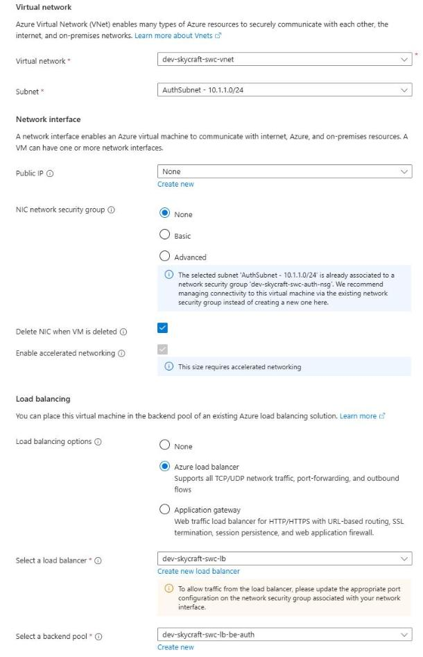

### Step 3.2.5: Configure Authserver Management

**Management tab**:

| Field                       | Value                                            |
| --------------------------- | ------------------------------------------------ |
| Identity                    | ✅ Enable system assigned managed identity       |
| Microsoft Entra ID          | ❌ Unchecked                                     |
| Auto-shutdown               | ❌ Disabled (the wizard turns it on, for 7:00 PM with your e-mail address) |
| Backup                      | ❌ Unchecked                                     |
| Enable periodic assessment  | ❌ Unchecked                                     |
| Patch orchestration options | ✅ Image default                                 |

The Management tab has no Microsoft Defender for Cloud row; Defender is a subscription setting.

7. Click **Next: Monitoring**

**Monitoring tab**:

| Field                                | Value         |
| ------------------------------------ | ------------- |
| Enable recommended alert rules       | Leave unchecked (the default) |
| Boot diagnostics                     | **Disabled** (the default is Enable with managed storage account) |
| Enable OS guest diagnostics          | Leave unchecked (the default) |
| Enable application health monitoring | Leave unchecked (the default) |

8. Click **Next: Advanced** (leave defaults)
9. Click **Next: Tags**

### Step 3.2.6: Add Tags to Authserver VM

**Tags tab**:

| Name        | Value       |
| ----------- | ----------- |
| Project     | SkyCraft    |
| Environment | Development |
| CostCenter  | MSDN        |
| Owner       | mbiszczanik |

10. Click **Review + create**
11. Review the configuration summary. The page also shows the signed-in account's name, e-mail address and phone number: crop them out of any screenshot you share
12. Click **Create**

**Expected Result**:

- Deployment starts (takes 2-5 minutes)
- VM `dev-skycraft-swc-auth-vm` created in Zone 1
- Connected to AuthSubnet with no public IP
- Added to load balancer backend pool

### Step 3.2.7: Verify Authserver VM Deployment

1. Wait for deployment to complete
2. Click **Go to resource**
3. Verify the following in the **Overview** blade:

| Property               | Expected Value                   |
| ---------------------- | -------------------------------- |
| Status                 | Running                          |
| Location               | Sweden Central                   |
| Size                   | Standard_B2ls_v2                 |
| Availability zone      | 1                                |
| Public IP address      | None                             |
| Virtual network/subnet | dev-skycraft-swc-vnet/AuthSubnet |

4. In the left menu, under **Networking** (expand it if it is collapsed), click **Network settings**
5. Verify the private IP address is in the 10.1.1.x range

**Expected Result**: VM running with private IP in AuthSubnet range.

---

## 📖 Section 3: Create Worldserver Virtual Machine (30 minutes)

### Step 3.2.8: Create Worldserver VM

Repeat the VM creation process for the Worldserver. The wizard pre-fills the same defaults as for the Authserver (the warning in Step 3.2.2), so set every row below:

1. Navigate to **Virtual machines** → **+ Create** → **Virtual machine**

**Basics tab**:

| Field                | Value                                   |
| -------------------- | --------------------------------------- |
| Resource group       | `dev-skycraft-swc-rg`                   |
| Virtual machine name | `dev-skycraft-swc-world-vm`             |
| Region               | **Sweden Central**                      |
| Availability options | **Availability zone**                   |
| Availability zone    | **Zone 2** (different from Authserver!) |
| Security type        | **Standard** (the default is Trusted launch) |
| Image                | **Ubuntu Server 22.04 LTS - x64 Gen2**  |
| Size                 | **Standard_B2ls_v2**                    |
| Authentication type  | **SSH public key**                      |
| Username             | `azureuser`                             |
| SSH public key       | [Same key as Authserver: pasted `.pub` (option A) or stored key `platform-skycraft-swc-ssh` (option B)] |
| Public inbound ports | **None**                                |

> [!NOTE]
> We are using the same ssh key for simplicity. Best practice is to use different keys for different VMs.

### Step 3.2.9: Configure Worldserver Disks

**Disks tab**:

| Field          | Value            |
| -------------- | ---------------- |
| OS disk type   | **Standard SSD** (the default is Premium SSD) |
| Delete with VM | ✅ Checked       |

2. Click **Next: Networking**

### Step 3.2.10: Configure Worldserver Networking

**Networking tab**:

| Field                      | Value                          |
| -------------------------- | ------------------------------ |
| Virtual network            | `dev-skycraft-swc-vnet`        |
| Subnet                     | **WorldSubnet (10.1.2.0/24)**  |
| Public IP                  | **None**                       |
| NIC network security group | **None**                       |
| Delete NIC when VM is deleted | ✅ Checked                  |
| Load balancing options     | **Azure load balancer**        |
| Select a load balancer     | `dev-skycraft-swc-lb`          |
| Select a backend pool      | `dev-skycraft-swc-lb-be-world` |

As in Step 3.2.4, replace the new VNet, subnet and public IP the wizard pre-fills.

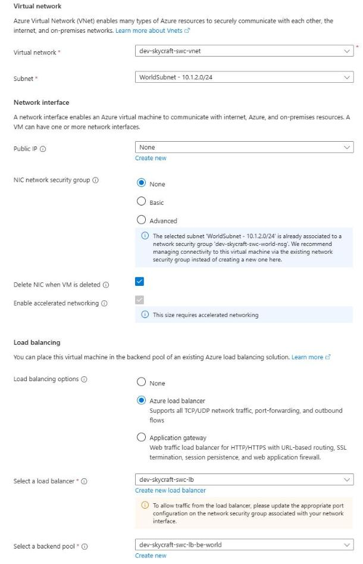

### Step 3.2.11: Configure Worldserver Management

**Management tab**:

| Field                       | Value                                            |
| --------------------------- | ------------------------------------------------ |
| Identity                    | ✅ Enable system assigned managed identity       |
| Microsoft Entra ID          | ❌ Unchecked                                     |
| Auto-shutdown               | ❌ Disabled (the wizard turns it on, for 7:00 PM with your e-mail address) |
| Backup                      | ❌ Unchecked                                     |
| Enable periodic assessment  | ❌ Unchecked                                     |
| Patch orchestration options | ✅ Image default                                 |

**Monitoring tab**:

| Field                                | Value         |
| ------------------------------------ | ------------- |
| Enable recommended alert rules       | Leave unchecked (the default) |
| Boot diagnostics                     | **Disabled** (the default is Enable with managed storage account) |
| Enable OS guest diagnostics          | Leave unchecked (the default) |
| Enable application health monitoring | Leave unchecked (the default) |

### Step 3.2.12: Configure Tags and Create Worldserver

**Tags tab**:

| Name        | Value       |
| ----------- | ----------- |
| Project     | SkyCraft    |
| Environment | Development |
| CostCenter  | MSDN        |
| Owner       | mbiszczanik |

3. Click **Review + create** → **Create**

**Expected Result**:

- VM `dev-skycraft-swc-world-vm` created in Zone 2
- Connected to WorldSubnet
- Added to load balancer backend pool for port 8085

### Step 3.2.13: Verify Both VMs

1. Navigate to **Virtual machines**
2. Verify both VMs are listed and running:

| VM Name                   | Zone | Subnet      | Size             | Status  |
| ------------------------- | ---- | ----------- | ---------------- | ------- |
| dev-skycraft-swc-auth-vm  | 1    | AuthSubnet  | Standard_B2ls_v2 | Running |
| dev-skycraft-swc-world-vm | 2    | WorldSubnet | Standard_B2ls_v2 | Running |

The list's **Public IP address** column shows the load balancer's public IP for both VMs. That is the address of the frontend they sit behind, not an address of their own: neither VM has a public IP.

3. Navigate to **Load balancers** → `dev-skycraft-swc-lb` → **Backend pools**
4. Verify both backend pools have VMs:
   - `dev-skycraft-swc-lb-be-auth`: 1 VM
   - `dev-skycraft-swc-lb-be-world`: 1 VM

#### Add Both VMs to the Outbound Pool

The subnets are private (Lab 2.1), so the VMs reach the internet (package updates, VM extensions) only through the load balancer's outbound rule from Lab 2.3, `dev-skycraft-swc-lb-outbound`. One frontend IP can carry only one outbound rule, so that rule serves one pool, `dev-skycraft-swc-lb-be-outbound`, and both VMs share it. The VM wizard puts a VM into a single backend pool, so add both VMs to the outbound pool here.

5. Click **Backend pools** → `dev-skycraft-swc-lb-be-outbound`
6. Under **IP configurations**, click **+ Add**
7. Under **Add IP configurations to backend pool**, tick the rows of `dev-skycraft-swc-auth-vm` and `dev-skycraft-swc-world-vm`
8. Click **Add**
9. Click **Save**

If the pool list was already open when the pool was created, it shows the pool only after **Refresh**.

#### Put Both NICs into Their Application Security Groups

Lab 2.2 created the application security groups `dev-skycraft-swc-asg-auth` and `dev-skycraft-swc-asg-world` with no members. An ASG groups network interfaces by role, so an NSG rule can name the role instead of IP ranges. Now that the VMs exist, put each VM's network interface into its group:

10. Navigate to **Virtual machines** → `dev-skycraft-swc-auth-vm` → **Networking** → **Application security groups** (Networking is a group of the left menu; expand it if it is collapsed)
11. Click **Add application security groups**, tick `dev-skycraft-swc-asg-auth` and click **Add**
12. Navigate to **Virtual machines** → `dev-skycraft-swc-world-vm` → **Networking** → **Application security groups**
13. Click **Add application security groups**, tick `dev-skycraft-swc-asg-world` and click **Add**

The same with Az PowerShell. The network interface is found through the VM, because the Portal names it after the VM with a few digits added:

```powershell
$rg = 'dev-skycraft-swc-rg'
foreach ($role in 'auth', 'world') {
    $vm  = Get-AzVM -ResourceGroupName $rg -Name "dev-skycraft-swc-$role-vm"
    $nic = Get-AzNetworkInterface -ResourceId $vm.NetworkProfile.NetworkInterfaces[0].Id
    $asg = Get-AzApplicationSecurityGroup -ResourceGroupName $rg -Name "dev-skycraft-swc-asg-$role"
    $nic.IpConfigurations[0].ApplicationSecurityGroups = @($asg)
    $nic | Set-AzNetworkInterface | Out-Null
}
```

**Read the effective security rules.** Azure evaluates NSG rules per network interface: the rules of the subnet's NSG and of the NIC's own NSG, with every ASG in a rule resolved to the private IPs of its member NICs.

14. Navigate to **Virtual machines** → `dev-skycraft-swc-auth-vm` → **Networking** → **Network settings**, then, under **Essentials**, click the value next to **Effective security rules**. You see `dev-skycraft-swc-auth-nsg` (from `AuthSubnet`) with its custom rules and the default rules (65000-65500)
15. Now the database side. Navigate to **Network security groups** → `dev-skycraft-swc-db-nsg` → **Settings** → **Inbound security rules**. `Allow-MySQL-From-AppTier` lets port 3306 in from the application tier: from the two subnet ranges, or, if you saved Step 2.2.9 of Lab 2.2, from `dev-skycraft-swc-asg-auth` and `dev-skycraft-swc-asg-world`. With the NICs in the groups, that ASG source now means exactly these two VMs, whatever their IP addresses
16. On the same NSG, under **Help**, click **Effective security rules**. The page lists no network interface: effective rules exist only for a NIC the NSG applies to, and `DatabaseSubnet` holds no VM yet. A database VM placed there later would show `Allow-MySQL-From-AppTier` with its source resolved to the private IPs of the auth and world VMs

**Expected Result**: Both VMs running in different availability zones, connected to respective load balancer backend pools, `dev-skycraft-swc-lb-be-outbound` lists 2 VMs (auth and world), and each VM's network interface is in its application security group.

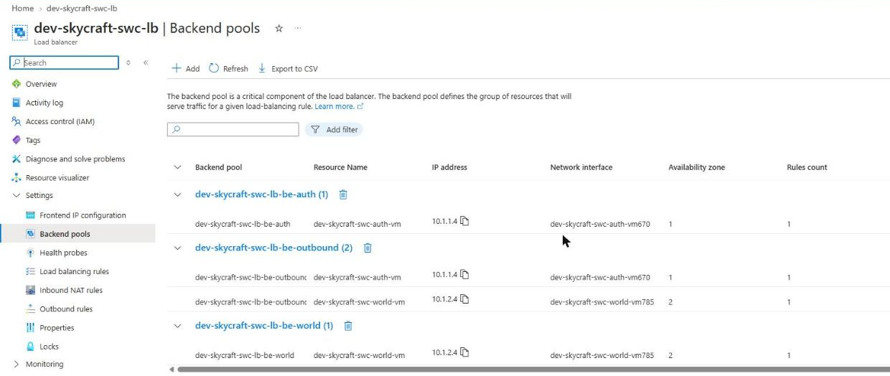

---

## 📖 Section 4: Configure Managed Data Disks (30 minutes)

### Why Data Disks?

The Worldserver VM needs additional storage for:

- MySQL database files
- Game world data
- Logs and backups

**Best Practice**: Keep database storage on a separate disk from the OS disk for:

- Better performance (dedicated I/O)
- Independent backup and snapshot capability
- Ability to resize without OS changes
- Can detach and attach to different VM if needed

### Step 3.2.14: Add Data Disk to Worldserver VM

1. Navigate to **Virtual machines** → `dev-skycraft-swc-world-vm`
2. In the left menu, under **Settings** (expand it if it is collapsed), click **Disks**
3. Click **+ Create and attach a new disk**. A new row appears in the Data disks table, pre-filled with Premium SSD v2, 1 GiB and host caching None (2026-10-24). Choosing Standard SSD resets the size to 4 GiB and keeps host caching at None, so set the storage type first and the size and caching after it. Set its cells:

**Data disk configuration**:

| Field              | Value                                        |
| ------------------ | -------------------------------------------- |
| LUN                | 0                                            |
| Disk name          | `dev-skycraft-swc-world-vm-data`             |
| Storage type       | **Standard SSD (locally-redundant storage)** |
| Size               | **64 GiB** (E6)                              |
| Host caching       | **Read-only**                                |

4. Click **Apply** at the bottom of the page

**Note**: On 2026-10-26 **Apply** turned grey as soon as **Storage type** was changed from the pre-filled Premium SSD v2, with every cell valid, in three tries. If **Apply** stays grey, click **Discard changes** and create the disk with the Az PowerShell block below.

The inline row has no tags field. `Inherit-Project-Tag` (Lab 1.3) gives the new disk `Project` from the resource group. If your subscription has `Enforce-Project-Tag` without `Inherit-Project-Tag`, **Apply** seems to do nothing: the reason, "disallowed by policy", is only under the notification bell. Then create the disk with its tags instead, with the block below or under **Disks** → **+ Create** (zone 2, the four tags), and attach it with **Attach existing disks**.

```powershell
$rg = 'dev-skycraft-swc-rg'
$diskConfig = New-AzDiskConfig -Location swedencentral -Zone 2 -CreateOption Empty -DiskSizeGB 64 -SkuName StandardSSD_LRS `
    -Tag @{ Project = 'SkyCraft'; Environment = 'Development'; CostCenter = 'MSDN'; Owner = 'mbiszczanik' }
$disk = New-AzDisk -ResourceGroupName $rg -DiskName dev-skycraft-swc-world-vm-data -Disk $diskConfig
$vm = Get-AzVM -ResourceGroupName $rg -Name dev-skycraft-swc-world-vm
$vm = Add-AzVMDataDisk -VM $vm -Name $disk.Name -ManagedDiskId $disk.Id -Lun 0 -CreateOption Attach -Caching ReadOnly
Update-AzVM -ResourceGroupName $rg -VM $vm
```

**Expected Result**:

- Data disk creation starts
- Disk appears in the Data disks list at LUN 0
- Total: 1 OS disk + 1 Data disk

### Step 3.2.15: Initialize Data Disk Inside VM

The data disk is attached but not yet formatted. You need to connect to the VM via Azure Bastion and initialize it.

**Connect via Azure Bastion:**

1. Navigate to **Virtual machines** → `dev-skycraft-swc-world-vm`
2. Click **Connect** in the top menu
3. Select **Connect via Bastion** (or **Bastion** tab)
4. If prompted, click **Use Bastion**
5. Configure the connection:

| Field               | Value                                                                  |
| ------------------- | ---------------------------------------------------------------------- |
| Authentication Type | **SSH Private Key from Local File**                                    |
| Username            | `azureuser`                                                            |
| Local File          | Browse to your private key file (`skycraft-dev` for option A, `platform-skycraft-swc-ssh.pem` for option B) |

6. Click **Connect**

> [!TIP]
>
> - Ensure your browser allows pop-ups from Azure Portal
> - The SSH session opens in a new browser tab
> - If connection fails, verify: (1) VM is running, (2) VNet peering is connected, (3) NSG allows SSH from 10.0.0.0/26
> - **No Bastion?** Run the commands below without an SSH session: on the VM, under **Operations**, click **Run command** → **RunShellScript**, paste them and click **Run**. Each run takes a minute or two and shows the output when it ends

**Connection Flow Visualization:**

```
You (Browser) → Azure Portal → Bastion (10.0.0.x) → Peering → WorldServer (10.1.2.x)
```

7. Once connected, run these commands to initialize the disk:

`Standard_B2ls_v2` has no temporary disk, so the new data disk is the second disk the kernel sees, `/dev/sdb`, not `/dev/sdc` as on sizes with a temporary disk. A device letter can change between boots; the Azure Linux agent therefore adds a stable name for each data disk by its LUN, `/dev/disk/azure/scsi1/lun0` for LUN 0, and the commands below use only that name.

```bash
# List the disks: the 64 GB disk without partitions is the new data disk
lsblk -o NAME,SIZE,TYPE,MOUNTPOINT

# Expected output (partial):
# NAME     SIZE TYPE MOUNTPOINT
# sda       30G disk
# ├─sda1  29.9G part /
# ├─sda14    4M part
# └─sda15  106M part /boot/efi
# sdb       64G disk           <-- the new data disk (LUN 0)

# The stable name of LUN 0 points to it
ls -l /dev/disk/azure/scsi1/lun0
# Expected: ... /dev/disk/azure/scsi1/lun0 -> ../../../sdb

# Create one partition over the whole disk (GPT)
sudo parted /dev/disk/azure/scsi1/lun0 --script mklabel gpt mkpart data ext4 0% 100%
sudo partprobe /dev/disk/azure/scsi1/lun0

# The partition's stable name is lun0-part1
ls -l /dev/disk/azure/scsi1/lun0-part1

# Format the partition with ext4
sudo mkfs.ext4 /dev/disk/azure/scsi1/lun0-part1

# Create the mount point and mount the partition
sudo mkdir -p /data
sudo mount /dev/disk/azure/scsi1/lun0-part1 /data

# Mount it at every boot, by its stable name; nofail lets the VM boot without the disk
echo "/dev/disk/azure/scsi1/lun0-part1 /data ext4 defaults,nofail 0 2" | sudo tee -a /etc/fstab

# Verify mount
df -h /data
# Expected: /dev/sdb1 of about 63G, mounted on /data
```

**Expected Result**:

- Data disk partitioned and formatted with ext4
- Mounted at `/data`
- Configured in `/etc/fstab` by its stable name for persistent mount after reboot

### Step 3.2.16: Verify Data Disk Configuration

```bash
# Verify disk is mounted
df -h

# Verify fstab entry
cat /etc/fstab | grep data

# Test write access
sudo touch /data/test-file
ls -la /data/

# Exit Bastion session
exit
```

**Expected Result**: 64 GB data disk mounted at `/data` and ready for MySQL installation.

---

## 📖 Section 5: Configure Azure Disk Encryption (35 minutes)

### What is Azure Disk Encryption?

**Azure Disk Encryption (ADE)** encrypts OS and data disks using:

- **Linux**: dm-crypt subsystem
- **Windows**: BitLocker

**Benefits**:

- Data-at-rest encryption
- Keys stored in Azure Key Vault
- Meets security and compliance requirements
- Transparent to applications

> [!WARNING]
> **Retirement**: Azure Disk Encryption retires on **September 15, 2028**, and Microsoft recommends **encryption at host** for new deployments. AZ-104 (skills measured as of April 17, 2026) lists *Configure encryption at host for Azure virtual machines*, not ADE. This lab still uses ADE on one VM because Lab 5.2 teaches the key vault permission Azure Backup needs for an encrypted VM; Step 3.2.21 shows encryption at host.

> **SkyCraft Choice**: Encrypt the **Authserver VM only**. The Worldserver stays unencrypted on purpose: Lab 5.2 restores single files from its backup and replicates it with Site Recovery, and file-level recovery is not available for a VM encrypted with ADE. Lab 5.2 backs up the encrypted Authserver, after giving Azure Backup a role on the key vault.

**Duration**: the steps take about 35 minutes. The encryption of the OS volume then runs inside the VM for about 2 hours (measured on `Standard_B2s_v2` on 2026-10-15); continue with Sections 6-8 meanwhile, which do not touch the Authserver.

`scripts/Enable-Encryption.ps1` does Steps 3.2.18-3.2.20 in one run (resize, encrypt, wait, resize back), and `scripts/Deploy-Bicep.ps1` runs it after deploying the key vault.

### Step 3.2.17: Create Azure Key Vault for Encryption Keys

1. Navigate to **Key vaults** → **+ Create**

**Basics tab**:

| Field                        | Value                                   |
| ---------------------------- | --------------------------------------- |
| Subscription                 | [Your subscription]                     |
| Resource group               | `dev-skycraft-swc-rg`                   |
| Key vault name               | `dev-skycraft-swc-kv` (globally unique) |
| Region                       | **Sweden Central**                      |
| Pricing tier                 | **Standard**                            |
| Days to retain deleted vaults | `7`                                    |
| Purge protection             | **Disable purge protection**            |

Set the region explicitly: the form defaults to **East US**, which Lab 1.3's `Restrict-Azure-Regions` refuses. Seven days and no purge protection match the Bicep path and let `Remove-LabResource.ps1 -IncludeKeyVault` purge the vault, so its name is free again at once.

Key vault names are unique across all of Azure. If the form says `dev-skycraft-swc-kv` is taken, add a short suffix of your own, for example `dev-skycraft-swc-kv-ab` (24 characters at most), use that name wherever this lab says `dev-skycraft-swc-kv`, and pass it to the lab scripts with `-KeyVaultName` (`Deploy-Bicep.ps1`, `Enable-Encryption.ps1`, `Test-Lab.ps1`, `Remove-LabResource.ps1`). In a class, every learner needs a different name, so add your initials from the start. `Deploy-Bicep.ps1` checks the name before it deploys and stops if it is taken.

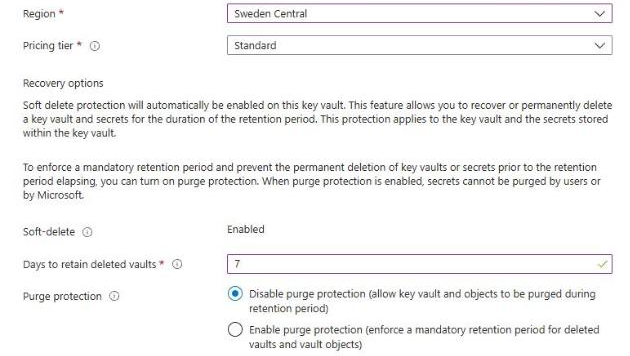

2. Click **Next: Access configuration**

**Access configuration**:

| Field                                       | Value                                             |
| ------------------------------------------- | ------------------------------------------------- |
| Permission model                            | **Azure role-based access control (recommended)** |
| Azure Virtual Machines for deployment       | ✅ Checked                                        |
| Azure Disk Encryption for volume encryption | ✅ Checked                                        |

The two check boxes are under **Resource access**. Leave Azure Resource Manager for template deployment unchecked; ADE does not need it.

3. Click **Next: Networking**

**Networking**:

| Field                | Value                |
| -------------------- | -------------------- |
| Enable public access | ✅ Checked           |
| Allow access from    | **All networks**     |

> [!NOTE]
> For production, you should restrict access to specific VNets. For this lab, we allow public access for simplicity.

4. Click **Next: Tags**

**Tags**:

| Name        | Value       |
| ----------- | ----------- |
| Project     | SkyCraft    |
| Environment | Development |
| CostCenter  | MSDN        |
| Owner       | mbiszczanik |

5. Click **Review + create** → **Create**

The same with Az PowerShell (the permission model is Azure RBAC by default):

```powershell
New-AzKeyVault -Name dev-skycraft-swc-kv -ResourceGroupName dev-skycraft-swc-rg -Location swedencentral `
    -Sku Standard -EnabledForDeployment -EnabledForDiskEncryption -SoftDeleteRetentionInDays 7 `
    -Tag @{ Project = 'SkyCraft'; Environment = 'Development'; CostCenter = 'MSDN'; Owner = 'mbiszczanik' }
```

**Expected Result**: Key vault `dev-skycraft-swc-kv` created with disk encryption enabled.

<a id="step-3218-resize-vms-for-azure-disk-encryption-step-takes-about-15-30-mins"></a>

### Step 3.2.18: Resize the Authserver VM for Azure Disk Encryption

Azure Disk Encryption for Linux VMs requires **8 GB RAM minimum** for OS disk encryption. `Standard_B2ls_v2` has only 4 GB, so resize the Authserver VM to its 8 GB sibling `Standard_B2s_v2` for the duration of the encryption. The Worldserver is not encrypted and keeps its size.

> [!IMPORTANT]
> **Memory Requirement**: ADE for Linux requires 8 GB RAM. The encryption process uses significant memory to encrypt the OS volume.

> [!NOTE]
> `Standard_B2ls_v2` and `Standard_B2s_v2` are in the same Bsv2 family (same hardware cluster), so the resize happens in place: the VM restarts, but no deallocation is needed. It took about 40 seconds on 2026-10-15.

1. Open **Azure Cloud Shell** (PowerShell) from the Azure Portal, or a local PowerShell signed in with `Connect-AzAccount`. A Cloud Shell session without a storage account (**No storage account required**) can run these commands.

2. Resize the Authserver VM to 8 GB RAM:

```powershell
# Resize to Standard_B2s_v2 (8 GB RAM) - in place, the VM restarts
$vm = Get-AzVM -ResourceGroupName dev-skycraft-swc-rg -Name dev-skycraft-swc-auth-vm
$vm.HardwareProfile.VmSize = 'Standard_B2s_v2'
Update-AzVM -ResourceGroupName dev-skycraft-swc-rg -VM $vm
```

In the Portal the same is **Availability + scale** → **Size** on the VM (Step 3.2.26).

**Expected Result**: `dev-skycraft-swc-auth-vm` running with `Standard_B2s_v2` (2 vCPUs, 8 GB RAM).

<a id="step-3219-enable-azure-disk-encryption-on-both-vms"></a>

### Step 3.2.19: Enable Azure Disk Encryption on the Authserver VM

Azure Disk Encryption for Linux VMs is enabled with **Az PowerShell** or the **Azure CLI**; the Portal has no ADE option for a Linux VM.

1. Enable encryption on the Authserver VM:

```powershell
$kv = Get-AzKeyVault -VaultName dev-skycraft-swc-kv -ResourceGroupName dev-skycraft-swc-rg
Set-AzVMDiskEncryptionExtension -ResourceGroupName dev-skycraft-swc-rg -VMName dev-skycraft-swc-auth-vm `
    -DiskEncryptionKeyVaultUrl $kv.VaultUri -DiskEncryptionKeyVaultId $kv.ResourceId -VolumeType All -SkipVmBackup -Force
```

The Azure CLI equivalent is `az vm encryption enable --name dev-skycraft-swc-auth-vm --resource-group dev-skycraft-swc-rg --disk-encryption-keyvault dev-skycraft-swc-kv --volume-type All`.

**Command Parameters Explained**:

| Parameter                    | Value                       | Description                                          |
| ---------------------------- | --------------------------- | ---------------------------------------------------- |
| `-VMName`                    | `dev-skycraft-swc-auth-vm`  | The only VM this lab encrypts                        |
| `-DiskEncryptionKeyVaultUrl` | the vault's URI             | Where ADE stores the disk encryption secret          |
| `-DiskEncryptionKeyVaultId`  | the vault's resource ID     | The same vault, by ID                                |
| `-VolumeType`                | `All`                       | OS and data volumes; the Authserver has no data disk, so its data volume reads `NotMounted` |
| `-SkipVmBackup`              | (switch)                    | Required for a Linux VM with managed disks: without it the command stops with "-skipVmBackup parameter is a required parameter for encrypting Linux VMs with managed disks". Azure takes no backup before the encryption, and this VM has none yet (Lab 5.2 adds one); in production, take a snapshot or a backup first |

2. About tags: the command installs the VM extension `AzureDiskEncryptionForLinux`, and neither command has a tags option. This lab relies on Lab 1.3's `Inherit-Project-Tag` assignment, which gives the extension `Project` = `SkyCraft` from `dev-skycraft-swc-rg`. Without that assignment `Enforce-Project-Tag` refuses the extension with `RequestDisallowedByPolicy` (Troubleshooting, Issue 4).

3. Wait for the encryption. The command can return before the OS volume is done; the encryption then runs inside the VM and took about 2 hours on `Standard_B2s_v2` (2026-10-15). Check it with Step 3.2.20 and continue with Sections 6-8 meanwhile.

> [!CAUTION]
> Do not restart, stop or resize the Authserver VM until Step 3.2.20 shows `Encrypted`: that interrupts the encryption. Plan encryption during maintenance windows for production systems.

### Step 3.2.20: Verify Disk Encryption and Resize Back

1. Check the encryption status of both VMs:

```powershell
Get-AzVMDiskEncryptionStatus -ResourceGroupName dev-skycraft-swc-rg -VMName dev-skycraft-swc-auth-vm
Get-AzVMDiskEncryptionStatus -ResourceGroupName dev-skycraft-swc-rg -VMName dev-skycraft-swc-world-vm
```

**Expected Output**:

| VM | OsVolumeEncrypted | DataVolumesEncrypted |
| --- | --- | --- |
| `dev-skycraft-swc-auth-vm` | `Encrypted` (`EncryptionInProgress` while it runs) | `NotMounted` (no data disk) |
| `dev-skycraft-swc-world-vm` | `NotEncrypted` | `NotEncrypted` |

The Worldserver's `NotEncrypted` is the intended state, not a failure: Lab 5.2 needs it.

2. Once the Authserver reads `Encrypted`, resize it back to `Standard_B2ls_v2` to save costs:

```powershell
$vm = Get-AzVM -ResourceGroupName dev-skycraft-swc-rg -Name dev-skycraft-swc-auth-vm
$vm.HardwareProfile.VmSize = 'Standard_B2ls_v2'
Update-AzVM -ResourceGroupName dev-skycraft-swc-rg -VM $vm
```

> [!TIP]
> Resize back only after encryption has completed - the resize restarts the VM and would interrupt an encryption that is still running. `Enable-Encryption.ps1` does this for you when `-ResizeBack $true` (the default), and skips it when the encryption did not complete.

**Expected Result**: The Authserver's OS volume encrypted and the VM back at `Standard_B2ls_v2`; the Worldserver not encrypted.

---

### Step 3.2.21: (Optional) Enable Encryption at Host (Best Practice)

**Encryption at Host** is the modern, Microsoft-recommended approach for disk encryption. Unlike ADE, it:

- Encrypts data at the VM host level (before it reaches storage)
- Works with any VM size (no 8 GB RAM requirement)
- Covers temp disks and disk caches
- Requires no Key Vault configuration

> [!NOTE]
> **Feature Registration Required**: Encryption at Host must be registered on your subscription before use.

> [!WARNING]
> **Not on the Authserver.** Encryption at host cannot be enabled on a VM that has, or ever had, Azure Disk Encryption, so the commands below target the Worldserver. Site Recovery still protects a VM with encryption at host (Lab 5.2), but the failover VM does not keep the setting.

1. Register the EncryptionAtHost feature (one-time per subscription):

```powershell
# Register the feature
Register-AzProviderFeature -FeatureName EncryptionAtHost -ProviderNamespace Microsoft.Compute

# Check registration status (wait until RegistrationState is Registered)
Get-AzProviderFeature -FeatureName EncryptionAtHost -ProviderNamespace Microsoft.Compute

# Propagate the registration
Register-AzResourceProvider -ProviderNamespace Microsoft.Compute
```

2. Enable Encryption at Host on the Worldserver VM (it must be deallocated):

```powershell
Stop-AzVM -ResourceGroupName dev-skycraft-swc-rg -Name dev-skycraft-swc-world-vm -Force
$vm = Get-AzVM -ResourceGroupName dev-skycraft-swc-rg -Name dev-skycraft-swc-world-vm
Update-AzVM -ResourceGroupName dev-skycraft-swc-rg -VM $vm -EncryptionAtHost $true
Start-AzVM -ResourceGroupName dev-skycraft-swc-rg -Name dev-skycraft-swc-world-vm
```

3. Verify Encryption at Host is enabled:

```powershell
(Get-AzVM -ResourceGroupName dev-skycraft-swc-rg -Name dev-skycraft-swc-world-vm).SecurityProfile.EncryptionAtHost
```

**Expected Output**: `True`

**Comparison: ADE vs Encryption at Host**:

| Feature                  | Azure Disk Encryption | Encryption at Host      |
| ------------------------ | --------------------- | ----------------------- |
| **Encryption location**  | Disk level (guest OS) | Host level (hypervisor) |
| **RAM requirement**      | 8 GB minimum          | None                    |
| **Key Vault required**   | Yes                   | No                      |
| **Temp disk encrypted**  | No                    | Yes                     |
| **Disk cache encrypted** | No                    | Yes                     |
| **Future support**       | Retiring Sept 2028    | Recommended             |
| **On AZ-104**            | No                    | Yes                     |

4. You can also verify in Azure Portal: on the VM, under **Settings**, click **Disks**; encryption at host is shown there.

**Expected Result**: The Worldserver reports `EncryptionAtHost` = `True` if you ran this optional step; nothing changed otherwise.

---

## 📖 Section 6: Deploy VMs to Availability Zones (25 minutes)

### Understanding Availability Zones vs Availability Sets

| Feature                  | Availability Zones                  | Availability Sets               |
| ------------------------ | ----------------------------------- | ------------------------------- |
| **Isolation**            | Separate datacenters                | Same datacenter, separate racks |
| **SLA**                  | 99.99%                              | 99.95%                          |
| **Protection**           | Datacenter failure                  | Rack/power failure              |
| **Network latency**      | ~2ms between zones                  | Sub-millisecond                 |
| **Cost**                 | Same as standard                    | Same as standard                |
| **Cross-zone resources** | Standard LB, Zone-redundant storage | N/A                             |

**For SkyCraft**: We use **Availability Zones** for maximum fault tolerance.

### Step 3.2.22: Verify Availability Zone Distribution

Your VMs should already be in different zones:

```powershell
# List VMs with their availability zones
Get-AzVM -ResourceGroupName dev-skycraft-swc-rg |
    Select-Object Name, @{N='Zone';E={$_.Zones -join ','}}, @{N='Size';E={$_.HardwareProfile.VmSize}} |
    Format-Table -AutoSize

# Expected output:
# Name                      Zone Size
# ----                      ---- ----
# dev-skycraft-swc-auth-vm  1    Standard_B2ls_v2
# dev-skycraft-swc-world-vm 2    Standard_B2ls_v2
```

While the Authserver is still encrypting (Step 3.2.19), it shows `Standard_B2s_v2`.

**Expected Result**: VMs are distributed across Zone 1 and Zone 2.

### Step 3.2.23: Understand Zone-Redundant Load Balancing

A Standard load balancer serves backends in every zone. Whether its frontend survives a zone failure depends on the frontend's public IP: an IP in zones 1, 2 and 3 is zone-redundant. The load balancer's **Overview** does not say so; the public IP does.

1. Navigate to **Load balancers** → `dev-skycraft-swc-lb`
2. Under **Settings**, click **Frontend IP configuration** and open the public IP of `dev-skycraft-swc-lb-frontend`
3. On the public IP's **Overview**, read its availability zones: zones 1, 2 and 3 make it zone-redundant, meaning:
   - If Zone 1 fails, traffic routes to Zone 2
   - Players experience no interruption

The same with Az PowerShell:

```powershell
(Get-AzPublicIpAddress -ResourceGroupName dev-skycraft-swc-rg -Name dev-skycraft-swc-lb-pip).Zones
# Expected: 1, 2, 3
```

**Expected Result**: The load balancer's frontend is zone-redundant, because its public IP is in zones 1, 2 and 3.

### Step 3.2.24: Test High Availability (Conceptual)

In a real scenario, you would test HA by:

1. **Simulating zone failure**: Stop one VM
2. **Verifying traffic routing**: Load balancer routes to remaining VM
3. **Restoring service**: Start stopped VM, verify it rejoins backend pool

For this lab, we'll document the expected behavior:

| Scenario               | Expected Behavior                             |
| ---------------------- | --------------------------------------------- |
| Zone 1 fails           | Authserver unavailable, Worldserver continues |
| Zone 2 fails           | Worldserver unavailable, Authserver continues |
| Both zones operational | Full redundancy, load balanced                |

**Note**: For true game server HA, you would deploy multiple instances of each server type across different zones.

---

## 📖 Section 7: Manage VM Sizes (25 minutes)

### Step 3.2.25: View Available VM Sizes

Before resizing, check available sizes:

```powershell
# List the B-series v2 sizes in Sweden Central
Get-AzComputeResourceSku -Location swedencentral |
    Where-Object { $_.ResourceType -eq 'virtualMachines' -and $_.Name -like 'Standard_B*_v2' } |
    Select-Object Name,
        @{N='vCPUs';E={($_.Capabilities | Where-Object Name -eq 'vCPUs').Value}},
        @{N='MemoryGB';E={($_.Capabilities | Where-Object Name -eq 'MemoryGB').Value}} |
    Format-Table -AutoSize

# Expected output (partial):
# Name             vCPUs MemoryGB
# ----             ----- --------
# Standard_B2ls_v2 2     4
# Standard_B2s_v2  2     8
# Standard_B4ls_v2 4     8
# Standard_B4s_v2  4     16
```

The SKU list is large: the query takes from a few seconds to a few minutes (`Get-AzComputeResourceSku` took 10 seconds on 2026-10-24, `az vm list-skus` 2-4 minutes on 2026-10-15).

### Step 3.2.26: Resize Worldserver VM (Example)

If player load increases, you might need to resize:

1. Navigate to **Virtual machines** → `dev-skycraft-swc-world-vm`
2. Click **Stop** to deallocate the VM (required for most resizes), then **Yes** in the **Stop this virtual machine** box under the toolbar (leave **Apply force deallocate** cleared)

> [!WARNING]
> Resizing requires stopping the VM in most cases. Plan for downtime or use availability sets/zones with multiple instances.

> [!NOTE]
> A resize inside the same family (`Standard_B2ls_v2` to `Standard_B2s_v2`, both Bsv2) does not need a deallocation - Azure restarts the VM in place. The stop/start below is the general procedure that also covers cross-family resizes.

3. Wait for VM to fully stop (Status: Stopped (deallocated)). The Overview keeps showing Running until you click **Refresh**
4. In the left menu, under **Availability + scale** (expand it if it is collapsed), click **Size**
5. Search for `Standard_B2s_v2` (upgrade to 8 GB RAM)
6. Select **Standard_B2s_v2**
7. Click **Resize**
8. Wait for resize to complete (1-2 minutes)
9. Click **Start** to restart the VM (click **Refresh** to see the new state)

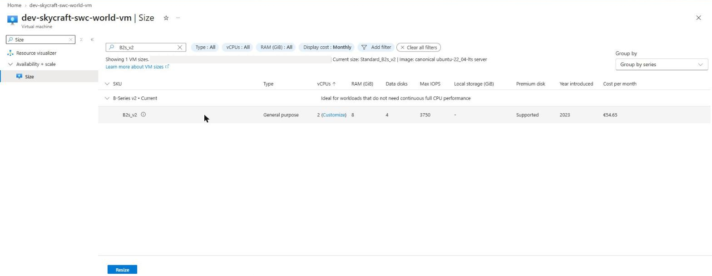

**Expected Result**:

- VM resized from Standard_B2ls_v2 (4 GB) to Standard_B2s_v2 (8 GB)
- All data preserved
- Network configuration retained

### Step 3.2.27: Resize Back for Cost Optimization (Optional)

For this lab, resize back to B2ls_v2 to minimize costs:

1. Stop the VM again
2. Resize to **Standard_B2ls_v2**
3. Start the VM

**Best Practice for Production**:

- Monitor CPU and memory usage over time
- Use Azure Advisor for right-sizing recommendations
- Consider Reserved Instances for predictable workloads (up to 72% savings)

### Step 3.2.28: Understand VM Size Constraints

Not all sizes are available in all zones or regions:

```powershell
# Check in which zones a size is offered, and whether this subscription may use it
Get-AzComputeResourceSku -Location swedencentral |
    Where-Object { $_.ResourceType -eq 'virtualMachines' -and $_.Name -eq 'Standard_D4s_v3' } |
    Select-Object Name,
        @{N='Zones';E={$_.LocationInfo.Zones -join ','}},
        @{N='Restrictions';E={$_.Restrictions.ReasonCode -join ','}}
```

An empty **Zones** column does not mean the size has no zones. Read **Restrictions** too: `NotAvailableForSubscription` means this subscription may not use the size there, which is how a lab subscription can lack a size that the region offers (as the B-series v1 sizes in Section 1). On 2026-10-15 the `az vm list-skus` form of this query printed no zones at all on the lab subscription.

| Constraint         | Resolution                             |
| ------------------ | -------------------------------------- |
| Size not in zone   | Deploy in different zone               |
| Size not in region | Choose different region or size family |
| Quota exceeded     | Request quota increase                 |
| Disk constraints   | Some sizes don't support Premium SSD   |

### Moving a VM to Another Resource Group (Concept)

Resource groups organise resources; a VM can move to another group, or another subscription, without being recreated. This lab does not move a VM: a move changes every resource ID, and the load balancer pools, ASGs and later labs refer to these VMs by ID. What a move involves:

- **The Portal path**: on the VM's **Overview**, **Move** → **Move to another resource group**. Azure lists the related resources (network interface, disks) to move with it and validates the move before it starts.
- **What moves together**: a VM moves with its disks and network interface. Resources it depends on that stay behind (the VNet, the load balancer) keep working across groups in the same subscription.
- **What changes**: the resource IDs. Scripts, RBAC assignments scoped to the old group, and policies of the old group no longer apply; the new group's policies and locks do (Lab 1.3).
- **What does not change**: the VM keeps running, its private IP and its zone stay the same.

Read more in [Move a VM to another resource group or subscription](https://learn.microsoft.com/en-us/azure/azure-resource-manager/management/move-resource-group-and-subscription).

---

## 📖 Section 8: Create Virtual Machine Scale Set (30 minutes)

### What are Virtual Machine Scale Sets (VMSS)?

**VM Scale Sets** allow you to deploy and manage a group of identical VMs with:

- **Auto-scaling**: Add/remove instances based on demand
- **Load balancing**: Automatic integration with Azure Load Balancer
- **High availability**: Spread across availability zones
- **Consistent configuration**: All instances use same image and settings

### When to Use VMSS for SkyCraft

| Use Case             | Individual VMs        | VM Scale Sets      |
| -------------------- | --------------------- | ------------------ |
| **Development**      | ✅ Simpler, 1-2 VMs   | ❌ Overkill        |
| **Small Production** | ✅ 2-5 VMs            | ❌ Not needed      |
| **Large Production** | ❌ Complex management | ✅ Auto-scaling    |
| **Variable Load**    | ❌ Manual scaling     | ✅ Auto-scaling    |
| **Event-based**      | ❌ Slow response      | ✅ Rapid scale-out |

### Step 3.2.29: Create a Virtual Machine Scale Set

The scale set goes into **`dev-skycraft-swc-rg`**. Lab 1.3 puts a `CanNotDelete` lock on `prod-skycraft-swc-rg`, so a scale set there could not be deleted in Step 3.2.33 (`ScopeLocked`); the dev group has no lock.

1. In Azure Portal, search for **Virtual machine scale sets** and click **+ Create**

> [!WARNING]
> As the VM wizard, this one pre-fills values the lab does not use:
>
> | Field | Portal default | Lab value |
> | --- | --- | --- |
> | Orchestration mode | Flexible | Uniform |
> | Security type | Trusted launch | Standard |
> | Scaling mode | (choose) | Manually update the capacity |
> | Virtual network | a new VNet | `dev-skycraft-swc-vnet` |
> | NIC network security group | Basic | None |

**Basics tab - Orchestration**:

| Field                          | Value                          |
| ------------------------------ | ------------------------------ |
| Subscription                   | Your subscription              |
| Resource group                 | `dev-skycraft-swc-rg`          |
| Virtual machine scale set name | `dev-skycraft-swc-world-vmss`  |
| Region                         | **Sweden Central**             |
| Availability zone              | **Zones 1, 2, 3** (select all) |
| Orchestration mode             | **Uniform**                    |
| Security type                  | **Standard**                   |

**Basics tab - Scaling**:

| Field          | Value                              |
| -------------- | ---------------------------------- |
| Scaling mode   | **Manually update the capacity**   |
| Instance count | **2**                              |

> **SkyCraft Choice**: The scale set starts with a fixed count, and Step 3.2.30 adds the autoscale rules afterwards. Choosing **Autoscaling** here makes the wizard create an autoscale setting, and the wizard's **Tags** tab cannot tag it (autoscale settings are not in its resource list). Under Lab 1.3's `Enforce-Project-Tag` alone, **Review + create** then stops at validation with `RequestDisallowedByPolicy` (seen on 2026-10-15). The two-step route works with or without `Inherit-Project-Tag`.

**Basics tab - Instance details**:

| Field           | Value                                      |
| --------------- | ------------------------------------------ |
| Image           | **Ubuntu Server 24.04 LTS - x64 Gen2** (the default; the scale set does not run the lab's services, so it needs no particular release) |
| VM architecture | **x64**                                    |
| Size            | **Standard_B2ls_v2** (2 vCPUs, 4 GB)       |

**Basics tab - Administrator account**:

| Field                 | Value                             |
| --------------------- | --------------------------------- |
| Authentication type   | **SSH public key**                |
| Username              | `azureuser`                       |
| SSH public key source | **Use existing public key**       |
| SSH public key        | Paste your `skycraft-dev.pub` key (option B: **Use existing key stored in Azure** → `platform-skycraft-swc-ssh`) |

2. Click **Next: Spot**

**Spot tab**:

- Leave defaults (we're not using Spot instances for this lab)

3. Click **Next: Disks**

**Disks tab**:

| Field              | Value            |
| ------------------ | ---------------- |
| OS disk type       | **Standard SSD** |
| Encryption at host | ❌ Unchecked     |

**Encryption at host** is greyed out with "Encryption at host is not registered for the selected subscription" unless you registered the feature in the optional Step 3.2.21; leave it unchecked either way.

4. Click **Next: Networking**

**Networking tab**:

| Field           | Value                   |
| --------------- | ----------------------- |
| Virtual network | `dev-skycraft-swc-vnet` |
| Subnet          | `WorldSubnet`           |

5. In the **Network interface** table, click the pencil icon of the network interface and set:

| Field                      | Value        |
| -------------------------- | ------------ |
| Subnet                     | `WorldSubnet` |
| NIC network security group | **None**     |
| Public IP address          | **Disabled** |

The pane opens on the first subnet of the VNet (`AppServiceSubnet`) with **Public IP address** **Enabled**, whatever the **Subnet** above says (seen 2026-10-26): set all three. Choose **None** for the NIC's NSG: `WorldSubnet` already has `dev-skycraft-swc-world-nsg` from Lab 2.2. The default, **Basic**, creates an extra NSG named `basicNsg<nic-name>`, and that NSG stays behind when the scale set is deleted. Click **OK**.

**Load balancing**:

| Field                  | Value                          |
| ---------------------- | ------------------------------ |
| Load balancing options | **Azure load balancer**        |
| Select a load balancer | `dev-skycraft-swc-lb`          |
| Select a backend pool  | `dev-skycraft-swc-lb-be-world` |

> [!NOTE]
> The VMSS instances will be added to the load balancer backend pool for automatic traffic distribution. The wizard joins one pool only, so the instances are **not** in the egress pool `dev-skycraft-swc-lb-be-outbound` and have **no internet access**: the subnet is private and the load balancer's outbound rule serves that pool alone. This lab installs nothing on them, so they need none. A production scale set would add the egress pool to its network profile, or use a NAT gateway.

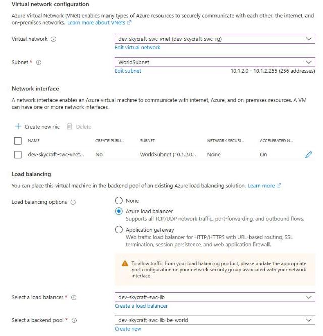

6. Click **Next: Management**

**Management tab**:

| Field          | Value      |
| -------------- | ---------- |
| Upgrade policy | **Manual** |

7. Click **Next: Health**

**Health tab**:

- Leave defaults

8. Click **Next: Advanced**

**Advanced tab**:

- Leave defaults

9. Click **Next: Tags**

**Tags**:

| Name        | Value       |
| ----------- | ----------- |
| Project     | SkyCraft    |
| Environment | Development |
| CostCenter  | MSDN        |
| Owner       | mbiszczanik |

10. Click **Review + create** → **Create**

**Expected Result**: VMSS `dev-skycraft-swc-world-vmss` created in `dev-skycraft-swc-rg` with 2 initial instances across availability zones.

### Step 3.2.30: Verify VMSS Deployment

1. Navigate to **Virtual machine scale sets** → `dev-skycraft-swc-world-vmss`

2. Click **Instances** in the left menu

3. Verify you see 2 instances running in different zones:

```powershell
# List VMSS instances
Get-AzVmssVM -ResourceGroupName dev-skycraft-swc-rg -VMScaleSetName dev-skycraft-swc-world-vmss |
    Select-Object Name, @{N='Zone';E={$_.Zones -join ','}}, ProvisioningState |
    Format-Table -AutoSize

# Expected output:
# Name                          Zone ProvisioningState
# ----                          ---- -----------------
# dev-skycraft-swc-world-vmss_0 1    Succeeded
# dev-skycraft-swc-world-vmss_1 2    Succeeded
```

#### Add the Autoscale Rules

4. In the left menu, under **Availability + scale**, click **Scaling**
5. Select the **Custom autoscale** card. In the Default condition, choose **Scale based on a metric** and set the instance limits:

| Field   | Value |
| ------- | ----- |
| Minimum | **1** |
| Maximum | **4** |
| Default | **2** |

6. Click **+ Add a rule** and add the scale-out rule; then add the scale-in rule the same way:

| Field                    | Scale out           | Scale in            |
| ------------------------ | ------------------- | ------------------- |
| Metric name              | Percentage CPU      | Percentage CPU      |
| Operator                 | Greater than        | Less than           |
| Metric threshold         | **70**              | **30**              |
| Duration (minutes)       | **5**               | **5**               |
| Operation                | Increase count by   | Decrease count by   |
| Instance count           | **1**               | **1**               |

7. Click **Save** at the top

The autoscale setting has no tags field here either. `Inherit-Project-Tag` (Lab 1.3) gives it `Project` from `dev-skycraft-swc-rg`; without that assignment, **Save** fails with `RequestDisallowedByPolicy`, shown under the notification bell. The Az PowerShell route sets the tags itself and works in both cases:

```powershell
$rg   = 'dev-skycraft-swc-rg'
$vmss = Get-AzVmss -ResourceGroupName $rg -VMScaleSetName dev-skycraft-swc-world-vmss
$ruleArgs = @{
    MetricTriggerMetricName        = 'Percentage CPU'
    MetricTriggerMetricResourceUri = $vmss.Id
    MetricTriggerTimeGrain         = [TimeSpan]::FromMinutes(1)
    MetricTriggerStatistic         = 'Average'
    MetricTriggerTimeWindow        = [TimeSpan]::FromMinutes(5)
    MetricTriggerTimeAggregation   = 'Average'
    ScaleActionType                = 'ChangeCount'
    ScaleActionValue               = '1'
    ScaleActionCooldown            = [TimeSpan]::FromMinutes(5)
}
$scaleOut = New-AzAutoscaleScaleRuleObject @ruleArgs -MetricTriggerOperator GreaterThan -MetricTriggerThreshold 70 -ScaleActionDirection Increase
$scaleIn  = New-AzAutoscaleScaleRuleObject @ruleArgs -MetricTriggerOperator LessThan -MetricTriggerThreshold 30 -ScaleActionDirection Decrease
$autoscaleProfile = New-AzAutoscaleProfileObject -Name 'Default' -CapacityDefault 2 -CapacityMinimum 1 -CapacityMaximum 4 -Rule $scaleOut, $scaleIn
New-AzAutoscaleSetting -Name dev-skycraft-swc-world-vmss-autoscale -ResourceGroupName $rg -Location swedencentral `
    -Profile $autoscaleProfile -Enabled -TargetResourceUri $vmss.Id `
    -Tag @{ Project = 'SkyCraft'; Environment = 'Development'; CostCenter = 'MSDN'; Owner = 'mbiszczanik' }
```

8. Back on **Scaling**, verify the scale-out and scale-in rules are configured

**Expected Result**: autoscale is configured (1-4 instances, CPU above 70% adds one, below 30% removes one). The idle instances run far below 30% CPU, so within about 10 minutes the scale-in rule takes the scale set from 2 instances to 1: that is the rule working, not a fault (seen on 2026-10-24).

### Step 3.2.31: Test Manual Scaling

1. In the VMSS blade, under **Availability + scale**, click **Scaling**

2. Select the **Manual scale** card. This turns the autoscale rules off until you select Custom autoscale again

3. Change **Instance count** to `3`

4. Click **Save** at the top

5. Click **Instances** to watch a new instance being created

6. Wait for the 3rd instance to reach **Running** state

7. Return to **Scaling** and scale back to **2** instances

8. Select **Custom autoscale** and click **Save** to turn the rules of Step 3.2.30 back on

**Expected Result**: VMSS successfully scales from 2 → 3 → 2 instances.

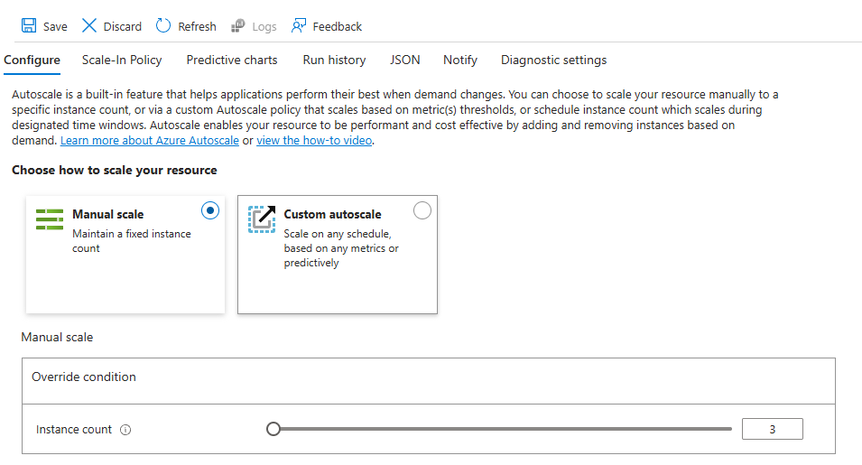

### Step 3.2.32: Connect to VMSS Instance via Bastion

1. In the VMSS blade, click **Instances**

2. Select an instance (e.g., `dev-skycraft-swc-world-vmss_0`)

3. Click **Connect** → **Bastion**

4. Enter credentials:
   - **Authentication Type**: **Private Key from Local File** (the page opens on **Microsoft Entra ID**, which the scale set is not set up for)
   - **Username**: `azureuser`
   - Select your private key file (`skycraft-dev`, or `platform-skycraft-swc-ssh.pem` with option B)

5. Click **Connect**

**Expected Result**: Connected to VMSS instance via Bastion. The instance has no internet access (Step 3.2.29), so `sudo apt update` there times out; that is expected.

### Step 3.2.33: Cleanup - Delete VMSS (Important for Cost)

> [!IMPORTANT]
> VMSS instances incur costs. Delete the VMSS after completing this lab section to avoid unnecessary charges.

1. Navigate to **Virtual machine scale sets** → `dev-skycraft-swc-world-vmss`

2. Click **Delete**

3. The confirmation is a bar with Yes and No buttons and an Apply force delete check box. Leave the check box cleared and click **Yes**

4. The scale set's instances, with their disks and network interfaces, go with it. Two resources may stay in `dev-skycraft-swc-rg`: the autoscale setting of Step 3.2.30 (tick Show hidden types in the resource group's list to see it) and, if the NIC's NSG was left at Basic, `basicNsg<nic-name>`. Delete them too

**Or via Az PowerShell**:

```powershell
$rg = 'dev-skycraft-swc-rg'
Remove-AzVmss -ResourceGroupName $rg -VMScaleSetName dev-skycraft-swc-world-vmss -Force

# The autoscale setting that targeted it, whatever its name
Get-AzAutoscaleSetting -ResourceGroupName $rg |
    Where-Object TargetResourceUri -like '*/virtualMachineScaleSets/dev-skycraft-swc-world-vmss' |
    ForEach-Object { Remove-AzAutoscaleSetting -ResourceGroupName $rg -Name $_.Name }

# An NSG the wizard created with NIC NSG = Basic
Get-AzNetworkSecurityGroup -ResourceGroupName $rg |
    Where-Object Name -like 'basicNsg*' |
    ForEach-Object { Remove-AzNetworkSecurityGroup -ResourceGroupName $rg -Name $_.Name -Force }
```

`scripts/Remove-LabResource.ps1` removes the scale set, its autoscale setting and that NSG as well.

**Expected Result**: VMSS deleted, with nothing left behind in `dev-skycraft-swc-rg`. You've completed the VMSS hands-on section.

### VMSS vs AKS for Game Servers

For containerized game servers, Azure Kubernetes Service (AKS) is an alternative:

| Feature           | VMSS               | AKS                  |
| ----------------- | ------------------ | -------------------- |
| Complexity        | Lower              | Higher               |
| Container support | Via Docker on VMs  | Native               |
| Scaling speed     | Minutes            | Seconds              |
| Cost              | VM-based           | Pod-based            |
| Game server fit   | Traditional setups | Modern microservices |

**Recommendation for SkyCraft**: Use VMSS for simplicity. AzerothCore runs well on VMs.

---

## ✅ Lab Checklist

Quick verification before proceeding:

### Virtual Machines Created

- [ ] `dev-skycraft-swc-auth-vm` deployed in Zone 1
- [ ] `dev-skycraft-swc-world-vm` deployed in Zone 2
- [ ] Both VMs running Ubuntu 22.04 LTS (the Bicep path: image version `22.04.202506200`, kernel `6.8.0-1030-azure`)
- [ ] Both VMs sized as Standard_B2ls_v2
- [ ] Both VMs have no public IP addresses

### Networking Configuration

- [ ] Authserver VM connected to AuthSubnet (10.1.1.0/24)
- [ ] Worldserver VM connected to WorldSubnet (10.1.2.0/24)
- [ ] Authserver added to load balancer backend pool (be-auth)
- [ ] Worldserver added to load balancer backend pool (be-world)
- [ ] Both VMs added to the outbound pool (be-outbound), their only internet access
- [ ] Authserver NIC in `dev-skycraft-swc-asg-auth`, Worldserver NIC in `dev-skycraft-swc-asg-world`
- [ ] SSH access verified via Azure Bastion (or the commands run through Run command)

### Disk Configuration

- [ ] OS disks using Standard SSD
- [ ] Data disk (64 GB) attached to Worldserver VM at LUN 0
- [ ] Data disk mounted at /data inside VM, through `/dev/disk/azure/scsi1/lun0-part1`
- [ ] Azure Disk Encryption enabled on the Authserver VM (OS volume `Encrypted`)
- [ ] Worldserver VM not encrypted with Azure Disk Encryption (Lab 5.2 needs it so)
- [ ] Key vault created for encryption keys

### Scale Set

- [ ] `dev-skycraft-swc-world-vmss` created in `dev-skycraft-swc-rg`, scaled 2 → 3 → 2, and deleted with its autoscale setting

### Tags Applied

- [ ] Project = SkyCraft
- [ ] Environment = Development
- [ ] CostCenter = MSDN
- [ ] Owner = mbiszczanik

**For detailed verification**, see [lab-checklist-3.2.md](lab-checklist-3.2.md)

---

## 📦 What This Lab Leaves Behind

Labs 5.1, 5.2 and 5.3 use the two VMs (`tools/lab-cycle-manifest.psd1`: 5.1, 5.3 <- 3.2), and Lab 5.2 relies on which one is encrypted. Daily costs are approximate, for Sweden Central, from the monthly figures in [ARCHITECTURE.md](ARCHITECTURE.md).

| Left behind | Where | Daily cost | What a later lab does with it |
| --- | --- | --- | --- |
| `dev-skycraft-swc-auth-vm`, Standard_B2ls_v2, zone 1, **encrypted with Azure Disk Encryption** (OS volume) | `dev-skycraft-swc-rg` | about 1 EUR while running, plus its 30 GB OS disk (about 0.12 EUR) | Lab 5.2 backs it up (Step 5.2.3). Azure Backup needs the Microsoft Entra app *Backup Management Service* to hold the *Key Vault Administrator* role on `dev-skycraft-swc-kv` first; without that role *Enable backup* fails with `400198 UserErrorKeyVaultPermissionsNotConfigured`. Lab 5.2 grants it in Step 5.2.3, before *Enable backup*. Labs 5.1 and 5.3 monitor it |
| `dev-skycraft-swc-world-vm`, Standard_B2ls_v2, zone 2, **not encrypted** | `dev-skycraft-swc-rg` | about 1 EUR while running, plus its OS disk | Lab 5.2 restores single files from its backup and replicates it with Site Recovery; file-level recovery is not available for an ADE-encrypted VM. Site Recovery also needs the VM's kernel to be one its Mobility service supports: a newer kernel fails with `ASRMobilityServiceKernelNotSupportedV2` (seen on 2026-10-17 with the 22.04 image's `6.8.0-1065-azure`). Lab 5.2 does not cover that yet (#366) |
| `dev-skycraft-swc-world-vm-data`, 64 GB Standard SSD at LUN 0, mounted at `/data` | `dev-skycraft-swc-rg` | about 0.25 EUR | Replicated with the world VM in Lab 5.2 (30 + 64 GB to copy) |
| `dev-skycraft-swc-kv`, Standard, Azure RBAC, enabled for disk encryption | `dev-skycraft-swc-rg` | close to 0 (billed per operation) | Holds the Authserver's disk encryption secret: do not delete it while that VM exists, because the VM needs the secret to start. Azure Backup needs a role on it before Lab 5.2 backs up the Authserver (see the first row) |
| Both NICs in their role pools and in `dev-skycraft-swc-lb-be-outbound` | `dev-skycraft-swc-lb` | 0 (the load balancer is Lab 2.3's) | Lab 2.3's Bicep can no longer be re-run while the NICs are in its pools (#352) |
| Both NICs in `dev-skycraft-swc-asg-auth` / `-asg-world` | Lab 2.2's ASGs | 0 | An NSG rule that names these ASGs now applies to these VMs |

Nothing is left from the scale set if Step 3.2.33 ran; `Test-Lab.ps1` warns when `dev-skycraft-swc-world-vmss` still exists. `scripts/Remove-LabResource.ps1` removes the VMs, the data disk, a leftover scale set with its autoscale setting and `basicNsg` NSG, and, with `-IncludeKeyVault`, deletes and purges the key vault. Run it only after Module 5, which needs the VMs.

---

## 🎓 Knowledge Check

Test your understanding with these questions:

1. **What is the difference between Availability Zones and Availability Sets?**

   <details>
     <summary>**Click to see the answer**</summary>

   **Answer**:

   **Availability Zones**:
   - Physically separate datacenters within a region
   - Each zone has independent power, cooling, and networking
   - Provides 99.99% SLA
   - Protects against entire datacenter failures
   - ~2ms latency between zones

   **Availability Sets**:
   - Logical groupings within a single datacenter
   - VMs distributed across fault domains (racks) and update domains
   - Provides 99.95% SLA
   - Protects against rack-level failures and maintenance reboots
   - Sub-millisecond latency

   **When to use which**:
   - Use **Availability Zones** when you need highest availability and can tolerate 2ms latency
   - Use **Availability Sets** when zones aren't available or latency is critical
   - For SkyCraft, we use Zones because game servers tolerate 2ms easily

   </details>

2. **Why do we use separate data disks instead of storing database files on the OS disk?**

   <details>
     <summary>**Click to see the answer**</summary>

   **Answer**: Using separate data disks provides several advantages:

   **1. Performance Isolation**:
   - Dedicated I/O bandwidth for database operations
   - OS operations don't compete with database reads/writes
   - Can choose higher performance tier for data disk only

   **2. Independent Management**:
   - Resize data disk without affecting OS
   - Snapshot data disk separately for backup
   - Different retention policies for OS vs data

   **3. Disaster Recovery**:
   - Data disk can be detached and attached to new VM
   - If OS disk corrupts, data is preserved
   - Can restore data from snapshot to new VM

   **4. Cost Optimization**:
   - OS disk can be smaller (30 GB)
   - Data disk sized for actual data needs
   - Different performance tiers as needed

   **For SkyCraft**: MySQL database performance benefits from Premium SSD data disk with dedicated IOPS.

   </details>

3. **What happens when you resize a VM from Standard_B2ls_v2 to Standard_D4s_v3?**

   <details>
     <summary>**Click to see the answer**</summary>

   **Answer**: Resizing a VM involves the following:

   **Process**:
   1. VM must be stopped (deallocated) for most size changes
   2. Azure moves VM to hardware with new specifications
   3. VM restarts with new size
   4. Public/private IPs are preserved (if static)
   5. Data disks remain attached

   **What Changes**:
   | Property | B2ls_v2 | D4s_v3 |
   |----------|---------|--------|
   | vCPUs | 2 | 4 |
   | RAM | 4 GB | 16 GB |
   | Temp disk | None (Bsv2 is diskless) | 32 GB |
   | Max data disks | 4 | 8 |
   | Max NICs | 2 | 2 |
   | Cost | ~$30/month | ~$140/month |

   **What's Preserved**:
   - OS disk data and configuration
   - Data disk attachments
   - Network configuration
   - Azure Bastion access
   - Tags and metadata

   **Potential Issues**:
   - New size must be available in same zone
   - Applications need restart configuration
   - IP address might change (if dynamic)

   </details>

4. **Why do we encrypt disks with Azure Disk Encryption?**

   <details>
     <summary>**Click to see the answer**</summary>

   **Answer**: Azure Disk Encryption provides data-at-rest security:

   **Security Benefits**:
   - **Compliance**: Meet regulatory requirements (GDPR, PCI-DSS)
   - **Data protection**: Prevent unauthorized access to disk images
   - **Defense in depth**: Additional layer beyond OS-level encryption

   **How It Works**:
   - **Linux**: Uses dm-crypt subsystem
   - **Windows**: Uses BitLocker
   - **Key storage**: Keys in Azure Key Vault (customer-managed or platform-managed)
   - **Transparent**: Applications see unencrypted data normally

   **What's Protected**:
   - OS disk contents
   - Data disk contents
   - Temporary disks (not encrypted by ADE, use host encryption)

   **For SkyCraft**:
   - The Authserver, which handles player logins, is encrypted with ADE
   - The Worldserver stays unencrypted so Lab 5.2 can restore single files from its backup and replicate it with Site Recovery
   - ADE retires on September 15, 2028; AZ-104 asks for encryption at host, which encrypts at the hypervisor and needs no key vault (Step 3.2.21)

   </details>

5. **How does Azure Bastion provide secure VM access?**

   <details>
     <summary>**Click to see the answer**</summary>

   **Answer**: Azure Bastion provides secure RDP/SSH without exposing VMs to internet:

   **How It Works**:

   ```
   Admin PC → HTTPS (443) → Azure Bastion → SSH (22) → VM
   (Internet)    (PaaS)        (Private IP)      (VNet)
   ```

   **Security Benefits**:
   1. **No public IP on VMs**: VMs have only private IPs
   2. **PaaS service**: No need to manage bastion VMs
   3. **TLS encryption**: Browser to Bastion is encrypted
   4. **Integrated with Azure AD**: Can use MFA
   5. **Session recording**: Audit logs available

   **Architecture in SkyCraft**:
   - Bastion deployed in Hub VNet (platform-skycraft-swc-vnet)
   - Peering allows access to Spoke VNets
   - AzureBastionSubnet has minimum /26 size
   - Standard SKU enables features like file copy

   **Comparison to Alternatives**:
   | Method | Security | Convenience | Cost |
   |--------|----------|-------------|------|
   | Public IP + NSG | Lower | High | Low |
   | Jump Box VM | Medium | Medium | Medium |
   | Azure Bastion | High | High | Higher |
   | VPN Gateway | Highest | Lower | Medium |

   </details>

6. **When should you use VM Scale Sets instead of individual VMs?**

   <details>
     <summary>**Click to see the answer**</summary>

   **Answer**: Use VMSS when you need auto-scaling and load distribution:

   **Use Individual VMs When**:
   - Fixed, predictable workload
   - 1-5 VMs needed
   - Simple deployment
   - Different configurations per VM
   - Stateful applications (databases)

   **Use VM Scale Sets When**:
   - Variable workload (auto-scale)
   - 5+ identical VMs needed
   - Need rapid scale-out
   - Stateless applications
   - Rolling updates required

   **VMSS Features**:
   - Automatic scaling (CPU, memory, schedule)
   - Automatic load balancer integration
   - Rolling upgrades (zero downtime)
   - Automatic repair (replace unhealthy instances)
   - Spot instances support (cost savings)

   **For SkyCraft**:
   - **Authserver**: Individual VM (stateful, low load)
   - **Worldserver (Dev)**: Individual VM (simple)
   - **Worldserver (Prod)**: VMSS (auto-scale for player load)
   - **Database**: Individual VM (stateful)

   </details>

7. **What is the B-series VM "burstable" capability and when is it useful?**

   <details>
     <summary>**Click to see the answer**</summary>

   **Answer**: B-series VMs can "burst" above baseline performance using CPU credits:

   **How It Works**:
   - VMs accumulate CPU credits when running below baseline
   - Credits can be "spent" for higher performance when needed
   - If credits exhausted, VM runs at baseline only

   **Example (Standard_B2ls_v2)**:
   - Baseline: a guaranteed fraction of the 2 vCPUs, always available
   - Burst: up to 100% of 2 vCPUs for as long as credits last
   - Credits accumulate whenever the VM runs below its baseline
   - Banked credits are capped at roughly one day of accumulation

   **When B-series is Good**:
   | Use Case | Fit | Reason |
   |----------|-----|--------|
   | Dev/test | ✅ | Intermittent use |
   | Web servers | ✅ | Variable traffic |
   | Batch jobs | ✅ | Periodic spikes |
   | Game server (dev) | ✅ | Testing, few players |
   | Database | ❌ | Sustained I/O |
   | Game server (prod) | ❌ | Consistent load |

   **For SkyCraft**:
   - **Development**: B-series is cost-effective
   - **Production**: D-series recommended for consistent performance

   **Cost Comparison**:
   - Standard_B2ls_v2: ~$30/month
   - Standard_D2s_v3: ~$70/month
   - B-series saves ~60% for variable workloads

   </details>

---

## 🔧 Troubleshooting

### Issue 1: VM creation fails with quota error

**Symptom**: Error: "Operation could not be completed as it results in exceeding approved cores quota"

**Solution**:

- Check current quota: `Get-AzVMUsage -Location swedencentral | Where-Object CurrentValue -gt 0`
- Request quota increase: Azure Portal → Subscriptions → Usage + quotas → Request increase
- Alternatively, use smaller VM size or different region
- MSDN subscriptions have limited quotas (~20 cores)

### Issue 2: Cannot connect via Azure Bastion

**Symptom**: Bastion connection times out or fails

**Solution**:

- Verify VNet peering is connected (hub to spoke)
- Check NSG allows SSH (port 22) from Bastion subnet (10.0.0.0/26)
- Verify VM is running (not stopped/deallocated)
- Try refreshing Azure Portal and reconnecting
- Check Bastion is in same region as target VMs

### Issue 3: Data disk not visible in VM

**Symptom**: `lsblk` doesn't show new disk after attaching

**Solution**:

```bash
# Rescan SCSI bus
echo "- - -" | sudo tee /sys/class/scsi_host/host*/scan

# Wait 30 seconds and check again
lsblk

# If still not visible, try rebooting VM
sudo reboot
```

### Issue 4: Disk encryption fails

**Symptom**: "Disk encryption failed" error after enabling ADE, or `RequestDisallowedByPolicy` naming `AzureDiskEncryptionForLinux`

**Solution**:

- `RequestDisallowedByPolicy` ... `All resources must be tagged with Project=SkyCraft`: the extension has no tags option, and Lab 1.3's `Enforce-Project-Tag` refuses it unless `Inherit-Project-Tag` adds the tag. Assign `Inherit-Project-Tag` (Lab 1.3, Step 1.3.8), wait about 10 minutes, and run Step 3.2.19 again
- `-skipVmBackup parameter is a required parameter for encrypting Linux VMs with managed disks`: add `-SkipVmBackup` to `Set-AzVMDiskEncryptionExtension`, as Step 3.2.19 does
- Ensure Key Vault has "Azure Disk Encryption for volume encryption" enabled (**Access configuration** → **Resource access**)
- Verify VM is running (not stopped) and has 8 GB RAM (Step 3.2.18)
- Wait for any pending operations to complete
- View the status: `Get-AzVMDiskEncryptionStatus -ResourceGroupName <rg> -VMName <vm>`

### Issue 5: VM won't resize to desired size

**Symptom**: Size not available or resize fails

**Solution**:

- Stop (deallocate) VM completely before resizing
- Check size availability in zone: the `Get-AzComputeResourceSku` query of Step 3.2.28, with the size you want
- Try different zone or availability set
- Some sizes require specific hardware features

### Issue 6: Load balancer health probe fails

**Symptom**: Backend pool shows VMs as "Unhealthy"

**Solution**:

- Verify application is listening on probe port (3724 or 8085)
- For this lab, VMs won't have applications yet - this is expected
- To test temporarily, run: `nc -l 3724` on Authserver VM
- Check NSG allows inbound on probe port from Azure Load Balancer

### Issue 7: `SSH key <name> does not exist!` when scripting option B

**Symptom**: `az vm create --ssh-key-name platform-skycraft-swc-ssh` fails with `ERROR: SSH key platform-skycraft-swc-ssh does not exist!`, although the portal wizard lists the key

**Cause**: The portal lists SSH keys for the whole subscription, but `--ssh-key-name` looks only in the VM's own resource group. The key from Step 3.2.1 option B lives in `platform-skycraft-swc-rg`.

**Solution**: Read the public key and pass its value instead of its name:

```powershell
$publicKey = (Get-AzSshKey -ResourceGroupName platform-skycraft-swc-rg -Name platform-skycraft-swc-ssh).publicKey
```

Pass `$publicKey` to `az vm create --ssh-key-values`, to `Add-AzVMSshPublicKey -KeyData`, or export it to a file for `Deploy-Bicep.ps1 -SshKeyPath` (Step 3.2.1).

### Issue 8: Apply or Save seems to do nothing

**Symptom**: In Step 3.2.14 (**Apply** after **+ Create and attach a new disk**) or Step 3.2.30 (**Save** on **Custom autoscale**) the page does not change and shows no error

**Cause**: The resource the page creates has no tags field, and Lab 1.3's `Enforce-Project-Tag` refused it. The Portal shows the refusal only under the notification bell: "... was disallowed by policy. Reasons: 'All resources must be tagged with Project=SkyCraft'".

**Solution**: Assign `Inherit-Project-Tag` (Lab 1.3, Step 1.3.8) and try again after about 10 minutes, or use the tagged Az PowerShell block of that step.

### Issue 9: Deleting the scale set fails with `ScopeLocked`

**Symptom**: Step 3.2.33 fails with `ScopeLocked`

**Cause**: The scale set is in `prod-skycraft-swc-rg`, as an earlier version of this guide said, and Lab 1.3's `CanNotDelete` lock protects that group.

**Solution**: This guide creates the scale set in `dev-skycraft-swc-rg`, which has no lock. To delete one already in prod, remove the lock `lock-no-delete-prod` (**prod-skycraft-swc-rg** → **Settings** → **Locks**), delete the scale set, and create the lock again as Lab 1.3 describes; or run `scripts/Remove-LabResource.ps1 -Environment prod` with the lock removed.

---

## 📚 Additional Resources

**Official Documentation**:

- [Azure Virtual Machines Documentation](https://learn.microsoft.com/en-us/azure/virtual-machines/)
- [Linux Virtual Machines in Azure](https://learn.microsoft.com/en-us/azure/virtual-machines/linux/)
- [Azure Disk Encryption for Linux VMs](https://learn.microsoft.com/en-us/azure/virtual-machines/linux/disk-encryption-overview)
- [Availability Zones](https://learn.microsoft.com/en-us/azure/availability-zones/az-overview)
- [VM Scale Sets](https://learn.microsoft.com/en-us/azure/virtual-machine-scale-sets/)

**VM Sizing**:

- [Azure VM Sizes](https://learn.microsoft.com/en-us/azure/virtual-machines/sizes)
- [B-series Burstable VMs](https://learn.microsoft.com/en-us/azure/virtual-machines/sizes-b-series-burstable)
- [Pricing Calculator](https://azure.microsoft.com/en-us/pricing/calculator/)

**Best Practices**:

- [Azure Well-Architected Framework: VM Reliability](https://learn.microsoft.com/en-us/azure/well-architected/service-guides/virtual-machines)
- [Security Best Practices for VMs](https://learn.microsoft.com/en-us/azure/virtual-machines/security-recommendations)

---

## 📌 Module Navigation

- [← Back to Module 3 Index](../README.md)
- [← Previous Lab: 3.1 Infrastructure as Code](../3.1-infrastructure-as-code/lab-guide-3.1.md)
- [Next Lab: 3.3 Containers →](../3.3-containers/lab-guide-3.3.md)

---

## 📝 Lab Summary

**What You Accomplished**:

- ✅ Created 2 Ubuntu Linux VMs for SkyCraft game servers
- ✅ Deployed VMs across Availability Zones 1 and 2 for high availability
- ✅ Configured SSH authentication with key pairs
- ✅ Connected VMs to existing VNet subnets (AuthSubnet, WorldSubnet)
- ✅ Added VMs to load balancer backend pools, and both to the outbound pool for internet access
- ✅ Put the VM network interfaces into their application security groups and read the effective security rules
- ✅ Attached and initialized 64 GB data disk for database storage
- ✅ Enabled Azure Disk Encryption on the Authserver VM, and kept the Worldserver unencrypted for Lab 5.2
- ✅ Created Azure Key Vault for encryption keys
- ✅ Practiced VM resizing for workload optimization
- ✅ Created, scaled and deleted a VM Scale Set with autoscale rules

**Infrastructure Deployed**:
| Resource | Name | Configuration |
|----------|------|---------------|
| VM (Authserver) | dev-skycraft-swc-auth-vm | Zone 1, B2ls_v2, AuthSubnet |
| VM (Worldserver) | dev-skycraft-swc-world-vm | Zone 2, B2ls_v2, WorldSubnet |
| Data Disk | dev-skycraft-swc-world-vm-data | 64 GB Standard SSD, LUN 0 |
| Key Vault | dev-skycraft-swc-kv | Disk encryption secret of the Authserver VM |

**Skills Gained**:

- Azure VM creation and configuration
- Availability zone deployment strategies
- Managed disk management
- Azure Disk Encryption implementation, and where encryption at host replaces it
- Application security groups and effective security rules
- VM Scale Sets and autoscale rules
- VM sizing and optimization
- Azure Bastion secure access

**Time Spent**: ~4 hours

**Ready for Lab 3.3?** Next, you'll explore Azure container services including Azure Container Registry, Container Instances, and Container Apps for modern microservices approaches.

---

*Note: The VMs are now ready for software installation. In a future lab or project step, you would install AzerothCore on these VMs to run the actual game server. The focus of this lab was Azure VM infrastructure.*
