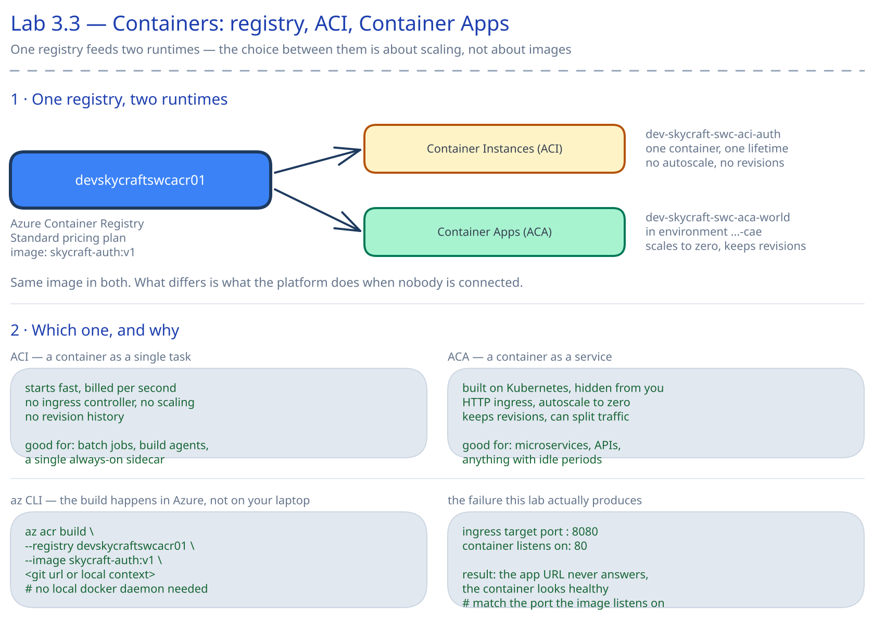
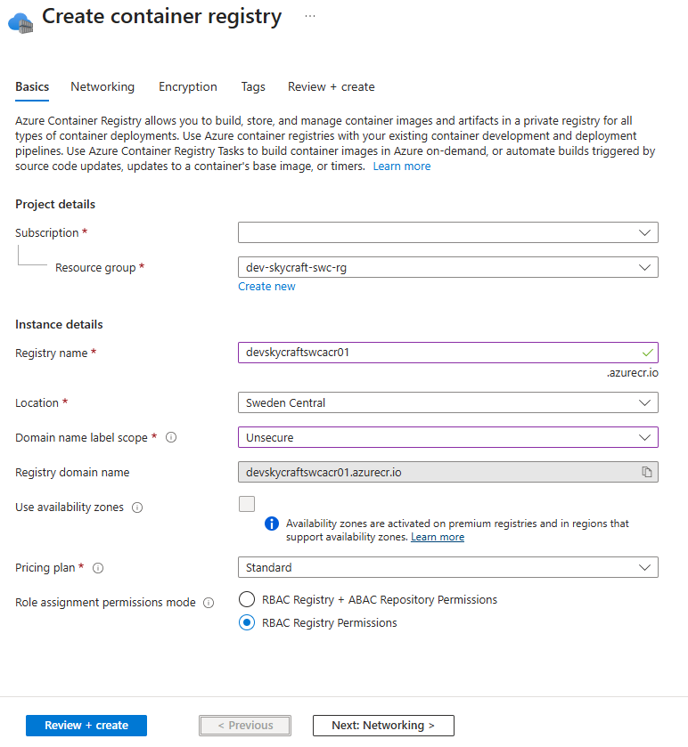
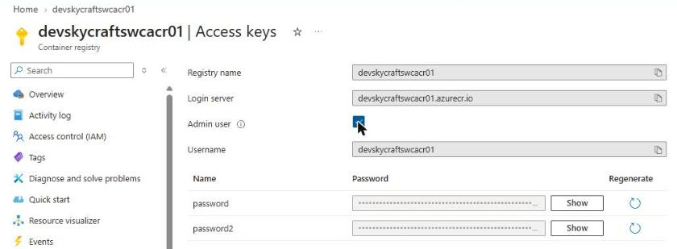
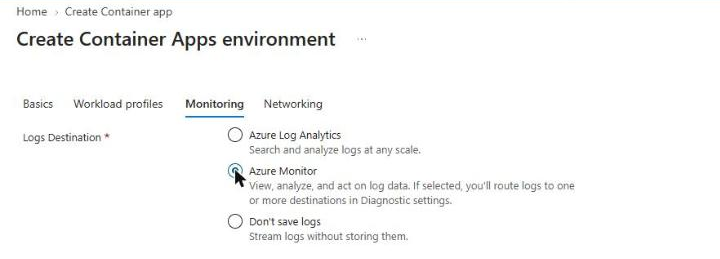
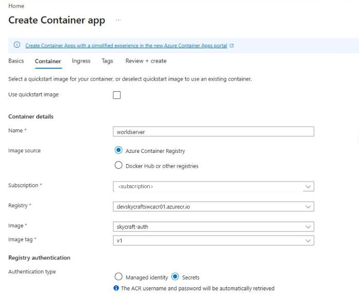
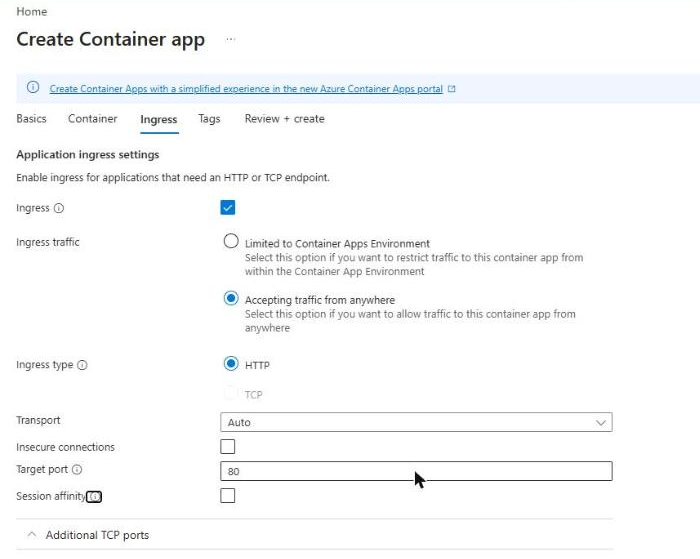
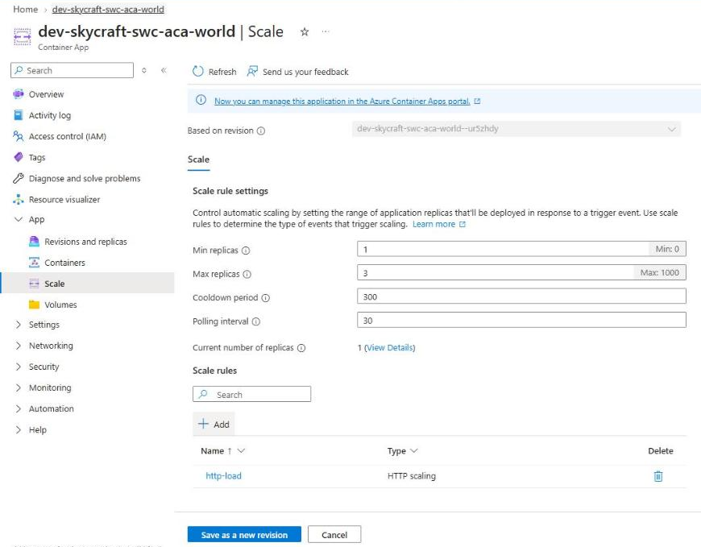

# Lab 3.3: Provision and Manage Containers (2 hours)

## 🎯 Learning Objectives

By completing this lab, you will:

- **Create** and manage an Azure Container Registry (ACR) to store private container images.
- **Build** and push a Docker container image using ACR Tasks.
- **Provision** Azure Container Instances (ACI) to run isolated containers.
- **Deploy** and scale microservices using Azure Container Apps (ACA).
- **Manage** container scaling and sizing properties.

---

## 🏗️ Architecture Overview

You will deploy a containerized environment for the SkyCraft authentication service:

<picture>
  <source media="(prefers-color-scheme: dark)" srcset="images/lab-3.3-architecture.dark.svg">
  <source media="(prefers-color-scheme: light)" srcset="images/lab-3.3-architecture.svg">
  
</picture>

## 📋 Real-World Scenario

**Situation**: The SkyCraft engineering team wants to modernize the legacy server architecture. The `AuthServer` is a lightweight component that doesn't require a full Virtual Machine, making it a perfect candidate for containerization. Additionally, the `WorldServer` needs to scale dynamically based on player count.

**Your Task**: You will set up a private container registry, containerize the authentication service, and explore two different hosting options: Azure Container Instances for simple, isolated workloads, and Azure Container Apps for scalable, serverless microservices.

## ⏱️ Estimated Time: 2 hours

- **Section 1**: Azure Container Registry (30 min)
- **Section 2**: Azure Container Instances (30 min)
- **Section 3**: Azure Container Apps (45 min, including about 5 minutes of deployment)
- **What This Lab Leaves Behind** and cleanup (15 min of your time; the Container Apps environment's delete then runs up to 25 minutes on its own, and you do not need to watch it)

## ✅ Prerequisites

Before starting this lab:

- [ ] Resource group `dev-skycraft-swc-rg` (Lab 1.2), with its four SkyCraft tags (Lab 1.3, Step 1.3.1). Nothing else from an earlier lab is required: the containers here use no VNet, and `scripts/Deploy-Bicep.ps1` creates the resource group if it is missing and bootstraps the registry and the image itself (`tools/lab-cycle-manifest.psd1` lists this lab as depending on 1.2 only).
- [ ] Labs 3.1 and 3.2 completed - recommended for context, not a dependency.
- [ ] **Owner** or **Contributor** role on the subscription. This lab grants no roles, so Contributor is enough on every path.
- [ ] PowerShell 7+ and the `Az` module (Az.Accounts, Az.Resources, Az.ContainerRegistry, Az.ContainerInstance, Az.App).
- [ ] Bicep CLI on `PATH` - Az PowerShell compiles `main.bicep` through it.

If you completed Lab 1.3, its policies are still assigned to your subscription and apply to every create in this lab:

- `Restrict-Azure-Regions` refuses a resource outside **Sweden Central** and **North Europe**. The Container App wizard starts in **West US 2**, and the container instance logs it would create go to **East US**; every create step below names the region and says what to change.
- `Enforce-Project-Tag` refuses a resource without `Project` = `SkyCraft`. Every create step below sets the four SkyCraft tags on its **Tags** tab. `Inherit-Project-Tag` (Lab 1.3, Step 1.3.8) adds `Project` from `dev-skycraft-swc-rg` to anything created in it without the tag, so a resource the **Tags** tab does not reach is still accepted.
- `Require-Environment-Tag-RG` refuses a resource group without an `Environment` tag, including one Azure would create for you (`DefaultResourceGroup-*`). The steps below turn off the one option known to need such a group (the container instance logs of Step 3.3.4). In the agent Portal pass of 2026-10-15 the activity log still showed a refused attempt to create `DefaultResourceGroup-SEC`; which step caused it was not recorded, and nothing the lab checks was missing because of it (Troubleshooting, Issue 4). The one group Azure does create here, the Container Apps environment's infrastructure group (Step 3.3.6), was not refused in that pass.

Check the prerequisites with Az PowerShell (signed in with `Connect-AzAccount` to the subscription you use for the course):

```powershell
Get-AzResourceGroup -Name 'dev-skycraft-swc-rg' | Select-Object ResourceGroupName, Location, Tags
```

**Expected Result**: One resource group in `swedencentral`, whose tags include `Project` = `SkyCraft` and `Environment` = `Development`.

## 🛠️ Portal, PowerShell and Bicep Paths

You can build this lab in the Portal by following this guide, with the Az PowerShell blocks under each step, or with Bicep. The three paths end in the same state, and `scripts/Test-Lab.ps1` accepts it whichever path built it:

| Path | What it creates |
| ---- | --------------- |
| Portal (this guide) | Everything in the steps below |
| Az PowerShell (the blocks under Steps 3.3.1, 3.3.2, 3.3.4 and 3.3.8) | The registry with its admin user, the container instance, the Container Apps environment and the app with its ingress and scale rule |
| `scripts/Deploy-Bicep.ps1` (Bicep, `bicep/acr.bicep` and `bicep/main.bicep`) | The same as the PowerShell blocks, plus the image of Step 3.3.3 |

The end state on every path:

- `devskycraftswcacr01`: Standard, admin user enabled, image `skycraft-auth:v1`.
- `dev-skycraft-swc-aci-auth`: Linux, SKU Standard, restart policy Always, 1 CPU core and 1 GiB memory, a public IP with port 80 and the DNS name label `dev-skycraft-swc-aci-auth-[suffix]` in the **Any reuse (unsecure)** scope, no container instance logs.
- `dev-skycraft-swc-cae-02`: a Workload profiles environment with the Consumption profile, logs sent to **Azure Monitor** (no Log Analytics workspace).
- `dev-skycraft-swc-aca-world`: container `worldserver` (0.25 CPU cores, 0.5 Gi memory) pulling with the registry's admin credentials, external HTTP ingress on port 80 without insecure connections, 1-3 replicas with the HTTP rule `http-load` at 10 concurrent requests.
- The four SkyCraft tags on all four resources.

Three values differ by path and are meant to: the DNS label's suffix (yours in the Portal and PowerShell, a 13-character hash of the resource group's id in Bicep); the image (built from source by ACR Tasks in Step 3.3.3, imported from Microsoft Container Registry by `Deploy-Bicep.ps1`, which has no build command to call; both images serve the same "Welcome to Azure Container Instances!" page); and the name of the environment's infrastructure resource group, which Azure creates and you never use (`ME_dev-skycraft-swc-cae-02` on the Bicep path; on the other two Azure chooses it, and it starts with `ME_`).

Steps without a PowerShell or Bicep counterpart: 3.3.3 has only its Azure CLI command (no Az PowerShell cmdlet builds an image from source; see the note there), and 3.3.5 only reads the result. Steps 3.3.6-3.3.9 share one PowerShell block, under Step 3.3.8, because the Portal creates the environment and the app in one deployment.

If you deployed this lab with `scripts/Deploy-Bicep.ps1` before its template declared the Consumption workload profile, your existing environment is a Consumption-only environment, and Azure cannot change an environment's type. `Deploy-Bicep.ps1` then stops before it changes anything and says so: run `./scripts/Remove-LabResource.ps1` first (it deletes the app, the environment and the rest of the lab), then deploy again.

---

## 📖 Section 1: Azure Container Registry (30 min)

### What is Azure Container Registry?

**Azure Container Registry (ACR)** is a managed, private Docker registry service based on the open-source Docker Registry 2.0. It allows you to build, store, and manage container images and artifacts for all types of container deployments.

For SkyCraft, we need a secure place to store our proprietary game server images rather than using public repositories like Docker Hub.

### Step 3.3.1: Create a Container Registry

1. In the Azure Portal, search for **Container registries**.
2. Click **+ Create**.
3. On the **Basics** tab, fill in:

| Field                                 | Value                         |
| ------------------------------------- | ----------------------------- |
| **Subscription**                      | Your subscription             |
| **Resource group**                    | `dev-skycraft-swc-rg`         |
| **Registry name**                     | `devskycraftswcacr01`         |
| **Location**                          | **Sweden Central**            |
| **Domain name label scope**           | **Unsecure**                  |
| **Pricing plan**                      | **Standard**                  |
| **Role assignment permissions mode**  | **RBAC Registry Permissions** |

> **Note**: The registry name must be globally unique and contain only alphanumeric characters. If `devskycraftswcacr01` is taken, use another name (for example `devskycraftswcacr02`) everywhere this guide says `devskycraftswcacr01`, and pass it to the lab's scripts with `-AcrName`.

4. Click the **Tags** tab and add:

| Name        | Value       |
| ----------- | ----------- |
| Project     | SkyCraft    |
| Environment | Development |
| CostCenter  | MSDN        |
| Owner       | mbiszczanik |

5. Click **Review + create**, then **Create**.

**Expected Result**:

- Validation passes and deployment succeeds. Without the tags, the Portal refuses validation once Lab 1.3's `Enforce-Project-Tag` is assigned.
- The registry `devskycraftswcacr01` is listed in `dev-skycraft-swc-rg`.



**Cost**: A Standard registry costs about 0.60 EUR per day for as long as it exists, whether you use it or not. Delete it when you finish the lab (see What This Lab Leaves Behind).

**With Az PowerShell** (instead of items 1-5):

```powershell
$tags = @{ Project = 'SkyCraft'; Environment = 'Development'; CostCenter = 'MSDN'; Owner = 'mbiszczanik' }
New-AzContainerRegistry -ResourceGroupName 'dev-skycraft-swc-rg' -Name 'devskycraftswcacr01' `
    -Location 'swedencentral' -Sku 'Standard' -Tag $tags
```

### Step 3.3.2: Enable Admin User

To allow simple authentication for our labs, we will enable the Admin user. The container instance (Step 3.3.4) and the container app (Step 3.3.7) both pull the image with it. In production, you would typically use Managed Identities instead.

1. Navigate to `devskycraftswcacr01` → **Overview**
2. In the left menu, under **Settings** (expand it if it is collapsed), click **Access keys**.
3. Check **Admin user**, unless it is checked already.
4. Note the login server (`devskycraftswcacr01.azurecr.io`), the username and the passwords shown on the page. The Portal reads them itself in the next steps; you need them only for the troubleshooting items below.

**Expected Result**:

- Admin user is checked.
- The username is `devskycraftswcacr01`, and two passwords are shown masked, each with a **Show** button.



> **Warning**: The admin user is one shared username and password with push and pull rights on every repository. Anyone who has the password can push images to the registry. This lab uses it because it works with every path and needs no role assignment; production registries leave it unchecked and grant the `AcrPull` role to a managed identity.

**With Az PowerShell**:

```powershell
Update-AzContainerRegistry -ResourceGroupName 'dev-skycraft-swc-rg' -Name 'devskycraftswcacr01' -EnableAdminUser
```

### Step 3.3.3: Build and Push an Image using ACR Tasks

We will use **ACR Tasks** to build a container image directly in Azure without needing Docker installed locally. We'll use a sample application to represent our AuthServer.

1. Open **Cloud Shell** in the Azure Portal (the icon in the top bar) and choose **Bash**. If Cloud Shell asks how to start, choose **No storage account required**: a storage account would be created in a new resource group that Lab 1.3's policies refuse, and it costs money.
2. Run the following command to build an image from a public GitHub Dockerfile and push it to your registry. Replace `[your-acr-name]` with your actual registry name (`devskycraftswcacr01`).

```azurecli
az acr build --registry [your-acr-name] --image skycraft-auth:v1 --output json https://github.com/Azure-Samples/aci-helloworld.git
```

> **Why this works**: `az acr build` streams the build context to Azure, builds the image on Azure's infrastructure, and pushes it to your registry automatically.

> [!NOTE]
> **This is the documented az CLI exception.** Every other operational command in
> this course is Az PowerShell ([powershell-standards.md](../../docs/powershell-standards.md)
> §5), because the az CLI and Az PowerShell can be signed in to different
> subscriptions. `az acr build` stays because Az PowerShell has **no cmdlet that
> builds an image from source**: there is no equivalent to swap in.
>
> Before running it, confirm the az CLI is on the same subscription as your
> Az PowerShell session:
>
> ```powershell
> az account show --output json | ConvertFrom-Json | Select-Object -ExpandProperty id
> (Get-AzContext).Subscription.Id   # these two must match
> ```
>
> The lab's `scripts/Deploy-Bicep.ps1` does **not** run this command. Because it
> has no cmdlet to call, it imports the same prebuilt image from Microsoft
> Container Registry instead (`Import-AzContainerRegistryImage` with
> `mcr.microsoft.com/azuredocs/aci-helloworld:latest`), which produces a
> functionally equivalent runnable web image. Run this step by hand to learn ACR
> Tasks; run the script to provision the lab. If ACR Tasks are not available in
> your subscription, use the same import (Troubleshooting, Issue 5).

**Expected Result**:

- The build process logs appear in the console.
- Final status shows `Run ID: ... was successful`.
- In `devskycraftswcacr01`, under **Services**, **Repositories** lists `skycraft-auth` with tag `v1`.

---

## 📖 Section 2: Azure Container Instances (30 min)

### What are Azure Container Instances?

**Azure Container Instances (ACI)** allow you to run containers on Azure without managing virtual machines or adopting a higher-level service like Kubernetes. It's the fastest way to run a container in Azure.

We will use ACI to deploy a single instance of the AuthServer for testing.

### Step 3.3.4: Deploy Container to ACI

1. In the Azure Portal, search for **Container instances**.
2. Click **+ Create**.
3. On the **Basics** tab, fill in:

| Field                  | Value                        |
| ---------------------- | ---------------------------- |
| **Subscription**       | Your subscription            |
| **Resource group**     | `dev-skycraft-swc-rg`        |
| **Container name**     | `dev-skycraft-swc-aci-auth`  |
| **Region**             | **Sweden Central**           |
| **Availability zones** | None                         |
| **SKU**                | **Standard**                 |
| **Image source**       | **Azure Container Registry** |
| **Registry**           | `devskycraftswcacr01`        |
| **Image**              | `skycraft-auth`              |
| **Image tag**          | `v1`                         |

**Note**: If the Portal says "Admin user must first be enabled for this registry in order to access the image during the container instance creation." and **Image** stays greyed out, do Step 3.3.2 and then start this wizard again (Troubleshooting, Issue 2).

4. Click **Change size** (the size starts at 1 vCPU and 1.5 GiB memory), and fill in:

| Field                    | Value |
| ------------------------ | ----- |
| **Number of CPU cores**  | 1     |
| **Memory (GiB)**         | 1     |

5. Click **Ok** (the pane is titled **Change container size**).
6. Click **Next: Networking**, and fill in:

| Field                             | Value                                  |
| --------------------------------- | -------------------------------------- |
| **Networking type**               | **Public**                             |
| **DNS name label**                | `dev-skycraft-swc-aci-auth-[suffix]`   |
| **DNS name label scope reuse**    | **Any reuse (unsecure)**               |

Replace `[suffix]` with four to six lowercase letters and digits of your own, for example your initials and two digits. The label must be unique in Sweden Central in this scope. Leave the ports list as it is: one row, port 80, protocol TCP.

> **Warning**: As soon as you type a DNS name label, **DNS name label scope reuse** changes from **Any reuse (unsecure)** to **Tenant**. Set it back to **Any reuse (unsecure)**. **Tenant** is the safer choice: it adds a hash segment to the address (`<label>.<hash>.swedencentral.azurecontainer.io`), so nobody outside your tenant can take the name over after you delete the container. This lab uses **Any reuse (unsecure)** because it is the only scope all three paths reach: Az PowerShell's `New-AzContainerGroup` has no scope parameter and gets Azure's default, **Any reuse (unsecure)**, and the lab's Bicep leaves the same default (its FQDN output assumes it). Keep **Tenant** for anything you build after this course.

7. Click **Next: Monitoring**, and fill in:

| Field                              | Value       |
| ---------------------------------- | ----------- |
| **Enable container instance logs** | **Uncheck** |

> **Warning**: **Enable container instance logs** is checked by default. With no Log Analytics workspace in your subscription it creates a new one, `DefaultWorkspace-<subscription id>-EUS`, in a default resource group in **East US**; once Module 5 has created `platform-skycraft-swc-law`, the tab offers that workspace instead (**Log Analytics workspace**). That workspace costs money for every log it stores, sits outside the regions Lab 1.3 allows, and later Module 5 wizards would offer it as a default. Uncheck the box. If you create the instance with the box checked, delete the instance and create it again; wait a minute after the delete before you reuse the name `dev-skycraft-swc-aci-auth`. The workspace stays after the instance is gone, and no other lab of this course uses it (Module 5 uses `platform-skycraft-swc-law`), so delete it, and then `DefaultResourceGroup-EUS` if nothing else is in it (What This Lab Leaves Behind). `scripts/Remove-LabResource.ps1` deletes both for you only while the instance it deletes still sends its logs to that workspace: it finds the workspace through the instance, so once you have recreated the instance without logs, it no longer sees the old workspace.

8. Click **Next: Advanced**, and fill in:

| Field              | Value      |
| ------------------ | ---------- |
| **Restart policy** | **Always** |

9. Click **Next: Tags**, and add:

| Name        | Value       |
| ----------- | ----------- |
| Project     | SkyCraft    |
| Environment | Development |
| CostCenter  | MSDN        |
| Owner       | mbiszczanik |

10. Click **Review + create**, then **Create**.

**Expected Result**:

- Deployment succeeds within two minutes.
- `dev-skycraft-swc-aci-auth` is listed in `dev-skycraft-swc-rg` with status **Running**.

**Cost**: A running container instance with 1 CPU core and 1 GiB memory costs about 1.20 EUR per day. It is billed per second while it runs; stop or delete it when you finish the lab.

**With Az PowerShell** (instead of items 1-10; replace `ab12` with your own suffix):

```powershell
$rg     = 'dev-skycraft-swc-rg'
$suffix = 'ab12'
$tags   = @{ Project = 'SkyCraft'; Environment = 'Development'; CostCenter = 'MSDN'; Owner = 'mbiszczanik' }
$acr    = Get-AzContainerRegistry -ResourceGroupName $rg -Name 'devskycraftswcacr01'
$cred   = Get-AzContainerRegistryCredential -Registry $acr

$container = New-AzContainerInstanceObject -Name 'dev-skycraft-swc-aci-auth' `
    -Image "$($acr.LoginServer)/skycraft-auth:v1" -RequestCpu 1 -RequestMemoryInGb 1 `
    -Port @(New-AzContainerInstancePortObject -Port 80 -Protocol TCP)
$registryCredential = New-AzContainerGroupImageRegistryCredentialObject -Server $acr.LoginServer `
    -Username $cred.Username -Password (ConvertTo-SecureString $cred.Password -AsPlainText -Force)

# No -LogAnalytic* parameters: no container instance logs. No scope parameter exists: the label
# gets the Any reuse (unsecure) scope, as in the Portal steps and the Bicep.
New-AzContainerGroup -ResourceGroupName $rg -Name 'dev-skycraft-swc-aci-auth' -Location 'swedencentral' `
    -Container $container -ImageRegistryCredential $registryCredential `
    -OSType 'Linux' -Sku 'Standard' -RestartPolicy 'Always' `
    -IPAddressType 'Public' -IPAddressDnsNameLabel "dev-skycraft-swc-aci-auth-$suffix" `
    -IPAddressPort @(New-AzContainerGroupPortObject -Port 80 -Protocol TCP) `
    -Tag $tags
```

### Step 3.3.5: Verify the Application

1. Navigate to `dev-skycraft-swc-aci-auth` → **Overview**
2. Copy the FQDN (Fully Qualified Domain Name) shown under Essentials.
   - Example: `dev-skycraft-swc-aci-auth-ab12.swedencentral.azurecontainer.io`
   - If the FQDN has one more segment before `swedencentral` (`dev-skycraft-swc-aci-auth-ab12.<16 characters>.swedencentral.azurecontainer.io`), the scope stayed on Tenant. The page still works; `Test-Lab.ps1` accepts it.
3. Open the FQDN in a new browser tab, with `http://` in front of it.

**Expected Result**:

- You see the "Welcome to Azure Container Instances!" page (representing our SkyCraft AuthServer placeholder).

---

## 📖 Section 3: Azure Container Apps (45 min)

### What are Azure Container Apps?

**Azure Container Apps (ACA)** is a serverless container service built on Kubernetes. Unlike ACI, it supports advanced features like auto-scaling (including scaling to zero), multiple revisions, and integrated ingress, making it suitable for microservices.

We will deploy the "WorldServer" component here to take advantage of scaling capabilities. The Portal creates the Container Apps environment and the app in one wizard, so Steps 3.3.6-3.3.8 fill one wizard and end with one **Create**.

### Step 3.3.6: Create a Container Apps Environment

1. In the Azure Portal, search for **Container Apps**.
2. Click **+ Create** → **Container App**.
3. On the **Basics** tab, fill in:

| Field                   | Value                        |
| ----------------------- | ---------------------------- |
| **Subscription**        | Your subscription            |
| **Resource group**      | `dev-skycraft-swc-rg`        |
| **Container app name**  | `dev-skycraft-swc-aca-world` |
| **Deployment source**   | **Container image**          |
| **Region**              | **Sweden Central**           |

> **Warning**: The wizard pre-fills **Resource group** with another group of your subscription (in the pass it was `NetworkWatcherRG`) and **Region** with **West US 2**. Change both. A Container App in West US 2 is refused by Lab 1.3's `Restrict-Azure-Regions`, and one in `NetworkWatcherRG` lands in a group without SkyCraft tags.

4. Under **Container Apps environment**, click **Create new**.
5. A new page opens, titled "Create Container Apps environment". On its **Basics** tab, fill in:

| Field                  | Value                     |
| ---------------------- | ------------------------- |
| **Environment name**   | `dev-skycraft-swc-cae-02` |
| **Zone redundancy**    | **Disabled**              |

Leave the **Workload profiles** tab as it is: the environment gets the **Consumption** profile, which charges only while an app runs in it.

6. Click the **Monitoring** tab, and fill in:

| Field                 | Value             |
| --------------------- | ----------------- |
| **Logs Destination**  | **Azure Monitor** |

> **Warning**: **Logs Destination** starts at **Azure Log Analytics** with a new workspace named `workspace` followed by the resource group's name without dashes (for example `workspacedevskycraftswcrg1a2b`). That workspace stays in `dev-skycraft-swc-rg` after this lab, costs money for every log it stores, and four Module 5 wizards then offer it as their default workspace instead of `platform-skycraft-swc-law` (issue #374). **Azure Monitor** creates no workspace: the environment sends its logs only where a diagnostic setting tells it to, and this lab adds none. The Bicep path makes the same choice. If you created the workspace by mistake, delete it from **Log Analytics workspaces** once the environment is gone; no other lab uses it. `scripts/Remove-LabResource.ps1` deletes it too, as part of deleting the whole lab (registry, container instance, environment and app): the workspace the environment sends its logs to, whatever its name and resource group, and a workspace in `dev-skycraft-swc-rg` that keeps the Portal's automatic name. It never deletes a workspace named `<environment>-skycraft-swc-law`, such as `platform-skycraft-swc-law`, the shared workspace of Lab 5.1: if you pointed the environment at one, the script names it and keeps it.

> **Warning**: Check the page before the next item. An environment's name, its zone redundancy and its type (Workload profiles) cannot be changed after it is created; to change one, you delete the environment, which takes up to 25 minutes, and create it again.

7. Click **Create**.

**Expected Result**:

- The page closes, and the app wizard shows `dev-skycraft-swc-cae-02` (new) under **Container Apps environment**. Nothing is created yet: the environment is created together with the app in Step 3.3.8.



> [!NOTE]
> The `-02` suffix on the environment is deliberate. On the Bicep path the environment's infrastructure resource group is named `ME_<environment-name>`, and that name cannot be changed once the environment exists, so the first environment's leftovers cannot be redeployed onto; `bicep/main.bicep`, `scripts/Test-Lab.ps1` and `scripts/Remove-LabResource.ps1` all use `dev-skycraft-swc-cae-02` (see `ARCHITECTURE.md` §5). The app carries no suffix: nothing immutable hangs off its name, and `platform-skycraft-swc-aca-world-02` would exceed the 32 characters a Container App allows. Every name in this lab takes the environment as its prefix - `Deploy-Bicep.ps1 -Environment prod` deploys `prodskycraftswcacr01`, `prod-skycraft-swc-aci-auth`, `prod-skycraft-swc-cae-02` and `prod-skycraft-swc-aca-world` into `prod-skycraft-swc-rg`.

The infrastructure resource group is created and managed by Azure, and deleted with the environment. Its name starts with `ME_`: the Bicep template asks for `ME_` followed by the environment's name, while the Portal and the PowerShell block leave the rest of the name to Azure. Do not create, tag or change it: Azure creates it without your tags, and Lab 1.3's policies did not refuse it in the agent Portal pass of 2026-10-15.

### Step 3.3.7: Configure Container Settings

The app reuses the `skycraft-auth` image for the lab demo.

1. Click **Next: Container**.
2. Uncheck **Use quickstart image**.
3. Fill in:

| Field                   | Value                                |
| ----------------------- | ------------------------------------ |
| **Name**                | `worldserver`                        |
| **Image source**        | **Azure Container Registry**         |
| **Subscription**        | Your subscription                    |
| **Registry**            | `devskycraftswcacr01`                |
| **Image**               | `skycraft-auth`                      |
| **Image tag**           | `v1`                                 |
| **Authentication type** | **Secrets**                          |
| **Workload profile**    | **Consumption**                      |
| **CPU and memory**      | **0.25 CPU cores, 0.5 Gi memory**    |

**Name** is pre-filled with the app's name; replace it with `worldserver`. **CPU and memory** starts at 0.5 CPU cores and 1 Gi memory; the smaller size is enough for this demo and costs half as much.

> **Note**: **Authentication type** may start at **Managed identity**, with **System assigned Identity (environment)** and the remark "Required role assignment: ACR pull". That choice makes the Portal grant a role on the registry, which needs Owner or User Access Administrator. This lab uses **Secrets**: the app pulls with the registry's admin user from Step 3.3.2, as the container instance and the Bicep path do, and no role is granted.

**Expected Result**:

- The **Container** tab shows the container `worldserver` with the image `skycraft-auth:v1` from `devskycraftswcacr01`, **Secrets** authentication and 0.25 CPU cores with 0.5 Gi memory. Nothing is created yet: Step 3.3.8 ends the wizard.



### Step 3.3.8: Configure Ingress

1. Click **Next: Ingress**.
2. Check **Ingress** (it is off by default).
3. Fill in:

| Field                     | Value                                |
| ------------------------- | ------------------------------------ |
| **Ingress traffic**       | **Accepting traffic from anywhere**  |
| **Ingress type**          | **HTTP**                             |
| **Transport**             | **Auto**                             |
| **Insecure connections**  | Uncheck                              |
| **Target port**           | 80                                   |

> **Warning**: **Ingress traffic** starts at **Limited to Container Apps Environment**. **Accepting traffic from anywhere** gives the app a public HTTPS address that anyone on the internet can open; this lab needs it to check the app from your browser. Leave **Insecure connections** unchecked so that plain HTTP is redirected to HTTPS.

4. Click the **Tags** tab, and add (the tags apply to the app and the new environment):

| Name        | Value       |
| ----------- | ----------- |
| Project     | SkyCraft    |
| Environment | Development |
| CostCenter  | MSDN        |
| Owner       | mbiszczanik |

5. Click **Review + create**, then **Create**.

The **Review + create** page can still list a **Log Analytics workspace (New)** under the new environment after you chose **Azure Monitor** in Step 3.3.6. The template behind it (**Download a template for automation**) holds only the environment and the app, and no workspace is created.

**Expected Result**:

- Deployment succeeds after a few minutes (the environment takes most of the time).
- `dev-skycraft-swc-rg` lists the Container Apps environment `dev-skycraft-swc-cae-02` and the container app `dev-skycraft-swc-aca-world`, and no new Log Analytics workspace.
- On the app's **Overview** page, **Application Url** opens the same "Welcome to Azure Container Instances!" page over HTTPS.



**With Az PowerShell** (instead of Steps 3.3.6-3.3.9; it creates the environment and the app with the scale settings of Step 3.3.9):

```powershell
$rg   = 'dev-skycraft-swc-rg'
$tags = @{ Project = 'SkyCraft'; Environment = 'Development'; CostCenter = 'MSDN'; Owner = 'mbiszczanik' }
$acr  = Get-AzContainerRegistry -ResourceGroupName $rg -Name 'devskycraftswcacr01'
$cred = Get-AzContainerRegistryCredential -Registry $acr

# The Portal registers the resource provider for you; from PowerShell, register it once per subscription.
Register-AzResourceProvider -ProviderNamespace 'Microsoft.App' | Out-Null

# Step 3.3.6: the environment - the Consumption workload profile, logs to Azure Monitor (no workspace).
$environment = New-AzContainerAppManagedEnv -ResourceGroupName $rg -Name 'dev-skycraft-swc-cae-02' `
    -Location 'swedencentral' -AppLogConfigurationDestination 'azure-monitor' `
    -WorkloadProfile @(New-AzContainerAppWorkloadProfileObject -Name 'Consumption' -Type 'Consumption') `
    -Tag $tags

# Steps 3.3.7-3.3.9: the container, the registry's admin credentials, the ingress and the scale rule.
$configuration = New-AzContainerAppConfigurationObject `
    -Secret @(New-AzContainerAppSecretObject -Name 'acr-password' -Value $cred.Password) `
    -Registry @(New-AzContainerAppRegistryCredentialObject -Server $acr.LoginServer -Username $cred.Username -PasswordSecretRef 'acr-password') `
    -IngressExternal $true -IngressTargetPort 80 -IngressTransport 'auto' -IngressAllowInsecure $false
$container = New-AzContainerAppTemplateObject -Name 'worldserver' -Image "$($acr.LoginServer)/skycraft-auth:v1" `
    -ResourceCpu 0.25 -ResourceMemory '0.5Gi'
$scaleRule = New-AzContainerAppScaleRuleObject -Name 'http-load' -HttpMetadata @{ concurrentRequests = '10' }

New-AzContainerApp -ResourceGroupName $rg -Name 'dev-skycraft-swc-aca-world' -Location 'swedencentral' `
    -ManagedEnvironmentId $environment.Id -WorkloadProfileName 'Consumption' `
    -Configuration $configuration -TemplateContainer $container `
    -ScaleMinReplica 1 -ScaleMaxReplica 3 -ScaleRule $scaleRule `
    -Tag $tags
```

### Step 3.3.9: Configure Scaling

1. Navigate to `dev-skycraft-swc-aca-world` → **Overview**
2. In the left menu, under **App** (expand it if it is collapsed), click **Scale**.
3. Fill in:

| Field            | Value |
| ---------------- | ----- |
| **Min replicas** | 1     |
| **Max replicas** | 3     |

The page starts at **Min replicas** 0 and **Max replicas** 10, with one scale rule the Portal added, `http-scaler` (HTTP, 10 concurrent requests). A minimum of 1 keeps one replica always ready, so the first request does not wait for a replica to start; it also means the app is billed all day (see What This Lab Leaves Behind).

4. In the row of the scale rule `http-scaler`, click **Delete**.
5. Click **+ Add**, and fill in:

| Field                   | Value            |
| ----------------------- | ---------------- |
| **Rule name**           | `http-load`      |
| **Type**                | **HTTP scaling** |
| **Concurrent requests** | 10               |

6. Click **Add scale rule**.
7. Click **Save as a new revision**.

**Expected Result**:

- A new revision is created with the scaling rules applied.
- **Scale** shows **Min replicas** 1, **Max replicas** 3 and the single rule `http-load`.
- If traffic increases beyond 10 concurrent requests, ACA will automatically spin up more replicas (up to 3).



The Az PowerShell block under Step 3.3.8 sets the same scale settings when it creates the app.

---

## ✅ Lab Checklist

Quick verification:

- [ ] **ACR** `devskycraftswcacr01` created and contains `skycraft-auth:v1`
- [ ] **ACI** `dev-skycraft-swc-aci-auth` is running and accessible via FQDN
- [ ] **ACA** `dev-skycraft-swc-aca-world` is deployed in environment `dev-skycraft-swc-cae-02`
- [ ] Scaling rules configured for ACA
- [ ] No new Log Analytics workspace in `dev-skycraft-swc-rg`

Run the lab's validator from the lab folder:

```powershell
./scripts/Test-Lab.ps1
```

**Expected Result**: `All Lab 3.3 checks passed.`, exit code 0.

For detailed verification, see [lab-checklist-3.3.md](lab-checklist-3.3.md).

---

## 📦 What This Lab Leaves Behind

No later lab needs an object this lab creates: `tools/lab-cycle-manifest.psd1` lists no lab that depends on Lab 3.3. Delete the resources when you finish, because three of them cost money every day they exist. The daily costs below are approximate list prices for Sweden Central; check the [Azure pricing calculator](https://azure.microsoft.com/pricing/calculator/) for your own.

| Left behind | Where | Daily cost | What it does in later labs |
| --- | --- | --- | --- |
| `devskycraftswcacr01` (Standard) | `dev-skycraft-swc-rg` | about 0.60 EUR | Nothing; Lab 3.4 does not use it |
| `dev-skycraft-swc-aci-auth` (1 CPU core, 1 GiB, running) | `dev-skycraft-swc-rg` | about 1.20 EUR | Nothing |
| `dev-skycraft-swc-cae-02` (Consumption profile) | `dev-skycraft-swc-rg`, plus its `ME_` infrastructure group | 0 on its own | Nothing |
| `dev-skycraft-swc-aca-world` (1 replica always ready) | `dev-skycraft-swc-rg` | up to about 0.20 EUR, less while the monthly free grant lasts | Nothing |
| The Log Analytics workspace the environment sends its logs to (the Portal's `workspacedevskycraftswcrg...`), **only** if you kept **Azure Log Analytics** in Step 3.3.6 | `dev-skycraft-swc-rg`, or the group you picked | per GB of logs stored | Nothing; Module 5 wizards would offer it as their default workspace |
| `DefaultWorkspace-<subscription id>-EUS`, **only** if you left **Enable container instance logs** checked in Step 3.3.4 and Lab 1.3's policies did not refuse it | `DefaultResourceGroup-EUS` (East US) | per GB of logs stored | Nothing; Module 5 wizards may offer it as a default |

To remove them, run the lab's cleanup from the lab folder:

```powershell
./scripts/Remove-LabResource.ps1
```

It asks before each delete and names the resource it is about to delete (`-WhatIf` lists them without deleting anything; `-Force` skips the questions). It deletes the app before its environment, then the Log Analytics workspace the environment sends its logs to, whatever its name and resource group, and any workspace in `dev-skycraft-swc-rg` that carries the Portal's automatic name (`workspace` followed by the resource group's name without dashes), then the container instance and the registry. Last, if the container instance sent its logs to `DefaultWorkspace-<subscription id>-<region>`, it deletes that workspace and then `DefaultResourceGroup-<region>` if nothing else is in that group; if something is, it keeps the group and names what is in it. It never deletes a workspace named `<environment>-skycraft-swc-law` (Lab 5.1's shared workspace, which Module 5 uses): if the environment or the instance sent its logs to one, the script names it and keeps it. It leaves `dev-skycraft-swc-rg` and its tags in place. The environment's delete takes up to 25 minutes. In the Portal, delete the same resources in the same order.

The script finds `DefaultWorkspace-<subscription id>-EUS` only through the container instance. If you recreated the instance without logs, as Step 3.3.4 says, or deleted it before you ran the script, the workspace is no longer linked to anything the script deletes, and it stays. No other lab of this course uses it, so delete it yourself, and then `DefaultResourceGroup-EUS` if nothing else is in it:

```powershell
Get-AzResource -ResourceGroupName 'DefaultResourceGroup-EUS' |
    Select-Object Name, ResourceType, ResourceId
Remove-AzResource -ResourceId '<ResourceId of DefaultWorkspace-... from above>' -Force
# Only if the list above showed nothing but that workspace:
Remove-AzResourceGroup -Name 'DefaultResourceGroup-EUS' -Force
```

---

## 🔧 Troubleshooting

### Issue 1: "Quota exceeded" for ACI

**Symptom**: Deployment fails with a quota error.
**Solution**: Ensure you are using a region where you have quota. **Sweden Central** usually has availability. The only other region this lab allows is **North Europe**: `bicep/main.bicep` accepts only `swedencentral` and `northeurope`, and after Lab 1.3 `Restrict-Azure-Regions` refuses every other region. To deploy there with Bicep, run `./scripts/Deploy-Bicep.ps1 -Location northeurope`; in the Portal, choose **North Europe** as the **Region** in Steps 3.3.4 and 3.3.6.

### Issue 2: The ACI wizard says the admin user must be enabled

**Symptom**: In Step 3.3.4, after you choose the registry on the **Basics** tab, the wizard shows "Admin user must first be enabled for this registry in order to access the image during the container instance creation.", and **Image** and **Image tag** stay greyed out.
**Solution**: Do Step 3.3.2 (check **Admin user** in the registry's **Access keys**). Then close the container instance wizard and start **+ Create** again: the open wizard keeps what it read when it opened, so the message stays until you restart it. The browser asks "Leave site?" when you close a filled-in wizard; confirm it.

### Issue 3: Ingress 404/502

**Symptom**: ACA URL returns error.
**Solution**: Check the **Target Port** in Ingress settings. Our sample image listens on port 80. If you set it to 8080 or 443, it will fail.

### Issue 4: A create is refused by policy

**Symptom**: Validation fails or the notification bell shows `RequestDisallowedByPolicy` with "All resources must be tagged with Project=SkyCraft" or "Resources must be deployed to Sweden Central or North Europe regions only".
**Solution**: Lab 1.3's policies are in effect. Fill in the **Tags** tab with the four tags of the step and choose **Sweden Central** as the region; in Step 3.3.6, check that **Resource group** and **Region** are not the wizard's pre-filled values. The activity log may also show that Azure tried to create `DefaultResourceGroup-SEC` and was refused by `Require-Environment-Tag-RG`. The agent Portal pass of 2026-10-15 saw that refusal without recording which step caused it; none of the lab's resources is in that group, and `scripts/Test-Lab.ps1` still passed. If a create step itself fails with this refusal, check that **Enable container instance logs** is unchecked in Step 3.3.4 and that **Logs destination** is **Azure Monitor** in Step 3.3.6.

### Issue 5: `az acr build` is not available

**Symptom**: Step 3.3.3 fails with an error saying that ACR Tasks or task runs are not allowed for your subscription.
**Solution**: Import the same sample image from Microsoft Container Registry instead, as `scripts/Deploy-Bicep.ps1` does:

```powershell
Import-AzContainerRegistryImage -ResourceGroupName 'dev-skycraft-swc-rg' -RegistryName 'devskycraftswcacr01' `
    -SourceRegistryUri 'mcr.microsoft.com' -SourceImage 'azuredocs/aci-helloworld:latest' -TargetTag 'skycraft-auth:v1'
```

### Issue 6: The container app cannot pull the image right after the registry was created

**Symptom**: The deployment in Step 3.3.8 fails with an error that the registry's host name (`devskycraftswcacr01.azurecr.io`) could not be found.
**Solution**: A brand-new registry's name can take a minute or two to resolve inside Azure. Wait two minutes and create the app again (`scripts/Deploy-Bicep.ps1` waits 90 seconds after creating the registry for the same reason).

## 🎓 Knowledge Check

1. **Why would you choose Azure Container Apps (ACA) over Azure Container Instances (ACI)?**

   <details>
     <summary>**Click to see the answer**</summary>

   **Answer**: Choose ACA when you need **auto-scaling** (including scale-to-zero), **microservices orchestration**, multiple **revisions**, or integrated service discovery. ACI is better for "burst" workloads, simple isolated containers, or task automation that doesn't require orchestration.
   </details>

2. **What is the purpose of the ACR Admin User?**

   <details>
     <summary>**Click to see the answer**</summary>

   **Answer**: The Admin User provides a simple username/password authentication method for the registry. It is useful for testing and simple scenarios but is **not recommended for production** (use Service Principals or Managed Identities instead for better security and granularity).
   </details>

## 📚 Additional Resources

- [Azure Container Registry Documentation](https://learn.microsoft.com/en-us/azure/container-registry/)
- [Azure Container Instances Documentation](https://learn.microsoft.com/en-us/azure/container-instances/)
- [Azure Container Apps Documentation](https://learn.microsoft.com/en-us/azure/container-apps/)
- [Log storage and monitoring options in Azure Container Apps](https://learn.microsoft.com/en-us/azure/container-apps/log-options)
- [Set scaling rules in Azure Container Apps](https://learn.microsoft.com/en-us/azure/container-apps/scale-app)

## 📌 Module Navigation

- [← Back to Module 3 Index](../README.md)
- [Lab 3.4: Create and Configure Azure App Service →](../3.4-app-service/lab-guide-3.4.md)

## 📝 Lab Summary

What You Accomplished:
✅ Created a private **Azure Container Registry**.
✅ Built and pushed a container image without a local Docker engine using **ACR Tasks**.
✅ Deployed a container to **Azure Container Instances**.
✅ Deployed a scalable container app to **Azure Container Apps**.

Time Spent: ~2 hours
