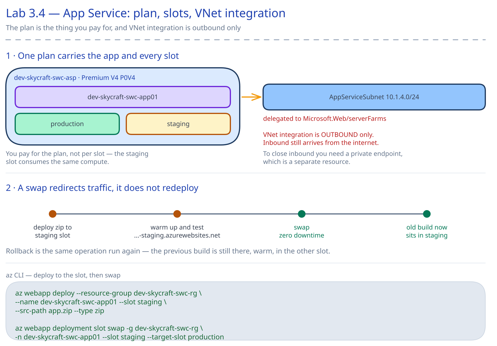
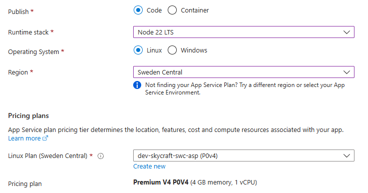
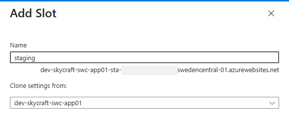
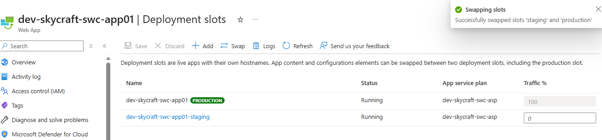
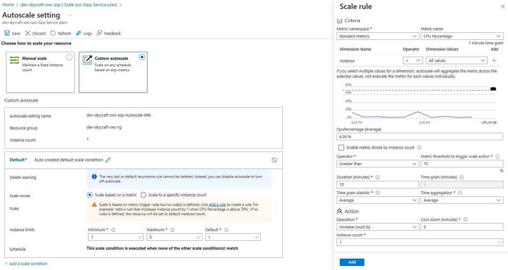
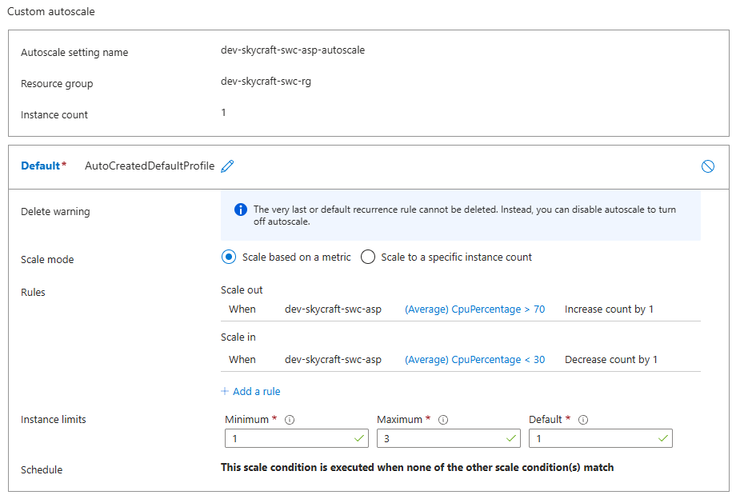
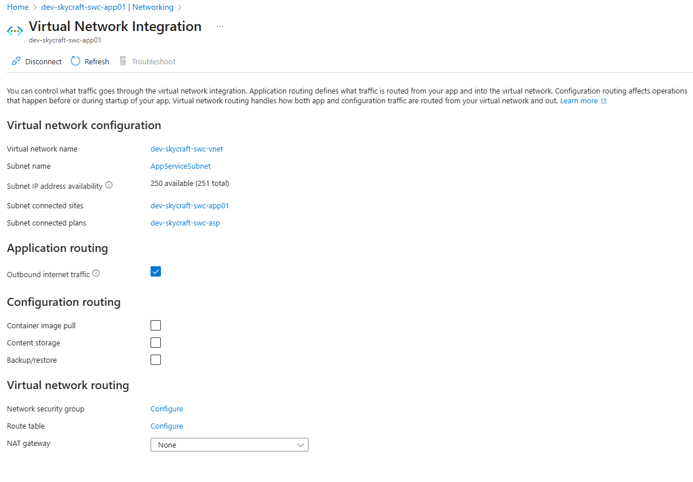
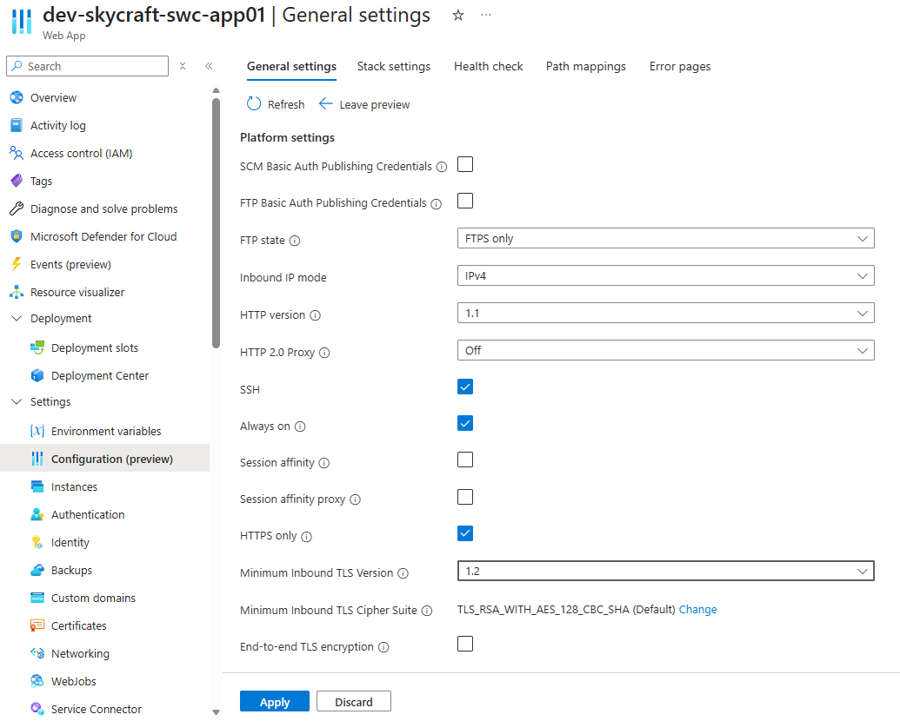
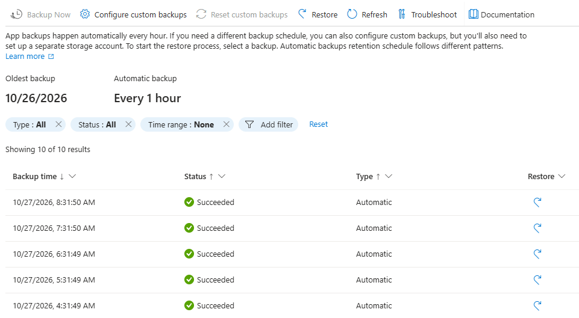

# Lab 3.4: Create and Configure Azure App Service (2 hours)

## 🎯 Learning Objectives

By completing this lab, you will:

- Provision an Azure App Service Plan (ASP) with appropriate pricing tier
- Deploy a web-based monitoring dashboard for SkyCraft using Azure App Service
- Configure deployment slots for safe "blue-green" deployments
- Implement auto-scaling rules based on CPU metrics
- Secure the application with HTTPS/TLS
- Configure VNet Integration to allow the Web App to access private resources
- Review the automatic backups App Service takes for disaster recovery

---

## 🏗️ Architecture Overview

You'll deploy this PaaS infrastructure for the SkyCraft monitoring dashboard:

<picture>
  <source media="(prefers-color-scheme: dark)" srcset="images/lab-3.4-architecture.dark.svg">
  <source media="(prefers-color-scheme: light)" srcset="images/lab-3.4-architecture.svg">
  
</picture>

---

## 📋 Real-World Scenario

**Situation**: The SkyCraft operations team needs a lightweight, accessible dashboard to monitor server status and view game logs without logging into VMs via SSH. This dashboard should be accessible via a web browser but secured.

**Your Task**: Deploy a "Game Master Dashboard" using Azure App Service. This approach minimizes infrastructure management (no OS updates) and provides built-in scaling and deployment features. You need to ensure the dashboard can talk to the backend servers (via VNet Integration) and can be updated without downtime (via Deployment Slots).

---

## ⏱️ Estimated Time: 2 hours

- **Section 1**: Understanding App Service Plans (15 min)
- **Section 2**: Create App Service Plan & Web App (30 min)
- **Section 3**: Deploy the Dashboard (20 min)
- **Section 4**: Configure Deployment Slots (25 min)
- **Section 5**: Configure Auto-scaling (15 min)
- **Section 6**: Networking & Security (15 min)

---

## ✅ Prerequisites

Before starting this lab:

- [ ] Completed Lab 2.1 (Virtual Networks)
- [ ] Resource Group `dev-skycraft-swc-rg` exists
- [ ] VNet `dev-skycraft-swc-vnet` exists, with the subnet `AppServiceSubnet` (10.1.4.0/24) delegated to `Microsoft.Web/serverFarms`
- [ ] If you completed Lab 1.3: `dev-skycraft-swc-rg` carries the tag `Project` = `SkyCraft` (Step 1.3.1), and the policy assignment `Inherit-Project-Tag` exists (Step 1.3.8)

**Why the last item matters**: Lab 1.3's `Enforce-Project-Tag` refuses every new resource without `Project` = `SkyCraft`, and `Restrict-Azure-Regions` refuses every region except Sweden Central and North Europe. Steps 3.4.1 and 3.4.2 set the region and the tags themselves. The panes of Steps 3.4.5 (deployment slot) and 3.4.8-3.4.9 (autoscale setting) have no tags: there, `Inherit-Project-Tag` copies `Project` from `dev-skycraft-swc-rg` to the new resource, and `Enforce-Project-Tag` then accepts it. Without Lab 1.3's assignments, nothing is refused and nothing is copied.

**Verify prerequisites**:

```powershell
Get-AzResourceGroup -Name dev-skycraft-swc-rg
Get-AzVirtualNetwork -Name dev-skycraft-swc-vnet -ResourceGroupName dev-skycraft-swc-rg |
    Get-AzVirtualNetworkSubnetConfig -Name AppServiceSubnet |
    Select-Object Name, AddressPrefix, @{N='Delegation';E={$_.Delegations.ServiceName}}
# 'SkyCraft' if you completed Lab 1.3
(Get-AzResourceGroup -Name dev-skycraft-swc-rg).Tags['Project']
```

---

## 🛠️ Portal, PowerShell and Bicep Paths

You can build this lab in the Portal by following this guide, or with Bicep. Both paths end in the same state, which `scripts/Test-Lab.ps1` accepts whichever path built it: the plan on Premium V4 P0V4, the web app and its `staging` slot on Node 22 LTS with the startup command `pm2 serve /home/site/wwwroot --no-daemon`, both connected to `AppServiceSubnet`, HTTPS only with TLS 1.2, and an autoscale setting on the plan (1-3 instances, two CPU rules).

| Path | What it creates |
| ---- | --------------- |
| Portal (this guide) | Everything in the steps below |
| `scripts/Deploy-Bicep.ps1` (Bicep, `bicep/main.bicep`) | The plan (Step 3.4.1); the web app with its runtime, startup command, HTTPS only and TLS 1.2 (Steps 3.4.2, 3.4.4 and 3.4.11); the `staging` slot with the same settings (Step 3.4.5); the autoscale setting (Steps 3.4.8-3.4.9); the VNet integration of the app and the slot (Step 3.4.10). It deploys no dashboard. |

The Az PowerShell blocks in Steps 3.4.4, 3.4.6 and 3.4.7 deploy the dashboard and swap the slots, whichever path built the resources; after `Deploy-Bicep.ps1`, run them to reach the end of Section 4.

Steps without an Az PowerShell block in this guide: 3.4.1, 3.4.2, 3.4.5, 3.4.8-3.4.11, and the startup command in Step 3.4.4. Their scripted path is the Bicep. Steps without a Bicep counterpart: 3.4.3 (a file on your computer), 3.4.4, 3.4.6 and 3.4.7 (deploying content and swapping are operations, not resources), 3.4.12 (reference only) and 3.4.13 (automatic backups need no configuration).

The Bicep also sets what the Portal's create wizard leaves without being asked: **Always on** on, **Session affinity** and **Session affinity proxy** off, and basic authentication for FTP and SCM publishing off. It also sets the VNet integration with **Outbound internet traffic** checked, which the Portal path adds in Step 3.4.10.

The paths differ only in names and tags, which `Test-Lab.ps1` does not check (walked in the Portal on 2026-10-24: the slot cloned the runtime, the startup command, HTTPS only and TLS 1.2): the Portal names the autoscale setting `dev-skycraft-swc-asp-Autoscale-<number>`, the Bicep `dev-skycraft-swc-asp-autoscale`; `Test-Lab.ps1` and `Remove-LabResource.ps1` find it through the plan it scales. In the Portal, the slot and the autoscale setting get only the `Project` tag (from `Inherit-Project-Tag`); the Bicep gives them all four SkyCraft tags.

> [!WARNING]
> Pick one path per lab. Do not run `Deploy-Bicep.ps1` on a lab you built in the Portal: because the names differ, it adds a second autoscale setting to the plan, and Azure allows only one per resource. Run `Remove-LabResource.ps1` first, then deploy.

---

## 📖 Section 1: Understanding App Service Plans (15 minutes)

### What is an App Service Plan?

An **App Service Plan (ASP)** defines the set of compute resources for a web app to run. It's analogous to a "server farm" in conventional hosting.

Key attributes determined by the ASP:

- **Region**: Where the hardware resides (e.g., Sweden Central).
- **Scale Count**: Number of instances.
- **Instance Size**: CPU/RAM (e.g., Small, Medium, Large).
- **SKU/Tier**: Features available (Free, Shared, Basic, Standard, Premium, Isolated).

### Choosing the Right Tier for SkyCraft

| Tier                  | Features                                                                                   | Use Case                      |
| --------------------- | ------------------------------------------------------------------------------------------ | ----------------------------- |
| **Free/Shared**       | Shared infrastructure, no scaling, no deployment slots, no VNet integration               | Dev/Test of simple prototypes |
| **Basic (B1)**        | Dedicated instances, custom domains, TLS, manual scale-out, VNet integration, backups     | Low-traffic sites             |
| **Standard (S1)**     | Everything in Basic, plus **autoscale** and **deployment slots**                           | Production workloads          |
| **Premium V4 (P0V4)** | The features of Standard on newer hardware: faster processors, NVMe local storage, higher scale limits | **SkyCraft Lab**              |

For this lab, we will use **Premium V4 P0V4**. The lab needs **deployment slots** (Section 4) and **autoscale** (Section 5), which Basic does not have; Standard S1 has both, and so does P0V4. P0V4 is chosen over S1 for its hardware: Premium V4 is the current Premium generation, with faster processors and NVMe local storage ([Configure Premium V4 tier](https://learn.microsoft.com/azure/app-service/app-service-configure-premium-v4-tier)). Price is not the reason either way: on Linux in Sweden Central, P0V4 and S1 both cost about 0.095 USD per hour (Azure Retail Prices API, read 2026-10-08), about 2.30 USD per day while the plan exists. VNet integration is not the reason either: Basic has it too.

---

## 📖 Section 2: Create App Service Plan & Web App (30 minutes)

### Step 3.4.1: Create App Service Plan

1. In Azure Portal, search for **App Service plans**
2. Click **+ Create**
3. On the **Basics** tab, fill in:

| Field            | Value                  |
| ---------------- | ---------------------- |
| Subscription     | [Your Subscription]    |
| Resource Group   | `dev-skycraft-swc-rg`  |
| Name             | `dev-skycraft-swc-asp` |
| Operating System | **Linux**              |
| Region           | **Sweden Central**     |
| Pricing plan     | **Premium V4 P0V4**    |
| Zone redundancy  | **Disabled**           |

**Note**: The form opens with **Region** = West US 3 and **Pricing plan** = Premium V3 P1V3 (seen 2026-10-15). Change both. Lab 1.3's `Restrict-Azure-Regions` refuses West US 3, and P1V3 is a larger size that costs more than P0V4. If **Premium V4 P0V4** is not in the **Pricing plan** list, click **Explore pricing plans**, select **P0V4** under **Premium V4**, and click **Select**.

**Note**: Leave **Zone redundancy** at **Disabled**. Enabled, the plan runs at least two instances, which doubles its cost.

> [!NOTE]
> Ensure you select **Linux**. While SkyCraft game servers run on Linux, the dashboard could run on Windows, but we'll stick to Linux for consistency and cost.

4. Click the **Tags** tab and add:

| Name        | Value       |
| ----------- | ----------- |
| Environment | Development |
| Project     | SkyCraft    |
| CostCenter  | MSDN        |
| Owner       | mbiszczanik |

5. Click **Review + create**, then **Create**

**Expected Result**: App Service Plan `dev-skycraft-swc-asp` is created in Sweden Central, with **Pricing plan** Premium V4 (P0v4) and the four tags. From now on it costs about 2.30 USD per day until you delete it (see Clean Up).

### Step 3.4.2: Create Web App

1. In Azure Portal, search for **App Services**
2. Click **+ Create** → **Web App**
3. On the **Basics** tab, fill in the fields in this order:

| Field                          | Value                                              |
| ------------------------------ | -------------------------------------------------- |
| Subscription                   | [Your Subscription]                                |
| Resource Group                 | `dev-skycraft-swc-rg`                              |
| Name                           | `dev-skycraft-swc-app01`                           |
| Publish                        | **Code**                                           |
| Runtime stack                  | **Node 22 LTS**                                    |
| Operating System               | **Linux**                                          |
| Region                         | **Sweden Central**                                 |
| Linux Plan                     | `dev-skycraft-swc-asp`                             |

**Note**: Set **Region** before **Linux Plan**: the plan list shows only plans in the selected region. The form starts at West US 3 with a new plan already filled in, named `ASP-<resource group without hyphens>-<4 characters>` on Premium V3 P0V3. Once **Region** is Sweden Central, the form selects `dev-skycraft-swc-asp (P0v4)` from Step 3.4.1 (seen 2026-10-24). Check that it did: a proposed new plan left in place bills on its own. **Pricing plan** then shows Premium V4 P0V4.

**Note**: The **Basics** tab has no **Secure unique default hostname** control any more: the form gives every new app a random part in its address, shown under **Name** as you type (`-<16 characters>.swedencentral-01.azurewebsites.net` once the region is set). The **Review + create** page lists it as **Secure unique default hostname: Enabled**. Nobody else can claim that address after you delete the app.

**Note**: Leave the **Database** and **Deployment** tabs as they are: no database, **Continuous deployment** Disable, **Basic authentication** Disable.

**Note**: **Node 20 LTS** is no longer offered; the list has Node 22 LTS, Node 24 LTS and a preview. This lab uses **Node 22 LTS**. A Node runtime does not serve a static `index.html` on its own; Step 3.4.4 sets the startup command that does.

**Note**: The form checks the **Name** as you type. If it says the name is not available (`The app name <name> is not available in <region>`, seen 2026-10-26), add a suffix such as your initials, and use that name wherever this guide says `dev-skycraft-swc-app01`; pass it to `scripts/Test-Lab.ps1` and `scripts/Remove-LabResource.ps1` as `-AppName`.

4. Click the **Networking** tab and fill in:

| Field                              | Value   |
| ---------------------------------- | ------- |
| Enable public access               | **On**  |
| Enable virtual network integration | **Off** |

**Note**: With **Enable public access** On, anyone who knows the app's address can open the dashboard: the lab adds no sign-in (see ARCHITECTURE.md). Virtual network integration is added in Step 3.4.10.

5. Click the **Monitor + secure** tab and fill in:

| Field                         | Value  |
| ----------------------------- | ------ |
| Enable Application Insights   | **No** |

**Note**: The form turns **Enable Application Insights** on, with a new Application Insights resource. Turn it off: Application Insights bills for the data it collects, and it also creates a Log Analytics workspace in a group `DefaultResourceGroup-SEC` and an "Application Insights Smart Detection" action group, both of which Lab 1.3's policies refuse.

6. Click the **Tags** tab and add:

| Name        | Value       |
| ----------- | ----------- |
| Environment | Development |
| Project     | SkyCraft    |
| CostCenter  | MSDN        |
| Owner       | mbiszczanik |

7. Click **Review + create**, then **Create**

**Note**: The review page may say "Basic authentication for this app is currently disabled and may impact deployments". Leave it disabled: `Publish-AzWebApp` in Step 3.4.4 deploys with your Azure sign-in (seen working 2026-10-15).

**Expected Result**: The Web App is deployed. On its **Overview**, copy the **Default domain**: it has the form `dev-skycraft-swc-app01-<16 characters>.swedencentral-01.azurewebsites.net`. Open `https://` followed by that domain: you see the default "Your web app is running and waiting for your content" landing page.



---

## 📖 Section 3: Deploy the Dashboard (20 minutes)

We will deploy a simple "Coming Soon" dashboard to simulate the application.

### Step 3.4.3: Create Dashboard File

On your local machine, create a file named `index.html` with the following content:

```html
<!DOCTYPE html>
<html>
  <head>
    <title>SkyCraft Dashboard</title>
    <style>
      body {
        font-family: Arial, sans-serif;
        background-color: #f0f2f5;
        text-align: center;
        padding-top: 50px;
      }
      .card {
        background: white;
        padding: 20px;
        border-radius: 8px;
        box-shadow: 0 2px 4px rgba(0, 0, 0, 0.1);
        display: inline-block;
      }
      .status {
        color: green;
        font-weight: bold;
      }
    </style>
  </head>
  <body>
    <div class="card">
      <h1>SkyCraft GM Dashboard</h1>
      <p>Server Status: <span class="status">ONLINE</span></p>
      <p>Region: Sweden Central</p>
      <p>Version: 1.0 (Development)</p>
    </div>
  </body>
</html>
```

### Step 3.4.4: Deploy via Zip Deploy

First give the app the command that serves the dashboard, then deploy it. A Node runtime starts a Node program; it does not serve an HTML file by itself, and since Node 14 the App Service image no longer starts PM2 on its own. `pm2 serve` is the static file server built into PM2, which the App Service Node images include: it serves the files in `/home/site/wwwroot`, where zip deploy puts them, and `--no-daemon` keeps PM2 in the foreground, as App Service needs ([Configure a Node.js app](https://learn.microsoft.com/azure/app-service/configure-language-nodejs)).

1. In Azure Portal, search for **App Services**
2. Click **dev-skycraft-swc-app01**
3. Under **Settings**, select **Configuration**
4. Click the **Stack settings** tab
5. **Startup command**: `pm2 serve /home/site/wwwroot --no-daemon`
6. Click **Apply** at the bottom

**Expected Result**: A notification says "Successfully updated the stack settings", and the app restarts. No confirmation is asked (seen 2026-10-24).

> [!NOTE]
> If the page has no **Stack settings** tab (the older layout), the startup command is on the **General settings** tab: enter it there, click **Save**, then **Continue** to confirm that the app restarts.

Azure App Service supports simple deployment by uploading a ZIP file.

7. Compress `index.html` into a zip file named `dashboard.zip`.
8. Deploy the zip with Az PowerShell. Run this from the folder that holds `dashboard.zip`: either your local PowerShell 7 session or Cloud Shell (PowerShell).

**If using Cloud Shell**:

1. Switch Cloud Shell to **PowerShell** and upload `dashboard.zip` with **Manage files** > **Upload**. A session without a storage account (**No storage account required**) can do this too: the file lands in your home directory, which Cloud Shell deletes when the session ends.
2. Run:

```powershell
Publish-AzWebApp `
  -ResourceGroupName dev-skycraft-swc-rg `
  -Name dev-skycraft-swc-app01 `
  -ArchivePath (Resolve-Path .\dashboard.zip) `
  -Force
```

**Expected Result**: Refresh your Web App URL. You should see the "SkyCraft GM Dashboard" with "Version: 1.0 (Development)". If the default landing page stays, check the startup command (items 3-6) and refresh again after a minute: the app restarts after each change.

---

## 📖 Section 4: Configure Deployment Slots (25 minutes)

Deployment slots allow you to deploy different versions of your app (e.g., "Staging") and swap them with production with zero downtime. Slots run on the plan's instances: there is no extra charge for them.

### Step 3.4.5: Create Staging Slot

1. In Azure Portal, search for **App Services**
2. Click **dev-skycraft-swc-app01**
3. Under **Deployment**, select **Deployment slots**
4. Click **+ Add** in the toolbar (the empty page says "No slots have been added")
5. **Name**: `staging`
6. **Clone settings from**: `dev-skycraft-swc-app01` (the list starts at **Do not clone settings**)
7. Click **Add**

**Note**: The pane closes by itself once you click **Add**; the slot appears in the list within about a minute (seen 2026-10-24). If the pane stays open, click **Close** when it reports the slot as created.

**Note**: Clone the settings from the app, so the slot gets the runtime (Node 22 LTS) and the startup command too. A slot starts without content, whichever you choose.

**Note**: The **Add Slot** pane has no tags. With Lab 1.3's assignments in place, `Inherit-Project-Tag` gives the slot the `Project` tag of `dev-skycraft-swc-rg`, and `Enforce-Project-Tag` accepts it. If the slot is refused with "All resources must be tagged with Project=SkyCraft", see Troubleshooting, Issue 3.

**Expected Result**: The list shows the production app and `dev-skycraft-swc-app01-staging`, both **Running**. The slot's address has its own random part: `dev-skycraft-swc-app01-staging-<16 characters>.swedencentral-01.azurewebsites.net`.



### Step 3.4.6: Deploy V2 to Staging

1. In the **Deployment slots** list of Step 3.4.5, click **dev-skycraft-swc-app01-staging**
2. Under **Settings**, select **Configuration**
3. Click the **Stack settings** tab
4. Verify:
   - **Startup command**: `pm2 serve /home/site/wwwroot --no-daemon`

**Note**: If **Startup command** is empty on the slot, enter `pm2 serve /home/site/wwwroot --no-daemon` and click **Apply**: without it, the slot shows the default page instead of the dashboard. In the older layout without a **Stack settings** tab, the field is on **General settings**, and the button is **Save**, then **Continue**.

5. Click **Overview** and copy the slot's **Default domain**
6. Modify your local `index.html` to say **"Version: 2.0 (Staging)"** and change the status color to **Blue**.
7. Zip it as `dashboard-v2.zip`.
8. Deploy to the **staging** slot:

```powershell
Publish-AzWebApp `
  -ResourceGroupName dev-skycraft-swc-rg `
  -Name dev-skycraft-swc-app01 `
  -Slot staging `
  -ArchivePath (Resolve-Path .\dashboard-v2.zip) `
  -Force
```

> [!TIP]
> The backtick (`` ` ``) at the end of each line is PowerShell's line-continuation
> character. You can also drop the backticks and write the whole call on one line.

**Expected Result**:

- Production URL shows "Version 1.0".
- Staging URL shows "Version 2.0".

### Step 3.4.7: Perform a Swap

1. In Azure Portal, search for **App Services**
2. Click **dev-skycraft-swc-app01**
3. Under **Deployment**, select **Deployment slots**
4. Click **Swap**
5. **Source**: `dev-skycraft-swc-app01-staging` (pre-selected)
6. **Target**: `dev-skycraft-swc-app01`, marked **PRODUCTION** (pre-selected)
7. **Perform swap with preview**: leave unchecked (it is greyed out: preview needs slot settings, which this lab has none of)
8. Click **Start Swap**

**Note**: The pane closes by itself, and the list greys out while the swap runs (seen 2026-10-24). If the pane stays open, click **Close** when the swap has finished.

**Expected Result**: After the swap completes (Wait ~1-2 mins), refresh the **Production** URL. It should now show "Version 2.0". The Staging URL will now show "Version 1.0" (they swapped places).



The same swap with Az PowerShell:

```powershell
Switch-AzWebAppSlot `
  -ResourceGroupName dev-skycraft-swc-rg `
  -Name dev-skycraft-swc-app01 `
  -SourceSlotName staging `
  -DestinationSlotName production
```

---

## 📖 Section 5: Configure Auto-scaling (15 minutes)

We want the dashboard to scale out if too many Game Masters use it simultaneously.

> [!IMPORTANT]
> Autoscale adds instances you pay for. With the rules below, the plan runs up to three P0V4 instances, about 6.90 USD per day at full scale, while the average CPU stays above 70%.

### Step 3.4.8: Configure Scale Out Rule

1. In Azure Portal, search for **App Service plans**
2. Click **dev-skycraft-swc-asp**
3. Under **Settings**, select **Scale out (App Service plan)**.
   > _Note: The UI might say "Apps in this plan will scale together"._
4. Under **Scale out method**, select **Rules Based** (the page starts at **Manual**)
5. Click **Configure** at the bottom of the page
6. Select **Custom autoscale**
7. **Scale mode**: **Scale based on a metric** (it starts at **Scale to a specific instance count**)
8. Click **Add a rule**: with no rule yet, it is a link inside the warning "Scale is based on metric trigger rules but no rule(s) is defined"
9. In the pane that opens, check (the pane opens with these values filled in, seen 2026-10-24):
   - **Metric namespace**: Standard metrics
   - **Metric name**: CPU Percentage
   - **Operator**: Greater than
   - **Metric threshold to trigger scale action**: 70
   - **Duration (minutes)**: 10
   - **Operation**: Increase count by
   - **Instance count**: 1
   - **Cool down (minutes)**: 5
10. Click **Add**

**Note**: The page proposes the **Autoscale setting name** `dev-skycraft-swc-asp-Autoscale-<number>` in `dev-skycraft-swc-rg`, in the plan's region. Keep it: `Test-Lab.ps1` finds the setting through the plan, whatever its name. The page has no tags; `Inherit-Project-Tag` adds `Project` when you save in Step 3.4.9.

**Expected Result**: The pane closes, and the **Default** scale condition lists the rule under **Rules**, **Scale out**. Nothing is saved until Step 3.4.9.



### Step 3.4.9: Configure Scale In Rule

Always pair a scale-out rule with a scale-in rule to save costs!

1. Click **+ Add a rule** under the scale-out rule
2. In the pane that opens, fill in (it opens with the scale-out values again: change **Operator**, the threshold and **Operation**):
   - **Metric name**: CPU Percentage
   - **Operator**: Less than
   - **Metric threshold to trigger scale action**: 30
   - **Duration (minutes)**: 10
   - **Operation**: Decrease count by
   - **Instance count**: 1
   - **Cool down (minutes)**: 5
3. Click **Add**
4. Under **Instance limits**, fill in (all three start at 1):
   - **Minimum**: 1
   - **Maximum**: 3
   - **Default**: 1
5. Click **Save** in the toolbar

**Expected Result**: The plan will now auto-scale between 1 and 3 instances based on CPU load. If **Save** seems to do nothing, open the notifications (the bell): a refusal "disallowed by policy" means `dev-skycraft-swc-rg` lacks `Project` = `SkyCraft` (Troubleshooting, Issue 3).



---

## 📖 Section 6: Networking & Security (15 minutes)

### Step 3.4.10: VNet Integration

To allow the dashboard to connect to the Game Servers (e.g., to query status directly via IP), we need VNet Integration. Integration is a setting of each slot: it is neither cloned nor swapped, so you connect the app and the `staging` slot separately, to the same subnet.

1. In Azure Portal, search for **App Services**
2. Click **dev-skycraft-swc-app01**
3. Under **Settings**, select **Networking**.
4. Under **Outbound traffic configuration**, click **Not configured** (the value of _Virtual network integration_).
5. Click **Add virtual network integration**
6. **Virtual network**: `dev-skycraft-swc-vnet`
7. **Subnet**: `AppServiceSubnet`
8. Click **Connect**
9. On the **Virtual Network Integration** page, verify:
   - **Outbound internet traffic** (under **Application routing**): checked
10. Under **Deployment**, select **Deployment slots**
11. Click **dev-skycraft-swc-app01-staging**
12. Under **Settings**, select **Networking**
13. Under **Outbound traffic configuration**, click **Not configured** (the value of _Virtual network integration_).
14. Click **Add virtual network integration**
15. Under **App Service Plan connections**, select `dev-skycraft-swc-vnet/AppServiceSubnet`: the connection the plan already has from the app. The pane opens with **New connection** selected.
16. Check that the pane shows no **Virtual Network** or **Subnet** fields any more: they belong to **New connection**
17. Click **Connect**
18. On the **Virtual Network Integration** page, verify:
    - **Outbound internet traffic** (under **Application routing**): checked

**Note**: If **Outbound internet traffic** is unchecked on the app or on the slot, check it and click **Apply**. Checked, the app sends its outbound traffic, internet traffic included, through the VNet ([Manage virtual network integration routing](https://learn.microsoft.com/azure/app-service/configure-vnet-integration-routing)); the Bicep path sets the same, and `Test-Lab.ps1` checks it.

**Note**: The subnet list groups the subnets by whether they can be used; `AppServiceSubnet` (10.1.4.0/24) is among those that can. Lab 2.1 created it for this purpose and delegated it to `Microsoft.Web/serverFarms`. There is no **Existing subnet** choice any more.

**Expected Result**: The app and the slot are connected to the VNet: their **Virtual Network Integration** page shows `dev-skycraft-swc-vnet` and `AppServiceSubnet`, and under **Application routing**, **Outbound internet traffic** is checked. They can reach private IPs (like the database or VMs) within that VNet.



### Step 3.4.11: HTTPS Only

The create wizard already turns **HTTPS only** on and sets the minimum TLS version to 1.2, so this step is a check. An app created with Az PowerShell or the Azure CLI starts with **HTTPS only** off.

1. In Azure Portal, search for **App Services**
2. Click **dev-skycraft-swc-app01**
3. Under **Settings**, select **Configuration**
4. Click the **General settings** tab
5. Verify:
   - **HTTPS only**: checked
   - **Minimum Inbound TLS Version**: 1.2

**Note**: If **HTTPS only** is unchecked, check it and click **Apply** at the bottom (**Save** in the older layout without a **Stack settings** tab).

**Note**: **HTTPS only** and the TLS version are settings of each slot. To check the `staging` slot as well, open `dev-skycraft-swc-app01-staging` and verify the same two settings there (the slot cloned both, seen 2026-10-24).

**Expected Result**: All HTTP requests are redirected to HTTPS: `http://` followed by the app's default domain answers with a 301 redirect to the `https://` address.



### Step 3.4.12: Custom DNS (Conceptual)

In a real production environment, you wouldn't use the `azurewebsites.net` domain. You would map a custom domain (e.g., `dashboard.skycraft.com`).

**Steps to configure (For Reference Only):**

1. Buy a domain from a registrar (GoDaddy, Namecheap, etc.).
2. In the app, under **Settings**, select **Custom domains**, then **+ Add custom domain**.
3. **Domain provider**: All other domain services.
4. **TLS/SSL certificate**: Managed certificate (Free).
5. **Validation**: Add the `TXT` and `CNAME` records provided by Azure to your domain registrar's DNS settings.
6. **Bind**: Once validated, click **Validate** and **Add**.

> [!NOTE]
> We skip this step in the lab because it requires purchasing a real domain name.

### Step 3.4.13: Review Backups

App Service backs up every app on the Basic tier and above automatically, every hour, at no extra cost and with nothing to configure. The platform keeps these automatic backups for 30 days, and you can restore any of them to the app or to a slot ([Back up and restore your app](https://learn.microsoft.com/azure/app-service/manage-backup)). This lab relies on them and configures no custom backup; neither does the Bicep path.

1. In Azure Portal, search for **App Services**
2. Click **dev-skycraft-swc-app01**
3. Under **Settings**, select **Backups**

**Expected Result**: The **Backups** page shows the automatic backups, taken **Every 1 hour**. The first one can take up to an hour after the app was created.



**Custom backups are not part of this lab.** **Configure custom backups** writes backups on a schedule you choose to a storage account and container you choose. That storage account costs money, the lab's cleanup does not delete it, and the pane's **Create new** control for it has no tags. Use custom backups when you need backups you can download, keep longer than 30 days or take over a virtual network.

---

## ✅ Lab Checklist

- [ ] App Service Plan `dev-skycraft-swc-asp` (Linux, Premium V4 P0V4) created in Sweden Central
- [ ] Web App created and running Linux, Node 22 LTS, with the startup command `pm2 serve /home/site/wwwroot --no-daemon`
- [ ] Dashboard HTML deployed to Production
- [ ] Staging slot created and V2 deployed
- [ ] Swap performed successfully
- [ ] Autoscale rules configured (CPU > 70% out, CPU < 30% in, 1-3 instances)
- [ ] VNet Integration configured with `AppServiceSubnet` on the app and the `staging` slot
- [ ] HTTPS Only enabled
- [ ] Automatic backups listed on the **Backups** page

For detailed verification, see `lab-checklist-3.4.md`, and run `scripts/Test-Lab.ps1`.

---

## 📦 What This Lab Leaves Behind

No later lab needs an object this lab creates: `tools/lab-cycle-manifest.psd1` lists no lab that depends on Lab 3.4. The plan bills by the hour whether the app is used or not, so delete everything when you finish (see Clean Up). Costs are Linux pay-as-you-go prices in Sweden Central (Azure Retail Prices API, read 2026-10-08).

| Left behind | Where | Daily cost | What it does in later labs |
| --- | --- | --- | --- |
| `dev-skycraft-swc-asp` (Premium V4 P0V4, 1 instance) | `dev-skycraft-swc-rg` | about 2.30 USD; up to about 6.90 USD while autoscale runs three instances | Nothing; it is what you pay for |
| `dev-skycraft-swc-app01` and its `staging` slot | `dev-skycraft-swc-rg` | 0 (they run on the plan) | Nothing |
| The autoscale setting of the plan | `dev-skycraft-swc-rg` | 0 | Nothing |
| VNet integration of the app and the slot | `AppServiceSubnet` in `dev-skycraft-swc-vnet` | 0 | Holds a service association link on the subnet: the subnet, the VNet and the resource group cannot be deleted until the integration is disconnected (Clean Up) |
| Automatic backups | The platform | 0 | Nothing; they are deleted with the app |

---

## 🧹 Clean Up

Delete the lab's resources when you finish: the plan costs about 2.30 USD per day. **The order matters.** Disconnect the VNet integration of the slot and the app first, then delete the app (its slot goes with it), the autoscale setting and the plan. Deleting the plan or the app while an integration is still connected can leave an orphaned service association link on `AppServiceSubnet`, which blocks deleting the subnet, the VNet, their network security groups and the whole resource group; only Azure support can remove it.

The script does it in that order, checks that both integrations are gone before it deletes anything, and finds the autoscale setting through the plan, whatever its name:

```powershell
.\scripts\Remove-LabResource.ps1
```

In the Portal, the same order:

1. In Azure Portal, search for **App Services**
2. Click **dev-skycraft-swc-app01**
3. Under **Deployment**, select **Deployment slots**
4. Click **dev-skycraft-swc-app01-staging**
5. Under **Settings**, select **Networking**
6. Under **Outbound traffic configuration**, click the value of _Virtual network integration_ (it names `AppServiceSubnet`)
7. Click **Disconnect**, and confirm
8. Verify that the slot's **Networking** page shows _Virtual network integration_: **Not configured**
9. In Azure Portal, search for **App Services**
10. Click **dev-skycraft-swc-app01**
11. Under **Settings**, select **Networking**
12. Under **Outbound traffic configuration**, click the value of _Virtual network integration_ (it names `AppServiceSubnet`)
13. Click **Disconnect**, and confirm
14. Under **Settings**, select **Networking**, and verify:
    - _Virtual network integration_: **Not configured**
15. Click **Overview**, click **Delete**, type the app's name, and click **Delete**. The pane lists the app, its `staging` slot and, when this is the plan's last app, the plan with **Delete App Service plan** set to **Yes**: all three are deleted.
16. In Azure Portal, search for **Resource groups**
17. Click **dev-skycraft-swc-rg**
18. Click **Manage view**, then **Show hidden types**
19. Click the plan's autoscale setting: `dev-skycraft-swc-asp-Autoscale-<number>` if you built the lab in the Portal, `dev-skycraft-swc-asp-autoscale` if you deployed the Bicep
20. The setting's own page has no **Delete**: go back to the resource list, tick its row, click **Delete** on the toolbar, and confirm
21. In Azure Portal, search for **App Service plans**
22. Click **dev-skycraft-swc-asp**. If it is not listed, App Service deleted the plan with its last app in item 15, and the list ends here
23. Click **Delete**, and confirm

**Note**: Do not go on to item 15 until both **Networking** pages show _Virtual network integration_ as **Not configured**: the slot's (item 8) and the app's (item 14). An integration left in place keeps a link on `AppServiceSubnet` that blocks Lab 2.1's subnet from being changed or deleted.

The script does not delete the resource group or the VNet: Lab 2.1 owns them.

---

## 🔧 Troubleshooting

### Issue 1: The default page stays, or "Service Unavailable" (503)

**Symptom**: After Step 3.4.4, the app still shows "Your web app is running and waiting for your content", or returns 503.
**Cause**: The app has no startup command, or another one. A Node runtime does not serve a static `index.html` by itself.
**Solution**: Set **Startup Command** to `pm2 serve /home/site/wwwroot --no-daemon` as in Step 3.4.4, save, wait a minute for the restart, and refresh. For the `staging` slot, see Step 3.4.6. If the page is still not there, check that `index.html` sits at the top of the zip file, not inside a folder.

### Issue 2: VNet Integration Fails

**Symptom**: "Cannot add VNet Integration".
**Cause**: Subnet might be delegated to another service or overlapping CIDR.
**Solution**: Ensure the subnet is **delegated** to `Microsoft.Web/serverFarms` and holds nothing else. Lab 2.1 creates `AppServiceSubnet` with this delegation; on a subnet without one, App Service adds it while connecting, as long as you are allowed to change the subnet. A subnet delegated to another service cannot be used.

### Issue 3: "All resources must be tagged with Project=SkyCraft"

**Symptom**: Adding the slot (Step 3.4.5) or saving the autoscale setting (Step 3.4.9) does nothing visible, and the notifications show "disallowed by policy ... All resources must be tagged with Project=SkyCraft".
**Cause**: Lab 1.3's `Enforce-Project-Tag` refuses the resource, and `Inherit-Project-Tag` had no `Project` tag to copy: `dev-skycraft-swc-rg` lacks `Project` = `SkyCraft`, or the `Inherit-Project-Tag` assignment does not exist.
**Solution**: Add the tag to `dev-skycraft-swc-rg` (Lab 1.3, Step 1.3.1) or create `Inherit-Project-Tag` (Lab 1.3, Step 1.3.8), wait a few minutes for the assignment to take effect, and repeat the step.

### Issue 4: "Resources must be deployed to Sweden Central or North Europe regions only"

**Symptom**: A create in Step 3.4.1 or 3.4.2 is refused.
**Cause**: The wizard's **Region** was left at its default (West US 3), which Lab 1.3's `Restrict-Azure-Regions` refuses.
**Solution**: Set **Region** to Sweden Central and create again.

### Issue 5: A second App Service plan `ASP-...` appeared

**Symptom**: `dev-skycraft-swc-rg` holds a plan named `ASP-<resource group without hyphens>-<4 characters>` next to `dev-skycraft-swc-asp`.
**Cause**: In Step 3.4.2, **Linux Plan** was left at the new plan the form proposes.
**Solution**: Move the app to `dev-skycraft-swc-asp`, then delete the extra plan: it bills on its own. To move it, open the app; under **App Service plan**, select **App Service plan**, click **Change plan**, select `dev-skycraft-swc-asp`, and click **Save** ([Move an app to another App Service plan](https://learn.microsoft.com/azure/app-service/app-service-plan-manage#move-an-app-to-another-app-service-plan)). Disconnect the VNet integration first if Step 3.4.10 is done. If `dev-skycraft-swc-asp` is not in the list, delete the app and the extra plan, wait a minute, and repeat Step 3.4.2 with the same name.

---

## 🎓 Knowledge Check

1. **Why did we choose the Premium V4 (P0V4) tier instead of Basic (B1)?**
   <details>
     <summary>Click to see the answer</summary>
     **Answer**: The lab needs **Deployment Slots** and **Auto-scaling**, and Basic has neither (it supports manual scale-out only). Standard S1 would provide both as well; P0V4 offers the same features on newer hardware (faster processors, NVMe local storage) at about the same price as S1 in Sweden Central. VNet integration is not the reason: Basic supports it too.
   </details>

2. **What happens to the Staging slot after a Swap?**
   <details>
     <summary>Click to see the answer</summary>
     **Answer**: The Staging slot takes on the previous Production content/configuration. The instances are literally swapped (hostnames map to different processes). This allows you to "undo" a swap by swapping again if the new version fails in production. Settings tied to a slot, such as VNet integration and HTTPS only, stay with their slot.
   </details>

3. **Why do we need VNet Integration?**
   <details>
     <summary>Click to see the answer</summary>
     **Answer**: By default, App Service is public and cannot reach private IPs in your Azure Virtual Network. VNet Integration allows the web app to make **outbound** calls to private resources (like your SQL DB or Game Server VMs) within the VNet.
   </details>

---

## 📌 Module Navigation

← [Back to Module 3 Index](../README.md)
Next Lab: [Module 4 - Storage](../../module-4-storage/README.md) ->

## 📝 Lab Summary

You have successfully:

- Provisioned a PaaS environment for web hosting.
- Implemented a blue-green deployment strategy using Slots.
- Configured robust auto-scaling to handle load spikes.
- Secured the network path between the Web App and the backend infrastructure.
