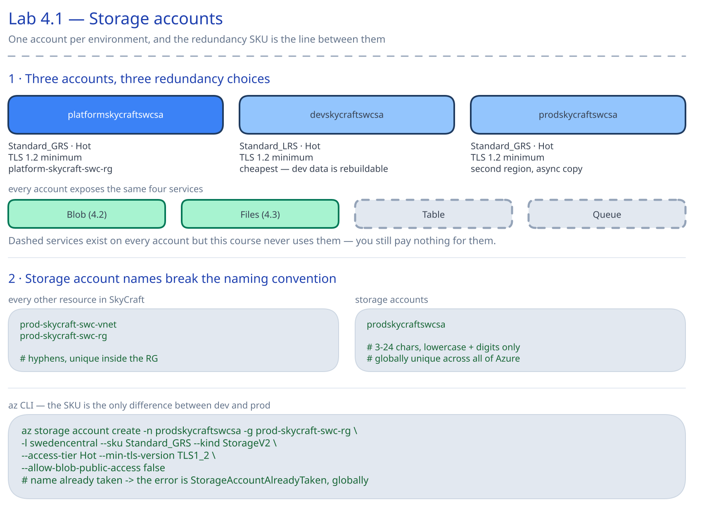
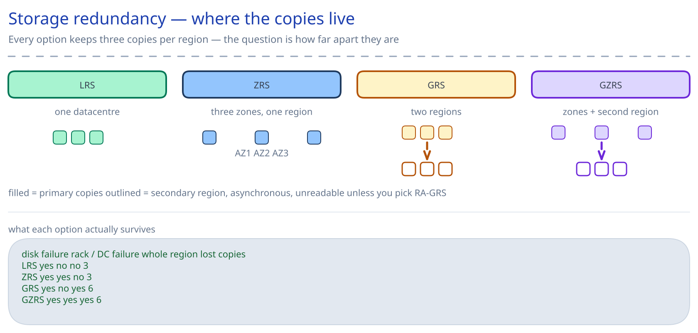
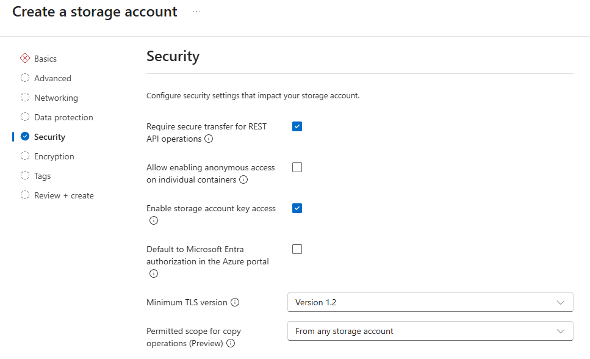
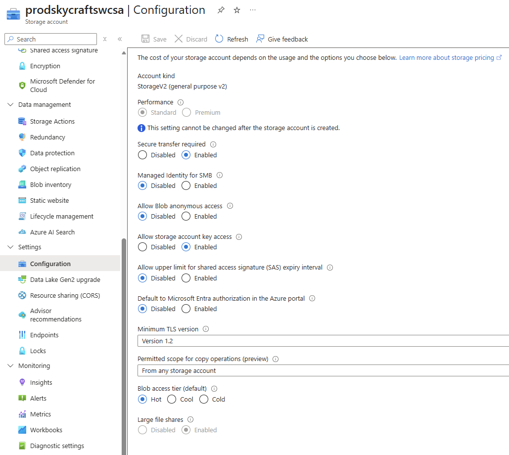
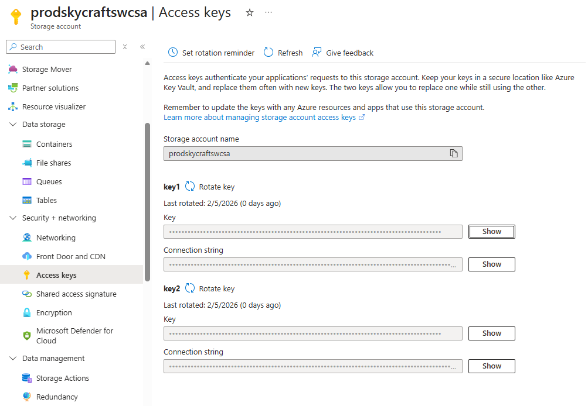

# Lab 4.1: Configure and Manage Storage Accounts (2 hours)

## 🎯 Learning Objectives

By completing this lab, you will:

- Understand Azure Storage services and their use cases
- Create storage accounts with appropriate naming conventions following project standards
- Choose an Azure Storage redundancy option (LRS, ZRS, GRS, GZRS, RA-GRS, RA-GZRS) for each environment
- Verify encryption at rest, and know which encryption settings (customer-managed key support, infrastructure encryption) can only be chosen when an account is created
- Set the default access tier (Hot, Cool, Cold) of a storage account; Lab 4.2 sets the tier of individual blobs, Archive included
- Manage access keys and rotate them
- Use Az PowerShell and the Azure CLI to create and check storage accounts
- Explore an account's data with Azure Storage Explorer or the Portal's Storage browser

> [!NOTE]
> Object replication and AzCopy are AZ-104 topics that this lab does not practise. Object replication copies blobs from a source account to a destination account, and needs blob versioning on both and change feed on the source ([Object replication for block blobs](https://learn.microsoft.com/azure/storage/blobs/object-replication-overview#prerequisites-and-caveats-for-object-replication)); Module 4 keeps change feed off on all three accounts, and only `prodskycraftswcsa` gets versioning (Lab 4.2). AzCopy needs a Microsoft Entra data role, such as **Storage Blob Data Contributor**, which Lab 4.2 has you assign on `prodskycraftswcsa` for its Azure CLI upload, or a SAS token, which Lab 4.4 creates. See Additional Resources for both.

---

## 🏗️ Architecture Overview

This lab deploys storage accounts across all three SkyCraft environments with environment-appropriate redundancy:

<picture>
  <source media="(prefers-color-scheme: dark)" srcset="images/lab-4.1-architecture.dark.svg">
  <source media="(prefers-color-scheme: light)" srcset="images/lab-4.1-architecture.svg">
  
</picture>

---

## 📋 Real-World Scenario

**Situation**: SkyCraft needs persistent storage for game server configurations, player data backups, world state snapshots, and asset distribution. The storage requirements vary by environment:

| Environment     | Use Case                                 | Redundancy Need       | Cost Priority           |
| --------------- | ---------------------------------------- | --------------------- | ----------------------- |
| **Platform**    | Shared scripts, templates, common assets | Geo-redundancy for DR | Medium                  |
| **Development** | Dev server configs, test data            | Local redundancy only | High (cost-saving)      |
| **Production**  | Player data, world saves, game assets    | Geo-redundancy for DR | Low (reliability first) |

**Your Task**: Deploy storage accounts across all three environments with appropriate redundancy, configure security settings (TLS 1.2, anonymous blob access off), apply governance tags, and verify encryption at rest.

**Business Impact**:

- Ensure player data survives regional outages (GRS in production)
- Reduce development costs with LRS instead of GRS (about half the storage price)
- Meet compliance requirements for data encryption
- Enable disaster recovery with geo-replicated storage

---

## ⏱️ Estimated Time: 2 hours

- **Section 1**: Azure Storage Fundamentals (30 min)
- **Section 2**: Create Storage Accounts via Portal (35 min)
- **Section 3**: Create Storage Accounts via CLI/PowerShell (20 min)
- **Section 4**: Verify Encryption and Security (20 min)
- **Section 5**: Access Keys and Data Management (15 min)

Sections 2 and 3 are two ways to create the same three accounts: run one of them (see Portal, PowerShell and Bicep Paths). If you run Section 2, the 20 minutes of Section 3 go to reading how Steps 4.1.5 and 4.1.6 map each wizard setting to a parameter, and to Step 4.1.7, which every path runs.

---

## ✅ Prerequisites

Before starting this lab:

- [ ] Completed Lab 1.2: the resource groups exist:
  - `platform-skycraft-swc-rg`
  - `dev-skycraft-swc-rg`
  - `prod-skycraft-swc-rg`
- [ ] Contributor (or Owner) on the three resource groups
- [ ] PowerShell 7 with the Az module (`Install-Module -Name Az`), signed in with `Connect-AzAccount`
- [ ] Azure CLI (version 2.50.0 or later), only for the Azure CLI blocks of Steps 4.1.5, 4.1.7 and 4.1.13
- [ ] Azure Storage Explorer (optional, Step 4.1.15)
- [ ] If you completed Lab 1.3: the three resource groups carry the tag `Project` = `SkyCraft` (Steps 1.3.1-1.3.3), and its policy assignments are in place (Steps 1.3.5, 1.3.8 and 1.3.9)

**Why the last item matters**: Lab 1.3's `Restrict-Azure-Regions` refuses every region except Sweden Central and North Europe, and `Enforce-Project-Tag` refuses every new resource without `Project` = `SkyCraft`. Every create step in this lab sets the region (Sweden Central) and all four SkyCraft tags itself, so both policies let the accounts through. If you forget the `Project` tag, `Inherit-Project-Tag` copies it from the resource group; no policy adds the other three tags, so they are only what you type. `Test-Lab.ps1` checks `Project`, `Environment` and `CostCenter`; it does not check `Owner`. Lab 1.3 also puts a delete lock on `platform-skycraft-swc-rg` and `prod-skycraft-swc-rg`: it does not stop you creating or changing the accounts, only deleting them (see Clean Up).

Nothing in this lab uses a virtual machine or a network from Modules 2 and 3.

**Verify prerequisites**:

```powershell
Get-AzResourceGroup -Name platform-skycraft-swc-rg, dev-skycraft-swc-rg, prod-skycraft-swc-rg |
    Select-Object ResourceGroupName, Location, @{N='Project';E={$_.Tags['Project']}}
# Three rows. Project shows 'SkyCraft' if you completed Lab 1.3.
```

> [!IMPORTANT]
> **Run the Module 4 labs in order (4.1 → 4.2 → 4.3 → 4.4).** All four configure the **same**
> three storage accounts, and they are cumulative forward: each lab replaces the account-level
> properties and the sub-services it owns, while leaving the sub-services it does not own alone.
> Re-running Lab 4.1 after Lab 4.2 turns production blob versioning back off, and after Lab 4.3
> it resets file-share retention from 14 days back to 7. Lab 4.2's and Lab 4.4's Bicep leave the
> file service alone, so re-running them keeps the 14 days. See `docs/bicep-standards.md`
> §4.5 for the mechanism.

**Preview - the AVM module call the Bicep path makes**:

```bicep
module modStorageAccount 'br/public:avm/res/storage/storage-account:0.33.0' = [for env in varEnvironments: {
  name: 'sa-deployment-${env}'
  scope: resourceGroup('${env}-skycraft-swc-rg')
  params: {
    name: '${env}skycraftswcsa'
    skuName: varSkuNames[env]           // GRS for platform/prod, LRS for dev
    allowCrossTenantReplication: false  // the Portal's default on the Advanced tab
    requireInfrastructureEncryption: parEnableInfrastructureEncryption
    networkAcls: { bypass: 'AzureServices', defaultAction: 'Allow' }
    blobServices: { /* 7-day blob and container soft delete */ }
    fileServices: { /* 7-day share soft delete */ }
  }
}]
```

The `requireInfrastructureEncryption` and `networkAcls` params are lab-friction overrides
(`docs/bicep-standards.md` §4.5): the module defaults `requireInfrastructureEncryption` to `true`
(Azure's own default is `false`, and the property is creation-only), and emits
`defaultAction: 'Deny'` when `networkAcls` is omitted — locking the account before Lab 4.4 teaches
locking it.

---

## 🛠️ Portal, PowerShell and Bicep Paths

You can create the three accounts in the Portal (Steps 4.1.2-4.1.4), with Az PowerShell (Step 4.1.6) or the Azure CLI (Step 4.1.5), or with Bicep. **Pick one path**: all of them create the same three accounts with the same names, so running a second path after the first adds nothing. Every path ends in the state that `scripts/Test-Lab.ps1` accepts whichever path built it, and apart from the three known differences below the paths set the same values: three StorageV2 accounts in Sweden Central (`platformskycraftswcsa` and `prodskycraftswcsa` on GRS, `devskycraftswcsa` on LRS), access tier Hot, secure transfer required, minimum TLS 1.2, anonymous blob access off, account key access on, cross-tenant replication off, public network access enabled from all networks, Microsoft-managed keys without infrastructure encryption, 7-day soft delete for blobs, containers and file shares, blob versioning and change feed off, and the four SkyCraft tags.

| Path | What it creates |
| ---- | --------------- |
| Portal (Section 2) | Everything in Steps 4.1.2-4.1.4 |
| Az PowerShell (Step 4.1.6) or Azure CLI (Step 4.1.5) | The same three accounts, with the settings of every wizard tab, and the soft delete settings of the Data protection tab |
| `scripts/Deploy-Bicep.ps1 -All` (Bicep, `bicep/main.bicep`) | The same three accounts and soft delete settings. Without `-All` it deploys only the dev account. |

Steps that change nothing in Azure, and so have no scripted or Bicep counterpart: 4.1.1 (reading), 4.1.7 (lists the accounts; it has CLI and PowerShell commands), 4.1.8 and 4.1.10-4.1.11 (verify in the Portal; the checklist's validation commands read the same values), 4.1.9 (a look at the customer-managed key form, saved nowhere), 4.1.12 and 4.1.14 (view keys and connection strings), 4.1.15 (Storage Explorer or Storage browser). Step 4.1.13 rotates a key: it has Az PowerShell and CLI commands but no Bicep counterpart, because a rotation is an operation, not a resource.

Three differences between the paths are known, and `Test-Lab.ps1` checks none of them. The first two change nothing in the later labs; the third can stop the Bicep path of Labs 4.1-4.4 (#390):

- **Require Encryption in Transit for SMB**: the Portal's Advanced tab ticks it by default; the PowerShell, CLI and Bicep paths do not set it. With **Require secure transfer for REST API operations** on, as on every path here, Azure Files already requires an encrypted SMB connection ([Create a storage account](https://learn.microsoft.com/azure/storage/common/storage-account-create#security-tab)), so file shares behave the same.
- **Local users** (`isLocalUserEnabled`): the Bicep turns them off, which is the default of the module it uses; the Portal, PowerShell and CLI paths leave Azure's own value. Local users sign in over SFTP or NFS v3, which every path leaves off, so no lab uses them. A `Deploy-Bicep.ps1 -WhatIf` over accounts built another way lists this property as a change.
- **Large file shares**: the wizard no longer offers this setting, and today every pay-as-you-go file share can grow to 100 TiB whatever it shows ([Azure Files scale targets](https://learn.microsoft.com/azure/storage/files/storage-files-scale-targets#classic-file-share-scale-targets-microsoftstorage)). The Bicep sends **Disabled** for the locally redundant `devskycraftswcsa` (its module's default) and nothing for the two GRS accounts; the other paths send nothing, and an account's **Configuration** page may show **Large file shares** **Enabled** and greyed out. Azure does not let an enabled setting be turned off, so if `Deploy-Bicep.ps1` stops on `devskycraftswcsa` with an error about large file shares, the account was built by another path with the setting on: leave the account as it is, and do not run the Bicep of this lab or of Labs 4.2-4.4 over it. Issue #390 tracks the live check and the fix.

---

## 📖 Section 1: Azure Storage Fundamentals (30 min)

### What is Azure Storage?

**Azure Storage** is Microsoft's cloud storage solution providing massively scalable, durable, and highly available storage. A single standard storage account can store up to **5 PiB of data**; see [Scalability and performance targets for standard storage accounts](https://learn.microsoft.com/azure/storage/common/scalability-targets-standard-account) for its request rate limits.

Azure Storage includes four core services:

| Service           | Description                          | Protocol         | SkyCraft Use Case          |
| ----------------- | ------------------------------------ | ---------------- | -------------------------- |
| **Blob Storage**  | Object storage for unstructured data | REST/HTTP        | Game assets, backups, logs |
| **Azure Files**   | Managed file shares                  | SMB 3.0, NFS 4.1 | Shared server configs      |
| **Queue Storage** | Message queuing                      | REST/HTTP        | Game event processing      |
| **Table Storage** | NoSQL key-value store                | REST/HTTP        | Player session data        |

### Storage Account Types

| Type                    | Services        | Performance  | Use Case                     |
| ----------------------- | --------------- | ------------ | ---------------------------- |
| **Standard GPv2**       | All 4 services  | Standard HDD | General purpose (our choice) |
| **Premium Block Blob**  | Blobs only      | Premium SSD  | High-transaction workloads   |
| **Premium File Shares** | Files only      | Premium SSD  | Enterprise file shares       |
| **Premium Page Blobs**  | Page blobs only | Premium SSD  | VM disks (IaaS)              |

> **SkyCraft Choice**: We use **Standard GPv2** accounts because they support all services, offer the best cost-performance ratio, and provide all redundancy options.

### Understanding Redundancy Options

Azure Storage automatically maintains **multiple copies** of your data. The redundancy option determines how and where those copies are stored:

**Within a Single Region:**

| Option  | Copies | Locations            | Durability               | Cost   |
| ------- | ------ | -------------------- | ------------------------ | ------ |
| **LRS** | 3      | Single datacenter    | 11 nines (99.999999999%) | Lowest |
| **ZRS** | 3      | 3 availability zones | 12 nines                 | Medium |

**Across Regions (Geo-Redundant):**

| Option      | Copies | Locations                       | Durability | Cost     |
| ----------- | ------ | ------------------------------- | ---------- | -------- |
| **GRS**     | 6      | 3 local + 3 in paired region    | 16 nines   | High     |
| **GZRS**    | 6      | 3 zones + 3 in paired region    | 16 nines   | Highest  |
| **RA-GRS**  | 6      | GRS + read access to secondary  | 16 nines   | High+    |
| **RA-GZRS** | 6      | GZRS + read access to secondary | 16 nines   | Highest+ |

For Sweden Central, the paired region that holds the geo-redundant copies is Sweden South.

<picture>
  <source media="(prefers-color-scheme: dark)" srcset="images/lab-4.1-redundancy.dark.svg">
  <source media="(prefers-color-scheme: light)" srcset="images/lab-4.1-redundancy.svg">
  
</picture>

### SkyCraft Redundancy Strategy

| Environment     | Redundancy | Justification                                        |
| --------------- | ---------- | ---------------------------------------------------- |
| **Development** | LRS        | Cost-effective, data can be recreated                |
| **Platform**    | GRS        | Geo-redundancy for shared services DR                |
| **Production**  | GRS        | Geo-redundancy for player data, enables archive tier |

### Step 4.1.1: Understand Storage Account Naming Rules

Storage account names have **unique requirements** different from other Azure resources:

| Rule           | Requirement                                | Example                               |
| -------------- | ------------------------------------------ | ------------------------------------- |
| **Scope**      | Globally unique across ALL Azure customers | Only one `mystorageaccount` worldwide |
| **Length**     | 3-24 characters                            | `prodskycraftswcsa` (17 chars) ✓      |
| **Characters** | Lowercase letters and numbers only         | No hyphens, underscores, or uppercase |
| **Start**      | Must start with a letter or number         | `1storage` ✓, `_storage` ✗            |

**SkyCraft Naming Pattern**: `{environment}skycraftswcsa`

| Environment | Storage Account Name    | Notes         |
| ----------- | ----------------------- | ------------- |
| Platform    | `platformskycraftswcsa` | 21 characters |
| Development | `devskycraftswcsa`      | 16 characters |
| Production  | `prodskycraftswcsa`     | 17 characters |

> **Note**: Unlike other Azure resources, storage account names cannot include hyphens. This is why we use `platformskycraftswcsa` instead of `platform-skycraft-swc-sa`.

> [!WARNING]
> The name is reserved worldwide while the account exists. If you delete an account and want to create it again with the same name, wait a minute after the deletion finishes; until then the Portal can report the name as taken. If someone else owns the name, see Troubleshooting, Issue 1.

---

## 📖 Section 2: Create Storage Accounts via Portal (35 min)

The **Create a storage account** wizard has eight tabs, listed on its left: **Basics**, **Advanced**, **Networking**, **Data protection**, **Security**, **Encryption**, **Tags** and **Review + create** (seen 2026-10-16). Most defaults are what this lab wants; the notes below each tab name the defaults that cost money, delete data or open access, and the settings that cannot be changed after the account is created.

### Step 4.1.2: Create Platform Storage Account

1. In Azure Portal, search for **Storage accounts**
2. Click the **Resources** tab
3. Click **+ Create**

**Note**: Searching for **Storage accounts** opens **Storage center | Blob Storage**; its **Resources** tab lists the storage accounts and has **+ Create** on its toolbar. If the list keeps loading, click **Summary** and then **Resources** again.

4. On the **Basics** tab, fill in:

| Field                | Value                                             |
| -------------------- | ------------------------------------------------- |
| Subscription         | Your subscription                                 |
| Resource group       | `platform-skycraft-swc-rg`                        |
| Storage account name | `platformskycraftswcsa`                           |
| Region               | **(Europe) Sweden Central**                       |
| Primary service      | **Azure Blob Storage or Azure Data Lake Storage** |
| Performance          | **Standard**                                      |
| Redundancy           | **Geo-redundant storage (GRS)**                   |

5. Leave **Make read access to data available in the event of regional unavailability** unchecked
6. Leave **Geo priority replication** unchecked

**Note**: **Primary service** is required: the wizard does not go on until something is picked. It only guides the wizard and does not stop the account from holding file shares, queues or tables (Lab 4.3 adds a file share). Leave **Primary workload**, which appears after it, at **Select...**: a workload changes the wizard's defaults on the other tabs.

**Note**: Two check boxes under **Redundancy** cost money. **Make read access to data available in the event of regional unavailability** turns GRS into RA-GRS, which is billed at a higher rate, and `Test-Lab.ps1` expects `Standard_GRS`. **Geo priority replication** adds a charge per GB replicated, billed for 30 days more after you turn it off ([Geo priority replication](https://learn.microsoft.com/azure/storage/common/storage-redundancy-priority-replication#feature-pricing)).

> [!WARNING]
> **Region** and **Performance** cannot be changed after the account is created: a wrong choice means deleting the account and creating it again. **Redundancy** can be changed later, but moving between some options (for example to zone-redundant storage) is a migration, not a setting. Lab 1.3's `Restrict-Azure-Regions` refuses any region but Sweden Central and North Europe.

7. Click the **Advanced** tab
8. Leave these values, which are the tab's defaults, and set any that differ:

| Field                                 | Value     |
| ------------------------------------- | --------- |
| Enable hierarchical namespace         | unchecked |
| Enable network file system v3         | unchecked |
| Enable SFTP                           | unchecked |
| Allow cross-tenant replication        | unchecked |
| Access tier                           | **Hot**   |
| Enable Managed Identity for SMB       | unchecked |
| Require Encryption in Transit for SMB | checked   |

**Note**: The tab has an **Azure Blob Storage** section and an **Azure Files** section; **Enable network file system v3** and **Enable SFTP** stay greyed out without a hierarchical namespace. Leave **Enable hierarchical namespace** unchecked: an account can be upgraded to a hierarchical namespace later, but never back. **Allow cross-tenant replication**, checked, would let object replication copy this account's blobs to an account in another Microsoft Entra tenant. **Access tier** **Cool** or **Cold** lowers the storage price but raises the price of every read and write and charges for blobs deleted early, so keep **Hot** for data the game reads often (Lab 4.2 tiers individual blobs).

9. Click the **Networking** tab
10. Leave these values, which are the tab's defaults, and set any that differ:

| Field                       | Value                         |
| --------------------------- | ----------------------------- |
| Public network access       | **Enable**                    |
| Public network access scope | **Enable from all networks**  |
| Routing preference          | **Microsoft network routing** |

**Note**: **Enable from all networks** opens the account's endpoints to the internet; requests still need an access key, a SAS token or a Microsoft Entra identity, and anonymous access stays off (Security tab). The lab keeps it open so the Portal and your computer can reach the account in Labs 4.2 and 4.3; Lab 4.4 limits it to selected networks. **Disable** or **Secure by perimeter** would block the Portal's own access to the account's data from your computer. Do not add a private endpoint here: it is billed per hour.

11. Click the **Data protection** tab
12. Leave these values, which are the tab's defaults, and set any that differ:

| Field                                       | Value     |
| ------------------------------------------- | --------- |
| Enable point-in-time restore for containers | unchecked |
| Enable soft delete for blobs                | checked   |
| Enable soft delete for containers           | checked   |
| Enable soft delete for classic file shares  | checked   |
| Enable versioning for blobs                 | unchecked |
| Enable blob change feed                     | unchecked |
| Enable version-level immutability support   | unchecked |

**Note**: Keep the retention of each soft delete setting at its default of 7 days. Soft delete keeps deleted data, and bills its storage, for those 7 days, which is what lets you undo a deletion; without it, a deleted blob, container or file share is gone at once. Point-in-time restore also turns on versioning and change feed, which add cost; Lab 4.2 turns versioning on where it is needed.

> [!WARNING]
> Leave **Enable version-level immutability support** unchecked. It can only be set when an account is created and cannot be turned off afterwards, and while it is on, the account cannot be deleted until every container has been emptied ([Configure immutability policies for blob versions](https://learn.microsoft.com/azure/storage/blobs/immutable-policy-configure-version-scope#enable-support-for-version-level-immutability)).

13. Click the **Security** tab
14. Leave these values, which are the tab's defaults, and set any that differ:

| Field                                                        | Value                        |
| ------------------------------------------------------------ | ---------------------------- |
| Require secure transfer for REST API operations              | checked                      |
| Allow enabling anonymous access on individual containers     | unchecked                    |
| Enable storage account key access                            | checked                      |
| Default to Microsoft Entra authorization in the Azure portal | unchecked                    |
| Minimum TLS version                                          | **Version 1.2**              |
| Permitted scope for copy operations (Preview)                | **From any storage account** |

**Note**: These settings moved from the Advanced tab to this tab. **Allow enabling anonymous access on individual containers**, checked, would let anyone with the right role make a container readable without signing in; Lab 4.2 shows that it stays off. Leave **Enable storage account key access** checked: Labs 4.3 and 4.4 use the account key and SAS tokens. If the tab also shows **Enable Microsoft Defender for Storage**, leave it unchecked: Defender for Storage is billed per storage account per month.

15. Click the **Encryption** tab
16. Verify these values, which are the tab's defaults:

| Field                                    | Value                            |
| ---------------------------------------- | -------------------------------- |
| Encryption type                          | **Microsoft-managed keys (MMK)** |
| Enable support for customer-managed keys | **Blobs and files only**         |
| Enable infrastructure encryption         | unchecked                        |

> [!WARNING]
> **Enable support for customer-managed keys** and **Enable infrastructure encryption** cannot be changed after the account is created (the Portal says so under the first). Infrastructure encryption encrypts the data a second time at the infrastructure level; for high-compliance environments you would turn it on here, on a new account. This lab leaves it off, and `Deploy-Bicep.ps1 -InfraEncryption` can set it only on an account that does not exist yet.

17. Click the **Tags** tab
18. Add the tags:

| Tag         | Value       |
| ----------- | ----------- |
| Project     | SkyCraft    |
| Environment | Platform    |
| CostCenter  | MSDN        |
| Owner       | mbiszczanik |

19. Click the **Review + create** tab
20. Click **Create**

**Note**: The **Review + create** tab shows _Validating template..._ for about 15 seconds and then lists your settings, with **View automation template** at the bottom; it shows no "Validation passed" banner. **Create** is available once the validation is done. After **Create**, the deployment page can take about 20 seconds to appear: click **Create** once and wait.

**Expected Result**: The deployment succeeds in about a minute. Navigate to the resource to verify:

- Name: `platformskycraftswcsa`
- Location: Sweden Central
- Replication: Geo-redundant storage (GRS)
- Access tier: Hot



### Step 4.1.3: Create Development Storage Account

1. In Azure Portal, search for **Storage accounts**
2. Click the **Resources** tab
3. Click **+ Create**
4. On the **Basics** tab, fill in:

| Field                | Value                                             |
| -------------------- | ------------------------------------------------- |
| Subscription         | Your subscription                                 |
| Resource group       | `dev-skycraft-swc-rg`                             |
| Storage account name | `devskycraftswcsa`                                |
| Region               | **(Europe) Sweden Central**                       |
| Primary service      | **Azure Blob Storage or Azure Data Lake Storage** |
| Performance          | **Standard**                                      |
| Redundancy           | **Locally-redundant storage (LRS)**               |

**Note**: Leave **Primary workload** at **Select...**, as in Step 4.1.2.

5. Click the **Advanced** tab, and leave its defaults (the values listed in Step 4.1.2)
6. Click the **Networking** tab, and leave its defaults
7. Click the **Data protection** tab, and leave its defaults
8. Click the **Security** tab, and leave its defaults
9. Click the **Encryption** tab, and leave its defaults
10. Click the **Tags** tab
11. Add the tags:

| Tag         | Value       |
| ----------- | ----------- |
| Project     | SkyCraft    |
| Environment | Development |
| CostCenter  | MSDN        |
| Owner       | mbiszczanik |

12. Click the **Review + create** tab
13. Click **Create**

**Expected Result**: Storage account `devskycraftswcsa` created with LRS redundancy.

### Step 4.1.4: Create Production Storage Account

1. In Azure Portal, search for **Storage accounts**
2. Click the **Resources** tab
3. Click **+ Create**
4. On the **Basics** tab, fill in:

| Field                | Value                                             |
| -------------------- | ------------------------------------------------- |
| Subscription         | Your subscription                                 |
| Resource group       | `prod-skycraft-swc-rg`                            |
| Storage account name | `prodskycraftswcsa`                               |
| Region               | **(Europe) Sweden Central**                       |
| Primary service      | **Azure Blob Storage or Azure Data Lake Storage** |
| Performance          | **Standard**                                      |
| Redundancy           | **Geo-redundant storage (GRS)**                   |

5. Leave **Make read access to data available in the event of regional unavailability** unchecked
6. Leave **Geo priority replication** unchecked

**Note**: Leave **Primary workload** at **Select...**, as in Step 4.1.2. The two check boxes under **Redundancy** cost money (see Step 4.1.2).

7. Click the **Advanced** tab, and leave its defaults (the values listed in Step 4.1.2)
8. Click the **Networking** tab, and leave its defaults
9. Click the **Data protection** tab, and leave its defaults
10. Click the **Security** tab, and leave its defaults
11. Click the **Encryption** tab, and leave its defaults
12. Click the **Tags** tab
13. Add the tags:

| Tag         | Value       |
| ----------- | ----------- |
| Project     | SkyCraft    |
| Environment | Production  |
| CostCenter  | MSDN        |
| Owner       | mbiszczanik |

14. Click the **Review + create** tab
15. Click **Create**

**Expected Result**: Storage account `prodskycraftswcsa` created with GRS redundancy (geo-redundancy for player data, enables archive tier).

---

## 📖 Section 3: Create Storage Accounts via CLI/PowerShell (20 min)

This section is the scripted path for Steps 4.1.2-4.1.4: use it **instead of** Section 2, not after it. If you created the accounts in the Portal, read Steps 4.1.5 and 4.1.6 to see how each wizard setting maps to a parameter, and go on to Step 4.1.7. Step 4.1.6 (Az PowerShell) is the lab's scripted path; Step 4.1.5 does the same with the Azure CLI.

The commands set every value the wizard sets in Section 2, including the ones the wizard ticks by default, except **Require Encryption in Transit for SMB** (see the Paths section above): soft delete is a separate command, because creating an account from a script does not turn it on.

### Step 4.1.5: Create Storage Account with Azure CLI

The Azure CLI keeps its own sign-in, separate from Az PowerShell's. Before you run the block, check that `az account show` names the same subscription as `Get-AzContext`.

```bash
# Variables
LOCATION="swedencentral"
PLATFORM_RG="platform-skycraft-swc-rg"
DEV_RG="dev-skycraft-swc-rg"
PROD_RG="prod-skycraft-swc-rg"

# Basics, Advanced, Networking and Security tabs: Platform storage account (GRS)
az storage account create \
  --name platformskycraftswcsa \
  --resource-group $PLATFORM_RG \
  --location $LOCATION \
  --sku Standard_GRS \
  --kind StorageV2 \
  --access-tier Hot \
  --min-tls-version TLS1_2 \
  --https-only true \
  --allow-blob-public-access false \
  --allow-shared-key-access true \
  --allow-cross-tenant-replication false \
  --public-network-access Enabled \
  --tags Project=SkyCraft Environment=Platform CostCenter=MSDN Owner=mbiszczanik

# Development storage account (LRS)
az storage account create \
  --name devskycraftswcsa \
  --resource-group $DEV_RG \
  --location $LOCATION \
  --sku Standard_LRS \
  --kind StorageV2 \
  --access-tier Hot \
  --min-tls-version TLS1_2 \
  --https-only true \
  --allow-blob-public-access false \
  --allow-shared-key-access true \
  --allow-cross-tenant-replication false \
  --public-network-access Enabled \
  --tags Project=SkyCraft Environment=Development CostCenter=MSDN Owner=mbiszczanik

# Production storage account (GRS)
az storage account create \
  --name prodskycraftswcsa \
  --resource-group $PROD_RG \
  --location $LOCATION \
  --sku Standard_GRS \
  --kind StorageV2 \
  --access-tier Hot \
  --min-tls-version TLS1_2 \
  --https-only true \
  --allow-blob-public-access false \
  --allow-shared-key-access true \
  --allow-cross-tenant-replication false \
  --public-network-access Enabled \
  --tags Project=SkyCraft Environment=Production CostCenter=MSDN Owner=mbiszczanik

# Data protection tab: 7-day soft delete for blobs, containers and file shares on each account
for PAIR in "platformskycraftswcsa:$PLATFORM_RG" "devskycraftswcsa:$DEV_RG" "prodskycraftswcsa:$PROD_RG"; do
  NAME="${PAIR%%:*}"
  RG="${PAIR##*:}"
  az storage account blob-service-properties update \
    --account-name "$NAME" \
    --resource-group "$RG" \
    --enable-delete-retention true \
    --delete-retention-days 7 \
    --enable-container-delete-retention true \
    --container-delete-retention-days 7
  az storage account file-service-properties update \
    --account-name "$NAME" \
    --resource-group "$RG" \
    --enable-delete-retention true \
    --delete-retention-days 7
done
```

**Expected Output** (the last `az storage account create`, shortened):

```json
{
  "accessTier": "Hot",
  "allowBlobPublicAccess": false,
  "creationTime": "2026-02-03T06:15:00.000000+00:00",
  "minimumTlsVersion": "TLS1_2",
  "name": "prodskycraftswcsa",
  "primaryLocation": "swedencentral",
  "sku": {
    "name": "Standard_GRS",
    "tier": "Standard"
  }
}
```

### Step 4.1.6: Create Storage Account with PowerShell

```powershell
# Variables
$Location   = 'swedencentral'
$CommonTags = @{ Project = 'SkyCraft'; CostCenter = 'MSDN'; Owner = 'mbiszczanik' }
$Accounts   = @(
    @{ Name = 'platformskycraftswcsa'; ResourceGroup = 'platform-skycraft-swc-rg'; Sku = 'Standard_GRS'; Environment = 'Platform' }
    @{ Name = 'devskycraftswcsa';      ResourceGroup = 'dev-skycraft-swc-rg';      Sku = 'Standard_LRS'; Environment = 'Development' }
    @{ Name = 'prodskycraftswcsa';     ResourceGroup = 'prod-skycraft-swc-rg';     Sku = 'Standard_GRS'; Environment = 'Production' }
)

foreach ($account in $Accounts) {
    # Basics, Advanced, Networking and Security tabs
    New-AzStorageAccount `
        -ResourceGroupName $account.ResourceGroup `
        -Name $account.Name `
        -Location $Location `
        -SkuName $account.Sku `
        -Kind 'StorageV2' `
        -AccessTier 'Hot' `
        -MinimumTlsVersion 'TLS1_2' `
        -EnableHttpsTrafficOnly $true `
        -AllowBlobPublicAccess $false `
        -AllowSharedKeyAccess $true `
        -AllowCrossTenantReplication $false `
        -PublicNetworkAccess 'Enabled' `
        -Tag ($CommonTags + @{ Environment = $account.Environment })

    # Data protection tab: 7-day soft delete for blobs, containers and file shares
    Enable-AzStorageBlobDeleteRetentionPolicy -ResourceGroupName $account.ResourceGroup `
        -StorageAccountName $account.Name -RetentionDays 7
    Enable-AzStorageContainerDeleteRetentionPolicy -ResourceGroupName $account.ResourceGroup `
        -StorageAccountName $account.Name -RetentionDays 7
    Update-AzStorageFileServiceProperty -ResourceGroupName $account.ResourceGroup `
        -StorageAccountName $account.Name -EnableShareDeleteRetentionPolicy $true -ShareRetentionDays 7
}
```

**Expected Result**: Three accounts, each followed by its blob and file service settings, with no error. Step 4.1.7 lists them.

### Step 4.1.7: Verify Storage Accounts with CLI

```bash
# List all SkyCraft storage accounts
az storage account list \
  --query "[?contains(name,'skycraft')].{Name:name,ResourceGroup:resourceGroup,SKU:sku.name,Location:location}" \
  --output table
```

**Expected Output** (the order of the rows may differ):

```
Name                   ResourceGroup             SKU           Location
---------------------  ------------------------  ------------  -------------
devskycraftswcsa       dev-skycraft-swc-rg       Standard_LRS  swedencentral
platformskycraftswcsa  platform-skycraft-swc-rg  Standard_GRS  swedencentral
prodskycraftswcsa      prod-skycraft-swc-rg      Standard_GRS  swedencentral
```

The same list with Az PowerShell:

```powershell
Get-AzStorageAccount |
    Where-Object { $_.StorageAccountName -like '*skycraft*' } |
    Select-Object StorageAccountName, ResourceGroupName, @{N='SKU';E={$_.Sku.Name}}, PrimaryLocation |
    Format-Table -AutoSize
```

A SKU of `Standard_RAGRS` means **Make read access to data available in the event of regional unavailability** was checked in Step 4.1.2 or 4.1.4; see Troubleshooting, Issue 8.

---

## 📖 Section 4: Verify Encryption and Security (20 min)

This section changes nothing in Azure: the accounts got their encryption and security settings when they were created in Section 2 or 3. Step 4.1.9 only opens the customer-managed key form and closes it again.

### Step 4.1.8: Verify Encryption at Rest

Azure Storage automatically encrypts all data at rest using 256-bit AES encryption:

1. In Azure Portal, search for **Storage accounts**
2. Click the **Resources** tab
3. Click **prodskycraftswcsa**
4. Under **Security + networking**, select **Encryption**
5. Verify:
   - Encryption type: **Microsoft-managed keys**
   - This is **always enabled** and cannot be disabled

**Encryption Options Explained**:

| Option                           | Key Management                                         | Use Case                               |
| -------------------------------- | ------------------------------------------------------ | -------------------------------------- |
| **Microsoft-managed keys (MMK)** | Azure manages keys                                     | Default, sufficient for most workloads |
| **Customer-managed keys (CMK)**  | You manage keys in Key Vault                           | Compliance requirements                |
| **Infrastructure encryption**    | A second layer of encryption, chosen at creation only  | High-security workloads                |

### Step 4.1.9: Review the Customer-Managed Key Option

This step is a look at the form only: the lab keeps Microsoft-managed keys, which `Test-Lab.ps1` and the later labs expect, so nothing here is saved. Stay on the **Encryption** page of `prodskycraftswcsa` from Step 4.1.8.

1. Under **Encryption type**, select **Customer-managed keys**
2. Read the fields that appear: the key (from a key vault, or by key URI) and the identity the account uses to reach the key vault
3. Under **Encryption type**, select **Microsoft-managed keys** again

**Expected Result**: The page shows **Microsoft-managed keys** again, with nothing to save.

**What customer-managed keys would need**: a key vault with soft delete and purge protection on, an RSA key in it (a software-protected key in a Standard vault is enough; HSM-protected keys need a Premium vault or a Managed HSM), and a managed identity for the account with the **Key Vault Crypto Service Encryption User** role on the key. Key Vault bills each key operation, and if the key is deleted or the identity loses access, the account's data cannot be read ([Customer-managed keys for Azure Storage encryption](https://learn.microsoft.com/azure/storage/common/customer-managed-keys-overview)).

### Step 4.1.10: Verify TLS Settings

Stay on `prodskycraftswcsa`.

1. Under **Settings**, select **Configuration**
2. Verify:
   - Minimum TLS version: **Version 1.2**
   - Secure transfer required: **Enabled**

**Why TLS 1.2?**

- TLS 1.0 and 1.1 have known vulnerabilities
- Most compliance frameworks require TLS 1.2 minimum
- Azure will deprecate older TLS versions

### Step 4.1.11: Verify Public Access Settings

1. In **Configuration**, verify:
   - Allow Blob anonymous access: **Disabled**
   - Allow storage account key access: **Enabled**

This prevents accidental exposure of sensitive data through misconfigured container access levels.

**Expected Result**: The **Configuration** page of `prodskycraftswcsa` shows **Account kind** **StorageV2 (general purpose v2)**, **Performance** **Standard**, the values of Steps 4.1.10 and 4.1.11, and **Blob access tier (default)** **Hot**.



---

## 📖 Section 5: Access Keys and Data Management (15 min)

### Step 4.1.12: Understanding Access Keys

1. In Azure Portal, search for **Storage accounts**
2. Click the **Resources** tab
3. Click **prodskycraftswcsa**
4. Under **Security + networking**, select **Access keys**
5. Under **key1**, click **Show** next to _Key_

**Note**: Each key has its own **Show** buttons, one for the key and one for its connection string. A key shown on screen is a password to the whole account: do not put it in a screenshot or an issue. The page also offers **Set rotation reminder**, which records a reminder interval on the account; this lab rotates by hand in Step 4.1.13 and sets no reminder.

**Expected Result**: The page lists **key1** and **key2**, each with _Last rotated_, _Key_ and _Connection string_; key1's key is shown.

Each storage account has **two 512-bit access keys**:

- `key1` - Primary key
- `key2` - Secondary key

**Why Two Keys?**

Two keys enable zero-downtime key rotation: applications use `key1` while you rotate `key2`; you move the applications to the new `key2`, rotate `key1`, and move them back to `key1`. Repeat as needed.

### Step 4.1.13: Rotate Access Keys

Practice the dual-key rotation ceremony. In production, you would coordinate this with all applications using the key.

> [!WARNING]
> A rotation cannot be undone: the old key stops working at once, and every connection string, SAS token signed with it and application that uses it fails until it gets the new key. Nothing in the labs uses `key1` of `prodskycraftswcsa` yet; Labs 4.3 and 4.4 read the key when they need it, after this step.

#### Option 1: Azure Portal (GUI)

1. Under **Security + networking**, select **Access keys**
2. Note the date that key1's _Last rotated_ shows
3. Next to key1, click **Rotate key**
4. In the confirmation dialog, click **Yes**

**Expected Result**: key1's _Last rotated_ shows today's date, and key1's key has a new value.

#### Option 2: Azure CLI

```bash
# View current keys
az storage account keys list \
  --account-name prodskycraftswcsa \
  --resource-group prod-skycraft-swc-rg \
  --output table

# Regenerate Key1
az storage account keys renew \
  --account-name prodskycraftswcsa \
  --resource-group prod-skycraft-swc-rg \
  --key key1

# Verify new key value
az storage account keys list \
  --account-name prodskycraftswcsa \
  --resource-group prod-skycraft-swc-rg \
  --output table
```

#### Option 3: PowerShell

```powershell
# View current keys
Get-AzStorageAccountKey -ResourceGroupName 'prod-skycraft-swc-rg' -Name 'prodskycraftswcsa' |
  Format-Table KeyName, Value, CreationTime

# Regenerate Key1
New-AzStorageAccountKey -ResourceGroupName 'prod-skycraft-swc-rg' `
  -Name 'prodskycraftswcsa' `
  -KeyName 'key1'

# Verify new key value
Get-AzStorageAccountKey -ResourceGroupName 'prod-skycraft-swc-rg' -Name 'prodskycraftswcsa' |
  Format-Table KeyName, Value, CreationTime
```

With the CLI or PowerShell, key1 shows a new value and a new `CreationTime`, which the Portal shows as _Last rotated_.

> **Security Best Practice**: Rotate keys every 90 days. Use Azure Key Vault with automatic rotation for production.

### Step 4.1.14: Connection Strings

Each key has its own connection string, built from the account name and that key. Stay on the **Access keys** page of `prodskycraftswcsa`.

1. Under **key1**, click **Show** next to _Connection string_

**Expected Result**: key1's connection string has this form:

```
DefaultEndpointsProtocol=https;AccountName=prodskycraftswcsa;
AccountKey=<key>;EndpointSuffix=core.windows.net
```



Use these in applications to connect to storage. A connection string contains the key: keep it out of screenshots, issues and source code.

### Step 4.1.15: Browse Storage with Storage Browser or Storage Explorer

Azure Storage Explorer is a cross-platform desktop app for managing storage. The Portal's **Storage browser** shows the same tree without installing anything; use either.

#### Option 1: Azure Portal (Storage browser)

1. In Azure Portal, search for **Storage accounts**
2. Click the **Resources** tab
3. Click **devskycraftswcsa**
4. Click **Storage browser**

**Expected Result**: **Storage browser** lists **Blob containers**, **Classic file shares**, **Queues** and **Tables**. They are empty until Lab 4.2 adds containers. If the view keeps loading, press F5.

#### Option 2: Azure Storage Explorer (desktop)

1. Download it from [Azure Storage Explorer](https://azure.microsoft.com/products/storage/storage-explorer/), install it and launch it
2. Sign in with your Azure account
3. In the tree view, open `devskycraftswcsa`
4. Explore:
   - Blob Containers
   - File Shares
   - Queues
   - Tables

---

## ✅ Lab Checklist

- [ ] Platform storage account created with GRS redundancy
- [ ] Development storage account created with LRS redundancy
- [ ] Production storage account created with GRS redundancy (not RA-GRS)
- [ ] All storage accounts have TLS 1.2 minimum
- [ ] All storage accounts have anonymous blob access disabled
- [ ] All storage accounts have 7-day soft delete for blobs, containers and file shares
- [ ] All storage accounts tagged correctly (Project, Environment, CostCenter, Owner)
- [ ] Encryption verified on all accounts (Microsoft-managed keys)
- [ ] Access keys viewed and key1 of `prodskycraftswcsa` rotated

**For detailed verification**, see [lab-checklist-4.1.md](lab-checklist-4.1.md), or run `.\scripts\Test-Lab.ps1`.

---

## 📦 What This Lab Leaves Behind

The three accounts are the storage of Modules 4 and 5: `tools/lab-cycle-manifest.psd1` lists Labs 4.2, 4.3, 4.4, 5.1, 5.2 and 5.3 as depending on Lab 4.1, so keep them until you finish Module 5. A storage account has no fixed fee: you pay for the data it holds (per GB and month) and for the operations on it ([Azure Blob Storage pricing](https://azure.microsoft.com/pricing/details/storage/blobs/)). With the few megabytes the labs put in them, all three together cost well under 0.01 USD per day.

| Left behind | Where | Daily cost | What it does in later labs |
| --- | --- | --- | --- |
| `platformskycraftswcsa` (GRS) | `platform-skycraft-swc-rg` | about 0 (empty) | Lab 5.1 adds a diagnostic setting that sends its blob logs to Log Analytics; Lab 5.3 stores flow logs in it |
| `devskycraftswcsa` (LRS) | `dev-skycraft-swc-rg` | about 0 (empty) | Lab 4.2 adds a container for its anonymous access demo |
| `prodskycraftswcsa` (GRS) | `prod-skycraft-swc-rg` | about 0 (a few MB after Labs 4.2-4.3) | Lab 4.2 adds containers, versioning and lifecycle rules; Lab 4.3 a file share; Lab 4.4 its firewall and SAS; Lab 5.2 backs up its blobs |
| Soft-deleted data (7 days) | Each account | about 0 | Data you delete in later labs stays, and is billed, for 7 days before it is gone |
| A rotated key1 on `prodskycraftswcsa` | `prodskycraftswcsa` | 0 | Nothing; later labs read the current key |

**Re-running this lab later** changes what later labs set: re-running `Deploy-Bicep.ps1` after Lab 4.2 turns production blob versioning off again, after Lab 4.3 sets the production file-share soft delete retention back from 14 days to 7, and after Lab 4.4 opens the production account's firewall again (`networkAcls` back to **Allow**). Run the Module 4 labs in order (see Prerequisites).

---

## 🧹 Clean Up

Do not delete the accounts now: the later labs above use them. When you have finished Module 5, the lab's script deletes all three, and with them all the data in them:

```powershell
.\scripts\Remove-LabResource.ps1 -Environment all
```

While Lab 1.3's delete locks (`lock-no-delete-platform`, `lock-no-delete-prod`) are on `platform-skycraft-swc-rg` and `prod-skycraft-swc-rg`, Azure refuses to delete `platformskycraftswcsa` and `prodskycraftswcsa` (`ScopeLocked`), and the script reports both as failed. Run Lab 1.3's `scripts/Remove-LabResource.ps1` first, which removes the locks, or remove the two locks by hand (under **Settings**, **Locks** of each group) and run this script again.

---

## 🔧 Troubleshooting

### Issue 1: Storage Account Name Already Taken

**Symptom**: Error "The storage account named X is already taken"

**Solution**:

- Storage account names are globally unique
- If you deleted the account a moment ago, wait a minute and try again with the same name
- If someone else owns the name, add random numbers or your initials: `prodskycraftswc01sa`. `Test-Lab.ps1` and the later labs use the names of this guide, so with another name you replace it in their commands too.
- Check namespace availability:
  ```powershell
  Get-AzStorageAccountNameAvailability -Name prodskycraftswcsa
  ```

### Issue 2: Archive Tier Not Available in Lifecycle Management

**Symptom**: "Move to archive storage" option missing from lifecycle policy dropdown

**Solution**:

- Archive tier is NOT supported for ZRS, GZRS, or RA-GZRS redundancy
- Verify storage account uses LRS, GRS, or RA-GRS
- Check redundancy: `(Get-AzStorageAccount -ResourceGroupName <group> -Name <account>).Sku.Name`

### Issue 3: Insufficient Permissions

**Symptom**: "Authorization failed" when creating storage account

**Solution**:

- Verify Contributor or Storage Account Contributor role
- Check role assignment scope (subscription vs resource group)
- Use: `Get-AzRoleAssignment -SignInName <your sign-in name>`
- A role granted a moment ago can take about five minutes to take effect: wait, then sign out and in again before you retry

### Issue 4: Cannot Access Storage from VM

**Symptom**: Connection timeout from Azure VM

**Solution**:

- Check network rules: under **Security + networking**, select **Networking**
- Ensure VNet is allowed if using private endpoints
- Verify firewall isn't blocking port 443 (HTTPS)

### Issue 5: TLS Version Error

**Symptom**: "The client and server cannot communicate, because they do not possess a common algorithm"

**Solution**:

- Client application using TLS 1.0/1.1
- Update client to support TLS 1.2
- Temporarily (not recommended) lower minimum TLS version

### Issue 6: "All resources must be tagged with Project=SkyCraft"

**Symptom**: **Create** seems to do nothing, and the notifications show "disallowed by policy ... All resources must be tagged with Project=SkyCraft".

**Cause**: Lab 1.3's `Enforce-Project-Tag` refuses the account: it has no `Project` tag, and `Inherit-Project-Tag` had none to copy, because the resource group lacks `Project` = `SkyCraft` or the assignment does not exist.

**Solution**: Add the four tags on the **Tags** tab (Step 4.1.2) and create again. An account that exists without some of its tags gets them with:

```powershell
$account = Get-AzStorageAccount -ResourceGroupName prod-skycraft-swc-rg -Name prodskycraftswcsa
Update-AzTag -ResourceId $account.Id -Operation Merge -Tag @{
    Project = 'SkyCraft'; Environment = 'Production'; CostCenter = 'MSDN'; Owner = 'mbiszczanik'
}
```

### Issue 7: Encryption Settings Cannot Be Changed

**Symptom**: Cannot change **Enable support for customer-managed keys** or **Enable infrastructure encryption** after creation

**Solution**:

- Both are set when the account is created
- To change them: create a new storage account with the desired settings
- Copy the data to it (AzCopy or Storage Explorer), then delete the old account

### Issue 8: The SKU is `Standard_RAGRS`, not `Standard_GRS`

**Symptom**: `Test-Lab.ps1` reports `Redundancy is Standard_GRS` as failed with `Actual: Standard_RAGRS`.

**Cause**: **Make read access to data available in the event of regional unavailability** was checked under **Redundancy** on the **Basics** tab.

**Solution**: Under **Data management**, select **Redundancy**, set **Redundancy** to **Geo-redundant storage (GRS)** without read access, and click **Save**. With Az PowerShell: `Set-AzStorageAccount -ResourceGroupName prod-skycraft-swc-rg -Name prodskycraftswcsa -SkuName Standard_GRS`.

### Issue 9: "Resources must be deployed to Sweden Central or North Europe regions only"

**Symptom**: **Create** is refused with this message.

**Cause**: **Region** on the **Basics** tab was left at another region, which Lab 1.3's `Restrict-Azure-Regions` refuses.

**Solution**: Set **Region** to **(Europe) Sweden Central** and create again.

---

## 🎓 Knowledge Check

1. **What is the difference between GRS and GZRS redundancy?**

   <details>
     <summary>**Click to see the answer**</summary>

   **Answer**: GRS stores 3 copies locally using LRS (single datacenter) plus 3 copies in the paired region. GZRS stores 3 copies across availability zones (ZRS) plus 3 copies in the paired region. GZRS provides both local high availability (survives datacenter failure) AND geo-redundancy (survives regional failure), making it the most durable option.
   </details>

2. **Why should blob public access be disabled by default?**

   <details>
     <summary>**Click to see the answer**</summary>

   **Answer**: Disabling public access at the account level prevents accidental data exposure. Even if a container is misconfigured with public access, the account-level setting blocks anonymous access. This follows the principle of least privilege and prevents security incidents from misconfiguration.
   </details>

3. **What are the storage account naming requirements and why?**

   <details>
     <summary>**Click to see the answer**</summary>

   **Answer**: Storage account names must be 3-24 characters, globally unique, and contain only lowercase letters and numbers (no hyphens or special characters). The global uniqueness is required because the storage account name becomes part of the public endpoint URL (e.g., `mystorageaccount.blob.core.windows.net`).
   </details>

4. **When should you use LRS vs GZRS?**

   <details>
     <summary>**Click to see the answer**</summary>

   **Answer**: Use LRS for development/test environments or non-critical data where cost savings matter and data can be recreated. Use GZRS for production workloads containing irreplaceable data (like player saves) where maximum durability is required. The cost difference can be 2-3x, so choose based on data criticality.
   </details>

5. **Why does Azure provide two access keys per storage account?**

   <details>
     <summary>**Click to see the answer**</summary>

   **Answer**: Two keys enable zero-downtime key rotation. While applications use key1, you can regenerate key2. Then update applications to key2, regenerate key1, and switch back. This ensures continuous access during security-mandated key rotations without service interruption.
   </details>

6. **What is the purpose of requiring TLS 1.2 as minimum version?**

   <details>
     <summary>**Click to see the answer**</summary>

   **Answer**: TLS 1.0 and 1.1 have known security vulnerabilities including BEAST, POODLE, and weak cipher suites. TLS 1.2 provides strong encryption and is required by most compliance frameworks (PCI DSS, HIPAA). Azure is deprecating older TLS versions across all services.
   </details>

7. **What happens to data in the secondary region during GRS replication?**

   <details>
     <summary>**Click to see the answer**</summary>

   **Answer**: Data is asynchronously replicated to the secondary region. With standard GRS, this data is not readable unless a failover makes the secondary region the primary. With RA-GRS (Read-Access GRS), you can read from the secondary endpoint (`-secondary.blob.core.windows.net`) at any time, useful for read-heavy applications or disaster recovery testing.
   </details>

---

## 📚 Additional Resources

- [Azure Storage account overview](https://learn.microsoft.com/azure/storage/common/storage-account-overview)
- [Create a storage account](https://learn.microsoft.com/azure/storage/common/storage-account-create)
- [Azure Storage redundancy](https://learn.microsoft.com/azure/storage/common/storage-redundancy)
- [Storage account encryption](https://learn.microsoft.com/azure/storage/common/storage-service-encryption)
- [Manage storage account access keys](https://learn.microsoft.com/azure/storage/common/storage-account-keys-manage)
- [Configure storage firewalls and virtual networks](https://learn.microsoft.com/azure/storage/common/storage-network-security)
- [Object replication for block blobs](https://learn.microsoft.com/azure/storage/blobs/object-replication-overview)
- [Get started with AzCopy](https://learn.microsoft.com/azure/storage/common/storage-use-azcopy-v10)
- [AZ-104 Learning Path: Implement and manage storage](https://learn.microsoft.com/training/paths/az-104-manage-storage/)

---

## 📌 Module Navigation

[← Back to Module 4 Index](../README.md)

[Next Lab: 4.2 - Implement Azure Blob Storage →](../4.2-blob-storage/lab-guide-4.2.md)

---

## 📝 Lab Summary

**What You Accomplished:**

✅ Created three storage accounts with environment-appropriate redundancy:

- Platform: GRS for shared services
- Development: LRS for cost optimization
- Production: GRS for geo-redundancy and archive tier support

✅ Configured security best practices:

- TLS 1.2 minimum enforced
- Anonymous blob access disabled
- HTTPS-only traffic enabled
- 7-day soft delete for blobs, containers and file shares

✅ Applied governance tags to all resources:

- Project: SkyCraft
- Environment: Platform/Development/Production
- CostCenter: MSDN
- Owner: mbiszczanik

✅ Created the accounts on one path, and saw how each Portal setting maps to an Az PowerShell and Azure CLI parameter

✅ Rotated an access key and understood key management best practices

**Time Spent**: ~2 hours

**Ready for Lab 4.2?** Next, you'll create blob containers, configure access tiers, implement versioning and soft delete, and create lifecycle management policies for automatic data tiering.
