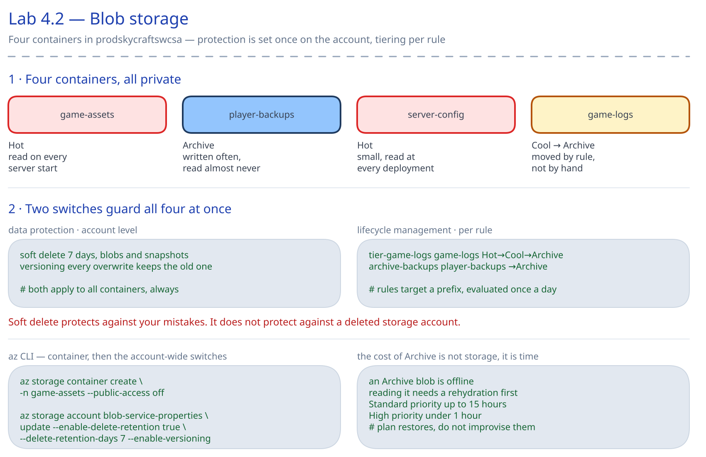
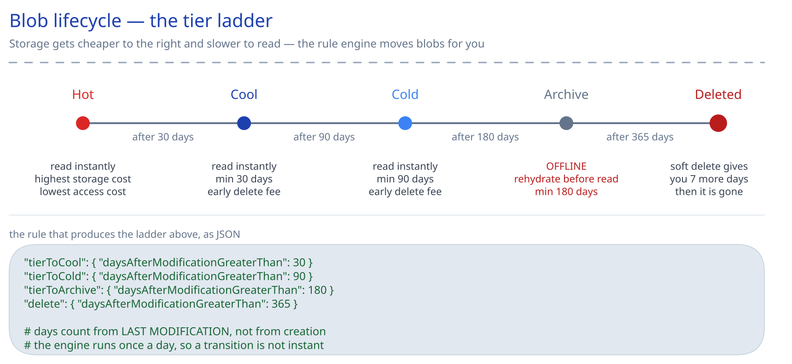
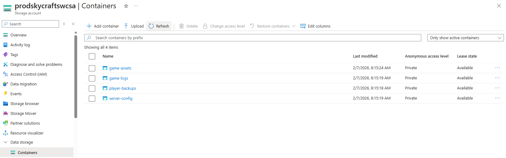
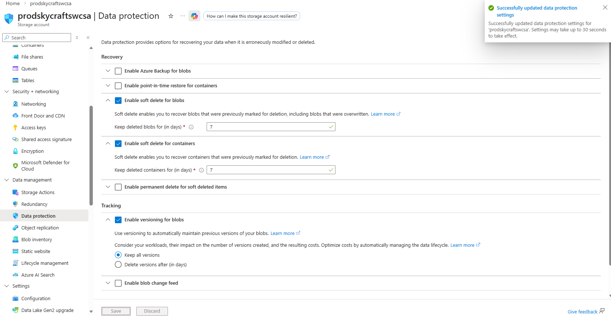

# Lab 4.2: Implement Azure Blob Storage (2 hours)

## 🎯 Learning Objectives

By completing this lab, you will:

- Understand blob types (Block, Append, Page) and their use cases
- Create and configure containers with appropriate access levels
- Configure blob access tiers (Hot, Cool, Cold, Archive) for cost optimization
- Implement soft delete and versioning for data protection
- Create lifecycle management policies, limited by prefix filters, for automatic tiering
- Upload and access blobs using the Azure Portal and Az PowerShell

---

## 🏗️ Architecture Overview

This lab configures blob storage for SkyCraft's production environment with multiple containers optimized for different data access patterns.

<picture>
  <source media="(prefers-color-scheme: dark)" srcset="images/lab-4.2-architecture.dark.svg">
  <source media="(prefers-color-scheme: light)" srcset="images/lab-4.2-architecture.svg">
  
</picture>

### Access Tier Transitions

<picture>
  <source media="(prefers-color-scheme: dark)" srcset="images/lab-4.2-lifecycle.dark.svg">
  <source media="(prefers-color-scheme: light)" srcset="images/lab-4.2-lifecycle.svg">
  
</picture>

## 📋 Real-World Scenario

**Situation**: SkyCraft's production environment needs to store various types of data with different access patterns and retention requirements:

| Data Type                      | Container        | Access Pattern             | Retention       | Cost Priority     |
| ------------------------------ | ---------------- | -------------------------- | --------------- | ----------------- |
| Game assets (textures, models) | `game-assets`    | Very frequent              | Indefinite      | Performance       |
| Player save backups            | `player-backups` | Rarely (disaster recovery) | 7 years         | Cost              |
| Server configuration           | `server-config`  | Frequent                   | Current version | Reliability       |
| Application logs               | `game-logs`      | Decreasing over time       | 1 year          | Cost optimization |

**Your Task**: Configure blob containers for each data type, implement appropriate access tiers, enable data protection features, and create lifecycle policies for automatic cost optimization. Each lifecycle rule applies to one container only: the rule that deletes logs after a year must never reach the game assets or the player backups.

**Business Impact**:

- **Cost Savings**: Archive tier is ~90% cheaper than Hot tier
- **Data Protection**: Versioning prevents accidental data loss
- **Compliance**: Soft delete ensures recoverability for audit requirements

## ⏱️ Estimated Time: 2 hours

- **Section 1**: Blob Storage Fundamentals (15 min)
- **Section 2**: Create and Configure Containers (25 min)
- **Section 3**: Configure Data Protection (20 min)
- **Section 4**: Lifecycle Management (30 min)
- **Section 5**: Upload and Access Blobs (25 min)
- **What This Lab Leaves Behind** (5 min)

## ✅ Prerequisites

Before starting this lab:

- [ ] Lab 4.1 completed: storage account `prodskycraftswcsa` (Standard_GRS) in `prod-skycraft-swc-rg` and `devskycraftswcsa` (Standard_LRS) in `dev-skycraft-swc-rg`, both in Sweden Central with their SkyCraft tags (`tools/lab-cycle-manifest.psd1` lists this lab as depending on 4.1 only).
- [ ] **Owner** or **Contributor** on both resource groups. The Portal and the Az PowerShell blocks reach the blobs with the account key, which these roles may read, so no data role is needed. Only the optional Azure CLI commands with `--auth-mode login` need **Storage Blob Data Contributor** (Step 4.2.11).
- [ ] PowerShell 7+ and the `Az` module (Az.Accounts, Az.Resources, Az.Storage). The Azure CLI is optional.
- [ ] A text editor to create two small local files (Steps 4.2.11-4.2.13).

If you completed Lab 1.3, its policies are still assigned to your subscription. This lab creates no new Azure resource: the containers, the lifecycle policy and the blob settings are parts of the two storage accounts from Lab 4.1, which already carry the region (Sweden Central) and the SkyCraft tags. `Enforce-Project-Tag` and `Inherit-Project-Tag` (Lab 1.3, Step 1.3.8) and `Restrict-Azure-Regions` (Step 1.3.9) evaluate only resources that have a location and tags, so no step below asks for a region or tags, and none is refused by them. The Bicep path sets the same region and four tags on both accounts as Lab 4.1 did. No step of this lab creates a resource group or makes Azure create one. Lab 1.3's delete lock on `prod-skycraft-swc-rg` (`lock-no-delete-prod`, Step 1.3.11) does not stop the steps below: they create containers and change settings in that group, which a delete lock allows. It does stop this lab's cleanup (see What This Lab Leaves Behind).

Check the prerequisites with Az PowerShell (signed in with `Connect-AzAccount` to the subscription you use for the course):

```powershell
Get-AzStorageAccount -ResourceGroupName 'prod-skycraft-swc-rg' -Name 'prodskycraftswcsa' |
    Select-Object StorageAccountName, Location, @{ n = 'Sku'; e = { $_.Sku.Name } }, Kind, AccessTier
Get-AzStorageAccount -ResourceGroupName 'dev-skycraft-swc-rg' -Name 'devskycraftswcsa' |
    Select-Object StorageAccountName, Location, @{ n = 'Sku'; e = { $_.Sku.Name } }, Kind, AllowBlobPublicAccess
```

**Expected Result**: `prodskycraftswcsa` in `swedencentral`, `Standard_GRS`, `StorageV2`, access tier `Hot`; `devskycraftswcsa` in `swedencentral`, `Standard_LRS`, `StorageV2`, `AllowBlobPublicAccess` `False`.

> [!IMPORTANT]
> **Run the Module 4 labs in order (4.1 → 4.2 → 4.3 → 4.4).** All four configure the **same**
> three storage accounts, and they are cumulative forward: each lab replaces the account-level
> properties and the sub-services it owns, while leaving the sub-services it does not own alone.
> Re-running Lab 4.2 after Lab 4.3 resets file-share retention from 14 days back to 7; re-running
> Lab 4.1 after Lab 4.2 turns production blob versioning back off. See `docs/bicep-standards.md`
> §4.5 for the mechanism.

## 🛠️ Portal, PowerShell and Bicep Paths

You can build this lab in the Portal by following this guide, with the Az PowerShell blocks under each step, or with Bicep. The three paths end in the same state, and `scripts/Test-Lab.ps1` accepts it whichever path built it:

| Path | What it configures |
| ---- | ------------------ |
| Portal (this guide) | Everything in the steps below |
| Az PowerShell (the blocks under Steps 4.2.2, 4.2.3, 4.2.5-4.2.9, 4.2.11-4.2.13) | The same, including the test blob and its second version |
| `scripts/Deploy-Bicep.ps1` (Bicep, `bicep/main.bicep`) | The containers, the data protection settings and the lifecycle policy; no blobs |

The end state on every path:

- `prodskycraftswcsa`: containers `game-assets`, `player-backups`, `server-config` and `game-logs`, all **Private**; soft delete for blobs and for containers, 7 days each; blob versioning on, all versions kept; blob change feed off.
- The lifecycle policy of `prodskycraftswcsa`, with two rules for block blobs, each limited to one container by a prefix filter:
  - `tier-game-logs`, prefix `game-logs/`: Cool after 30 days, Cold after 90, Archive after 180 (skipping blobs rehydrated in the last 7 days), Delete after 365.
  - `archive-backups`, prefix `player-backups/`: Archive after 7 days (skipping blobs rehydrated in the last 7 days).
- `devskycraftswcsa`: container `public-demo`, **Private**; anonymous access to the account **Disabled**; versioning off.

One value differs by path and is meant to: dev versioning is never set by the Portal (Azure reports it as unset) and is written as `false` by the Bicep; both mean off.

Steps without a PowerShell or Bicep counterpart: 4.2.1, 4.2.4 and 4.2.10 only read settings. 4.2.11 and 4.2.13 upload a blob, which is data, not configuration: they have PowerShell blocks but no Bicep, and `Test-Lab.ps1` does not check blobs. In 4.2.12, items 1, 3 and 4 are Portal only (a look at a switch, an anonymous request and a dialog you close); its container (item 2) has a PowerShell block and is in the Bicep.

**Preview - the AVM module call the Bicep path makes**:

```bicep
module modStorageProd 'br/public:avm/res/storage/storage-account:0.33.0' = {
  name: 'sa-deployment-prod-42'
  scope: resourceGroup(parResourceGroupNameProd)
  params: {
    name: 'prodskycraftswcsa'
    blobServices: {
      isVersioningEnabled: true
      containers: varContainersProd     // game-assets, player-backups, server-config, game-logs
    }
    managementPolicyRules: varLifecycleRules   // tier-game-logs (game-logs/), archive-backups (player-backups/)
  }
}
```

Containers and lifecycle rules are parameters of the same module that created the account in
Lab 4.1 — there is no separate container module and no cross-lab import any more. `fileServices`
is deliberately not passed: an omitted sub-service is skipped entirely, so Lab 4.1's file-share
settings survive untouched (`docs/bicep-standards.md` §4.5).

---

## 📖 Section 1: Blob Storage Fundamentals (15 min)

### What is Azure Blob Storage?

Azure Blob Storage is Microsoft's object storage solution optimized for storing massive amounts of unstructured data—data that doesn't adhere to a particular data model, such as text or binary data.

**Key Characteristics**:

- Massively scalable (up to 190.7 TiB per blob)
- Globally accessible via HTTP/HTTPS
- Supports streaming and random access patterns
- Integrated with Azure CDN for content delivery

### Blob Types

Azure Blob Storage supports three types of blobs, each optimized for different scenarios:

| Blob Type       | Max Size  | Write Pattern     | Use Case                             |
| --------------- | --------- | ----------------- | ------------------------------------ |
| **Block Blob**  | 190.7 TiB | Upload in blocks  | Images, videos, documents, backups   |
| **Append Blob** | 195 GiB   | Append-only       | Logging, audit trails, telemetry     |
| **Page Blob**   | 8 TiB     | Random read/write | Virtual hard disks (VHDs), databases |

> **For SkyCraft**: We'll use **Block Blobs** for game assets, backups and logs. Lifecycle management tiers block blobs only, so a log written as an append blob would never move to a cheaper tier.

### Access Tiers Deep Dive

Azure Blob Storage offers four access tiers with different cost profiles:

| Tier        | Storage Cost  | Access Cost | Retrieval Time    | Minimum Retention |
| ----------- | ------------- | ----------- | ----------------- | ----------------- |
| **Hot**     | Highest       | Lowest      | Immediate         | None              |
| **Cool**    | Lower (~50%)  | Higher      | Immediate         | 30 days           |
| **Cold**    | Lower (~70%)  | Higher      | Immediate         | 90 days           |
| **Archive** | Lowest (~90%) | Highest     | Hours (rehydrate) | 180 days          |

#### Understanding Rehydration

Data in the Archive tier must be **rehydrated** before access:

| Rehydration Priority | Time           | Cost          |
| -------------------- | -------------- | ------------- |
| Standard             | Up to 15 hours | Lower         |
| High                 | Under 1 hour   | Higher (~10x) |

> [!IMPORTANT]
> **Early Deletion Penalty**: Deleting or moving a blob from Cool/Cold/Archive before the minimum retention period incurs early deletion charges. Plan your lifecycle policies accordingly.

### Container Access Levels

Containers support three access levels:

| Level         | Public Access                      | Use Case                                |
| ------------- | ---------------------------------- | --------------------------------------- |
| **Private**   | None                               | Sensitive data, requires authentication |
| **Blob**      | Read-only for individual blobs     | CDN content, public documents           |
| **Container** | Full container listing + blob read | Public directories                      |

> [!WARNING]
> **Security Best Practice**: Use **Private** access level by default. Enable public access only for content explicitly intended for anonymous access (like CDN assets).

---

## 📖 Section 2: Create and Configure Containers (25 min)

### Step 4.2.1: Verify Storage Account Exists

Before creating containers, make sure the storage account from Lab 4.1 exists:

```powershell
Get-AzStorageAccount -ResourceGroupName 'prod-skycraft-swc-rg' -Name 'prodskycraftswcsa' |
    Select-Object StorageAccountName, @{ n = 'Sku'; e = { $_.Sku.Name } }, Kind
```

**Expected Result**: Storage account `prodskycraftswcsa` displayed with `Standard_GRS` redundancy.

### Step 4.2.2: Create Game Assets Container

This container will store game textures, models, and other assets.

> [!NOTE]
> **Security Best Practice**: In production, we keep containers **Private** (no anonymous access) and use robust delivery mechanisms like Azure CDN or Front Door with private origins. Step 4.2.12 walks through the **public access** settings on the Development account for the AZ-104 exam - and shows why, in this subscription, they stay off.

1. In Azure Portal, search for **Storage accounts**.
2. Open `prodskycraftswcsa` → **Containers** (in the left menu, under **Data storage**; expand the group if it is collapsed).
3. Click **+ Add container**.
4. In the pane that opens, New container, fill in:

| Field | Value         |
| ----- | ------------- |
| Name  | `game-assets` |

The **Anonymous access level** field is greyed out at **Private (no anonymous access)**, with the note "The access level is set to private because anonymous access is disabled on this storage account." Lab 4.1 turned anonymous access off for the whole account, so a container can only be private; there is nothing to choose.

> **Warning**: Leave the pane's **Advanced** section as it is. Its **Enable version-level immutability support** box cannot be turned off for the container once the container is created, and such a container cannot be deleted while it holds a blob, so this lab's cleanup would fail on it.

5. Click **Create**.

**Expected Result**: Container `game-assets` is listed with **Anonymous access level** **Private**. The list may also show `$logs`, a system container Azure creates for the account's own logs; leave it alone.

**With Az PowerShell** (instead of items 1-5):

```powershell
New-AzRmStorageContainer -ResourceGroupName 'prod-skycraft-swc-rg' -StorageAccountName 'prodskycraftswcsa' `
    -Name 'game-assets' -PublicAccess None
```

### Step 4.2.3: Create Private Containers

Create the remaining containers with **Private** access (no anonymous access):

| Container Name   | Purpose                                | Default Tier                   |
| ---------------- | -------------------------------------- | ------------------------------ |
| `player-backups` | Player save data for disaster recovery | Hot (will change to Archive)   |
| `server-config`  | Server configuration files             | Hot                            |
| `game-logs`      | Application logs                       | Hot (lifecycle will tier down) |

1. Click **+ Add container**.
2. Name: `player-backups`
3. Click **Create**.
4. Click **+ Add container**.
5. Name: `server-config`
6. Click **Create**.
7. Click **+ Add container**.
8. Name: `game-logs`
9. Click **Create**.

Each time, **Anonymous access level** is greyed out at **Private (no anonymous access)**, as in Step 4.2.2, and the **Advanced** section stays as it is.

**Expected Result**: Four containers created, all **Private**:

- `game-assets`
- `game-logs`
- `player-backups`
- `server-config`



**With Az PowerShell** (instead of items 1-9):

```powershell
foreach ($name in 'player-backups', 'server-config', 'game-logs') {
    New-AzRmStorageContainer -ResourceGroupName 'prod-skycraft-swc-rg' -StorageAccountName 'prodskycraftswcsa' `
        -Name $name -PublicAccess None
}

Get-AzRmStorageContainer -ResourceGroupName 'prod-skycraft-swc-rg' -StorageAccountName 'prodskycraftswcsa' |
    Select-Object Name, PublicAccess
```

### Step 4.2.4: Understand Access Tier Settings

> [!NOTE]
> **Container vs Blob Tiers**: Access tiers are set at the **blob level**, not the container level. However, you can set a default tier for the storage account that new blobs will inherit.

The default access tier for `prodskycraftswcsa` is **Hot** (Lab 4.1). Blobs uploaded will be Hot by default unless explicitly specified.

1. Navigate to `prodskycraftswcsa` → **Configuration** (in the left menu, under **Settings**).
2. Verify:
   - **Blob access tier (default)**: **Hot**

> **Cost**: **Cool** or **Cold** as the default lowers the storage price of every new blob, but raises the price of each read and write and adds an early deletion charge to any blob deleted or moved within 30 (Cool) or 90 (Cold) days. Leave **Hot** selected, and leave the page without saving.

**Expected Result**: The default tier stays as Lab 4.1 set it; nothing was saved.

> **For SkyCraft**: Keep the default as **Hot** since most new uploads are frequently accessed initially; the lifecycle rules of Section 4 move older blobs to cheaper tiers.

---

## 📖 Section 3: Configure Data Protection (20 min)

### Why Data Protection Matters

Data protection features prevent accidental data loss and support compliance requirements:

| Feature                      | Protection Against            | Recovery Time                |
| ---------------------------- | ----------------------------- | ---------------------------- |
| **Soft Delete (Blobs)**      | Accidental blob deletion      | Immediate (within retention) |
| **Soft Delete (Containers)** | Accidental container deletion | Immediate (within retention) |
| **Versioning**               | Overwrites and modifications  | Immediate (any version)      |
| **Point-in-Time Restore**    | Bulk data corruption          | Minutes to hours             |

Steps 4.2.5-4.2.7 are made on one page, **Data protection**, and saved once at the end of Step 4.2.7. Lab 4.1's wizard turned both soft delete settings on at 7 days already, so Steps 4.2.5 and 4.2.6 are checks: you change something only if your account differs.

### Step 4.2.5: Enable Soft Delete for Blobs

1. Navigate to `prodskycraftswcsa` → **Data protection** (in the left menu, under **Data management**).
2. Under **Recovery**, enable **Enable soft delete for blobs** (it is checked already if you created the account in Lab 4.1's wizard).
3. **Keep deleted blobs for (in days)**: `7`
4. Leave **Enable Azure Backup for blobs** unchecked - it bills each protected account and its backup storage; Lab 5.2 covers backup.
5. Leave **Enable point-in-time restore for containers** unchecked - it needs versioning and the change feed, and the change feed is billed for every change it logs.
6. Leave **Enable permanent delete for soft deleted items** unchecked - it lets anyone with delete rights erase soft-deleted blobs for good, which defeats soft delete.

**Expected Result**: **Enable soft delete for blobs** is checked with **Keep deleted blobs for (in days)** at `7`; the other three boxes under **Recovery** are unchecked. Do not leave the page; Step 4.2.7 saves it.

**With Az PowerShell**:

```powershell
Enable-AzStorageBlobDeleteRetentionPolicy -ResourceGroupName 'prod-skycraft-swc-rg' `
    -StorageAccountName 'prodskycraftswcsa' -RetentionDays 7
```

### Step 4.2.6: Enable Soft Delete for Containers

1. On the same page, under **Recovery**, enable **Enable soft delete for containers** (it is checked already if you created the account in Lab 4.1's wizard).
2. **Keep deleted containers for (in days)**: `7`

**Expected Result**: **Enable soft delete for containers** is checked with **Keep deleted containers for (in days)** at `7`.

**With Az PowerShell**:

```powershell
Enable-AzStorageContainerDeleteRetentionPolicy -ResourceGroupName 'prod-skycraft-swc-rg' `
    -StorageAccountName 'prodskycraftswcsa' -RetentionDays 7
```

### Step 4.2.7: Enable Blob Versioning

Versioning automatically maintains previous versions of a blob when it's modified or overwritten.

1. On the same page, under **Tracking**, enable **Enable versioning for blobs**.
2. Select **Keep all versions**.
3. Leave **Enable blob change feed** unchecked - it is billed for every change it logs, and no step of this course reads it.
4. Click **Save**.

> **Cost**: Every overwrite keeps the previous version, and every version is billed as stored data. In this lab that is two small text files. **Delete versions after (in days)** would limit it, but the Portal does that by adding a rule to the account's lifecycle policy: a third rule that Steps 4.2.8-4.2.9, the Az PowerShell blocks and the Bicep do not have, and that `Deploy-Bicep.ps1` would remove. Keep all versions here; Troubleshooting Issue 6 shows the rule you would add in production.

> **Warning**: If the page shows **Enable version-level immutability support** (under **Access control**), leave it unchecked. Version-level immutability cannot be disabled once it is enabled, and it keeps blobs and containers from being deleted.

**Expected Result**: The notification "Successfully updated data protection settings" appears, and the page shows:

- ✅ Soft delete for blobs (7 days)
- ✅ Soft delete for containers (7 days)
- ✅ Versioning enabled, keep all versions
- Azure Backup for blobs, point-in-time restore, permanent delete and change feed unchecked



**With Az PowerShell** (instead of items 1-4):

```powershell
Update-AzStorageBlobServiceProperty -ResourceGroupName 'prod-skycraft-swc-rg' `
    -StorageAccountName 'prodskycraftswcsa' -IsVersioningEnabled $true

Get-AzStorageBlobServiceProperty -ResourceGroupName 'prod-skycraft-swc-rg' -StorageAccountName 'prodskycraftswcsa' |
    Select-Object IsVersioningEnabled,
        @{ n = 'BlobSoftDeleteDays'; e = { $_.DeleteRetentionPolicy.Days } },
        @{ n = 'ContainerSoftDeleteDays'; e = { $_.ContainerDeleteRetentionPolicy.Days } },
        @{ n = 'ChangeFeed'; e = { $_.ChangeFeed.Enabled } }
```

---

## 📖 Section 4: Lifecycle Management (30 min)

### What is Lifecycle Management?

Lifecycle management policies automatically transition blobs between access tiers or delete them based on rules you define. This optimizes storage costs without manual intervention.

**Key Concepts**:

- Policies run **once per day** (not real-time)
- Actions execute based on **last modified** or **created** date
- A rule applies to **every block blob in the account** unless a filter limits it: a **blob prefix** (`<container>/<start of the blob name>`) or **blob index tags**
- One storage account has one lifecycle policy; the Portal adds rules to it, while Az PowerShell and the Azure CLI write the whole policy at once

> [!NOTE]
> **Archive Tier Redundancy**: Archive tier is supported for LRS, GRS, and RA-GRS storage accounts. It is NOT supported for ZRS, GZRS, or RA-GZRS. Since `prodskycraftswcsa` uses **GRS** redundancy, all lifecycle tier transitions including archive are available.

> [!WARNING]
> **A lifecycle rule without a filter deletes data across the whole account.** The rule of Step 4.2.8 deletes blobs 365 days after their last change. Without the prefix filter `game-logs/` it would also delete the game assets (kept indefinitely) and the player backups (kept 7 years) after one year; with versioning on, the game would then find only previous versions to restore by hand. Both rules below are limited to their own container, and `Test-Lab.ps1` fails a rule that is not.

### Step 4.2.8: Create Lifecycle Policy for Game Logs

This rule tiers the blobs in the `game-logs` container to cheaper tiers as they age, and deletes them after a year. It applies to no other container.

1. Navigate to `prodskycraftswcsa` → **Lifecycle management** (in the left menu, under **Data management**).
2. On the **List View** tab, click **Add a rule**.
3. On the **Details** tab, fill in:

| Field        | Value                    |
| ------------ | ------------------------ |
| Rule name    | `tier-game-logs`         |
| Rule scope   | Limit blobs with filters |
| Blob type    | Block blobs              |
| Blob subtype | Base blobs               |

**Limit blobs with filters** adds a third tab, **Filter set**, which this rule needs.

4. Click the **Base blobs** tab.

The tab shows one If / Then block: the condition Last modified, a box More than (days ago), and under Then the action Delete the blob. The rule needs four such blocks, one per row of this table, each with the condition Last modified:

| Block | More than (days ago) | Then                    |
| ----- | -------------------- | ----------------------- |
| 1     | 30                   | Move to cool storage    |
| 2     | 90                   | Move to cold storage    |
| 3     | 180                  | Move to archive storage |
| 4     | 365                  | Delete the blob         |

Items 5-16 fill the blocks in that order. Each item works on the newest block, the lowest on the tab.

5. **More than (days ago)**: `30`
6. Under **Then**, choose **Move to cool storage**.

> **Warning**: The first block starts at **Delete the blob**. Change it to **Move to cool storage**; a rule saved with the first block at its default deletes every log after 30 days.

7. Click **+ Add conditions**. A second block appears below the first; it may preselect the next action, so set it yourself.
8. **More than (days ago)**: `90`
9. Under **Then**, choose **Move to cold storage**.
10. Click **+ Add conditions** for the third block.
11. **More than (days ago)**: `180`
12. Under **Then**, choose **Move to archive storage**.
13. Leave **Skip blobs that have been rehydrated in the last** (in the archive block, at `7` days) checked - it keeps a blob you bring back from Archive out of Archive for 7 days, so the rule does not archive it again the next day and charge you a second rehydration.
14. Click **+ Add conditions** for the fourth block.
15. **More than (days ago)**: `365`
16. Under **Then**, choose **Delete the blob**.
17. Click the **Filter set** tab.
18. **Blob prefix**: `game-logs/`
19. Click **Add**.

> [!TIP]
> Since `prodskycraftswcsa` uses **GRS** redundancy, the "Move to archive storage" action is available in the dropdown. If you don't see this option, verify the storage account is not using ZRS/GZRS.

**Expected Result**: `tier-game-logs` is listed on the **List View** tab as **Enabled**. On the **Code View** tab, its `filters` hold `"prefixMatch": ["game-logs/"]` and `"blobTypes": ["blockBlob"]`.

**With Az PowerShell** (instead of items 1-19):

```powershell
$action = Add-AzStorageAccountManagementPolicyAction -BaseBlobAction TierToCool -DaysAfterModificationGreaterThan 30
$action = Add-AzStorageAccountManagementPolicyAction -InputObject $action -BaseBlobAction TierToCold -DaysAfterModificationGreaterThan 90
$action = Add-AzStorageAccountManagementPolicyAction -InputObject $action -BaseBlobAction TierToArchive `
    -DaysAfterModificationGreaterThan 180 -DaysAfterLastTierChangeGreaterThan 7
$action = Add-AzStorageAccountManagementPolicyAction -InputObject $action -BaseBlobAction Delete -DaysAfterModificationGreaterThan 365
$filter = New-AzStorageAccountManagementPolicyFilter -BlobType blockBlob -PrefixMatch 'game-logs/'
$ruleLogs = New-AzStorageAccountManagementPolicyRule -Name 'tier-game-logs' -Action $action -Filter $filter

# Set-AzStorageAccountManagementPolicy writes the whole policy: it replaces any rule not passed here.
# Step 4.2.9's block passes both rules.
Set-AzStorageAccountManagementPolicy -ResourceGroupName 'prod-skycraft-swc-rg' -StorageAccountName 'prodskycraftswcsa' `
    -Rule $ruleLogs
```

### Step 4.2.9: Create Policy for Player Backups

This rule moves the blobs in the `player-backups` container to the Archive tier after 7 days. It has no delete action.

1. On the **Lifecycle management** page of `prodskycraftswcsa`, on the **List View** tab, click **Add a rule**.
2. On the **Details** tab, fill in:

| Field        | Value                    |
| ------------ | ------------------------ |
| Rule name    | `archive-backups`        |
| Rule scope   | Limit blobs with filters |
| Blob type    | Block blobs              |
| Blob subtype | Base blobs               |

3. Click the **Base blobs** tab. It shows one block; leave its condition at Last modified.
4. **More than (days ago)**: `7`
5. Under **Then**, choose **Move to archive storage**.

> **Warning**: The block starts at **Delete the blob**. A rule saved with that default deletes every player backup 7 days after it was written. Choose **Move to archive storage**.

6. Leave **Skip blobs that have been rehydrated in the last** (at `7` days) checked, as in Step 4.2.8.
7. Click the **Filter set** tab.
8. **Blob prefix**: `player-backups/`
9. Click **Add**.

**Expected Result**: Rule `archive-backups` is listed next to `tier-game-logs` on the **List View** tab of `prodskycraftswcsa`, both **Enabled**.

**With Az PowerShell** (instead of items 1-9). It writes both rules, so it also repairs a `tier-game-logs` rule that lost its filter:

```powershell
$logs = Add-AzStorageAccountManagementPolicyAction -BaseBlobAction TierToCool -DaysAfterModificationGreaterThan 30
$logs = Add-AzStorageAccountManagementPolicyAction -InputObject $logs -BaseBlobAction TierToCold -DaysAfterModificationGreaterThan 90
$logs = Add-AzStorageAccountManagementPolicyAction -InputObject $logs -BaseBlobAction TierToArchive `
    -DaysAfterModificationGreaterThan 180 -DaysAfterLastTierChangeGreaterThan 7
$logs = Add-AzStorageAccountManagementPolicyAction -InputObject $logs -BaseBlobAction Delete -DaysAfterModificationGreaterThan 365
$ruleLogs = New-AzStorageAccountManagementPolicyRule -Name 'tier-game-logs' -Action $logs `
    -Filter (New-AzStorageAccountManagementPolicyFilter -BlobType blockBlob -PrefixMatch 'game-logs/')

$backups = Add-AzStorageAccountManagementPolicyAction -BaseBlobAction TierToArchive `
    -DaysAfterModificationGreaterThan 7 -DaysAfterLastTierChangeGreaterThan 7
$ruleBackups = New-AzStorageAccountManagementPolicyRule -Name 'archive-backups' -Action $backups `
    -Filter (New-AzStorageAccountManagementPolicyFilter -BlobType blockBlob -PrefixMatch 'player-backups/')

Set-AzStorageAccountManagementPolicy -ResourceGroupName 'prod-skycraft-swc-rg' -StorageAccountName 'prodskycraftswcsa' `
    -Rule $ruleLogs, $ruleBackups
```

**With the Azure CLI** (optional): the same policy as JSON, the form the Portal's **Code View** tab shows. Save it as `lifecycle-policy.json` and apply it; like the PowerShell block, it replaces the whole policy.

```json
{
  "rules": [
    {
      "enabled": true,
      "name": "tier-game-logs",
      "type": "Lifecycle",
      "definition": {
        "actions": {
          "baseBlob": {
            "tierToCool": { "daysAfterModificationGreaterThan": 30 },
            "tierToCold": { "daysAfterModificationGreaterThan": 90 },
            "tierToArchive": { "daysAfterModificationGreaterThan": 180, "daysAfterLastTierChangeGreaterThan": 7 },
            "delete": { "daysAfterModificationGreaterThan": 365 }
          }
        },
        "filters": {
          "blobTypes": ["blockBlob"],
          "prefixMatch": ["game-logs/"]
        }
      }
    },
    {
      "enabled": true,
      "name": "archive-backups",
      "type": "Lifecycle",
      "definition": {
        "actions": {
          "baseBlob": {
            "tierToArchive": { "daysAfterModificationGreaterThan": 7, "daysAfterLastTierChangeGreaterThan": 7 }
          }
        },
        "filters": {
          "blobTypes": ["blockBlob"],
          "prefixMatch": ["player-backups/"]
        }
      }
    }
  ]
}
```

```bash
az storage account management-policy create \
  --account-name prodskycraftswcsa \
  --resource-group prod-skycraft-swc-rg \
  --policy @lifecycle-policy.json
```

### Step 4.2.10: Verify Lifecycle Policies

In the Portal, the **Code View** tab of **Lifecycle management** shows the policy as JSON: the same two rules as the JSON in Step 4.2.9 (the order of the keys may differ). With Az PowerShell:

```powershell
(Get-AzStorageAccountManagementPolicy -ResourceGroupName 'prod-skycraft-swc-rg' -StorageAccountName 'prodskycraftswcsa').Rules |
    Select-Object Name, Enabled, @{ n = 'Prefix'; e = { $_.Definition.Filters.PrefixMatch -join ', ' } }
```

**Expected Result**:

```
Name            Enabled Prefix
----            ------- ------
tier-game-logs     True game-logs/
archive-backups    True player-backups/
```

An empty **Prefix** means the rule applies to the whole account: delete it and create it again as in Step 4.2.8 or 4.2.9, or run Step 4.2.9's PowerShell block, which writes both rules with their filters.

---

## 📖 Section 5: Upload and Access Blobs (25 min)

### Step 4.2.11: Upload Blob to Production (Private)

Upload a sample file to the **Production** container to verify upload capability and prepare for the versioning test. Note that this blob will be **Private**. On every path the blob is named `textures/test-asset.txt`, so that Step 4.2.13 overwrites the same blob and creates a second version of it.

1. On your computer, create a text file named `test-asset.txt` that contains the line `Test game asset content`.
2. Navigate to `prodskycraftswcsa` → **Containers** (under **Data storage**).
3. On the toolbar of the containers list, click **Upload**. The Upload blob pane opens; you do not need to open the container first.
4. **Select an existing container**: `game-assets`
5. Click **Browse for files** and choose your `test-asset.txt`.
6. Expand **Advanced**.
7. **Upload to folder**: `textures`
8. Click **Upload**.

**Expected Result**: `game-assets` holds the folder `textures` with the blob `test-asset.txt`, access tier **Hot (Inferred)**.

> **Note**: If opening the `game-assets` container keeps loading, use **Storage browser** (in the account's left menu, a top-level entry above the **Data storage** group, not inside any group): **Blob containers** → `game-assets`. Or list the blobs with the PowerShell block below.

**With Az PowerShell** (instead of items 1-8). The account's context uses the account key, which your Owner or Contributor role may read:

```powershell
'Test game asset content' | Out-File -FilePath 'test-asset.txt' -Encoding utf8
$ctx = (Get-AzStorageAccount -ResourceGroupName 'prod-skycraft-swc-rg' -Name 'prodskycraftswcsa').Context

Set-AzStorageBlobContent -Container 'game-assets' -File 'test-asset.txt' -Blob 'textures/test-asset.txt' -Context $ctx
Get-AzStorageBlob -Container 'game-assets' -Context $ctx | Select-Object Name, AccessTier, Length
```

**With the Azure CLI** (optional). `--auth-mode login` signs in to the blob service with your own account, so it needs a data role:

```bash
az role assignment create \
  --role "Storage Blob Data Contributor" \
  --assignee $(az ad signed-in-user show --query id -o tsv) \
  --scope $(az storage account show --name prodskycraftswcsa --resource-group prod-skycraft-swc-rg --query id -o tsv)
```

Wait about five minutes after the role assignment before the upload: until the role takes effect, the upload fails with `AuthorizationPermissionMismatch` (Troubleshooting, Issue 7).

```bash
echo "Test game asset content" > test-asset.txt
az storage blob upload \
  --account-name prodskycraftswcsa \
  --container-name game-assets \
  --name "textures/test-asset.txt" \
  --file test-asset.txt \
  --auth-mode login
```

### Step 4.2.12: Public Access - the two switches, and why they stay off here (10 min)

> [!NOTE]
> **Exam Requirement**: Configuring anonymous (public) blob access is an **AZ-104 skill**, so you need to know where both switches are. SkyCraft keeps anonymous access **off** on both accounts, so this step is a walk-through of the settings rather than a configuration - the `public-demo` container is created **Private**, exactly as `bicep/main.bicep` and `scripts/Test-Lab.ps1` expect. Nothing in the course enforces this with Azure Policy (Lab 1.3 assigns only the tag and allowed-locations policies), so it is up to you not to leave a switch on: a learner who enables public access here ends up with a container `Test-Lab.ps1` fails, and with an anonymously readable dev account.

1. **Find the account-level switch** (Dev):
   - Navigate to `devskycraftswcsa` → **Configuration** (under **Settings**)
   - Verify the switch:
     - **Allow Blob anonymous access**: **Disabled**

   > `Deploy-Bicep.ps1` deploys the switch that way (`allowBlobPublicAccess: false`). Look at it, but leave it **Disabled** and do not click **Save**. If you do enable it, set it back to **Disabled** and **Save** again at once, or `Test-Lab.ps1` fails `DEV: AllowBlobPublicAccess is disabled`. (Organizations commonly pin this switch with a **Deny** assignment of the built-in policy *Storage account public access should be disallowed*; on such a subscription the save is refused with **RequestDisallowedByPolicy**. The SkyCraft course does not assign it.)

2. **Create the `public-demo` container - Private**:
   - Go to **Containers** (in the left menu, under **Data storage**) → **+ Add container**
   - Name: `public-demo`
   - Click **Create**

   > In the **New container** pane, **Anonymous access level** is greyed out at Private (no anonymous access), with the note "The access level is set to private because anonymous access is disabled on this storage account." That is the account switch of item 1 at work: while it is off, the pane offers no other level. Leave the **Advanced** section as it is (Step 4.2.2).

3. **Prove the container is not anonymous**:
   - **Containers** (under **Data storage**) → `public-demo`
   - Click **Upload**, select a small local text file named `file.txt`, and click **Upload**
   - Select `file.txt` → **Overview** → copy its **URL** (`https://devskycraftswcsa.blob.core.windows.net/public-demo/file.txt`)
   - Open the URL in an incognito/private browser window
   - **Result**: `PublicAccessNotPermitted` (HTTP 409, *Public access is not permitted on this storage account.*) - the account switch overrides every container. You would see `ResourceNotFound` (404) instead only if the account switch were **on** and the container still **Private**.

4. **See the container-level switch** (read-only here):
   - `public-demo` → **Change access level**. The **Anonymous access level** dropdown lists **Private (no anonymous access)**, **Blob (anonymous read access for blobs only)** and **Container (anonymous read access for containers and blobs)** - this dialog offers all three even with the account switch off, unlike the **New container** pane of item 2. The account switch is what makes a public level ineffective: a blob URL keeps returning `PublicAccessNotPermitted` until the account allows anonymous access. Close the dialog without changing anything; a container left at Blob or Container fails `Test-Lab.ps1`.

> **Takeaway**: Public access is controlled at **two levels**, and both must be on for anonymous reads to work:
>
> 1. Storage Account (`AllowBlobPublicAccess`) - the master switch; Azure Policy can pin it to `false` for a whole subscription (the course itself does not assign that policy)
> 2. Container (`PublicAccess` level: `Private` / `Blob` / `Container`) - only takes effect when the account switch is on
>
> On the exam, be ready to configure both; in SkyCraft, `Test-Lab.ps1` asserts `AllowBlobPublicAccess = false` on both accounts and `public-demo` = `Private`.

**With Az PowerShell** (item 2 only; items 1, 3 and 4 have no scripted counterpart):

```powershell
New-AzRmStorageContainer -ResourceGroupName 'dev-skycraft-swc-rg' -StorageAccountName 'devskycraftswcsa' `
    -Name 'public-demo' -PublicAccess None
(Get-AzStorageAccount -ResourceGroupName 'dev-skycraft-swc-rg' -Name 'devskycraftswcsa').AllowBlobPublicAccess   # False
```

### Step 4.2.13: Test Versioning

Overwrite the blob of Step 4.2.11 to create a new version. Use the same blob name as there: a blob with another name is a new blob, not a second version.

1. Change the line in your local `test-asset.txt` to `Updated test asset content - Version 2` and save the file.
2. Navigate to `prodskycraftswcsa` → **Containers** (under **Data storage**), and click **Upload** on the toolbar.
3. **Select an existing container**: `game-assets`
4. Click **Browse for files** and choose your `test-asset.txt`.
5. Check **Overwrite if files already exist**.
6. Expand **Advanced**.
7. **Upload to folder**: `textures`
8. Click **Upload**.
9. Open `prodskycraftswcsa` → **Containers** (under **Data storage**) → `game-assets` → `textures` → `test-asset.txt` → **Versions**.

**Expected Result**: The **Versions** tab of `textures/test-asset.txt` lists two versions: the current one and the version of Step 4.2.11.

**With Az PowerShell** (instead of items 1-9):

```powershell
'Updated test asset content - Version 2' | Out-File -FilePath 'test-asset.txt' -Encoding utf8
$ctx = (Get-AzStorageAccount -ResourceGroupName 'prod-skycraft-swc-rg' -Name 'prodskycraftswcsa').Context

Set-AzStorageBlobContent -Container 'game-assets' -File 'test-asset.txt' -Blob 'textures/test-asset.txt' -Context $ctx -Force
Get-AzStorageBlob -Container 'game-assets' -Prefix 'textures/test-asset.txt' -IncludeVersion -Context $ctx |
    Select-Object Name, VersionId, IsLatestVersion
```

**Expected Result** (PowerShell): two rows for `textures/test-asset.txt`, one of them with `IsLatestVersion` `True`.

---

## ✅ Lab Checklist

- [ ] Four containers created (game-assets, player-backups, server-config, game-logs)
- [ ] `game-assets` is private (no anonymous access)
- [ ] All containers are private
- [ ] Soft delete enabled for blobs (7 days)
- [ ] Soft delete enabled for containers (7 days)
- [ ] Blob versioning enabled
- [ ] `tier-game-logs` lifecycle rule created, limited to the prefix `game-logs/`
- [ ] `archive-backups` lifecycle rule created, limited to the prefix `player-backups/`
- [ ] Test blob `textures/test-asset.txt` uploaded, with two versions

Run the lab's validator from the lab folder:

```powershell
./scripts/Test-Lab.ps1
```

**Expected Result**: `SUCCESS: Lab 4.2 compliant!`, exit code 0. It checks the two accounts (provisioned, anonymous access off), the five containers, the data protection settings and both lifecycle rules: enabled, limited by their prefix filters, and with the actions and days of Steps 4.2.8 and 4.2.9, so a block left at **Delete the blob** fails. It does not check the blobs.

**For detailed verification**, see [lab-checklist-4.2.md](lab-checklist-4.2.md)

---

## 📦 What This Lab Leaves Behind

The lab cycle's `tools/lab-cycle-manifest.psd1` lists no lab that depends on Lab 4.2, because it builds Lab 4.4 with Lab 4.4's Bicep. Labs 4.3 and 4.4 work on the same storage accounts. Lab 4.4's Bicep declares the same five containers again, next to its own `dev-assets`, so it recreates them if they are gone. Lab 4.4's Portal path creates no container, and its Step 4.4.3 sets a stored access policy on one you pick: if you run this lab's cleanup before Lab 4.4, create any container first (as in Step 4.2.2). The accounts themselves, and their cost, come from Lab 4.1. The daily costs below are approximate list prices for Sweden Central; check the [Azure pricing calculator](https://azure.microsoft.com/pricing/calculator/) for your own.

| Left behind | Where | Daily cost | What it does in later labs |
| --- | --- | --- | --- |
| Containers `game-assets`, `player-backups`, `server-config`, `game-logs` | `prodskycraftswcsa` | 0 (a container costs nothing; its blobs do) | On Lab 4.4's Portal path, Step 4.4.3 sets its stored access policy on one of them |
| `textures/test-asset.txt`, two versions; `file.txt` in `public-demo` | `prodskycraftswcsa`, `devskycraftswcsa` | well under 0.01 EUR (a few bytes each) | Nothing |
| Lifecycle policy (`tier-game-logs`, `archive-backups`) | `prodskycraftswcsa` | 0 (the policy is free; each tier change it makes is billed as one write operation) | Nothing; it acts only on blobs under `game-logs/` and `player-backups/` |
| Versioning, soft delete (7 days) | `prodskycraftswcsa` | every kept version and every soft-deleted blob is billed as stored data | Re-running Lab 4.1's Bicep turns versioning back off |
| Container `public-demo` | `devskycraftswcsa` | 0 | Nothing |
| **Storage Blob Data Contributor** for your account, **only** if you ran the optional Azure CLI commands of Step 4.2.11 | `prodskycraftswcsa` | 0 | Lab 4.4 grants a data role of its own; remove yours when you no longer need it |

To remove what this lab added, run the lab's cleanup from the lab folder:

```powershell
./scripts/Remove-LabResource.ps1
```

It asks before it changes anything (`-WhatIf` lists the changes; `-Force` skips the questions). It deletes the four production containers and `public-demo` with their blobs, removes the lifecycle policy, turns production versioning off and keeps anonymous access off on the dev account. It keeps both storage accounts. Deleted containers and blobs stay recoverable, and billed, for the 7 days of soft delete. The cleanup removes no diagnostic setting: this lab creates none.

While Lab 1.3's delete lock (`lock-no-delete-prod`) is on `prod-skycraft-swc-rg`, Azure refuses to delete the four production containers and the lifecycle policy (`ScopeLocked`). The script reports each refusal as `[ERROR]`, carries on with the rest (versioning off, the dev account) and exits 1; it does not remove the lock itself (tracked in [issue #372](https://github.com/mbiszczanik/skycraft/issues/372)). To clean up completely, remove `lock-no-delete-prod` by hand (`prod-skycraft-swc-rg` → **Locks**, under **Settings**), run the script again, wait a minute, and then create the lock again as in Lab 1.3, Step 1.3.11. Or leave the production containers and the policy in place: they cost next to nothing (see the table).

The cleanup does not remove a role assignment; remove the optional one with:

```powershell
$scope = (Get-AzStorageAccount -ResourceGroupName 'prod-skycraft-swc-rg' -Name 'prodskycraftswcsa').Id
Remove-AzRoleAssignment -ObjectId (Get-AzADUser -SignedIn).Id -RoleDefinitionName 'Storage Blob Data Contributor' -Scope $scope
```

---

## 🔧 Troubleshooting

### Issue 1: Cannot Change Access Tier

**Symptom**: Access tier option not available or grayed out

**Solution**:

- Ensure storage account is **StorageV2** (General Purpose v2)
- Archive tier requires block blobs only (not page or append)
- Check if blob is in a rehydration process

### Issue 2: Lifecycle Policy Not Executing

**Symptom**: Blobs not moving to cool/archive after expected time

**Solution**:

- Policies run **once per day**, not immediately
- Check blob's `Last Modified` date (not creation date)
- Verify policy is **enabled** (not just created)
- Check that the blob's full name, container included, starts with the rule's prefix: `game-logs/server-01.log` matches `game-logs/`, a blob in another container does not. Prefixes are case-sensitive.
- Allow 24-48 hours for first execution

```powershell
# Check a blob's last modified date and tier
$ctx = (Get-AzStorageAccount -ResourceGroupName 'prod-skycraft-swc-rg' -Name 'prodskycraftswcsa').Context
Get-AzStorageBlob -Container 'game-logs' -Blob 'example.log' -Context $ctx | Select-Object Name, LastModified, AccessTier
```

### Issue 3: Cannot Access Archived Blob

**Symptom**: Error when trying to download archived blob

**Solution**:

- Archive blobs must be **rehydrated** before access
- Use Portal: Blob → Change tier → Hot/Cool with rehydration priority
- Or Az PowerShell:

```powershell
$ctx  = (Get-AzStorageAccount -ResourceGroupName 'prod-skycraft-swc-rg' -Name 'prodskycraftswcsa').Context
$blob = Get-AzStorageBlob -Container 'player-backups' -Blob 'archived-blob.dat' -Context $ctx
$blob.BlobClient.SetAccessTier('Hot', $null, 'High')
```

The rules' **Skip blobs that have been rehydrated in the last** setting (`daysAfterLastTierChangeGreaterThan: 7`) keeps the rehydrated blob out of Archive for 7 days.

### Issue 4: Early Deletion Charges Warning

**Symptom**: Warning about charges when deleting cool/archive blobs

**Solution**:

- Cool tier: 30-day minimum retention
- Cold tier: 90-day minimum retention
- Archive tier: 180-day minimum retention
- Plan lifecycle policies to avoid early deletion

### Issue 5: Soft Delete Not Working

**Symptom**: Deleted blobs not appearing in soft-deleted list

**Solution**:

- Verify soft delete is enabled (not just versioning)
- Include deleted blobs in the list:

```powershell
$ctx = (Get-AzStorageAccount -ResourceGroupName 'prod-skycraft-swc-rg' -Name 'prodskycraftswcsa').Context
Get-AzStorageBlob -Container 'game-assets' -IncludeDeleted -Context $ctx | Select-Object Name, IsDeleted, VersionId
```

### Issue 6: Versioning Creating Too Many Versions

**Symptom**: Storage costs increasing due to version accumulation

**Solution**:

- Add lifecycle rule to delete old versions (in the Portal, a rule with **Blob subtype** **Versions**):

```json
{
  "actions": {
    "version": {
      "delete": { "daysAfterCreationGreaterThan": 90 }
    }
  }
}
```

### Issue 7: An Azure CLI Upload Fails with `AuthorizationPermissionMismatch`

**Symptom**: `az storage blob upload ... --auth-mode login` fails with *This request is not authorized to perform this operation using this permission.*

**Solution**:

- `--auth-mode login` needs a data role such as **Storage Blob Data Contributor**; **Owner** and **Contributor** are management roles and do not include it (Step 4.2.11)
- A new role assignment takes up to about five minutes to take effect; wait, then run the upload again
- Or use the Portal or the Az PowerShell block of Step 4.2.11, which use the account key and need no data role

### Issue 8: Container Delete Fails

**Symptom**: Cannot delete container with blobs

**Solution**:

- Delete all blobs first, or delete the whole container from **Containers** (under **Data storage**; it takes its blobs with it)
- A container with version-level immutability cannot be deleted while it holds a blob (Step 4.2.2)

---

## 🎓 Knowledge Check

1. **What is the difference between blob versioning and soft delete?**

   <details>
     <summary>**Click to see the answer**</summary>

   **Answer**: **Soft delete** protects against accidental deletion by retaining deleted blobs for a specified period (they can be undeleted). **Versioning** maintains all previous versions of a blob when it's modified or overwritten, allowing you to restore any historical version. Use both together for comprehensive data protection.
   </details>

2. **When should you use Archive tier vs Cold tier?**

   <details>
     <summary>**Click to see the answer**</summary>

   **Answer**: Use **Cold tier** (90+ days) when data is rarely accessed but still needs immediate availability when requested. Use **Archive tier** (180+ days) only when retrieval can wait several hours and data is accessed less than once per year. Archive requires rehydration (1-15 hours) before access, while Cold provides immediate access.
   </details>

3. **Why might a lifecycle policy not execute after the specified number of days?**

   <details>
     <summary>**Click to see the answer**</summary>

   **Answer**: Lifecycle policies run once per day (not real-time), so there can be up to 24-hour delay. The policy checks **last modified date**, not creation date, so if a blob was modified recently, the timer resets. Also verify the policy is enabled and the filter conditions (prefix, blob type) correctly match the target blobs.
   </details>

4. **What happens if you delete a blob with versioning enabled?**

   <details>
     <summary>**Click to see the answer**</summary>

   **Answer**: When you delete a blob with versioning enabled, the current version becomes a previous version marked as "deleted" rather than being permanently removed. A new "current version" is created that represents the deleted state. Previous versions remain accessible and can be promoted to restore the blob.
   </details>

5. **What is the cost difference between Hot and Archive tiers for 100 GB of data?**

   <details>
     <summary>**Click to see the answer**</summary>

   **Answer**: In Sweden Central region (approximate monthly costs):
   - **Hot**: ~$0.0208/GB × 100 GB = ~$2.08/month
   - **Archive**: ~$0.00099/GB × 100 GB = ~$0.10/month

   Archive is approximately **95% cheaper** for storage, but has higher access costs and rehydration time. Choose Archive only for rarely accessed data where retrieval delays are acceptable.
   </details>

6. **Why should you use Private access level by default for containers?**

   <details>
     <summary>**Click to see the answer**</summary>

   **Answer**: Private access requires authentication for all blob access, preventing accidental data exposure. Public access (Blob or Container level) allows anonymous internet access, which could lead to data leaks, compliance violations, and unexpected egress costs. Only use public access for content explicitly intended for anonymous access (like CDN-served static assets) - and expect many organizations' subscriptions to deny the account-level switch outright through Azure Policy.
   </details>

7. **How do you restore a soft-deleted container?**

   <details>
     <summary>**Click to see the answer**</summary>

   **Answer**: In Azure Portal: go to the storage account → **Data storage** → **Containers** → switch the filter from "Only show active containers" to show deleted containers → select the deleted container → click "Undelete". Via Az PowerShell: `Restore-AzRmStorageContainer -ResourceGroupName <rg> -StorageAccountName <account> -Name <container-name> -DeletedContainerVersion <version>`. The container and all its blobs are restored to their state at deletion time.
   </details>

8. **Why does each lifecycle rule in this lab carry a prefix filter?**

   <details>
     <summary>**Click to see the answer**</summary>

   **Answer**: Without a filter, a rule applies to every block blob in the account. `tier-game-logs` deletes blobs after 365 days, so without `game-logs/` it would delete the game assets and the player backups as well. A prefix (`<container>/<start of the name>`) or blob index tags limit a rule to the data it was written for.
   </details>

---

## 📚 Additional Resources

- [Blob Storage access tiers overview](https://learn.microsoft.com/azure/storage/blobs/access-tiers-overview)
- [Optimize costs with lifecycle management](https://learn.microsoft.com/azure/storage/blobs/lifecycle-management-overview)
- [Configure a lifecycle management policy](https://learn.microsoft.com/azure/storage/blobs/lifecycle-management-policy-configure)
- [Soft delete for blobs](https://learn.microsoft.com/azure/storage/blobs/soft-delete-blob-overview)
- [Blob versioning](https://learn.microsoft.com/azure/storage/blobs/versioning-overview)
- [Rehydrate archived blobs](https://learn.microsoft.com/azure/storage/blobs/archive-rehydrate-overview)
- [Azure Storage pricing](https://azure.microsoft.com/pricing/details/storage/blobs/)

---

## 📌 Module Navigation

[← Lab 4.1: Storage Accounts](../4.1-storage-accounts/lab-guide-4.1.md)

[Next Lab: 4.3 - Azure Files →](../4.3-azure-files/lab-guide-4.3.md)

---

## 📝 Lab Summary

**What You Accomplished:**

✅ Understood blob types and their use cases (Block, Append, Page)
✅ Created four containers with appropriate access levels
✅ Configured access tiers for cost optimization
✅ Enabled comprehensive data protection (soft delete, versioning)
✅ Created lifecycle management policies, each limited to its own container
✅ Uploaded and accessed blobs using the Portal and Az PowerShell

**Cost Optimization Impact**:

- Archive tier saves ~95% on storage for rarely accessed data
- Lifecycle policies automate tier transitions without manual intervention
- Version cleanup policies prevent runaway storage costs

**Time Spent**: ~2 hours

**Ready for Lab 4.3?** Next, you'll configure Azure Files for shared storage with SMB/NFS access, snapshots, and identity-based authentication.
