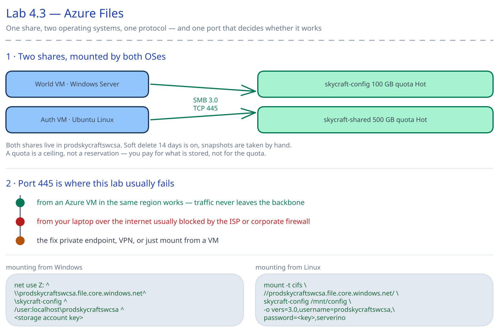
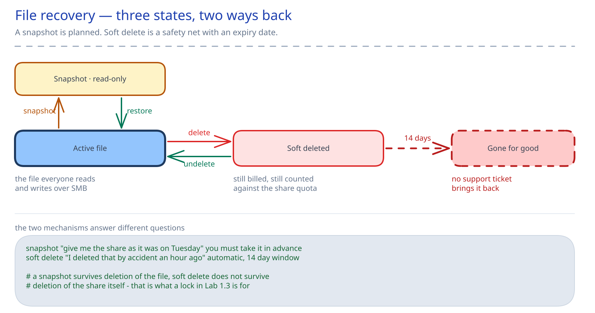
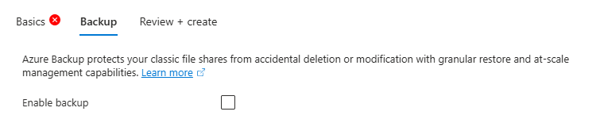
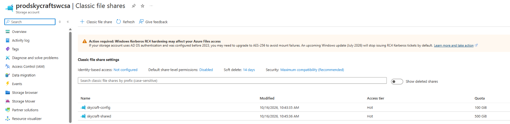
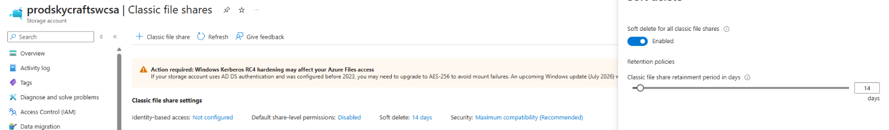
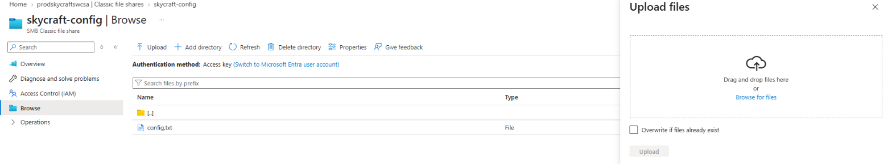
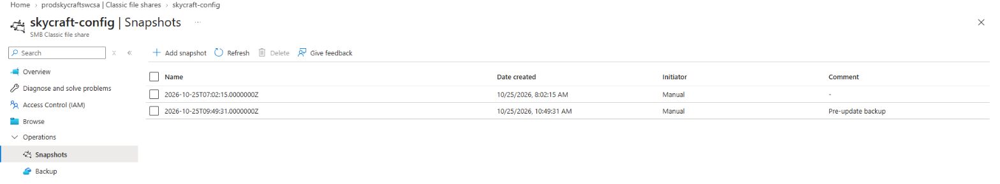
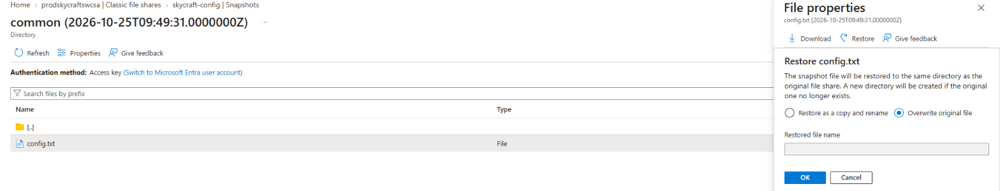
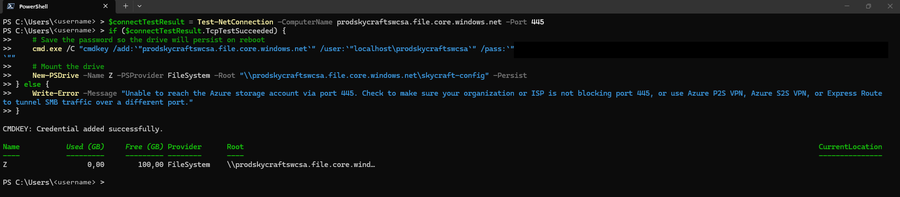
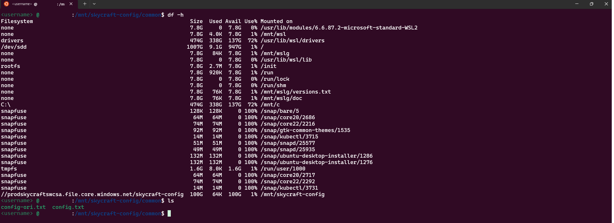

# Lab 4.3: Configure Azure Files (1.5 hours)

## 🎯 Learning Objectives

By completing this lab, you will:

- Master **Azure Files provisioning** by creating and configuring SMB file shares using Portal, Az PowerShell and the Azure CLI (AZ-104: Configure Azure Files)
- Implement **quota management and access tier selection** for cost-optimized shared storage
- Configure **snapshots and soft delete** to protect critical game configuration data
- Restore individual files from snapshots to validate a disaster recovery workflow
- Mount Azure File Shares on **Windows and Linux** using SMB 3.x
- Troubleshoot common Azure Files connectivity failures (port 445, authentication)

---

## 🏗️ Architecture Overview

This diagram shows the Azure Files infrastructure you will deploy inside the production resource group, including the two file shares, data protection settings, and VM connectivity over SMB:

<picture>
  <source media="(prefers-color-scheme: dark)" srcset="images/lab-4.3-architecture.dark.svg">
  <source media="(prefers-color-scheme: light)" srcset="images/lab-4.3-architecture.svg">
  
</picture>

### Logic Flow / Lifecycle

<picture>
  <source media="(prefers-color-scheme: dark)" srcset="images/lab-4.3-file-recovery.dark.svg">
  <source media="(prefers-color-scheme: light)" srcset="images/lab-4.3-file-recovery.svg">
  
</picture>

---

## 📋 Real-World Scenario

**Situation**: SkyCraft game servers need a shared file system to store configuration files (`server.properties`), allowlist/blocklist data, and shared game assets. Unlike Blob Storage (which is object-based), these legacy game server applications require a standard file system interface (SMB) to read and write files. The Linux game server VMs (Module 3) and the administrators' Windows workstations must access the same data concurrently.

| Data Category         | Access Pattern        | Requirement                     | Priority |
| :-------------------- | :-------------------- | :------------------------------ | :------- |
| Server configs        | Frequent reads/writes | Low latency, snapshot-protected | High     |
| Shared game assets    | Read-heavy, large     | High capacity (500 GB)          | Medium   |
| Cross-platform access | Concurrent SMB        | Windows + Linux mount support   | High     |

**Your Task**: You will provision Azure File Shares to meet these needs, ensuring that:

1. **Config data** is protected with snapshots for quick rollback.
2. **Shared assets** have enough capacity (quota) for growth.
3. **Access** is possible from both Windows and Linux machines via SMB 3.x.

**Business Impact**:

- **Compatibility**: Supports legacy apps without code changes via SMB mount.
- **Resilience**: Snapshots allow sub-minute recovery from "bad config" pushes.
- **Cost Control**: Quotas cap how far each share can grow, and the Hot tier fits small, often-read files better than the Transaction optimized tier the Portal proposes.
- **Governance**: Centralized file shares eliminate config drift across servers.

---

## ⏱️ Estimated Time: 1.5 hours

- **Section 1**: Azure Files Fundamentals (15 min)
- **Section 2**: Create File Shares (30 min)
- **Section 3**: Data Protection & Snapshots (25 min)
- **Section 4**: Mount & Test (20 min)
- **What This Lab Leaves Behind** and **Clean Up** (5 min)

---

## ✅ Prerequisites

Before starting this lab:

- [ ] Lab 4.1 completed: storage account `prodskycraftswcsa` (StorageV2, Standard_GRS) in `prod-skycraft-swc-rg`, in Sweden Central, with its four SkyCraft tags. Lab 4.1's Portal wizard (**Data protection** tab) and its Bicep turn file share soft delete on with 7 days; if the account was built another way, soft delete may be off, and Step 4.3.3 turns it on. `tools/lab-cycle-manifest.psd1` lists Lab 4.1 as this lab's only dependency; Lab 4.2 normally comes first (see the note below), but nothing in this lab uses its containers.
- [ ] **Owner** or **Contributor** on `prod-skycraft-swc-rg`. The Portal and the Az PowerShell blocks reach the files with the account key, which these roles may read, so no data role is needed.
- [ ] PowerShell 7+ with the `Az` module (Az.Accounts, Az.Resources, Az.Storage; `scripts/Test-Lab.ps1` also uses Az.RecoveryServices), signed in with `Connect-AzAccount`. Step 4.3.6's Az PowerShell block needs Az.Storage 9.0.0 or later: `Get-Module Az.Storage -ListAvailable` lists the versions you have. The Azure CLI is optional (Option 3 blocks).
- [ ] For Step 4.3.7: a Windows computer that can reach port 445 on the internet (many home and corporate networks block it; the step says how to test).
- [ ] For Step 4.3.8: a Linux machine with `cifs-utils`, such as Lab 3.2's `dev-skycraft-swc-auth-vm` (reached through Azure Bastion from Lab 2.2) or WSL2 on your computer.
- [ ] Understanding of SMB protocol basics and file system concepts

If you completed Lab 1.3, its policies are still assigned to your subscription. This lab creates no new Azure resource with a region or tags of its own: a file share, its directories, files and snapshots, and the file service's soft delete setting are parts of `prodskycraftswcsa`, which already carries the region (Sweden Central) and the four SkyCraft tags from Lab 4.1. `Enforce-Project-Tag` and `Inherit-Project-Tag` (Lab 1.3, Step 1.3.8) and `Restrict-Azure-Regions` (Step 1.3.9) evaluate only resources that have tags and a location, so no step below asks for a region or tags, and none is refused by them. The Bicep path redeploys the account with the same region and four tags as Lab 4.1. No step makes Azure create a resource group or a resource of its own, unless you leave **Enable backup** ticked in Steps 4.3.1-4.3.2, which can create a Recovery Services vault and a backup policy (see the warning in Step 4.3.1). Lab 1.3's delete lock on `prod-skycraft-swc-rg` (`lock-no-delete-prod`, Step 1.3.11) does not stop the steps below, which create and change things in that group; it does stop this lab's cleanup (see Clean Up).

Check the prerequisites with Az PowerShell:

```powershell
Get-AzStorageAccount -ResourceGroupName 'prod-skycraft-swc-rg' -Name 'prodskycraftswcsa' |
    Select-Object StorageAccountName, Location, @{ n = 'Sku'; e = { $_.Sku.Name } }, Kind, ProvisioningState
(Get-AzStorageFileServiceProperty -ResourceGroupName 'prod-skycraft-swc-rg' -StorageAccountName 'prodskycraftswcsa').ShareDeleteRetentionPolicy
```

**Expected Result**: `prodskycraftswcsa` in `swedencentral`, `Standard_GRS`, `StorageV2`, `Succeeded`; file share soft delete `Enabled` `True` with `Days` `7` if Lab 4.1's Portal wizard or Bicep built the account. If the account was built another way, `Enabled` may read `False`; Step 4.3.3 turns it on. `Days` reads 14 if you ran this lab before.

> [!IMPORTANT]
> **Run the Module 4 labs in order (4.1 → 4.2 → 4.3 → 4.4).** All four configure the **same**
> three storage accounts, and they are cumulative forward: each lab replaces the account-level
> properties and the sub-services it owns, while leaving the sub-services it does not own alone.
> Re-running Lab 4.1 after Lab 4.2 turns production blob versioning back off, and after Lab 4.3
> it resets file-share retention from 14 days back to 7. Lab 4.2's and Lab 4.4's Bicep leave the
> file service alone, so re-running them keeps the 14 days. See `docs/bicep-standards.md` §4.5 for
> the mechanism.

---

## 🛠️ Portal, PowerShell and Bicep Paths

You can build this lab in the Portal (Option 1 of each step), with the Az PowerShell blocks (Option 2), or with Bicep (`scripts/Deploy-Bicep.ps1`, which deploys `bicep/main.bicep` to `prodskycraftswcsa` by default). The Azure CLI blocks (Option 3) are an optional third way to run Steps 4.3.1-4.3.5. **Pick one path** for Steps 4.3.1-4.3.3: they all create the same two shares and the same setting, and `scripts/Test-Lab.ps1` accepts the result whichever path built it. Storage account names are unique across Azure: if Lab 4.1 had to use another name than `prodskycraftswcsa`, pass it to `Deploy-Bicep.ps1`, `Test-Lab.ps1` and `Remove-LabResource.ps1` as `-StorageAccountName`. `Deploy-Bicep.ps1` checks the name before it deploys and stops if it is taken by someone else.

The end state on every path:

- File share `skycraft-config` on `prodskycraftswcsa`: SMB, access tier **Hot**, quota 100 GiB.
- File share `skycraft-shared` on `prodskycraftswcsa`: SMB, access tier **Hot**, quota 500 GiB.
- File share soft delete on the account: enabled, 14 days.
- No Azure Backup on either share, and no other share on the account.

| Path | What it creates |
| ---- | --------------- |
| Portal (Option 1 of Steps 4.3.1-4.3.8) | Everything in the steps below |
| Az PowerShell (Option 2 of Steps 4.3.1-4.3.7; Step 4.3.8's Option 2 is bash on the Linux machine) | The same, including the directory, the file, the snapshot and the restore |
| `scripts/Deploy-Bicep.ps1` (Bicep, `bicep/main.bicep`) | The two shares and the 14-day soft delete only |

Steps without a Bicep counterpart: 4.3.4-4.3.6 work on data (a directory, a file, a snapshot and a restore), which a template does not create; they have Az PowerShell blocks, and `Test-Lab.ps1` does not check them. 4.3.7 and 4.3.8 mount the share on a client: the Portal generates a script, Option 2 is the same script written out, and there is nothing to deploy. Nothing in this lab is Portal-only.

Two differences between the paths are known:

- **Azure Backup**: the Portal's new share wizard ticks **Enable backup** on its **Backup** tab by default. Steps 4.3.1 and 4.3.2 have you untick it, so the Portal ends where the Az PowerShell blocks and the Bicep end: with no backup. `Test-Lab.ps1` fails a share that a Recovery Services vault protects.
- **The Bicep redeploys the whole account**, not only its file service: it restates the account settings Lab 4.1 sets (redundancy, TLS 1.2, no anonymous blob access, `networkAcls` **Allow**), and the AVM module sends its own default for every account setting the template does not name. Run after Lab 4.4, it opens the production account's firewall again. With `-Environment dev` it targets `devskycraftswcsa` and sends **Disabled** for large file shares; if that account was built in the Portal or with PowerShell, Azure may refuse the deployment (issue #390). The default `prod` target, a geo-redundant account, is not affected.

**Preview - the AVM module call the Bicep path makes**:

```bicep
module modStorage 'br/public:avm/res/storage/storage-account:0.33.0' = {
  name: 'sa-deployment-files'
  scope: resourceGroup('${parEnvironment}-skycraft-swc-rg')
  params: {
    name: '${parEnvironment}skycraftswcsa'
    blobServices: {}                    // skip the blob service - Lab 4.2 owns it
    fileServices: {
      shareDeleteRetentionPolicy: { enabled: true, days: 14 }
      shares: [ /* skycraft-config 100 GiB, skycraft-shared 500 GiB, both Hot */ ]
    }
  }
}
```

The empty `blobServices: {}` is load-bearing: the module skips a sub-service whose parameter is
empty, so Lab 4.2's containers, versioning and lifecycle rules are left exactly as they were.
`blobServices` is the only sub-service that needs the explicit `{}` — it is the only one with a
non-empty default (`docs/bicep-standards.md` §4.5). The template configures no backup.

---

## 📖 Section 1: Azure Files Fundamentals (15 min)

### What is Azure Files?

Azure Files provides fully managed file shares in the cloud, accessible via the industry-standard **Server Message Block (SMB)** or **Network File System (NFS)** protocols. Unlike Blob Storage (which uses a flat namespace with REST API access), Azure Files exposes a traditional directory and file hierarchy that applications can mount as a network drive — no code changes required.

Azure Files is the natural fit when your workload needs a shared file system that multiple VMs or containers can access simultaneously. For SkyCraft, this means all game servers can read the same `server.properties` and allowlist data without maintaining separate copies on each VM.

### Classic File Shares and File Shares

Azure Files has two kinds of share, and the Portal names them differently ([Azure Files management concepts](https://learn.microsoft.com/azure/storage/files/files-management-concepts)):

| Kind                 | Lives in                                         | Protocols  | Billing                            | This lab      |
| :------------------- | :----------------------------------------------- | :--------- | :--------------------------------- | :------------ |
| **Classic file share** | A storage account (`Microsoft.Storage`)        | SMB, NFS   | Pay-as-you-go (StorageV2 account) or provisioned (FileStorage account) | ✅ Used |
| **File share**       | Its own resource in a resource group (`Microsoft.FileShares`) | NFS only | Provisioned v2 only, SSD   | Not used      |

The shares of this lab are **classic file shares** in `prodskycraftswcsa`, a StorageV2 account: you pay for the data stored and for the operations on it, not for the quota. Do not create them from the Portal's **File shares** service (the result of searching for "File shares"): that creates a `Microsoft.FileShares` share, which supports only NFS and bills its provisioned storage, IOPS and throughput every hour whether you use them or not.

### Deep Dive: Protocols (SMB vs. NFS)

Azure Files supports two main protocols. We will use SMB for maximum compatibility with both Windows and Linux clients.

| Feature            | SMB (Server Message Block)      | NFS (Network File System)      |
| :----------------- | :------------------------------ | :----------------------------- |
| **OS Support**     | Windows, Linux, macOS           | Linux (4.1+) only              |
| **Authentication** | AD DS, Entra ID DS, Storage Key | Network/IP-based only          |
| **Encryption**     | AES-256 (SMB 3.0+)              | None (relies on VNet security) |
| **Use Case**       | Lift-and-shift, Gen-purpose     | HPC, Linux-heavy apps          |

### Performance Tiers

| Tier                      | Workload              | Backend | SkyCraft Use Case              |
| :------------------------ | :-------------------- | :------ | :----------------------------- |
| **Premium**               | High IOPS (Databases) | SSD     | Not available: needs a provisioned FileStorage account, so the wizard greys it out here |
| **Transaction Optimized** | High churn            | HDD     | The Portal's default; possible, but overkill |
| **Hot**                   | General purpose       | HDD     | ✅ Best fit for config files   |
| **Cool**                  | Archive/Backups       | HDD     | Old snapshots/logs only        |

> **SkyCraft Choice**: We use the **Hot** tier for SkyCraft because game config files are small but accessed frequently when servers start up or reload. Transaction optimized, which the Portal proposes, has the highest price per stored GiB and the lowest per operation, a fit for migrations and very busy shares. The transaction costs of the Cool tier would outweigh the storage savings. Premium SSD is unnecessary since config reads are not IOPS-intensive. All three HDD tiers use the same hardware; only the prices differ ([Understand Azure Files billing](https://learn.microsoft.com/azure/storage/files/understanding-billing#pay-as-you-go-model)).

> [!WARNING]
> Choose the tier when you create the share. A share's tier can be changed at most five times in 30 days, and after a change it cannot be changed again for 24 hours; each change is billed as one transaction per file in the share ([Understand Azure Files billing](https://learn.microsoft.com/azure/storage/files/understanding-billing#switching-between-access-tiers)).

---

## 📖 Section 2: Create File Shares (30 min)

### Step 4.3.1: Create Configuration File Share

We need a share named `skycraft-config` with a 100 GiB quota. This share stores `server.properties`, allowlists, and similar configuration data that all game servers must read.

#### Option 1: Azure Portal (GUI)

1. In Azure Portal, search for **Storage accounts**
2. Click the **Resources** tab
3. Click **prodskycraftswcsa**

**Note**: Searching for **Storage accounts** opens **Storage center | Blob Storage**; its **Resources** tab lists the storage accounts.

4. Under **Data storage**, select **Classic file shares**

**Note**: The page may open with a banner, "Action required: Windows Kerberos RC4 hardening may affect your Azure Files access". It concerns accounts that use Active Directory (Kerberos) authentication; this lab mounts with the account key, so there is nothing to do. Under **Classic file share settings**, the page lists **Identity-based access** (**Not configured**), **Default share-level permissions** (**Disabled**), **Soft delete** (**7 days** after Lab 4.1's Portal wizard or Bicep, **Disabled** if it is off) and **Security** (**Maximum compatibility (Recommended)**). Leave **Security** as it is: its **Maximum security** profile allows only Kerberos and AES-256-GCM, so the account key mounts of Steps 4.3.7 and 4.3.8 (NTLMv2) would be refused, and Windows clients older than Windows 11 could not connect at all ([SMB security settings](https://learn.microsoft.com/azure/storage/files/files-smb-protocol#smb-security-settings)).

5. Click **+ Classic file share**
6. On the **Basics** tab, fill in:

| Field       | Value             |
| :---------- | :---------------- |
| Name        | `skycraft-config` |
| Access tier | **Hot**           |

**Note**: **Access tier** defaults to **Transaction optimized**; pick **Hot** (see the warning in Section 1 on changing it later). **Premium** is listed but greyed out. The tab has no quota field: you set the quota after the share is created.

7. Click the **Backup** tab
8. Uncheck **Enable backup**

> [!WARNING]
> **Enable backup** is ticked by default. Left ticked, **Create** also turns on Azure Backup for the share: it uses an existing Recovery Services vault (for example `platform-skycraft-swc-rsv`, if Lab 5.2 ran in this subscription before) or creates a new one, with a new daily policy (7:30 PM UTC, each backup kept 30 days). From then on you pay a protected-instance fee and the storage of the backup snapshots ([About Azure Files backup](https://learn.microsoft.com/azure/backup/azure-file-share-backup-overview#backup-costs)), and Azure Backup puts a delete lock on `prodskycraftswcsa` that blocks deleting any of its file shares, so this lab's cleanup fails. Backups are Lab 5.2's topic; the Az PowerShell and Bicep paths of this lab create none, and `Test-Lab.ps1` fails a protected share. If you already created a share with backup on, see Troubleshooting, Issue 6.

9. Click the **Review + create** tab
10. Click **Create**

**Note**: After **Create**, the Portal opens the new share's page.

11. Click **Edit quota**
12. In the pane that opens, Edit quota, fill in:

| Field       | Value |
| :---------- | :---- |
| Quota       | `100` |

13. Click **OK**
14. Click **Refresh**

**Note**: A new share's quota is 102400 GiB (100 TiB, the most a pay-as-you-go share can hold); the pane's **Set to maximum** sets that value again. In a pay-as-you-go account the quota is only a limit: it costs nothing, and writes fail once the share is full ([Modify an Azure file share](https://learn.microsoft.com/azure/storage/files/modify-file-share)). The share's page keeps showing 102400 until you click **Refresh**.

#### Option 2: Az PowerShell

```powershell
# Create the file share: Hot tier, 100 GiB quota. This creates no backup.
New-AzRmStorageShare `
  -ResourceGroupName "prod-skycraft-swc-rg" `
  -StorageAccountName "prodskycraftswcsa" `
  -Name "skycraft-config" `
  -QuotaGiB 100 `
  -AccessTier Hot
```

#### Option 3: Azure CLI (optional)

```bash
# Create file share with 100GB quota
az storage share-rm create \
  --name skycraft-config \
  --storage-account prodskycraftswcsa \
  --resource-group prod-skycraft-swc-rg \
  --quota 100 \
  --access-tier Hot \
  --output table
```

**Expected Result**: `skycraft-config` file share exists with 100 GiB quota and Hot access tier, and no backup.

| Property    | Expected Value    |
| :---------- | :---------------- |
| Name        | `skycraft-config` |
| Quota       | 100 GiB           |
| Access Tier | Hot               |
| Backup      | Not configured    |



---

### Step 4.3.2: Create Shared Data Share

Create a second share `skycraft-shared` for larger game assets such as maps, textures, and mod packages that all servers reference.

#### Option 1: Azure Portal (GUI)

1. Navigate to `prodskycraftswcsa` → **Classic file shares** (in the left menu, under **Data storage**; expand the group if it is collapsed)
2. Click **+ Classic file share**
3. On the **Basics** tab, fill in:

| Field       | Value             |
| :---------- | :---------------- |
| Name        | `skycraft-shared` |
| Access tier | **Hot**           |

4. Click the **Backup** tab
5. Uncheck **Enable backup** (ticked by default; see the warning in Step 4.3.1)
6. Click the **Review + create** tab
7. Click **Create**
8. Click **Edit quota**
9. In the pane that opens, Edit quota, fill in:

| Field       | Value |
| :---------- | :---- |
| Quota       | `500` |

10. Click **OK**
11. Click **Refresh**

#### Option 2: Az PowerShell

```powershell
New-AzRmStorageShare `
  -ResourceGroupName "prod-skycraft-swc-rg" `
  -StorageAccountName "prodskycraftswcsa" `
  -Name "skycraft-shared" `
  -QuotaGiB 500 `
  -AccessTier Hot
```

#### Option 3: Azure CLI (optional)

```bash
# Create shared data file share with 500GB quota
az storage share-rm create \
  --name skycraft-shared \
  --storage-account prodskycraftswcsa \
  --resource-group prod-skycraft-swc-rg \
  --quota 500 \
  --access-tier Hot \
  --output table
```

**Expected Result**: `skycraft-shared` file share exists with 500 GiB quota and Hot access tier, and no backup. The Classic file shares list shows both shares, each with access tier Hot and its quota.

| Property    | Expected Value    |
| :---------- | :---------------- |
| Name        | `skycraft-shared` |
| Quota       | 500 GiB           |
| Access Tier | Hot               |
| Backup      | Not configured    |



---

## 📖 Section 3: Data Protection & Snapshots (25 min)

### What are Azure Files Snapshots?

Snapshots are **read-only, point-in-time copies** of an entire file share. They are incremental — Azure only stores the data that has changed since the last snapshot. This makes them both fast to create and cost-efficient. Snapshots are critical for SkyCraft because a bad config push can be rolled back in seconds by restoring the previous snapshot instead of manually rebuilding configuration.

**Soft delete** adds a second safety net: if an entire file share is accidentally deleted, it can be recovered within the retention period.

> **SkyCraft Choice**: We set share soft delete to **14 days** (Lab 4.1's Portal wizard and Bicep set 7) because it covers two full sprint cycles — enough time for the team to notice even "silent" deletions. For snapshots, we take a manual snapshot here; scheduled backups come with Azure Backup in Lab 5.2, which is why Steps 4.3.1 and 4.3.2 leave **Enable backup** unticked.

### Step 4.3.3: Configure Soft Delete

Protect against accidental deletion of the file shares. Lab 4.1's Portal wizard (the **Data protection** tab) and its Bicep turn share soft delete on with 7 days; if the account was built another way, soft delete may be off. Either way, this step turns it on with a retention of 14 days.

#### Option 1: Azure Portal (GUI)

1. Navigate to `prodskycraftswcsa` → **Classic file shares** (in the left menu, under **Data storage**; expand the group if it is collapsed)
2. Click the link next to _Soft delete_ (**7 days** or **Disabled**)

**Note**: The link next to **Soft delete** shows the current retention: **7 days** after Lab 4.1's Portal wizard or Bicep, or **Disabled** if soft delete is off. Click it either way. It opens the **Soft delete** pane.

3. Make sure **Soft delete for all classic file shares** is enabled
4. Fill in:

| Field                                         | Value |
| :-------------------------------------------- | :---- |
| Classic file share retainment period in days | `14`  |

5. Click **Save**

#### Option 2: Az PowerShell

```powershell
Update-AzStorageFileServiceProperty `
  -ResourceGroupName "prod-skycraft-swc-rg" `
  -StorageAccountName "prodskycraftswcsa" `
  -EnableShareDeleteRetentionPolicy $true `
  -ShareRetentionDays 14
```

#### Option 3: Azure CLI (optional)

```bash
# Enable soft delete with 14-day retention
az storage account file-service-properties update \
  --account-name prodskycraftswcsa \
  --resource-group prod-skycraft-swc-rg \
  --enable-delete-retention true \
  --delete-retention-days 14
```

**Expected Result**: Soft delete is enabled with a 14-day retention window for all file shares in this storage account; the **Classic file shares** page shows **Soft delete** **14 days**.

> [!IMPORTANT]
> Soft delete is a storage-account-level setting — it applies to **all** file shares, not just one. A deleted share stays recoverable (**Show deleted shares** on the **Classic file shares** page lists it) and is billed for the data it holds until the retention ends. A new retention applies to shares deleted after the change; a share deleted earlier keeps the expiry it had ([Azure file share soft delete](https://learn.microsoft.com/azure/storage/files/storage-files-prevent-file-share-deletion)).

> [!WARNING]
> Do not turn soft delete off. While it is off, deleting a share deletes it, its files and its snapshots at once, with nothing to restore.



---

### Step 4.3.4: Upload a Test File

Before creating a snapshot, upload a test file so you can verify the snapshot-restore workflow.

#### Option 1: Azure Portal (GUI)

1. Navigate to `prodskycraftswcsa` → **Classic file shares** (under **Data storage**) → `skycraft-config` → **Browse**

**Note**: **Browse** shows **Authentication method: Access key (Switch to Microsoft Entra user account)**. Leave the access key: browsing with your Microsoft Entra account needs a file data role that this lab does not grant.

2. Click **+ Add directory**
3. Name: `common`
4. Click **OK**
5. On your computer, create a text file named `config.txt` that holds one line: `server-name=skycraft-prod-01`
6. **Browse** → `common`
7. Click **Upload**
8. In the pane that opens, choose `config.txt` on your computer (drag it into the pane, or browse for it)
9. Click **Upload**

#### Option 2: Az PowerShell

```powershell
# Get storage context (it signs requests with the account key)
$saContext = (Get-AzStorageAccount `
  -ResourceGroupName "prod-skycraft-swc-rg" `
  -Name "prodskycraftswcsa").Context

# Create directory
New-AzStorageDirectory `
  -ShareName "skycraft-config" `
  -Path "common" `
  -Context $saContext

# Create and upload test file
"server-name=skycraft-prod-01" | Out-File -FilePath ".\config.txt" -Encoding utf8
Set-AzStorageFileContent `
  -ShareName "skycraft-config" `
  -Source ".\config.txt" `
  -Path "common/config.txt" `
  -Context $saContext
```

#### Option 3: Azure CLI (optional)

```bash
# Get storage account key
STORAGE_KEY=$(az storage account keys list \
  --account-name prodskycraftswcsa \
  --resource-group prod-skycraft-swc-rg \
  --query "[0].value" --output tsv)

# Create directory
az storage directory create \
  --share-name skycraft-config \
  --name common \
  --account-name prodskycraftswcsa \
  --account-key $STORAGE_KEY

# Create and upload a test file
echo "server-name=skycraft-prod-01" > config.txt
az storage file upload \
  --share-name skycraft-config \
  --source config.txt \
  --path common/config.txt \
  --account-name prodskycraftswcsa \
  --account-key $STORAGE_KEY
```

**Expected Result**: File `common/config.txt` is visible in the `skycraft-config` share.



---

### Step 4.3.5: Create Manual Snapshot

Snapshots are read-only point-in-time copies. Create one before any config changes so you have a known-good state.

#### Option 1: Azure Portal (GUI)

1. Navigate to `prodskycraftswcsa` → **Classic file shares** (under **Data storage**) → `skycraft-config`
2. Under **Operations**, select **Snapshots**
3. Click **+ Add snapshot**
4. Comment: `Pre-update backup`
5. Click **OK**

#### Option 2: Az PowerShell

```powershell
# -Snapshot takes a snapshot of the existing share instead of creating a share
New-AzRmStorageShare `
  -ResourceGroupName "prod-skycraft-swc-rg" `
  -StorageAccountName "prodskycraftswcsa" `
  -Name "skycraft-config" `
  -Snapshot
```

#### Option 3: Azure CLI (optional)

```bash
# Create a snapshot of skycraft-config
az storage share-rm snapshot \
  --storage-account prodskycraftswcsa \
  --resource-group prod-skycraft-swc-rg \
  --name skycraft-config \
  --output table
```

**Expected Result**: A new snapshot appears in the Snapshots list with the current timestamp and, on the Portal path, the comment "Pre-update backup". A snapshot taken with Option 2 or 3 has no comment: find it by its time.

**Note**: A snapshot is billed only for the data that differs from the live share and from the other snapshots, on the share's own storage meter. A share holds at most 200 snapshots, and a share that has snapshots can only be deleted together with them: this lab's cleanup deletes both.



---

### Step 4.3.6: Restore a File from Snapshot

Simulate a bad config push by modifying the test file, then restore the original version from the snapshot.

#### Option 1: Azure Portal (GUI)

1. Navigate to `prodskycraftswcsa` → **Classic file shares** (under **Data storage**) → `skycraft-config` → **Browse** → `common` → select `config.txt`
2. Click **Download** to save the file locally
3. Open the downloaded file in a text editor, change content to `server-name=BROKEN`, and save
4. Back in the Portal, click **Upload** → select the modified `config.txt` → check **Overwrite if files already exist** → **Upload**
5. Under **Operations**, select **Snapshots** → select `Pre-update backup` (the snapshot's Comment)
6. Browse to `common/config.txt` → **Restore** (selecting the file opens its File properties pane)
7. **Overwrite original file** → **OK**
8. Download `config.txt` again and verify the content is back to `server-name=skycraft-prod-01`

**Note**: The restore pane opens on **Restore as a copy and rename**, which keeps the broken file and writes the snapshot's version next to it under a new name. Choose **Overwrite original file** to roll the change back.

#### Option 2: Az PowerShell

```powershell
$saContext = (Get-AzStorageAccount -ResourceGroupName "prod-skycraft-swc-rg" -Name "prodskycraftswcsa").Context
# Older Az.Storage cannot read a file through a snapshot's ShareClient
if ((Get-Module Az.Storage).Version -lt [version]"9.0.0") { throw "Step 4.3.6 needs Az.Storage 9.0.0 or later; see the note below this block" }

# Simulate the bad config push
"server-name=BROKEN" | Out-File -FilePath ".\config.txt" -Encoding utf8
Set-AzStorageFileContent -ShareName "skycraft-config" -Source ".\config.txt" -Path "common/config.txt" `
  -Context $saContext -Force

# Open the newest snapshot of the share (Step 4.3.5)
$snapshotTime = (Get-AzRmStorageShare -ResourceGroupName "prod-skycraft-swc-rg" -StorageAccountName "prodskycraftswcsa" `
    -IncludeSnapshot | Where-Object { $_.Name -eq "skycraft-config" -and $_.SnapshotTime } |
    Sort-Object SnapshotTime -Descending | Select-Object -First 1).SnapshotTime
if (-not $snapshotTime) { throw "No snapshot of skycraft-config found; run Step 4.3.5 first" }
# Azure reports the snapshot time in UTC, and -SnapshotTime takes a DateTimeOffset: mark the time
# as UTC so the conversion cannot shift it by your time zone and miss the snapshot
$snapshotUtc = if ($snapshotTime.Kind -eq 'Local') { $snapshotTime.ToUniversalTime() } else { [DateTime]::SpecifyKind($snapshotTime, 'Utc') }
$snapshot = Get-AzStorageShare -Name "skycraft-config" -SnapshotTime ([DateTimeOffset]$snapshotUtc) -Context $saContext

# Copy the file from the snapshot over the live one, then read the live one back
Get-AzStorageFileContent -ShareClient $snapshot.ShareClient -Path "common/config.txt" `
  -Destination ".\config-snapshot.txt" -Context $saContext -Force
Set-AzStorageFileContent -ShareName "skycraft-config" -Source ".\config-snapshot.txt" -Path "common/config.txt" `
  -Context $saContext -Force
Get-AzStorageFileContent -ShareName "skycraft-config" -Path "common/config.txt" -Destination ".\config-check.txt" `
  -Context $saContext -Force
Get-Content ".\config-check.txt"
```

**Note**: With Az.Storage 7.x, `Get-AzStorageFileContent -ShareClient` stops with "missing mandatory parameters: Share", and without `-Context` Az.Storage 9.0.0 stops with "Could not get the storage context". If the block throws because your Az.Storage is older, run `Install-Module Az.Storage -MinimumVersion 9.0.0 -Scope CurrentUser`, open a new PowerShell window, run `Import-Module Az.Storage -MinimumVersion 9.0.0` before any other Az.Storage command, and run the block again.

> [!TIP]
> In production, you can restore individual files without restoring the entire share. This is much faster than full-share restore for targeted rollbacks.

**Expected Result**: `config.txt` is restored to the original content from the snapshot.



---

## 📖 Section 4: Mount & Test (20 min)

### Step 4.3.7: Mount on Windows

Mount the `skycraft-config` share as drive letter **Z:** on your Windows computer. This simulates how an administrator's Windows workstation reaches the shared configuration.

Port 445 must be open from your computer to Azure. Test it first in PowerShell:

```powershell
Test-NetConnection -ComputerName prodskycraftswcsa.file.core.windows.net -Port 445
```

If `TcpTestSucceeded` is `False`, your network blocks SMB: skip to Step 4.3.8 and mount from a Linux VM in Azure instead (see Troubleshooting, Issue 1).

#### Option 1: Azure Portal (Generate Script)

1. Navigate to `prodskycraftswcsa` → **Classic file shares** (under **Data storage**) → `skycraft-config` → **Overview**
2. Click **Connect**
3. Click the **Windows** tab
4. Drive letter: **Z**
5. Authentication method: **Storage account key**
6. Click **Show Script**
7. Copy the script and run it in a normal (not elevated) PowerShell window on your computer

**Note**: The Portal asks for a normal PowerShell window, not one opened with **Run as administrator**: Windows keeps the drive letters mapped in an elevated window apart from those of your normal session, so a drive mapped as administrator does not appear in File Explorer.

> [!WARNING]
> The generated script contains the storage account key in clear text, and it saves the key in Windows Credential Manager (`cmdkey`) so the drive comes back after a restart. Anyone with the key has full access to every share, container, queue and table in the account. Do not paste the script into a chat, an issue or a screenshot; What This Lab Leaves Behind says how to remove the drive and the saved key.

#### Option 2: PowerShell (Manual)

Run it in a normal (not elevated) PowerShell window, as Option 1 does:

```powershell
# Mount the share as drive Z:
$connectTestResult = Test-NetConnection `
  -ComputerName prodskycraftswcsa.file.core.windows.net -Port 445

if ($connectTestResult.TcpTestSucceeded) {
    $storageKey = (Get-AzStorageAccountKey `
      -ResourceGroupName "prod-skycraft-swc-rg" `
      -Name "prodskycraftswcsa")[0].Value

    cmd.exe /C "cmdkey /add:prodskycraftswcsa.file.core.windows.net /user:Azure\prodskycraftswcsa /pass:$storageKey"
    New-PSDrive -Name Z -PSProvider FileSystem `
      -Root "\\prodskycraftswcsa.file.core.windows.net\skycraft-config" `
      -Persist
} else {
    Write-Host "Port 445 is blocked. Use a VPN or Azure VM." -ForegroundColor Red
}
```

**Expected Result**: Drive `Z:` is mapped and you can see the `common` directory with `config.txt`.

> [!WARNING]
> Many ISPs and corporate firewalls block port 445 (SMB). If `Test-NetConnection` fails, mount from an Azure VM instead, or use Azure VPN Gateway.



---

### Step 4.3.8: Mount on Linux

Mount the `skycraft-config` share on a Linux machine. This simulates how the Auth Server VM accesses shared configuration. Use Lab 3.2's `dev-skycraft-swc-auth-vm`, which you reach over SSH through Azure Bastion (Lab 2.2; Bastion is billed by the hour while it exists), or WSL2 on your computer if port 445 is open there.

#### Option 1: Azure Portal (Generate Script)

1. Navigate to `prodskycraftswcsa` → **Classic file shares** (under **Data storage**) → `skycraft-config` → **Overview** → **Connect**
2. Click the **Linux** tab
3. Click **Show Script**
4. Copy the generated script — it installs `cifs-utils`, stores the account key in a credentials file under `/etc/smbcredentials` and adds the mount to `/etc/fstab`
5. SSH into the Linux VM and execute the script

#### Option 2: Bash (Manual)

First read the account key on your computer with Az PowerShell; the VM has neither Az PowerShell nor the Azure CLI signed in:

```powershell
(Get-AzStorageAccountKey -ResourceGroupName "prod-skycraft-swc-rg" -Name "prodskycraftswcsa")[0].Value
```

Then, on the Linux machine, replace `<storage-account-key>` with that value:

```bash
# Install cifs-utils (Ubuntu/Debian)
sudo apt-get update && sudo apt-get install -y cifs-utils

# Create mount point and credentials directory
sudo mkdir -p /mnt/skycraft-config
sudo mkdir -p /etc/smbcredentials

# Create credentials file (secure); '>' overwrites, so the file holds one username and one password
sudo bash -c 'printf "username=prodskycraftswcsa\npassword=%s\n" "<storage-account-key>" > /etc/smbcredentials/prodskycraftswcsa.cred'
sudo chmod 600 /etc/smbcredentials/prodskycraftswcsa.cred

# Mount the share
sudo mount -t cifs \
  //prodskycraftswcsa.file.core.windows.net/skycraft-config \
  /mnt/skycraft-config \
  -o credentials=/etc/smbcredentials/prodskycraftswcsa.cred,dir_mode=0777,file_mode=0777,serverino,vers=3.1.1,sec=ntlmssp,seal

# Verify
ls /mnt/skycraft-config/common/
```

**Note**: `dir_mode=0777,file_mode=0777` lets every user on the machine read and change the mounted files, which is enough for a lab VM with one user. On a shared server, mount with `uid=`, `gid=` and narrower modes instead.

**Expected Result**: The `common/config.txt` file is visible at `/mnt/skycraft-config/common/config.txt`.

> [!NOTE]
> For persistent mounts that survive reboots, add the mount entry to `/etc/fstab`. The Portal-generated script does this automatically.



---

## ✅ Lab Checklist

### Resources Created

- [ ] `skycraft-config` (100 GiB quota, Hot tier, no backup)
- [ ] `skycraft-shared` (500 GiB quota, Hot tier, no backup)
- [ ] Directory `common` with `config.txt` in `skycraft-config`

### Data Protection

- [ ] Soft delete enabled for 14 days
- [ ] Snapshot created and restore capability verified

### Connectivity

- [ ] Mount script generated successfully
- [ ] Port 445 connectivity tested

### Tags (Storage Account)

- [ ] Project = `SkyCraft`
- [ ] Environment = `Production`
- [ ] CostCenter = `MSDN`
- [ ] Owner = `mbiszczanik`

Run the lab's validator from the lab folder:

```powershell
./scripts/Test-Lab.ps1
```

**Expected Result**: `Validation Complete. Failures: 0`, exit code 0. It checks the account (provisioned, redundancy), share soft delete (at least 14 days), that exactly the two shares exist with their quota and the Hot tier, and that no Recovery Services vault backs up a share of the account. It does not check the directory, the file, the snapshot or a mount.

**For detailed verification**, see [lab-checklist-4.3.md](lab-checklist-4.3.md)

---

## 📦 What This Lab Leaves Behind

`tools/lab-cycle-manifest.psd1` lists no lab that depends on Lab 4.3: no later lab uses the shares. They live in `prodskycraftswcsa`, which Lab 4.1 created and whose cost Lab 4.1 lists. A pay-as-you-go share is billed for the data it holds and the operations on it, not for its quota ([Understand Azure Files billing](https://learn.microsoft.com/azure/storage/files/understanding-billing#pay-as-you-go-model)); with a few bytes in them, both shares together cost well under 0.01 USD per day. Check the [Azure pricing calculator](https://azure.microsoft.com/pricing/calculator/) for your own prices.

| Left behind | Where | Daily cost | What it does in later labs |
| --- | --- | --- | --- |
| `skycraft-config` (100 GiB quota, Hot) with `common/config.txt` and the snapshot of Step 4.3.5 | `prodskycraftswcsa` | about 0 (a few bytes; quota is free) | Nothing. Lab 4.4 limits the account's firewall to `WorldSubnet` and your client IP, so a mount from another network stops working after Lab 4.4 |
| `skycraft-shared` (500 GiB quota, Hot), empty | `prodskycraftswcsa` | 0 | Nothing |
| File share soft delete, 14 days | `prodskycraftswcsa` | data in deleted shares is billed for 14 days | Re-running Lab 4.1's Bicep sets it back to 7 days; Lab 4.2's and Lab 4.4's Bicep leave it alone |
| Drive `Z:` and the saved key (`cmdkey`) | Your Windows computer | 0 | Nothing. Remove them with `Remove-PSDrive -Name Z` (or `net use Z: /delete`) and `cmdkey /delete:prodskycraftswcsa.file.core.windows.net` |
| The mount, `/etc/smbcredentials/prodskycraftswcsa.cred` and, from the Portal script, a line in `/etc/fstab` | The Linux machine of Step 4.3.8 | 0 | Nothing. Remove them with `sudo umount /mnt/skycraft-config`, `sudo rm /etc/smbcredentials/prodskycraftswcsa.cred` and by deleting the share's line from `/etc/fstab` |
| **Only if Enable backup was left ticked**: a Recovery Services vault (new, or Lab 5.2's), a daily backup policy, the protected shares and the vault's delete lock on the account | `prod-skycraft-swc-rg`, or `platform-skycraft-swc-rg` for Lab 5.2's vault | a protected-instance fee plus the backup snapshots' storage | Blocks this lab's cleanup; remove it as in Troubleshooting, Issue 6 |

---

## 🧹 Clean Up

Keep the shares if you go on to Lab 4.4: they cost next to nothing (see above). To remove what this lab added, run the lab's cleanup from the lab folder:

```powershell
./scripts/Remove-LabResource.ps1
```

It asks before it changes anything (`-WhatIf` lists the changes; `-Force` skips the question). It deletes `skycraft-config` and `skycraft-shared` **with their snapshots and every file in them**; the storage account and its soft delete setting stay. A deleted share stays recoverable, and billed, for the 14 days of soft delete. If you delete a share and want to create one with the same name again, wait a minute first: until Azure has finished the delete it answers with a conflict.

While Lab 1.3's delete lock (`lock-no-delete-prod`) is on `prod-skycraft-swc-rg`, Azure refuses to delete the shares (`ScopeLocked`). The script therefore lifts the lock for those deletes, waits 45 seconds for the removal to take effect, and creates the lock again with the same name, level and notes, also when a delete fails. Managing a lock needs **Owner** or **User Access Administrator** on the group, as in Lab 1.3. If the script cannot read, lift or restore the lock, it reports `[ERROR]` and exits 1: it deletes nothing in a group whose lock it could not read or lift, and for a lock it could not restore it prints the `New-AzResourceLock` command that creates it again. `-WhatIf` lifts no lock. In the Portal, **Delete share** on a locked account opens _Share can't be deleted_ with **Delete** greyed out. Azure Backup's own delete lock on the account blocks the delete in the same way, and the script leaves that lock alone: it reports each share it could not delete as `[ERROR]` and exits 1. Stop the backup first (Troubleshooting, Issue 6).

---

## 🔧 Troubleshooting

### Issue 1: "The network path was not found" (Error 53)

**Symptom**: `net use` or `New-PSDrive` fails with error code 53 even with correct credentials.

**Root Cause**: Port 445 (SMB) is blocked by your ISP, corporate firewall, or home router. Most residential ISPs block this port for security reasons.

**Solution**:

- Test connectivity: `Test-NetConnection -ComputerName prodskycraftswcsa.file.core.windows.net -Port 445`
- Use an Azure VM within the same VNet (port 445 is open within Azure networks)
- Use Azure VPN Gateway or ExpressRoute for on-premises mounting

---

### Issue 2: "Access Denied" (Error 5)

**Symptom**: Credentials rejected during mount. `cmdkey` stored the credential but mount still fails.

**Root Cause**: Invalid or rotated storage account key, or local system clock drift (Kerberos/SMB authentication requires synchronized clocks within ±5 minutes).

**Solution**:

- Read the current key: in `prodskycraftswcsa`, under **Security + networking**, select **Access keys** (a key rotated in Lab 4.1, Step 4.1.13, has a new value)
- Update the stored credential: `cmdkey /delete:prodskycraftswcsa.file.core.windows.net`, then run the mount script again
- Sync your system clock: `w32tm /resync` (Windows) or `sudo ntpdate pool.ntp.org` (Linux)

---

### Issue 3: File share cannot be deleted

**Symptom**: Deletion fails even for an empty share — Azure returns a conflict or a lock error.

**Root Cause**: Snapshots or open handles on the share, Lab 1.3's `lock-no-delete-prod` on the resource group (`ScopeLocked`, see Clean Up), or the delete lock Azure Backup puts on the account when it protects a share (Issue 6).

**Solution**:

- Delete the share together with its snapshots: `Remove-AzRmStorageShare -ResourceGroupName prod-skycraft-swc-rg -StorageAccountName prodskycraftswcsa -Name skycraft-config -Include Snapshots -Force` (the lab's cleanup does this)
- List and close open handles (a drive still mapped on a computer keeps them open):

```powershell
$saContext = (Get-AzStorageAccount -ResourceGroupName "prod-skycraft-swc-rg" -Name "prodskycraftswcsa").Context
Get-AzStorageFileHandle -ShareName "skycraft-config" -Recursive -Context $saContext
Close-AzStorageFileHandle -ShareName "skycraft-config" -Recursive -CloseAll -Context $saContext
```

---

### Issue 4: "mount error(13): Permission denied" on Linux / WSL2

**Symptom**: `mount -t cifs` fails with `mount error(13): Permission denied`. Kernel log (`dmesg`) shows `Send error in SessSetup = -13`.

**Root Cause**: This error has multiple causes — work through them in order:

| Cause                             | How to Check                                                                                       | Fix                                                                  |
| --------------------------------- | -------------------------------------------------------------------------------------------------- | -------------------------------------------------------------------- |
| **Missing `cifs-utils`**          | `which mount.cifs` returns nothing                                                                 | `sudo apt-get install -y cifs-utils`                                 |
| **Duplicate credentials**         | `sudo cat /etc/smbcredentials/prodskycraftswcsa.cred` shows multiple `username=`/`password=` lines | Recreate with `>` (overwrite) instead of `>>` (append)               |
| **SMB encryption not negotiated** | Storage has Secure Transfer Required (`EnableHttpsTrafficOnly: True`)                              | Add `vers=3.1.1,sec=ntlmssp,seal` to mount options                   |
| **Storage firewall blocking IP**  | `curl -s https://api.ipify.org` vs `(Get-AzStorageAccountNetworkRuleSet -ResourceGroupName prod-skycraft-swc-rg -Name prodskycraftswcsa).IpRules` | Add your IP: `Add-AzStorageAccountNetworkRule -ResourceGroupName prod-skycraft-swc-rg -Name prodskycraftswcsa -IPAddressOrRange <IP>` |
| **Security profile without NTLMv2** | **Classic file shares** page: **Security** is not **Maximum compatibility**                      | Set **Security** back to **Maximum compatibility (Recommended)**     |

**Solution** (verified on WSL2):

```bash
# 1. Clean credentials file (overwrite, not append)
sudo mkdir -p /etc/smbcredentials
sudo bash -c 'echo -e "username=prodskycraftswcsa\npassword=<YOUR_KEY>" > /etc/smbcredentials/prodskycraftswcsa.cred'
sudo chmod 600 /etc/smbcredentials/prodskycraftswcsa.cred

# 2. Mount with explicit SMB 3.1.1 encryption
sudo mount -t cifs \
  //prodskycraftswcsa.file.core.windows.net/skycraft-config \
  /mnt/skycraft-config \
  -o credentials=/etc/smbcredentials/prodskycraftswcsa.cred,dir_mode=0777,file_mode=0777,serverino,vers=3.1.1,sec=ntlmssp,seal
```

---

### Issue 5: Quota exceeded — upload fails

**Symptom**: File upload returns "ShareQuotaExceeded" error.

**Root Cause**: The file share has reached its configured quota limit. Unlike Blob Storage, Azure Files enforces hard quotas.

**Solution**:

- Increase the quota: on the share's page, click **Edit quota**, enter the new quota and click **OK** (in a pay-as-you-go account a larger quota costs nothing)
- Clean up unused files or old directories
- Check actual usage: **Classic file shares** (under **Data storage**) → select share → **Overview** → Used capacity

```powershell
# Increase quota to 200 GiB
Update-AzRmStorageShare -ResourceGroupName "prod-skycraft-swc-rg" -StorageAccountName "prodskycraftswcsa" `
  -Name "skycraft-config" -QuotaGiB 200
```

---

### Issue 6: Azure Backup protects a share (Enable backup was left ticked)

**Symptom**: `Test-Lab.ps1` reports `[FAIL] No Azure Backup protects a file share of the account`, the share's page lists a backup under **Operations** → **Backup**, or the cleanup fails on a lock it did not expect.

**Cause**: The **Backup** tab of the new share wizard was left at its default, **Enable backup** ticked (Steps 4.3.1 and 4.3.2). Azure Backup registered `prodskycraftswcsa` with a Recovery Services vault, protects the share with a daily policy and put a delete lock on the account.

**Solution**: Stop the backup and delete its data, then unregister the account from the vault. In the Portal: open the vault → **Backup items** (under **Protected items**) → **Azure Storage (Azure Files)** → the share → **Stop backup** → **Delete Backup Data**; then the vault's **Backup Infrastructure** (under **Manage**) → **Storage Accounts** → `prodskycraftswcsa` → **Unregister**. With Az PowerShell:

```powershell
foreach ($vault in Get-AzResource -ResourceType "Microsoft.RecoveryServices/vaults") {
    $items = Get-AzRecoveryServicesBackupItem -BackupManagementType AzureStorage -WorkloadType AzureFiles -VaultId $vault.ResourceId |
        Where-Object { $_.ContainerName -like "*;prod-skycraft-swc-rg;prodskycraftswcsa" }
    foreach ($item in $items) {
        Disable-AzRecoveryServicesBackupProtection -Item $item -VaultId $vault.ResourceId -RemoveRecoveryPoints -Force
    }
    if ($items) {
        $container = Get-AzRecoveryServicesBackupContainer -ContainerType AzureStorage -FriendlyName "prodskycraftswcsa" -VaultId $vault.ResourceId
        Unregister-AzRecoveryServicesBackupContainer -Container $container -VaultId $vault.ResourceId -Force
    }
}
```

Afterwards, check three things. Under **Settings**, **Locks** of `prodskycraftswcsa`: delete a lock that Azure Backup created if one is still there (not Lab 1.3's `lock-no-delete-prod`, which sits on the resource group). The soft delete of Step 4.3.3: when it unregisters an account whose share retention is exactly 14 days, Azure Backup turns share soft delete off ([Azure Backup soft delete for Azure Files](https://learn.microsoft.com/azure/backup/soft-delete-azure-file-share#frequently-asked-questions-azure-backup-soft-delete-for-azure-files)), so repeat Step 4.3.3 if it shows **Disabled**. And if the wizard created a new vault, delete it when it holds no backup item any more (it is not Lab 5.2's `platform-skycraft-swc-rsv`).

---

### Issue 7: A share's access tier is Transaction optimized

**Symptom**: `Test-Lab.ps1` reports `[FAIL] File share 'skycraft-config' access tier is Hot` with `Actual: TransactionOptimized`.

**Cause**: **Access tier** on the wizard's **Basics** tab was left at its default.

**Solution**: On the share's page, click **Change tier**, select **Hot** and click **Apply**. With Az PowerShell: `Update-AzRmStorageShare -ResourceGroupName prod-skycraft-swc-rg -StorageAccountName prodskycraftswcsa -Name skycraft-config -AccessTier Hot`. After a change, the tier cannot be changed again for 24 hours (see Section 1).

---

## 🎓 Knowledge Check

1. **Which protocol should you use for a Linux-only High Performance Computing (HPC) cluster?**

   <details>
     <summary>**Click to see the answer**</summary>

   **Answer**: **NFS (Network File System)** on Premium tier is preferred for Linux HPC due to POSIX compliance, high throughput, and low-latency SSD-backed storage. SMB would also work on Linux, but NFS avoids the overhead of SMB protocol translation and provides native Linux file semantics.
   </details>

2. **If you delete a file share, can you restore it?**

   <details>
     <summary>**Click to see the answer**</summary>

   **Answer**: Yes, **if soft delete is enabled** for file shares on the storage account. You can undelete the entire share (including all its files and directories) within the configured retention period. After the retention period expires, the share is permanently deleted. Note: soft delete protects the share itself — individual file deletions within a share are not recoverable via soft delete (use snapshots for that).
   </details>

3. **What is the primary factor affecting Azure Files snapshot costs?**

   <details>
     <summary>**Click to see the answer**</summary>

   **Answer**: You are billed on the **differential (incremental) data** between snapshots, not the full volume size. If you have a 100 GB share but only 2 MB changed since the last snapshot, you pay for ~2 MB of snapshot storage. This makes frequent snapshots cost-effective for change-tracking scenarios like SkyCraft config management.
   </details>

4. **Why does Azure Files require port 445 for SMB connections, and what happens if it is blocked?**

   <details>
     <summary>**Click to see the answer**</summary>

   **Answer**: Port 445 is the standard TCP port for the SMB protocol (since SMB 3.0 removed the dependency on NetBIOS ports 137-139). If port 445 is blocked — which is common with residential ISPs and corporate firewalls — you cannot mount the file share. Alternatives include:
   - Mounting from an Azure VM (port 445 is open within Azure)
   - Using Azure VPN Gateway or ExpressRoute
   - Using Azure File Sync to cache the share locally
   </details>

5. **What is the difference between a file share quota and a storage account capacity limit?**

   <details>
     <summary>**Click to see the answer**</summary>

   **Answer**: A **quota** is a configurable, per-share limit that restricts how much data a single file share can consume (e.g., 100 GB). It is a hard cap — writes fail when reached. In a pay-as-you-go account it costs nothing by itself; in a provisioned account the quota is the provisioned size you pay for. A **storage account capacity limit** is the total storage available across all shares, blobs, queues, and tables in the account (up to 5 PiB for standard accounts). Quotas are a governance tool to prevent any one share from monopolizing account capacity.
   </details>

6. **When should you choose Azure Files over Azure Blob Storage?**

   <details>
     <summary>**Click to see the answer**</summary>

   **Answer**: Choose Azure Files when:
   - Your application requires a **file system interface** (SMB/NFS mount) rather than REST API
   - You need **concurrent access** from multiple VMs to the same data
   - You are doing a **lift-and-shift** migration of on-premises file servers
   - The application expects standard file operations (open, read, write, seek)

   Choose Blob Storage when you need object storage with REST API access, lifecycle management, or CDN integration (e.g., distributing game client patches to players).
   </details>

7. **What does it cost to change the access tier of a file share from Hot to Cool, and how are its snapshots billed?**

   <details>
     <summary>**Click to see the answer**</summary>

   **Answer**: Moving a share to a cooler tier is billed as one write transaction of the cooler tier per file in the share (moving to a hotter tier from Cool also adds a data retrieval charge per GiB), and after a change the tier cannot be changed again for 24 hours, at most five times in 30 days. Snapshots have no line of their own on a pay-as-you-go bill: their differential size counts against the same **Data Stored** meter as the live share ([Understand Azure Files billing](https://learn.microsoft.com/azure/storage/files/understanding-billing#pay-as-you-go-snapshots)).
   </details>

---

## 📚 Additional Resources

- [Azure Files overview](https://learn.microsoft.com/azure/storage/files/storage-files-introduction)
- [Create an Azure classic file share](https://learn.microsoft.com/azure/storage/files/create-classic-file-share)
- [Understand Azure Files billing](https://learn.microsoft.com/azure/storage/files/understanding-billing)
- [About Azure Files backup](https://learn.microsoft.com/azure/backup/azure-file-share-backup-overview)
- [Troubleshoot Azure Files mounting on Windows](https://learn.microsoft.com/azure/storage/files/storage-troubleshoot-windows-file-connection-problems)
- [Troubleshoot Azure Files mounting on Linux](https://learn.microsoft.com/azure/storage/files/storage-troubleshoot-linux-file-connection-problems)
- [Overview of Azure Files identity-based authentication](https://learn.microsoft.com/azure/storage/files/storage-files-active-directory-overview)
- [Azure Files scalability and performance targets](https://learn.microsoft.com/azure/storage/files/storage-files-scale-targets)

**AZ-104 Learning Path**:

- [Configure Azure Files and Azure File Sync](https://learn.microsoft.com/training/modules/configure-azure-files-file-sync/)

---

## 📌 Module Navigation

[← Back to Module 4 Index](../README.md)

[← Previous Lab: 4.2 - Blob Storage](../4.2-blob-storage/lab-guide-4.2.md) | [Next Lab: 4.4 - Storage Security →](../4.4-storage-security/lab-guide-4.4.md)

---

## 📝 Lab Summary

**What You Accomplished:**

✅ Provisioned two SMB file shares with quota and tier configuration, without Azure Backup
✅ Raised soft delete to 14 days for accidental deletion protection
✅ Created a manual snapshot and validated file-level restore
✅ Mounted file shares on Windows (drive letter) and Linux (CIFS mount)
✅ Tested cross-platform access via SMB 3.x

**Infrastructure Deployed**:

| Resource        | Name              | Configuration                     |
| :-------------- | :---------------- | :-------------------------------- |
| File Share      | `skycraft-config` | 100 GiB, Hot, snapshot, no backup |
| File Share      | `skycraft-shared` | 500 GiB, Hot, no backup           |
| Data Protection | Soft Delete       | 14-day retention                  |

**Skills Gained**:

- Azure Files provisioning via Portal, Az PowerShell and the Azure CLI
- Snapshot creation and file-level restore
- SMB mount on Windows and Linux
- Port 445 connectivity troubleshooting

**Time Spent**: ~1.5 hours

**Ready for Lab 4.4?** Next, you'll secure your storage accounts using firewalls, virtual network rules, private endpoints, and shared access signatures (SAS).

---

_Note: The file shares are now ready for use by SkyCraft VMs. In Lab 4.4, you will restrict access to the production account with network rules, so only the allowed subnet and your own IP address can reach these shares._
