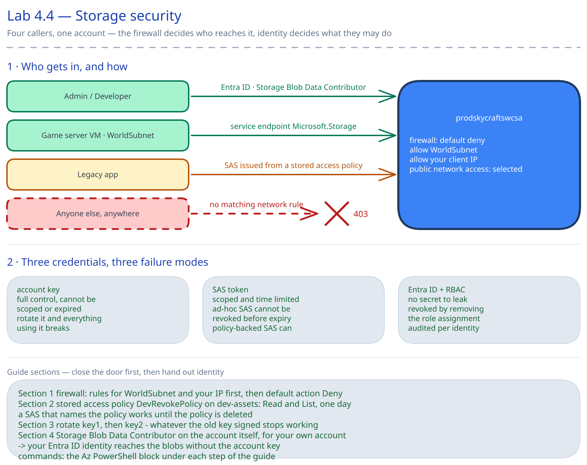
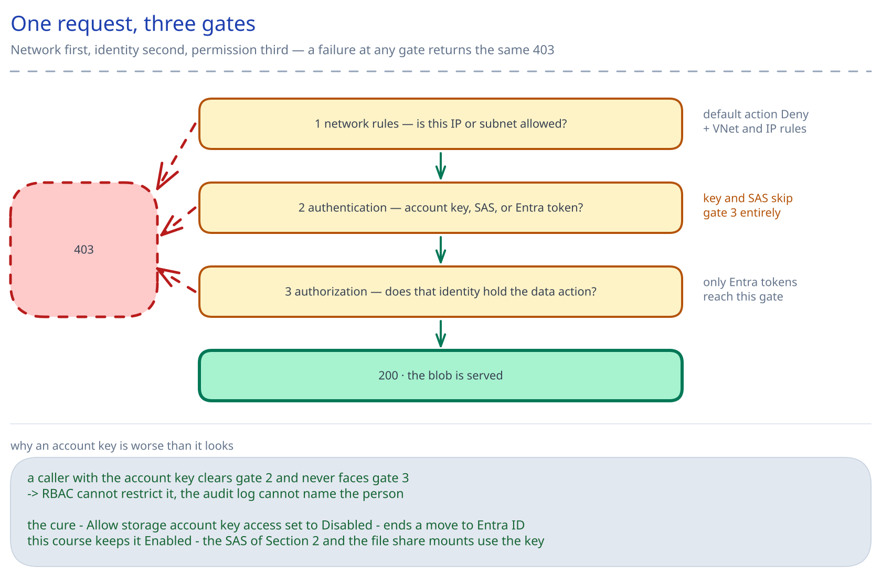

# Lab 4.4: Implementing Storage Security (2.5 hours)

## 🎯 Learning Objectives

By completing this lab, you will:

- Configure Azure Storage firewalls and virtual networks to restrict access (Section 1)
- Securely connect Azure resources using Service Endpoints (Section 1)
- Create and manage Shared Access Signature (SAS) tokens and Stored Access Policies (Section 2)
- Manage and rotate Storage Account Keys (Super Admin credentials) (Section 3)
- Implement Role-Based Access Control (RBAC) for storage data plane access (Section 4)

---

## 🏗️ Architecture Overview

### Topology

<picture>
  <source media="(prefers-color-scheme: dark)" srcset="images/lab-4.4-architecture.dark.svg">
  <source media="(prefers-color-scheme: light)" srcset="images/lab-4.4-architecture.svg">
  
</picture>

### Access Model

<picture>
  <source media="(prefers-color-scheme: dark)" srcset="images/lab-4.4-request-flow.dark.svg">
  <source media="(prefers-color-scheme: light)" srcset="images/lab-4.4-request-flow.svg">
  
</picture>

## 📋 Real-World Scenario

**Situation**: The SkyCraft game assets are stored in Azure Blob Storage. Currently, the storage account is accessible from anywhere on the internet. Additionally, developers have been using long-lived SAS tokens that cannot be easily revoked if a laptop is lost, and the primary Storage Account Key hasn't been rotated in months.

**Your Task**: You will implement a defense-in-depth strategy:

1. Lock down network access to only the VNet and authorized IPs.
2. Implement **Stored Access Policies** to allow revocable SAS tokens for developers.
3. Perform a **Key Rotation** ceremony to secure the root of trust.
4. Move data access to **Entra ID RBAC**, so people reach the blobs with their own identity instead of the account key.

**Business Impact**:

- **Compliance**: Meets security auditing requirements for data isolation.
- **Risk Mitigation**: Limits the blast radius of a leaked SAS token.
- **Operational Excellence**: Established process for key rotation prevents technical debt.

## ⏱️ Estimated Time: 2.5 hours

- **Section 1**: Network Security (Firewalls & Service Endpoints) (40 min)
- **Section 2**: Advanced SAS Management (Stored Access Policies) (45 min)
- **Section 3**: Key Management & Rotation (20 min)
- **Section 4**: Identity-Based Access (RBAC) (30 min)
- **What This Lab Leaves Behind** (5 min)
- **Lab Checklist and Knowledge Check** (10 min)

## ✅ Prerequisites

Before starting this lab:

- [ ] Completed **Lab 2.1: Virtual Networks** - `prod-skycraft-swc-vnet` with `WorldSubnet` in `prod-skycraft-swc-rg`
- [ ] Completed **Lab 2.2: Secure Access** - `WorldSubnet` must carry the `Microsoft.Storage`
      service endpoint, which Lab 2.2 adds. The storage firewall rejects a virtual network rule
      for a subnet without it.
- [ ] Completed **Lab 4.1: Storage Accounts** - `prodskycraftswcsa` in `prod-skycraft-swc-rg`
- [ ] Account with **User Access Administrator** or **Owner** role on the subscription (Step 4.4.7 assigns a role, and so does `scripts/Deploy-Bicep.ps1` unless you pass `-SkipDataRoleAssignment`)
- [ ] PowerShell 7+ and the `Az` module (Az.Accounts, Az.Resources, Az.Storage, Az.Network), run on **your own computer**: after Step 4.4.2 the storage account accepts data requests only from your computer's public IP address, so the data-plane commands of Sections 2 and 4 fail from Azure Cloud Shell, which uses another address. That holds with a storage account or without one: a Cloud Shell session without a storage account cannot run those commands either.
- [ ] `dev` or `prod` environment. `platform` is rejected by both the template and the
      scripts: the hub VNet has only `AzureBastionSubnet` and `GatewaySubnet`, so it has no
      workload subnet to allow through the storage firewall.

`tools/lab-cycle-manifest.psd1` lists this lab as depending on Labs 2.2 and 4.1. It does not need Lab 4.2's containers: Step 4.4.3 creates the lab's own container, `dev-assets`.

If you completed Lab 1.3, its policies are still assigned to your subscription. This lab creates no resource that has a region or tags: the container, the stored access policy, the role assignment, the keys and the network rules are parts of `prodskycraftswcsa` (Lab 4.1), which already carries the region (Sweden Central) and the SkyCraft tags, or extensions of it. `Enforce-Project-Tag` and `Inherit-Project-Tag` (Lab 1.3, Step 1.3.8) and `Restrict-Azure-Regions` (Step 1.3.9) evaluate only resources that have a location and tags, so no step below asks for a region or tags, and none is refused by them. No step creates a resource group or makes Azure create one. Lab 1.3's delete lock on `prod-skycraft-swc-rg` (`lock-no-delete-prod`, Step 1.3.11) does not stop the steps below - a delete lock allows changes, and deleting a stored access policy (Step 4.4.4) is a data operation the lock does not cover - but it does stop this lab's cleanup (see What This Lab Leaves Behind).

Check the prerequisites with Az PowerShell (signed in with `Connect-AzAccount` to the subscription you use for the course):

```powershell
Get-AzStorageAccount -ResourceGroupName 'prod-skycraft-swc-rg' -Name 'prodskycraftswcsa' |
    Select-Object StorageAccountName, Location, ProvisioningState, @{ n = 'DefaultAction'; e = { $_.NetworkRuleSet.DefaultAction } }
(Get-AzVirtualNetwork -ResourceGroupName 'prod-skycraft-swc-rg' -Name 'prod-skycraft-swc-vnet').Subnets |
    Where-Object Name -eq 'WorldSubnet' | Select-Object Name, @{ n = 'ServiceEndpoints'; e = { $_.ServiceEndpoints.Service -join ', ' } }
```

**Expected Result**: `prodskycraftswcsa` in `swedencentral`, `Succeeded`, default action `Allow` (Labs 4.1-4.3 leave the firewall open); `WorldSubnet` with `Microsoft.Storage` among its service endpoints.

> [!IMPORTANT]
> **Run the Module 4 labs in order (4.1 → 4.2 → 4.3 → 4.4).** All four configure the **same**
> three storage accounts, and they are cumulative forward: each lab replaces the account-level
> properties and the sub-services it owns, while leaving the sub-services it does not own alone.
> Re-running Lab 4.2 after Lab 4.3 resets file-share retention from 14 days back to 7; re-running
> Lab 4.1 after Lab 4.2 turns production blob versioning back off. See `docs/bicep-standards.md`
> §4.5 for the mechanism.

## 🛠️ Portal, PowerShell and Bicep Paths

You can build this lab in the Portal by following this guide, with the Az PowerShell blocks under each step, or with Bicep (`scripts/Deploy-Bicep.ps1`). The three paths end in the same state, and `scripts/Test-Lab.ps1` accepts it whichever path built it:

| Path | What it configures |
| ---- | ------------------ |
| Portal (this guide) | Everything in Steps 4.4.1-4.4.8 |
| Az PowerShell (the blocks under each step) | The same |
| `scripts/Deploy-Bicep.ps1` (Bicep, `bicep/main.bicep`) | The firewall, the container `dev-assets` and the role assignment; no stored access policy, SAS token, key rotation or blob (see below) |

The end state on every path, on `prodskycraftswcsa`:

- **Public network access** enabled from selected networks only (firewall default action `Deny`), with a virtual network rule for `prod-skycraft-swc-vnet/WorldSubnet`, an IP rule for your client IPv4 address, and the trusted Azure services exception (`bypass: AzureServices`).
- Container `dev-assets`, **Private**, with no stored access policy left (Step 4.4.4 deletes it).
- **Storage Blob Data Contributor** assigned on the account itself to your account.

Steps without a Bicep counterpart, and why: 4.4.1 only checks Lab 2.2's service endpoint (Lab 2.2's Bicep sets it). The stored access policy of 4.4.3 and the SAS token of 4.4.4 are data-plane objects that a template cannot create, and 4.4.4 deletes the policy again, so the end state is the same. 4.4.5 and 4.4.6 rotate keys, which is an operation, not a resource: `Test-Lab.ps1` reports when the keys were last rotated but does not count it. 4.4.8 uploads a blob, which is data. Every one of these steps has an Az PowerShell block.

Known differences between the paths:

- **Who gets the role.** The Portal and PowerShell steps assign it to your account. `Deploy-Bicep.ps1` assigns it to whoever runs the script - you, or a service principal in an automated run - unless you pass `-DataPrincipalId`. If that identity holds the role on the account already, the script sends no assignment, because Azure refuses a second assignment of the same role to the same principal at the same scope. Creating a role assignment needs **Owner** or **User Access Administrator**: an identity with only **Contributor**, which is enough for the rest of the template, fails the whole deployment with `AuthorizationFailed` on `Microsoft.Authorization/roleAssignments/write`. Run it then with `-SkipDataRoleAssignment`, and have the role assigned as in Step 4.4.7.
- **Which IP address is allowed.** The Portal adds the address your browser uses. `Deploy-Bicep.ps1` asks `api.ipify.org` for the address the script runs from and prints it: do not paste that output into a public issue. Behind a VPN, or from Cloud Shell, the two differ, and the Portal's data views then fail until you add your browser's address (Step 4.4.2). A Bicep deployment replaces the whole list of IP rules.
- **What else the Bicep restates.** To create `dev-assets`, the template has to pass the whole blob service configuration, so it also declares Lab 4.2's containers and the soft delete and versioning settings of Labs 4.1 and 4.2 (see the preview below). If you did those labs, nothing changes; if you did not, the Bicep creates those containers and the Portal path does not.
- **Properties the template's module sets.** A `Deploy-Bicep.ps1 -WhatIf` over a lab built in the Portal lists a few account properties as changes - `isLocalUserEnabled`, `isSftpEnabled`, `customDomain` and others - because the module writes its own defaults where the Portal leaves Azure's. None of them changes what this lab teaches.
- **Large file shares on the dev account.** With `-Environment dev`, the Bicep deploys over `devskycraftswcsa`. If another path built that account and it shows **Large file shares** **Enabled**, the deployment may stop with an error about large file shares: leave the account as it is and do not run the Bicep over it ([issue #390](https://github.com/mbiszczanik/skycraft/issues/390)). The steps below use the production account only.

**Preview - the AVM module call the Bicep path makes**:

```bicep
module modStorage 'br/public:avm/res/storage/storage-account:0.33.0' = {
  name: 'sa-deployment-security'
  scope: resourceGroup(varResourceGroupName)
  params: {
    name: '${parEnvironment}skycraftswcsa'
    networkAcls: {
      bypass: 'AzureServices'
      defaultAction: 'Deny'                                    // this lab is where Deny belongs
      virtualNetworkRules: [ { id: resVnet::resSubnet.id, action: 'Allow' } ]
      ipRules: empty(parClientIp) ? [] : [ { value: parClientIp, action: 'Allow' } ]
    }
    blobServices: { containers: varContainers }                // adds dev-assets
    roleAssignments: empty(parDataContributorPrincipalId) ? [] : [
      { principalId: parDataContributorPrincipalId, roleDefinitionIdOrName: 'Storage Blob Data Contributor' }
    ]
  }
}
```

Because `dev-assets` has to go through `blobServices`, and a non-empty `blobServices` replaces the
whole blob service configuration, this template restates the blob settings Labs 4.1 and 4.2 applied
to the same account. It is the only lab in Module 4 that has to (`docs/bicep-standards.md` §4.5).

---

## 📖 Section 1: Network Security (40 min)

### Deep Dive: Network Isolation

By default, Storage Accounts are accessible from the public internet. Secure organizations use one of two methods:

1. **Service Endpoints**: Optimizes the path between VNet and Storage over the Azure backbone. Free.
2. **Private Endpoints**: Gives the storage a private IP inside your VNet (more secure, extra cost: a private endpoint is billed per hour and per GB it carries, and needs a private DNS zone).

> **SkyCraft Choice**: We use **Service Endpoints** in this lab as a cost-effective way to secure the World Server traffic while blocking general internet access. Do not create a private endpoint in this lab.

The storage firewall works on the **data plane** only: requests to the blobs, files, queues and tables. The **control plane** - the Portal pages that change the account's settings, `Get-AzStorageAccount`, the role assignments - goes through Azure Resource Manager and is not blocked. So if you lock yourself out of the data, you can always open the **Networking** page again and add your address.

### Step 4.4.1: Enable Service Endpoint on VNet

Lab 2.2 (Step 2.2.15) added the `Microsoft.Storage` service endpoint to `WorldSubnet`, so this step is a check: you change something only if the endpoint is missing.

1. In Azure Portal, search for **Virtual networks**
2. Select `prod-skycraft-swc-vnet` → **Subnets** (in the left menu, under **Settings**) → `WorldSubnet`. The *Edit subnet* pane opens.
3. Check that the services table under *Service Endpoints* lists `Microsoft.Storage`.
4. If the table lists `Microsoft.Storage`, click **Cancel**: the endpoint is in place.

   Only if `Microsoft.Storage` is not in the table: instead of **Cancel**, open the **Select a service endpoint** dropdown, select **Microsoft.Storage** and click **Save**.

**Expected Result**: The **Services** table of `WorldSubnet` lists `Microsoft.Storage`.

**With Az PowerShell** (instead of items 1-4; it adds the endpoint only if it is missing, and keeps the subnet's other settings):

```powershell
$vnet   = Get-AzVirtualNetwork -ResourceGroupName 'prod-skycraft-swc-rg' -Name 'prod-skycraft-swc-vnet'
$subnet = $vnet.Subnets | Where-Object Name -eq 'WorldSubnet'
$subnet.ServiceEndpoints.Service

if ($subnet.ServiceEndpoints.Service -notcontains 'Microsoft.Storage') {
    # As Lab 2.2's script does: no Locations, which Azure records as every region.
    $subnet.ServiceEndpoints = @(@($subnet.ServiceEndpoints | ForEach-Object { @{ Service = $_.Service } }) + @{ Service = 'Microsoft.Storage' })
    $vnet | Set-AzVirtualNetwork | Out-Null
}
```

### Step 4.4.2: Configure Storage Firewall

> [!WARNING]
> **This step can lock you out of the account's data.** After **Save**, the account answers data requests only from `WorldSubnet` and from the IP addresses you list. Your browser, the PowerShell blocks of Sections 2 and 4 and `Test-Lab.ps1` all reach the data from your computer's public IP address, so add it (item 6). If that address changes later - another network, a VPN, a mobile hotspot - the Portal's container views show *This request is not authorized to perform this operation* until you add the new address on the same page (Troubleshooting, Issue 1).
>
> Do not choose **Disable** or **Secured by perimeter** under **Public network access**: either one closes the public endpoint to your computer too, and only a private endpoint or a network security perimeter would let you in again.

1. In Azure Portal, search for **Storage accounts**
2. Select `prodskycraftswcsa` → **Networking** (in the left menu, under **Security + networking**)
3. Next to *Public network access* (it shows *Enabled from all networks*), click **Manage**. The *Public network access* page opens. The page has a second **Manage**, under *Resource settings: Virtual networks, IP addresses, and exceptions*; use the one next to *Public network access*.
4. Under **Public network access**, leave **Enable** selected
5. Under **Public network access scope**, select **Enabled from selected networks**
6. Under **IPv4 Addresses**, click **+ Add your client IPv4 address**. Your address appears in the list.
7. Under **Virtual Networks**, click **+ Add a virtual network**, then **Add existing virtual network**. The *Add networks* pane opens.
8. In the *Add networks* pane, fill in:

| Field | Value |
| ----- | ----- |
| Subscription | your course subscription |
| Virtual networks | `prod-skycraft-swc-vnet` |
| Subnets | `WorldSubnet` |

   A subnet marked *(Service endpoint required)* has no `Microsoft.Storage` endpoint: go back to Step 4.4.1. Leave the other subnets out; each one you add is let through the firewall.

9. In the *Add networks* pane, click **Add**
10. Under **Exceptions**, leave **Allow trusted Microsoft services to access this resource** checked
11. Click **Save** at the bottom of the page.

The trusted services exception lets Azure services such as Azure Backup (Lab 5.2) reach the account; the Bicep path sets the same exception (`bypass: AzureServices`). The other two exceptions, read access to storage logging and to storage metrics from any network, stay unchecked: each would open the account's logs or metrics to every network. Leave **Resource instances** empty as well: an entry there lets one resource of another service through the firewall.

**Expected Result**: Back on the **Networking** page, **Public network access** shows *Enabled from selected networks*, with a summary of *Virtual networks 1*, *IPv4 addresses 1* and *Exceptions 1*. The firewall applies within a minute or so; if a container view fails right after **Save**, wait and reload.

**With Az PowerShell** (instead of items 1-11). Run it on your own computer: the IP address it adds is the one this computer uses.

```powershell
$clientIp = (Invoke-RestMethod -Uri 'https://api.ipify.org').Trim()
$subnetId = ((Get-AzVirtualNetwork -ResourceGroupName 'prod-skycraft-swc-rg' -Name 'prod-skycraft-swc-vnet').Subnets |
    Where-Object Name -eq 'WorldSubnet').Id

# The rules first, while the account still allows every network; then the default action.
Add-AzStorageAccountNetworkRule -ResourceGroupName 'prod-skycraft-swc-rg' -Name 'prodskycraftswcsa' -VirtualNetworkResourceId $subnetId
Add-AzStorageAccountNetworkRule -ResourceGroupName 'prod-skycraft-swc-rg' -Name 'prodskycraftswcsa' -IPAddressOrRange $clientIp
Update-AzStorageAccountNetworkRuleSet -ResourceGroupName 'prod-skycraft-swc-rg' -Name 'prodskycraftswcsa' `
    -DefaultAction Deny -Bypass AzureServices

Get-AzStorageAccountNetworkRuleSet -ResourceGroupName 'prod-skycraft-swc-rg' -Name 'prodskycraftswcsa' |
    Select-Object DefaultAction, Bypass, @{ n = 'Subnets'; e = { $_.VirtualNetworkRules.VirtualNetworkResourceId } }, @{ n = 'IpRules'; e = { $_.IpRules.IPAddressOrRange } }
```

**Expected Result** (PowerShell): `DefaultAction` `Deny`, `Bypass` `AzureServices`, one subnet ending in `/subnets/WorldSubnet` and one IP rule.

Step 4.4.4 shows the firewall at work: the same SAS link works from your computer and is refused from another network.

---

## 📖 Section 2: Advanced SAS Management (Stored Access Policies) (45 min)

### Deep Dive: Stored Access Policies vs Ad-hoc SAS

A standard SAS token is like a signed check—once issued, it cannot be stopped without changing the account key. A **Stored Access Policy** is like an authorized list; if you remove the item from the list, the token stops working (within about 30 seconds).

| Feature          | Ad-hoc SAS                        | Stored Access Policy                  |
| :--------------- | :-------------------------------- | :------------------------------------ |
| **Revocation**   | Impossible (without Key Rotation) | Delete the policy (up to 30 seconds)  |
| **Token Update** | Generate new token                | Just update policy (token stays same) |
| **Limit**        | None                              | 5 per container                       |

A stored access policy works only with a **service SAS** signed with an account key. A user delegation SAS, signed with your Microsoft Entra identity, is the safer choice in production, but it cannot use a stored access policy. If you delete a policy and create one with the same name again, every token that named it works again: give a replacement policy a new name.

### Step 4.4.3: Create Stored Access Policy

On every path the policy lives on the container `dev-assets`, which this step creates. The Bicep path creates the same container.

1. In Azure Portal, search for **Storage accounts**
2. Select `prodskycraftswcsa` → **Containers** (in the left menu, under **Data storage**)
3. Only if `dev-assets` is not in the containers list: click **+ Add container**. If it is there already - from an earlier run of this lab or from the Bicep path - go on to item 6.

   If you deleted `dev-assets` less than a minute ago - this lab's cleanup deletes it - wait a minute before you create it again: Azure refuses the name of a deleted container for at least 30 seconds, and **Create** then fails with a message that the container is being deleted (Troubleshooting, Issue 5).

4. In the *New container* pane, fill in:

| Field | Value |
| ----- | ----- |
| Name  | `dev-assets` |

   **Anonymous access level** is greyed out at **Private (no anonymous access)**: Lab 4.1 turned anonymous access off for the account. Leave the **Advanced** section as it is: version-level immutability support, once turned on for a container, cannot be turned off, and an immutability policy would stop this lab's cleanup from deleting the container's blobs.

5. Click **Create**
6. In the containers list, on the `dev-assets` row, click **...** (More), then **Access policy**. You do not need to open the container first.
7. Under **Stored access policies**, click **+ Add policy**. The *Add policy* pane opens. The page has a second **+ Add policy**, under **Immutable blob storage**: it creates a retention policy or legal hold that keeps the container's blobs from being changed or deleted. Do not use it.
8. In the *Add policy* pane, fill in:

| Field | Value |
| ----- | ----- |
| Identifier | `DevRevokePolicy` |
| Permissions | Select **Read** and **List** only |
| Start time | leave empty |
| Expiry time | Enter tomorrow's date and the current time, in your time zone |

   Select no other permission: **Write**, **Delete**, **Add**, **Create** and the rest let anyone who holds a token change or delete the container's blobs. Keep the expiry short: every token that names the policy works until then, unless you delete the policy first. Type the date and time, or pick them; do not press Escape in a date field - it closes the whole pane and loses what you typed. If the time goes back to 12:00:00 AM after you type it, leave it: the policy then expires at the start of tomorrow's date, which is enough for this lab.

9. In the *Add policy* pane, click **OK**
10. On the toolbar of the *Access policy* page, click **Save**

**Expected Result**: The **Access policy** page of `dev-assets` lists `DevRevokePolicy` under **Stored access policies**, with permissions `rl` and tomorrow's expiry. Without **Save** the policy is not stored.

> **Note**: Opening a container by its name may keep loading in today's Portal; this step uses the row's **...** menu for that reason. If the menu has no **Access policy** entry, use the PowerShell block below.

**With Az PowerShell** (instead of items 1-10). The account's context uses the account key, which your Owner role may read; run it on the computer whose address Step 4.4.2 allowed:

```powershell
# Only if dev-assets is not there yet (an earlier run, or the Bicep path). If you deleted it less
# than a minute ago, wait a minute first: Azure refuses the name for at least 30 seconds.
$existing = Get-AzRmStorageContainer -ResourceGroupName 'prod-skycraft-swc-rg' -StorageAccountName 'prodskycraftswcsa' |
    Where-Object Name -eq 'dev-assets'
if (-not $existing) {
    New-AzRmStorageContainer -ResourceGroupName 'prod-skycraft-swc-rg' -StorageAccountName 'prodskycraftswcsa' `
        -Name 'dev-assets' -PublicAccess None
}

$ctx = (Get-AzStorageAccount -ResourceGroupName 'prod-skycraft-swc-rg' -Name 'prodskycraftswcsa').Context
New-AzStorageContainerStoredAccessPolicy -Container 'dev-assets' -Policy 'DevRevokePolicy' `
    -Permission 'rl' -ExpiryTime (Get-Date).AddDays(1) -Context $ctx
Get-AzStorageContainerStoredAccessPolicy -Container 'dev-assets' -Context $ctx | Select-Object Policy, Permissions, ExpiryTime
```

### Step 4.4.4: Generate SAS via Policy

You create a token that names the policy, use it, revoke it by deleting the policy, and see it refused.

> [!WARNING]
> The **Blob SAS URL** this step shows is a password to the container: anyone who has it can list the container until the policy is deleted or expires. Do not paste it into a chat, an issue or a screenshot. Item 12 revokes it.

1. Go to `prodskycraftswcsa` → **Containers** (in the left menu, under **Data storage**)
2. On the `dev-assets` row, click **...** (More), then **Generate SAS**
3. In the *Generate SAS* pane, fill in:

| Field | Value |
| ----- | ----- |
| Signing method | **Account key** |
| Signing key | **Key 1** |
| Stored access policy | `DevRevokePolicy` |
| Allowed IP addresses | leave empty |
| Allowed protocols | **HTTPS only** |

   With a stored access policy selected, **Permissions** and **Expiry** are greyed out: the token takes them from the policy. **Start** stays editable, because this policy sets no start time. Without a policy the pane's own defaults apply - **Read** and an expiry about eight hours away - and such an ad hoc token can be revoked only by rotating the key that signed it (Section 3). **User delegation key** cannot use a stored access policy. An address in **Allowed IP addresses** would narrow the token further; the firewall of Step 4.4.2 already does that here.

4. Click **Generate SAS token and URL**
5. Copy the URL that the pane shows under *Blob SAS URL*
6. Open a new browser tab, paste the URL, add `&restype=container&comp=list` to its end, and press Enter.

**Expected Result**: The browser shows an XML document, `EnumerationResults`, for the container `dev-assets` - an empty list of blobs. The token lists the container because the policy grants **List**. If you saved the policy in Step 4.4.3 less than 30 seconds ago, the answer may instead be an XML error with the code `AuthenticationFailed` (HTTP 403): a new stored access policy takes up to 30 seconds to take effect, too. Wait 30 seconds and reload the tab.

7. Optional, to see the firewall at work: open the same URL on a phone that uses mobile data, with Wi-Fi off. The answer is an XML error with the code `AuthorizationFailure` (HTTP 403): the token is valid, but the request comes from a network the firewall does not allow. Use your own phone only, and close the tab afterwards.
8. Back in the Portal, on the `dev-assets` row of the containers list, click **...** (More), then **Access policy**
9. On the `DevRevokePolicy` row, click **...** (More), then **Delete**
10. On the toolbar, click **Save**
11. Wait 30 seconds: a change to a stored access policy takes up to 30 seconds to take effect.
12. Reload the browser tab of item 6.

**Expected Result**: The browser now shows an XML error with the code `AuthenticationFailed` (HTTP 403): the token names a policy that no longer exists. The container `dev-assets` stays; Section 4 uses it.

**With Az PowerShell** (instead of items 1-12). The token is kept in a variable and never printed:

```powershell
$ctx = (Get-AzStorageAccount -ResourceGroupName 'prod-skycraft-swc-rg' -Name 'prodskycraftswcsa').Context
$sas = New-AzStorageContainerSASToken -Name 'dev-assets' -Policy 'DevRevokePolicy' -Protocol HttpsOnly -Context $ctx
$url = "https://prodskycraftswcsa.blob.core.windows.net/dev-assets?$($sas.TrimStart('?'))&restype=container&comp=list"

Start-Sleep -Seconds 30     # the policy of Step 4.4.3 takes up to 30 seconds to take effect; until then the token gets 403
(Invoke-WebRequest -Uri $url -SkipHttpErrorCheck).StatusCode     # 200: the token works

Remove-AzStorageContainerStoredAccessPolicy -Container 'dev-assets' -Policy 'DevRevokePolicy' -Context $ctx
Start-Sleep -Seconds 30
(Invoke-WebRequest -Uri $url -SkipHttpErrorCheck).StatusCode     # 403: the token is revoked
Remove-Variable sas, url
```

---

## 📖 Section 3: Key Management & Rotation (20 min)

### Deep Dive: Two Keys, One at a Time

Each storage account has two access keys, `key1` and `key2`. Either one gives full access to every blob, file, queue and table in the account - the "super admin" credential - and signs every SAS made with an account key. Lab 4.1 (Step 4.1.13) showed the **Access keys** page and rotated `key1` once; this section runs the whole rotation.

Two keys exist so that a rotation never cuts an application off. The order matters:

1. Move every application to `key2`.
2. Rotate `key1`. Nothing uses it any more, so nothing breaks.
3. Move the applications to the new `key1`.
4. Rotate `key2`.

Rotating both keys at once, or rotating the key the applications still use, cuts them off until they get the new key. Microsoft recommends using one key at a time everywhere: an application on `key1` and another on `key2` cannot both survive a rotation.

A rotation invalidates everything signed with the old key: connection strings, Lab 4.3's file share mounts (they used `key1`), and every ad hoc or service SAS signed with it - the token of Step 4.4.4 too, had you kept its policy. It does not affect access through Microsoft Entra ID (Section 4) or a user delegation SAS.

> **No application in this course uses the keys of `prodskycraftswcsa` permanently**, so the steps below rotate both keys one after the other. If you still have Lab 4.3's share mounted (drive `Z:` on Windows, or the Linux mount), it stops working after Step 4.4.5: unmount it, or mount it again with the new key (Troubleshooting, Issue 2).

### Step 4.4.5: Rotate Access Key 1

> [!WARNING]
> A rotation cannot be undone: the old key stops working at once, and everything signed with it fails until it gets the new key.

1. In Azure Portal, search for **Storage accounts**
2. Select `prodskycraftswcsa` → **Access keys** (in the left menu, under **Security + networking**)
3. Note the date that `key1`'s *Last rotated* shows
4. Next to `key1`, click **Rotate key**
5. In the confirmation dialog, click **Yes**

**Expected Result**: `key1`'s *Last rotated* shows today's date. Do not click **Show** to check the new value: a key shown on screen is a password to the whole account, and does not belong in a screenshot.

> **Note**: The page also offers **Set rotation reminder**, which records a reminder interval (a key expiration policy) on the account; it is free, and this lab sets none. The **Security + networking** group also lists **Microsoft Defender for Cloud**: leave Defender for Storage off - it is billed per storage account each month, and its malware scanning per GB scanned.

**With Az PowerShell** (instead of items 1-5). The output shows each key's name and creation time, not its value:

```powershell
New-AzStorageAccountKey -ResourceGroupName 'prod-skycraft-swc-rg' -Name 'prodskycraftswcsa' -KeyName 'key1' | Out-Null
Get-AzStorageAccountKey -ResourceGroupName 'prod-skycraft-swc-rg' -Name 'prodskycraftswcsa' | Select-Object KeyName, CreationTime
```

### Step 4.4.6: Rotate Access Key 2

In production you would now move the applications to the new `key1` and wait until nothing uses `key2`. Here nothing does, so go on.

1. On the *Access keys* page of `prodskycraftswcsa`, next to `key2`, click **Rotate key**
2. In the confirmation dialog, click **Yes**

**Expected Result**: Both keys' *Last rotated* show today's date. `Test-Lab.ps1` prints when each key was last rotated.

**With Az PowerShell** (instead of items 1-2):

```powershell
New-AzStorageAccountKey -ResourceGroupName 'prod-skycraft-swc-rg' -Name 'prodskycraftswcsa' -KeyName 'key2' | Out-Null
Get-AzStorageAccountKey -ResourceGroupName 'prod-skycraft-swc-rg' -Name 'prodskycraftswcsa' | Select-Object KeyName, CreationTime
```

> **Security Best Practice**: Rotate keys every 90 days, or keep them in Azure Key Vault with automatic rotation. Better still, stop using them: Section 4 is the alternative.

---

## 📖 Section 4: Identity-Based Access (RBAC) (30 min)

### Deep Dive: Management Plane vs Data Plane

Azure separates two kinds of access to a storage account:

| Plane | What it covers | Example roles |
| ----- | -------------- | ------------- |
| **Management (control) plane** | The account's settings: firewall, keys, containers as resources | Owner, Contributor, Storage Account Contributor |
| **Data plane** | The data: reading, writing and deleting blobs | Storage Blob Data Reader, **Storage Blob Data Contributor**, Storage Blob Data Owner |

An **Owner** of the subscription has no data role. It reaches the blobs only by reading the account key - the Portal does that for you whenever it shows *Authentication method: Access key*. A data role lets you reach the blobs with your own Microsoft Entra identity instead: every request is logged under your name, and taking the role away ends your access without touching a key.

**Storage Blob Data Contributor** lets its holder read, write and delete every blob in the scope it is assigned at. This lab assigns it on the storage account, not on the resource group or the subscription, so that it reaches this account's data only.

> **Allow storage account key access** (account **Configuration**, under **Settings**) is **Enabled**, the default, and stays so in this course. Turning it off is the last step of a move to Entra ID: it would stop the account-key SAS of Section 2, Lab 4.3's key-based mounts, `Test-Lab.ps1`'s policy reads and the Portal's default access-key view. Do not change it here.

### Step 4.4.7: Assign Storage Blob Data Contributor

If you ran the optional Azure CLI commands of Lab 4.2 (Step 4.2.11), you hold this role on the account already: the wizard below then reports that the role assignment already exists. That is the state this step wants; go on to Step 4.4.8.

1. In Azure Portal, search for **Storage accounts**
2. Select `prodskycraftswcsa` → **Access control (IAM)** (in the left menu)
3. Click **+ Add** → **Add role assignment**
4. On the **Role** tab:

   - Click **Job function roles**
   - Search for **"Storage Blob Data Contributor"**
   - Click **Storage Blob Data Contributor** (not Storage Blob Data Owner, which can also change the access rules, nor Storage Blob Data Reader, which cannot write)
   - Click **Next**

5. On the **Members** tab:

   - **Assign access to**: User, group, or service principal
   - Click **+ Select members**
   - Search for your own account (the one you are signed in with)
   - Click your account
   - Click **Select**
   - Click **Next**

6. The **Conditions** tab opens: storage data roles can carry a condition that narrows them, for example to one container. Add no condition here.
7. Only if the wizard shows an Assignment type tab:

   - **Assignment type**: Active
   - **Assignment duration**: Permanent

   An **Eligible** assignment gives no access until you activate it.

8. Click the **Review + assign** tab, then click **Review + assign**

**Expected Result**: On the **Role assignments** tab of **Access control (IAM)**, **Storage Blob Data Contributor** lists your account with the scope *This resource*.

**Wait about five minutes** before Step 4.4.8: a new role assignment takes a few minutes to take effect on the data plane.

**With Az PowerShell** (instead of items 1-8). It assigns the role only if you do not hold it on the account already (Lab 4.2, Step 4.2.11): a second assignment fails with `RoleAssignmentExists`.

```powershell
# Get-AzADUser, Get-AzRoleAssignment and New-AzRoleAssignment need a Microsoft Graph token. If one
# fails with "Authentication failed against resource MicrosoftGraphEndpointResourceId", run
# Connect-AzAccount -AuthScope MicrosoftGraphEndpointResourceId and run it again
# (TROUBLESHOOTING.md in the repository root).
$scope    = (Get-AzStorageAccount -ResourceGroupName 'prod-skycraft-swc-rg' -Name 'prodskycraftswcsa').Id
$objectId = (Get-AzADUser -SignedIn).Id
$existing = Get-AzRoleAssignment -ObjectId $objectId -RoleDefinitionName 'Storage Blob Data Contributor' -Scope $scope |
    Where-Object Scope -eq $scope      # on the account itself, not inherited from the group or the subscription
if (-not $existing) {
    New-AzRoleAssignment -ObjectId $objectId -RoleDefinitionName 'Storage Blob Data Contributor' -Scope $scope
}
```

### Step 4.4.8: Access Blobs with Your Entra ID Identity

1. On your computer, create a text file named `hello-skycraft.txt` that contains the line `Hello from SkyCraft`.
2. Go to `prodskycraftswcsa` → **Containers** (in the left menu, under **Data storage**) → `dev-assets`
3. Next to *Authentication method* (it shows *Access key*), click **Switch to Microsoft Entra user account**
4. Click **Upload**, then **Browse for files**, choose your `hello-skycraft.txt` and click **Upload**

**Expected Result**: **Authentication method** shows *Microsoft Entra user account*, and `hello-skycraft.txt` is listed in `dev-assets`. The upload used your role, not the account key. If the Portal says you do not have permissions to list the data using your user account, the role has not taken effect yet: wait a few minutes and reload.

> **Note**: If the `dev-assets` container page keeps loading, use the PowerShell block below; it does the same with your identity.

**With Az PowerShell** (instead of items 1-4). `-UseConnectedAccount` signs the requests with your Az session's identity; no key is read:

```powershell
'Hello from SkyCraft' | Out-File -FilePath 'hello-skycraft.txt' -Encoding utf8
$ctx = New-AzStorageContext -StorageAccountName 'prodskycraftswcsa' -UseConnectedAccount

Set-AzStorageBlobContent -Container 'dev-assets' -File 'hello-skycraft.txt' -Blob 'hello-skycraft.txt' -Context $ctx
Get-AzStorageBlob -Container 'dev-assets' -Context $ctx | Select-Object Name, Length
```

**Expected Result** (PowerShell): `hello-skycraft.txt` listed. `AuthorizationPermissionMismatch` means the role has not taken effect yet (wait, then run it again); `AuthorizationFailure` means the request came from an address the firewall does not allow (Step 4.4.2).

---

## ✅ Lab Checklist

- [ ] `WorldSubnet` has `Microsoft.Storage` service endpoint enabled
- [ ] `prodskycraftswcsa` firewall restricted to VNet and Client IP
- [ ] `DevRevokePolicy` on `dev-assets` tested and verified for revocation
- [ ] Access Key 1 and Access Key 2 rotated, one at a time (*Last rotated* shows today)
- [ ] `Storage Blob Data Contributor` assigned to your user on the account
- [ ] A blob uploaded to `dev-assets` with your Microsoft Entra identity

Run the lab's validator from the lab folder:

```powershell
./scripts/Test-Lab.ps1
```

**Expected Result**: `Validation Complete. Failures: 0`, exit code 0. It checks that the account is provisioned, the firewall denies by default and lets `WorldSubnet` through, the service endpoint, the container `dev-assets` and the role assignment on the account. It prints the stored access policies it finds, your IP rules and when each key was last rotated, without counting them: Step 4.4.4 deletes the policy, and the Bicep path cannot rotate keys.

**Detailed verification**: [lab-checklist-4.4.md](lab-checklist-4.4.md)

---

## 📦 What This Lab Leaves Behind

The lab cycle's `tools/lab-cycle-manifest.psd1` lists no lab that depends on Lab 4.4, but Module 5 works on the same storage accounts, and the firewall stays on the production account until you remove it. The daily costs below are approximate list prices for Sweden Central; check the [Azure pricing calculator](https://azure.microsoft.com/pricing/calculator/) for your own.

| Left behind | Where | Daily cost | What it does in later labs |
| --- | --- | --- | --- |
| Firewall: default action **Deny**, rules for `WorldSubnet` and your IP address, trusted services exception | `prodskycraftswcsa` | 0 | The account's data answers only `WorldSubnet`, your address and trusted Azure services. From another network, or after your address changes, the Portal's container and file share views fail until you add the new address (Step 4.4.2). A VM outside `WorldSubnet` - for example Lab 4.3's Linux mount from another subnet - can no longer reach the share. Re-running the Bicep of Lab 4.1, 4.2 or 4.3 sets the default action back to **Allow**; run this lab's Bicep again afterwards. |
| Container `dev-assets` with `hello-skycraft.txt` | `prodskycraftswcsa` | well under 0.01 EUR (a few bytes) | Nothing |
| Rotated `key1` and `key2` | `prodskycraftswcsa` | 0 | Anything that kept an old key - Lab 4.3's mounts, a saved connection string - fails until it gets the current key. Later labs read the current key when they need it. |
| **Storage Blob Data Contributor** for your account | `prodskycraftswcsa` | 0 | Lets you reach the account's blobs with your identity in later labs. |
| `Microsoft.Storage` service endpoint on `WorldSubnet` | `prod-skycraft-swc-vnet` | 0 | Lab 2.2's, not this lab's; it stays. |

To remove what this lab added, run the lab's cleanup from the lab folder:

```powershell
./scripts/Remove-LabResource.ps1
```

It asks before it changes anything (`-WhatIf` lists the changes; `-Force` skips the questions). It sets the firewall's default action back to **Allow** (the rules stay in the list, without effect), deletes `dev-assets` with its blob - recoverable, and billed, for the 7 days of container soft delete - and removes every **Storage Blob Data Contributor** assignment made on the account itself, including the optional one of Lab 4.2. It keeps the storage account and Lab 2.2's service endpoint. A rotation cannot be undone, and needs no cleanup. The cleanup removes no diagnostic setting: this lab creates none.

While Lab 1.3's delete lock (`lock-no-delete-prod`) is on `prod-skycraft-swc-rg`, Azure refuses the deletes in that group - the container `dev-assets` and the role assignment - with `ScopeLocked`. The script reports each refusal as `[ERROR]`, carries on with the rest (the firewall revert is a change, which the lock allows) and exits 1; it does not remove the lock itself (tracked in [issue #372](https://github.com/mbiszczanik/skycraft/issues/372)). To clean up completely, remove `lock-no-delete-prod` by hand (`prod-skycraft-swc-rg` → **Locks**, under **Settings**), run the script again, wait a minute, and then create the lock again as in Lab 1.3, Step 1.3.11. Or leave the container and the role in place until you finish Module 5: they cost next to nothing (see the table).

---

## 🔧 Troubleshooting

### Issue 1: "This request is not authorized to perform this operation" in Portal

**Symptom**: After Step 4.4.2 the Portal cannot list the containers or their blobs, or shows *This request is not authorized to perform this operation*.
**Root Cause**: The Portal reads the data from your browser's public IP address. If that address is not in the firewall - you skipped item 6 of Step 4.4.2, or you are now on another network or a VPN - the account refuses it.
**Solution**: `prodskycraftswcsa` → **Networking** (under **Security + networking**) → **Manage** → under **IPv4 Addresses**, click **+ Add your client IPv4 address** → **Save**, then wait a minute. This page is part of the control plane, which the firewall does not block.

### Issue 2: Key rotation breaks legacy mounting

**Symptom**: Lab 4.3's file share mounts (drive `Z:` on Windows, the Linux mount) fail after Step 4.4.5.
**Root Cause**: Mounting via Storage Key uses that specific key, and Lab 4.3's commands used `key1`.
**Solution**: Mount the share again with the current key (Lab 4.3, Steps 4.3.7 and 4.3.8 read it afresh). In production, use the other key for mounting first: move the mounts to `key2`, rotate `key1`, move them back to the new `key1`, rotate `key2`.

### Issue 3: SAS Token still works after policy deletion

**Symptom**: Access remains for a short period.
**Root Cause**: A change to a stored access policy takes up to 30 seconds to take effect. Or the policy was deleted from the list but not saved.
**Solution**: Make sure you clicked **Save** on the **Access policy** page, wait 30 seconds and retry.

### Issue 4: The upload with your identity fails with `AuthorizationPermissionMismatch`

**Symptom**: Step 4.4.8 fails, in the Portal with a message that you do not have permissions to list the data using your user account, or in PowerShell with `AuthorizationPermissionMismatch`.
**Root Cause**: The role of Step 4.4.7 has not taken effect yet, or it was assigned to another account, or at another scope.
**Solution**: Wait about five minutes after the assignment. Then check **Access control (IAM)** → **Role assignments** of `prodskycraftswcsa` for **Storage Blob Data Contributor** with your account.

### Issue 5: Creating `dev-assets` fails in Step 4.4.3

**Symptom**: **Create** in the *New container* pane fails with a message that the container is being deleted, or that it already exists; `New-AzRmStorageContainer` fails with a conflict (HTTP 409) that says the same.
**Root Cause**: After a container is deleted, Azure refuses its name for at least 30 seconds - longer while the delete is still being processed. This lab's cleanup deletes `dev-assets`, so a re-run right after it hits this. Or `dev-assets` is there already, from an earlier run or from the Bicep path.
**Solution**: If it is being deleted, wait a minute and click **Create** again. If it exists, do not create it again: go on to item 6 of Step 4.4.3 and add the policy to the existing container.

## 🎓 Knowledge Check

1. **You issued a SAS token with a 5-year expiry. The laptop containing the token was stolen. How do you revoke it quickly?**
   <details>
     <summary>**Click to see the answer**</summary>
   **Answer**: If the token names a stored access policy, delete the policy (or change its expiry to the past). If it is an ad hoc token, you must rotate the Storage Account Access Key that was used to sign it. This will invalidate all tokens signed with that key.
   </details>

2. **Why does an Owner role still need the 'Storage Blob Data Contributor' role?**
   <details>
     <summary>**Click to see the answer**</summary>
   **Answer**: Azure differentiates between the Management Plane (ARM) and the Data Plane (Storage contents). Owner role only gives management rights; it reaches the data only by reading the account key, and with the key all access looks the same in the logs.
   </details>

3. **What is the limit of Stored Access Policies per container?**
   <details>
     <summary>**Click to see the answer**</summary>
   **Answer**: You can have a maximum of **5** stored access policies per container/share.
   </details>

4. **Why are there two account keys, and in which order do you rotate them?**
   <details>
     <summary>**Click to see the answer**</summary>
   **Answer**: So that applications never lose access: move them to `key2`, rotate `key1`, move them to the new `key1`, rotate `key2`.
   </details>

5. **You hold Storage Blob Data Contributor on the account, yet an upload from a café's Wi-Fi fails with `AuthorizationFailure`. Why, and why can you still open the account's Networking page?**
   <details>
     <summary>**Click to see the answer**</summary>
   **Answer**: The firewall is checked before the role: the café's public IP address is not in the account's IP rules, so the data request is refused whoever sends it. The **Networking** page is part of the control plane, which goes through Azure Resource Manager and is not subject to the storage firewall, so you can add the new address there.
   </details>

## 📚 Additional Resources

- [Azure Storage Firewalls and Virtual Networks](https://learn.microsoft.com/azure/storage/common/storage-network-security)
- [Define a stored access policy](https://learn.microsoft.com/rest/api/storageservices/define-stored-access-policy)
- [Manage storage account access keys](https://learn.microsoft.com/azure/storage/common/storage-account-keys-manage)
- [Authorize access with Entra ID (RBAC)](https://learn.microsoft.com/azure/storage/blobs/authorize-access-azure-active-directory)
- [Choose how to authorize access to blob data in the Azure portal](https://learn.microsoft.com/azure/storage/blobs/authorize-data-operations-portal)

## 📌 Module Navigation

[← Lab 4.3: Azure Files](../4.3-azure-files/lab-guide-4.3.md) | [Next Lab: 5.1 Monitoring →](../../module-5-monitoring-maintenance/5.1-azure-monitor/lab-guide-5.1.md)

---

## 📝 Lab Summary

**What You Accomplished**:
✅ Secured storage network perimeter via Service Endpoints
✅ Implemented revocable access using Stored Access Policies
✅ Rotated both storage account keys, one at a time
✅ Reached blob data with your Entra ID identity instead of a key

**Time Spent**: ~2.5 hours
