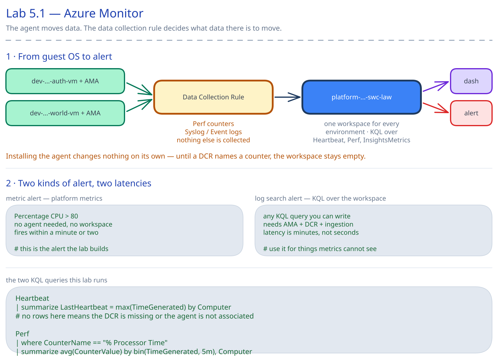

# Lab 5.1: Azure Monitor and Insights (2 hours)

## 🎯 Learning Objectives

By completing this lab, you will:

- Create and configure a **Log Analytics Workspace**
- Connect SkyCraft virtual machines with the **Azure Monitor Agent** and a **data collection rule**
- Create a **Log Search Alert** from a KQL query that fires when a VM stops sending `Heartbeat`
- Configure **Metric Alerts** for high CPU utilization
- Build a custom **Azure Dashboard** for multi-resource visibility
- Query logs using **Kusto Query Language (KQL)**
- Route a storage account's blob logs to the workspace with a **diagnostic setting**

---

## 🏗️ Architecture Overview

[Description]: Log Analytics Workspace serves as the central repository for all telemetry. Monitor Alerts watch the workspace and metrics to trigger notifications.

<picture>
  <source media="(prefers-color-scheme: dark)" srcset="images/lab-5.1-architecture.dark.svg">
  <source media="(prefers-color-scheme: light)" srcset="images/lab-5.1-architecture.svg">
  
</picture>

---

## 📋 Real-World Scenario

**Situation**: The SkyCraft game world servers periodically experience performance spikes. The operations team (led by Malfurion) needs a centralized way to view logs and receive urgent notifications if a server becomes unresponsive or overloaded. Currently, logs are scattered across individual VMs, making troubleshooting "AzerothCore" crashes difficult.

**Your Task**: Deploy a centralized Log Analytics Workspace, connect the existing SkyCraft development virtual machines to it, and create an automated alert system that notifies the team when CPU exceeds 80%.

---

## ⏱️ Estimated Time: 2 hours

- **Section 1**: Monitoring Fundamentals (20 min)
- **Section 2**: Deploy Log Analytics Workspace (20 min)
- **Section 3**: Connect VMs and Collect Data (20 min)
- **Section 4**: Querying with KQL (15 min)
- **Section 5**: Configure Alerts & Dashboards (20 min)
- **Section 6**: Route Storage Diagnostics to the Workspace (10 min)
- **Section 7**: Alert on a Missing Heartbeat (15 min)

---

## ✅ Prerequisites

Before starting this lab:

- [ ] Completed **Lab 3.2: Virtual Machines** - at least one of `dev-skycraft-swc-auth-vm` or `prod-skycraft-swc-auth-vm` is running (the dev VM is preferred as the monitored VM and alert target)
- [ ] Completed **Lab 4.1: Storage Accounts** (`platformskycraftswcsa` in `platform-skycraft-swc-rg` receives the storage diagnostic setting)
- [ ] Resource group `platform-skycraft-swc-rg` exists (Lab 1.2)
- [ ] `Contributor` role at the subscription level

These are the checks `scripts/Deploy-Bicep.ps1` performs before deploying - it exits if no VM or no platform storage account is found.

---

## 📖 Section 1: Monitoring Fundamentals (20 min)

### What is Azure Monitor?

**Azure Monitor** is a comprehensive solution for collecting, analyzing, and acting on telemetry from your cloud and on-premises environments. It helps you understand how your applications are performing and proactively identifies issues affecting them.

### Data Types: Metrics vs. Logs

| Feature         | Metrics                         | Logs                                |
| :-------------- | :------------------------------ | :---------------------------------- |
| **Data Format** | Numerical values over time      | Structured strings/records          |
| **Speed**       | Near real-time                  | Higher latency (minutes)            |
| **Retention**   | 93 days (standard)              | 30 days to 7 years                  |
| **Best For**    | Alerts, dashboards, autoscaling | Deep-dive troubleshooting, auditing |

### Log Analytics Workspace (LAW)

A **Log Analytics Workspace** is a unique environment for Azure Monitor log data. Each workspace has its own data repository and configuration, and data sources are configured to store their data in a particular workspace.

---

## 📖 Section 2: Deploy Log Analytics Workspace (20 min)

### Step 5.1.1: Create the Workspace

1. Navigate to **Azure Portal** → Search for **Log Analytics workspaces**.
2. Click **+ Create**.
3. Fill in the details:

| Field          | Value                       |
| :------------- | :-------------------------- |
| Subscription   | [Your Subscription]         |
| Resource Group | `platform-skycraft-swc-rg`  |
| Name           | `platform-skycraft-swc-law` |
| Region         | **Sweden Central**          |

4. Click the **Tags** tab and add the four SkyCraft tags. Lab 1.3's `Enforce-Project-Tag` refuses a workspace without `Project`, and *Review + Create* then ends in *Validation failed* (`RequestDisallowedByPolicy`):

| Name        | Value         |
| :---------- | :------------ |
| Project     | `SkyCraft`    |
| Environment | `Platform`    |
| CostCenter  | `MSDN`        |
| Owner       | `<your name>` |

5. Click **Review + Create** → **Create**.

#### Azure CLI

```azurecli
az monitor log-analytics workspace create \
  --resource-group platform-skycraft-swc-rg --workspace-name platform-skycraft-swc-law \
  --location swedencentral --sku PerGB2018 --retention-time 30 \
  --tags Project=SkyCraft Environment=Platform CostCenter=MSDN Owner="<your name>"
```

#### Azure PowerShell

```powershell
New-AzOperationalInsightsWorkspace -ResourceGroupName platform-skycraft-swc-rg -Name platform-skycraft-swc-law `
  -Location swedencentral -Sku PerGB2018 -RetentionInDays 30 `
  -Tag @{ Project = 'SkyCraft'; Environment = 'Platform'; CostCenter = 'MSDN'; Owner = '<your name>' }
```

**Expected Result**: The workspace `platform-skycraft-swc-law` is listed under **Log Analytics workspaces** in Sweden Central, with the four tags on its **Tags** page.

---

## 📖 Section 3: Connect VMs and Collect Data (20 min)

### Step 5.1.2: Connect Virtual Machines

Two pieces connect a VM to the workspace: the **Azure Monitor Agent (AMA)**, a VM extension that collects the data, and a **Data Collection Rule (DCR)**, which says what to collect and where to send it. The lab creates the rule with the **Data Collection Rules** wizard, which has a **Tags** tab, and installs the agent with the SkyCraft tags: Lab 1.3's `Enforce-Project-Tag` policy refuses an untagged extension. `scripts/Test-Lab.ps1` checks that the agent shows **Provisioning succeeded** on the rule's VM and that its `Heartbeat` reaches the workspace.

> [!NOTE]
> **VM insights** (**Monitor** → **Insights** (expand it if it is collapsed) → **Virtual Machines** → **Configure Insights**) is the Portal shortcut that creates a rule and installs the agent in one wizard. It has no Tags field, so under Lab 1.3's policies it ends in *Onboarding failed*, and its rule sends `InsightsMetrics`, not the `Perf` table Step 5.1.4 queries. Its defaults are also not the lab's: **OpenTelemetry metrics** to a new Azure Monitor workspace (the Log Analytics path is the unticked **[Classic] Log-based metrics**), **Enable recommended alerts** ticked (eight alert rules that e-mail you), a workspace other than `platform-skycraft-swc-law`, and a rule named `MSVMI-<...>` in the VM's resource group.

1. Navigate to **Monitor** → **Data Collection Rules** (under **Settings**) → **+ Create**.
2. **Basics**:

| Field                    | Value                      |
| :----------------------- | :------------------------- |
| Rule Name                | `skycraft-vm-dcr`          |
| Subscription             | [Your Subscription]        |
| Resource Group           | `platform-skycraft-swc-rg` |
| Region                   | **Sweden Central**         |
| Platform Type            | **Linux**                  |
| Data Collection Endpoint | leave empty                |

3. **Resources** → **+ Add resources** → expand `dev-skycraft-swc-rg`, check `dev-skycraft-swc-auth-vm` (or `prod-skycraft-swc-auth-vm` if only the prod environment exists) → **Apply**.
4. **Collect and deliver** → **+ Add data source**:
   - Data source type: **Performance Counters**, **Basic** (CPU, memory, disk and network)
   - **Next : Destination** → **+ Add destination**: Destination type **Azure Monitor Logs**, account `platform-skycraft-swc-law` → **Add data source**
5. **+ Add data source** again:
   - Data source type: **Linux Syslog**, the facilities at their defaults
   - Destination: **Azure Monitor Logs**, `platform-skycraft-swc-law` → **Add data source**
6. **Tags**: `Project = SkyCraft`, `Environment = Platform`, `CostCenter = MSDN`, `Owner = <your name>`.
7. Click **Review + create** → **Create**.
8. Open the VM → **Extensions + applications**. If `AzureMonitorLinuxAgent` is not listed with **Provisioning succeeded**, install it with the tags from Cloud Shell (PowerShell). The Portal offers no tags field for it, and running the block over an installed agent only sets its tags:

   ```powershell
   $vm = Get-AzVM -ResourceGroupName dev-skycraft-swc-rg -Name dev-skycraft-swc-auth-vm
   New-AzResource -ResourceId "$($vm.Id)/extensions/AzureMonitorLinuxAgent" -Location $vm.Location `
     -Properties @{ publisher = 'Microsoft.Azure.Monitor'; type = 'AzureMonitorLinuxAgent'; typeHandlerVersion = '1.0'; autoUpgradeMinorVersion = $true; enableAutomaticUpgrade = $true } `
     -Tag @{ Project = 'SkyCraft'; Environment = 'Development'; CostCenter = 'MSDN'; Owner = '<your name>' } -Force
   ```

   The same install in Cloud Shell (Bash):

   ```azurecli
   VM=$(az vm show -g dev-skycraft-swc-rg -n dev-skycraft-swc-auth-vm --query id -o tsv)
   az resource create --id "$VM/extensions/AzureMonitorLinuxAgent" --is-full-object --properties '{
     "location": "swedencentral",
     "tags": { "Project": "SkyCraft", "Environment": "Development", "CostCenter": "MSDN", "Owner": "<your name>" },
     "properties": { "publisher": "Microsoft.Azure.Monitor", "type": "AzureMonitorLinuxAgent", "typeHandlerVersion": "1.0", "autoUpgradeMinorVersion": true, "enableAutomaticUpgrade": true }
   }'
   ```

**Expected Result**: `skycraft-vm-dcr` lists `dev-skycraft-swc-auth-vm` under **Resources**, the VM shows `AzureMonitorLinuxAgent` with **Provisioning succeeded**, and after 5-10 minutes the queries in Steps 5.1.3 and 5.1.4 return rows.

---

## 📖 Section 4: Querying with KQL (15 min)

### Step 5.1.3: Run Your First Query

1. Navigate to your **Log Analytics workspace** (`platform-skycraft-swc-law`).
2. Click **Logs** in the left menu.
3. Close the *Welcome to Log Analytics* and *Queries hub* windows if they open.
4. Logs may open in Agent mode: a chat box that writes queries for you, with no query editor. Toggle **Agent** to **Off**, and confirm *Discard changes* if the Portal asks.
5. The editor then opens in *Simple mode*. Set the mode dropdown to **KQL mode**.
6. Paste the following query to check heartbeat (connectivity) of your VMs:

```kusto
Heartbeat
| summarize LastHeartbeat = max(TimeGenerated) by Computer
```

7. Click **Run**.

**Expected Result**: One row per connected VM, such as `dev-skycraft-swc-auth-vm`, with a `LastHeartbeat` from the last few minutes. No rows: see Troubleshooting, Issue 1.

### Step 5.1.4: Query Performance Data

Run this query to see top CPU consumers:

```kusto
Perf
| where CounterName == "% Processor Time"
| summarize AverageCPU = avg(CounterValue) by Computer, bin(TimeGenerated, 15m)
| render timechart
```

**Expected Result**: A time chart with one line per VM. The query editor stays in **KQL mode** for Step 5.1.6.

---

## 📖 Section 5: Configure Alerts & Dashboards (20 min)

### Step 5.1.5: Create a Metric Alert (CPU > 80%)

The alert rule and its action group are **platform** resources - they live in `platform-skycraft-swc-rg` next to the workspace, even though the rule watches a dev VM. Whichever blade you start from, the portal defaults the rule's resource group to the target VM's group (`dev-skycraft-swc-rg`), so set **Details** → **Resource group** to `platform-skycraft-swc-rg` explicitly. `scripts/Test-Lab.ps1` finds `skycraft-cpu-alert` through the VM it watches, so a rule left in the VM's group still passes, but the name must be `skycraft-cpu-alert`.

1. Navigate to **Monitor** → **Alerts** → **+ Create** → **Alert rule**.
2. **Scope**:
   - Scope level: **Subscription** (the default)
   - **+ Select scope** → expand `dev-skycraft-swc-rg` and check `dev-skycraft-swc-auth-vm` (or `prod-skycraft-swc-auth-vm` under `prod-skycraft-swc-rg` if only the prod environment exists) → **Apply**
3. **Condition** → **Signal name**: **Percentage CPU**. Configure the logic:
   - Threshold: **Static**
   - Aggregation type: **Average**
   - Operator: **Greater than**
   - Threshold value: **80**
   - Check every: **1 minute**
   - Lookback period: **5 minutes**
4. **Actions** → **+ Create action group**. On its **Basics** tab:

| Field             | Value                      |
| :---------------- | :------------------------- |
| Resource group    | `platform-skycraft-swc-rg` |
| Region            | **Global**                 |
| Action group name | `skycraft-ops-ag`          |
| Display name      | `SkyCraftOps`              |

*Region* starts at *(US) East US*, which Lab 1.3's `Restrict-Azure-Regions` refuses. Global is what the CLI, PowerShell and Bicep paths create, and the *Allowed locations* policy lets it through. *Display name* takes at most 12 characters.

5. Click the **Notifications** tab of the action group:
   - Notification type: **Email/SMS message/Push/Voice**
   - Name: `ops-email`
   - In the pane that opens, check **Email** and enter your address
   - Enable the common alert schema: **Yes** (the Bicep sets it too)
   - Click **OK**

   The pane notes that e-mails must be verified before the action group can send notifications: confirm the message Azure sends to that address.

6. Click the **Tags** tab of the action group and add the four tags from step 8 below, then **Review + create** → **Create**. The new group is selected on the rule's *Actions* tab.
7. **Details**:
   - Resource group: `platform-skycraft-swc-rg`
   - Severity: **2 - Warning** (it starts at *3 - Informational*)
   - Alert rule name: `skycraft-cpu-alert`
   - **Advanced options** → Enable upon creation: **checked**
8. **Tags**: `Project = SkyCraft`, `Environment = Platform`, `CostCenter = MSDN`, `Owner = <your name>`.
9. Click **Review + create** → **Create**.

#### Azure CLI

```azurecli
az monitor action-group create \
  --name skycraft-ops-ag --short-name SkyCraftOps \
  --resource-group platform-skycraft-swc-rg --location global \
  --action email ops-email you@example.com usecommonalertschema \
  --tags Project=SkyCraft Environment=Platform CostCenter=MSDN Owner="<your name>"

az monitor metrics alert create \
  --name skycraft-cpu-alert \
  --resource-group platform-skycraft-swc-rg \
  --scopes $(az vm show -g dev-skycraft-swc-rg -n dev-skycraft-swc-auth-vm --query id -o tsv) \
  --condition "avg Percentage CPU > 80" \
  --window-size 5m --evaluation-frequency 1m --severity 2 \
  --action skycraft-ops-ag \
  --tags Project=SkyCraft Environment=Platform CostCenter=MSDN Owner="<your name>"
```

#### Azure PowerShell

```powershell
$email = New-AzActionGroupEmailReceiverObject -Name ops-email -EmailAddress you@example.com -UseCommonAlertSchema $true
# -Enabled is a switch that defaults to off; Test-Lab.ps1 asserts the group is enabled
$ag = New-AzActionGroup -Name skycraft-ops-ag -ShortName SkyCraftOps -ResourceGroupName platform-skycraft-swc-rg -Location Global -EmailReceiver $email -Enabled `
  -Tag @{ Project = 'SkyCraft'; Environment = 'Platform'; CostCenter = 'MSDN'; Owner = '<your name>' }

$vm = Get-AzVM -Name dev-skycraft-swc-auth-vm -ResourceGroupName dev-skycraft-swc-rg
$criteria = New-AzMetricAlertRuleV2Criteria -MetricName 'Percentage CPU' -MetricNamespace 'Microsoft.Compute/virtualMachines' `
  -TimeAggregation Average -Operator GreaterThan -Threshold 80

Add-AzMetricAlertRuleV2 -Name skycraft-cpu-alert -ResourceGroupName platform-skycraft-swc-rg `
  -TargetResourceId $vm.Id -Condition $criteria -ActionGroupId $ag.Id `
  -WindowSize 00:05:00 -Frequency 00:01:00 -Severity 2 `
  -Description 'CPU > 80% on SkyCraft VM'

# Add-AzMetricAlertRuleV2 has no -Tag parameter; tag the rule afterwards
Update-AzTag -ResourceId (Get-AzMetricAlertRuleV2 -ResourceGroupName platform-skycraft-swc-rg -Name skycraft-cpu-alert).Id `
  -Tag @{ Project = 'SkyCraft'; Environment = 'Platform'; CostCenter = 'MSDN'; Owner = '<your name>' } -Operation Merge
```

**Expected Result**: `skycraft-cpu-alert` is listed under **Monitor** → **Alerts** → **Alert rules** in `platform-skycraft-swc-rg`, enabled, severity 2, with `skycraft-ops-ag` as its action. The action group `skycraft-ops-ag` shows **Global** as its location.

### Step 5.1.6: Pin to Dashboard

1. Run the CPU query from Step 5.1.4 again.
2. Click **Save** → **Pin to Azure dashboard**. The same menu offers *Pin to Grafana dashboard* and *Send to workbook*; this lab uses the Azure dashboard.
3. In the pane that opens, click **Create new**:
   - Type: **Private**
   - Dashboard name: `SkyCraft-Ops`
4. Click **Create and pin**.

If `SkyCraft-Ops` exists from an earlier run, pick it under *Existing* instead of creating a new one, or the Portal creates `SkyCraft-Ops (2)`.

> **SkyCraft Choice**: We pin to a **Private** dashboard. It is stored with your Portal settings, not as a resource in a resource group, so no region or tag policy applies to it. A **Shared** dashboard is a resource in a group: it would need Sweden Central and the four tags. `scripts/Remove-LabResource.ps1` does not see a private dashboard: delete it yourself under **Dashboard**.

**Expected Result**: **Dashboard** → `SkyCraft-Ops` shows the CPU time chart as a tile.

---

## 📖 Section 6: Route Storage Diagnostics to the Workspace (10 min)

### Step 5.1.7: Route storage diagnostics to the workspace

Beyond VM telemetry, this lab also routes the **platform storage account's blob logs** to the workspace, centralizing storage access auditing alongside VM metrics and logs. The setting is attached to the **blob service** of the account, not to the account itself.

1. Navigate to **Storage accounts** → `platformskycraftswcsa` → **Monitoring** (expand it if it is collapsed) → **Diagnostic settings**. The menu also lists **Diagnostic settings (classic)**: that is the older storage analytics logging, not this step.
2. In the list of resources, select **blob**, then **+ Add diagnostic setting**.
3. Diagnostic setting name: `skycraft-storage-diag`
4. Under **Logs**, check **Storage Read** and **Storage Write**.
5. Check **Send to Log Analytics workspace**.
6. Log Analytics workspace: `platform-skycraft-swc-law`.
7. Click **Save**.

The category groups (*audit*, *allLogs*) and *Storage Delete* stay unticked. The workspace dropdown may preselect another workspace, such as one that VM insights created in a VM's resource group: pick `platform-skycraft-swc-law`.

#### Azure CLI

```azurecli
SA=$(az storage account show -g platform-skycraft-swc-rg -n platformskycraftswcsa --query id -o tsv)
LAW=$(az monitor log-analytics workspace show -g platform-skycraft-swc-rg -n platform-skycraft-swc-law --query id -o tsv)

az monitor diagnostic-settings create --name skycraft-storage-diag \
  --resource "$SA/blobServices/default" --workspace "$LAW" \
  --logs '[{"category":"StorageRead","enabled":true},{"category":"StorageWrite","enabled":true}]'
```

#### Azure PowerShell

```powershell
$sa  = Get-AzStorageAccount -ResourceGroupName platform-skycraft-swc-rg -Name platformskycraftswcsa
$law = Get-AzOperationalInsightsWorkspace -ResourceGroupName platform-skycraft-swc-rg -Name platform-skycraft-swc-law
$logs = 'StorageRead', 'StorageWrite' | ForEach-Object { New-AzDiagnosticSettingLogSettingsObject -Category $_ -Enabled $true }

New-AzDiagnosticSetting -Name skycraft-storage-diag -ResourceId "$($sa.Id)/blobServices/default" -WorkspaceId $law.ResourceId -Log $logs
```

**Expected Result**: `skycraft-storage-diag` appears under the **blob** service's diagnostic settings. Nothing is logged until there is blob traffic - open a container of `platformskycraftswcsa` in **Storage browser** to generate some - and rows then appear in the workspace within about 15 minutes. Storage logs requests on a best-effort basis, so expect most requests rather than every one:

```kusto
StorageBlobLogs
| where AccountName == "platformskycraftswcsa"
| summarize Requests = count() by Category, OperationName
```

---

## 📖 Section 7: Alert on a Missing Heartbeat (15 min)

A **metric alert** (Step 5.1.5) watches a number the platform measures for every VM. A **log search alert** runs a KQL query on a schedule and fires on what the query returns, so it can watch anything the workspace holds. Here it fires when the VM sends no `Heartbeat` row for 5 minutes: the agent, the VM or its network is down, which a CPU alert never notices.

| Alert type       | Signal                          | Evaluated                                    | Fits                                      |
| :--------------- | :------------------------------ | :------------------------------------------- | :---------------------------------------- |
| Metric alert     | A platform metric (CPU, memory) | Every minute or less often                   | Thresholds on numbers, near real time     |
| Log search alert | The result of a KQL query       | Every minute or less often (here: 5 minutes) | Missing data, events, joins across tables |

### Step 5.1.8: Create a log search alert for a missing Heartbeat

The rule watches the VM itself, as the CPU alert does: a log search alert scoped to a VM queries that VM's rows in whatever workspace holds them, so the query needs no filter. It notifies the action group from Step 5.1.5. `scripts/Test-Lab.ps1` finds the rule through what it watches and what its query reads, not by name.

1. Navigate to **Monitor** → **Alerts** → **+ Create** → **Alert rule**.
2. **Scope**:
   - Scope level: **Subscription** (the default)
   - **+ Select scope** → expand `dev-skycraft-swc-rg` and check `dev-skycraft-swc-auth-vm` (the VM that carries the rule of Step 5.1.2, or `prod-skycraft-swc-auth-vm` under `prod-skycraft-swc-rg` if only the prod environment exists) → **Apply**
3. **Condition** → **Signal name**: **Custom log search**. Then configure:
   - **Search query**: `Heartbeat`
   - Measure: **Table rows**
   - Aggregation type: **Count**
   - Aggregation granularity: **5 minutes**
   - Operator: **Less than**
   - Threshold value: **1**
   - Frequency of evaluation: **5 minutes**

   If a separate Logs pane opens for the query, click *Run*, then *Continue Editing Alert*.
4. **Actions** → **Select action groups** → check `skycraft-ops-ag` → **Select**.
5. **Details**:
   - Resource group: `platform-skycraft-swc-rg`
   - Severity: **1 - Error**
   - Alert rule name: `skycraft-heartbeat-alert`
   - Region: **Sweden Central**
   - Identity: **None** (the rule runs its query with the permissions of whoever last saved it; a managed identity would need a role assignment first)
   - Under **Advanced options**, check **Enable upon creation** and **Automatically resolve alerts**
6. **Tags**: `Project = SkyCraft`, `Environment = Platform`, `CostCenter = MSDN`, `Owner = <your name>`.
7. Click **Review + create** → **Create**.

#### Azure CLI

The first run of `az monitor scheduled-query` installs its CLI extension; Cloud Shell asks once.

```azurecli
VM=$(az vm show -g dev-skycraft-swc-rg -n dev-skycraft-swc-auth-vm --query id -o tsv)
AG=$(az monitor action-group show -g platform-skycraft-swc-rg -n skycraft-ops-ag --query id -o tsv)

az monitor scheduled-query create \
  --name skycraft-heartbeat-alert --resource-group platform-skycraft-swc-rg --location swedencentral \
  --scopes "$VM" \
  --condition "count 'HB' < 1" --condition-query HB="Heartbeat" \
  --window-size 5m --evaluation-frequency 5m --severity 1 \
  --action-groups "$AG" \
  --description "No Heartbeat from the SkyCraft VM in 5 minutes" \
  --tags Project=SkyCraft Environment=Platform CostCenter=MSDN Owner="<your name>"
```

#### Azure PowerShell

```powershell
$vm = Get-AzVM -ResourceGroupName dev-skycraft-swc-rg -Name dev-skycraft-swc-auth-vm
$ag = Get-AzActionGroup -ResourceGroupName platform-skycraft-swc-rg -Name skycraft-ops-ag
$condition = New-AzScheduledQueryRuleConditionObject -Query 'Heartbeat' -TimeAggregation Count -Operator LessThan -Threshold 1 `
  -FailingPeriodNumberOfEvaluationPeriod 1 -FailingPeriodMinFailingPeriodsToAlert 1

# -Enabled and -AutoMitigate are switches that default to off
New-AzScheduledQueryRule -Name skycraft-heartbeat-alert -ResourceGroupName platform-skycraft-swc-rg -Location swedencentral `
  -DisplayName skycraft-heartbeat-alert -Description 'No Heartbeat from the SkyCraft VM in 5 minutes' `
  -Scope $vm.Id -CriterionAllOf $condition -ActionGroupResourceId $ag.Id `
  -WindowSize ([TimeSpan]::FromMinutes(5)) -EvaluationFrequency ([TimeSpan]::FromMinutes(5)) -Severity 1 -Enabled -AutoMitigate `
  -Tag @{ Project = 'SkyCraft'; Environment = 'Platform'; CostCenter = 'MSDN'; Owner = '<your name>' }
```

**Expected Result**: `skycraft-heartbeat-alert` is listed under **Monitor** → **Alerts** → **Alert rules** with signal type **Log search**, enabled, severity 1, in Sweden Central, with `skycraft-ops-ag` as its action. While the VM runs, the rule does not fire. Stop (deallocate) the VM to see it fire: within about 10 minutes **Monitor** → **Alerts** lists `skycraft-heartbeat-alert` as **Fired**, and `skycraft-ops-ag` sends you an e-mail. Start the VM again before you run `scripts/Test-Lab.ps1`, which waits for a fresh `Heartbeat`; the alert resolves on its own.

**Preview - the AVM module calls the Bicep path makes** (`bicep/main.bicep`; versions pinned in `docs/bicep-standards.md` §4.4):

```bicep
module modWorkspace 'br/public:avm/res/operational-insights/workspace:0.16.1' = {
  name: 'law-deployment'
  scope: resourceGroup('platform-skycraft-swc-rg')
  params: {
    name: 'platform-skycraft-swc-law'
    skuName: 'PerGB2018'
    dataRetention: 30                       // the module defaults to 365
    ...
  }
}

module modCpuAlert 'br/public:avm/res/insights/metric-alert:0.4.1' = {
  ...
  params: {
    criteria: {
      'odata.type': 'Microsoft.Azure.Monitor.SingleResourceMultipleMetricCriteria'
      allof: [ { metricName: 'Percentage CPU', operator: 'GreaterThan', threshold: 80, ... } ]
    }
    actions: [modActionGroup.outputs.resourceId]
  }
}

module modHeartbeatAlert 'br/public:avm/res/insights/scheduled-query-rule:0.6.0' = {
  ...
  params: {
    scopes: [parAgentVmResourceId]          // the VM that gets the agent
    evaluationFrequency: 'PT5M'
    windowSize: 'PT5M'
    criterias: {
      allOf: [ { query: 'Heartbeat', timeAggregation: 'Count', operator: 'LessThan', threshold: 1, ... } ]
    }
    actions: { actionGroupResourceIds: [modActionGroup.outputs.resourceId] }
  }
}
```

The data collection rule, the action group and the tagged Azure Monitor Agent (`avm/res/compute/virtual-machine/extension`, installed on the VM the rule is associated with) follow the same pattern. The storage diagnostic setting is the one resource without an AVM module and lives in `bicep/modules/storage-blob-diagnostics.bicep` (see `ARCHITECTURE.md` §5).

---

## ✅ Lab Checklist

- [ ] Log Analytics Workspace `platform-skycraft-swc-law` created
- [ ] At least one VM connected using Azure Monitor Agent
- [ ] KQL queries returned `Heartbeat` and `Perf` data
- [ ] Alert rule `skycraft-cpu-alert` (>80% CPU, severity 2) with action group `skycraft-ops-ag` (region Global) in `platform-skycraft-swc-rg`
- [ ] Azure Dashboard contains at least one pinned chart
- [ ] Diagnostic setting `skycraft-storage-diag` streams `StorageRead`/`StorageWrite` from `platformskycraftswcsa` to the workspace
- [ ] Log search alert `skycraft-heartbeat-alert` (Heartbeat rows < 1 in 5 minutes, severity 1) notifies `skycraft-ops-ag`

**For detailed verification**, see [lab-checklist-5.1.md](lab-checklist-5.1.md)

---

## 🔧 Troubleshooting

### Issue 1: "No Data Received" in Log Analytics

**Symptom**: KQL queries return empty results.

**Solution**:

- Ensure the VM is **Running**.
- Check that the VM lists `AzureMonitorLinuxAgent` under **Extensions + applications** with **Provisioning succeeded**; if not, run the install block in Step 5.1.2.
- Wait up to 10 minutes for the AMA agent to finalize configuration.
- Check if the **Data Collection Rule** is correctly associated with the VM.
- `Heartbeat` has rows but `Perf` is empty: the rule must send **Performance Counters** to **Azure Monitor Logs**. A rule made by VM insights sends `InsightsMetrics` instead.

### Issue 2: Create fails with "disallowed by policy"

**Symptom**: **Review + create** ends in *Validation failed* (`RequestDisallowedByPolicy`), or the notification bell shows *Resource ... was disallowed by policy*, naming *Enforce Project Tag Value* or *Resources must be deployed to Sweden Central or North Europe regions only*.

**Root Cause**: Lab 1.3's `Enforce-Project-Tag` refuses a resource without `Project` = `SkyCraft`, and `Restrict-Azure-Regions` refuses one outside Sweden Central and North Europe. The workspace and alert wizards start with no tags, and the action group's **Region** starts at **(US) East US**.

**Solution**:

- Fill the **Tags** tab of every wizard with the four tags the step lists, including the action group's own **Tags** tab in Step 5.1.5.
- Set the action group's **Region** to **Global**; set every other region to **Sweden Central**.

### Issue 3: Logs shows a chat box and no query editor

**Symptom**: **Logs** opens with a prompt box and suggestions, and there is nowhere to paste KQL.

**Root Cause**: The Logs page opens in **Agent** mode, and after that in **Simple mode**.

**Solution**:

- Toggle **Agent** to **Off**, confirm **Discard changes**, then switch **Simple mode** to **KQL mode** (Step 5.1.3).

### Issue 4: `skycraft-heartbeat-alert` fires while the VM is running

**Symptom**: **Monitor** → **Alerts** lists `skycraft-heartbeat-alert` as **Fired** although the VM is **Running**.

**Root Cause**: The rule counts the VM's `Heartbeat` rows, and there are none: the Azure Monitor Agent is missing or failed, the data collection rule is not associated with the VM, or the rule watches another VM than the one the data collection rule covers.

**Solution**:

- Run the `Heartbeat` query of Step 5.1.3; if it returns no row for the VM, fix the agent as in Issue 1.
- Open the rule → **Scope** and check that it is the VM listed under the data collection rule's **Resources**.

### Issue 5: `Test-Lab.ps1` does not find `skycraft-storage-diag`

**Symptom**: `Diagnostic setting 'skycraft-storage-diag' exists on blob service... FAIL`, although a setting was saved.

**Root Cause**: The setting was saved on the storage account rather than its **blob** service, under **Diagnostic settings (classic)**, or under another name.

**Solution**:

- Open **Monitoring** → **Diagnostic settings** (not the classic entry), select **blob**, and check that `skycraft-storage-diag` is listed there; create it there if not (Step 5.1.7).

---

## 🎓 Knowledge Check

1. **What is the difference between Azure Monitor Agent (AMA) and the legacy Log Analytics agent?**
   <details>
     <summary>**Click to see the answer**</summary>

   **Answer**: AMA provides more secure, granular data collection through Data Collection Rules (DCRs) and supports multi-homing more efficiently. The legacy agent is being deprecated in August 2024.
   </details>

2. **What does KQL stand for?**
   <details>
     <summary>**Click to see the answer**</summary>

   **Answer**: Kusto Query Language. It is used across Azure Monitor, Microsoft Sentinel, and Azure Data Explorer.
   </details>

---

## 📚 Additional Resources

- [Azure Monitor Documentation](https://learn.microsoft.com/en-us/azure/azure-monitor/overview)
- [Log Analytics Tutorial](https://learn.microsoft.com/en-us/azure/azure-monitor/logs/log-analytics-tutorial)
- [KQL Quick Reference](https://learn.microsoft.com/en-us/azure/data-explorer/kql-quick-reference)
- [Azure Monitor Agent Overview](https://learn.microsoft.com/en-us/azure/azure-monitor/agents/agents-overview)

---

## 📌 Module Navigation

[Module 5 README](../README.md) | [Next Lab: 5.2 Business Continuity →](../5.2-business-continuity/lab-guide-5.2.md)

---

## 📝 Lab Summary

**What You Accomplished:**

✅ Created a centralized Log Analytics Workspace for SkyCraft telemetry
✅ Connected VMs with the Azure Monitor Agent (AMA) and a data collection rule
✅ Queried performance data using Kusto Query Language (KQL)
✅ Configured metric alerts for CPU threshold monitoring
✅ Built a custom Azure Dashboard for operational visibility
✅ Routed the platform storage account's blob logs to the workspace
✅ Created a log search alert that fires when a VM stops sending Heartbeat

**Time Spent**: ~2 hours

**Ready for Lab 5.2?** Next, you'll implement backup and disaster recovery for SkyCraft VMs.
