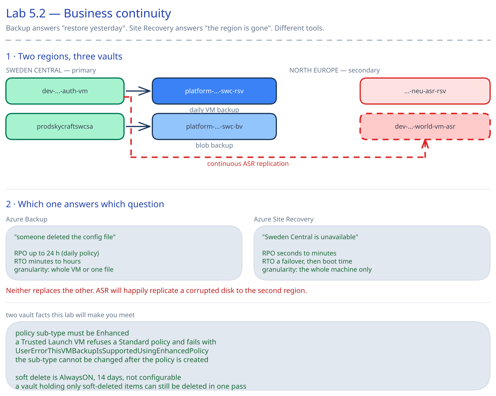

# Lab 5.2: Business Continuity & Disaster Recovery (2.5 hours)

## 🎯 Learning Objectives

By completing this lab, you will:

- Deploy an **Azure Recovery Services Vault (RSV)**
- Configure **Backup Policies** for different SLA requirements
- Implement **Azure VM Backup** for production workloads
- Perform a **File-Level Recovery (FLR)** from a backup snapshot
- Understand the difference between **LRS** and **GRS** for backup data
- Understand **Soft Delete** for protected items (and why Azure now enforces it)
- Route backup alerts to an action group with an **alert processing rule**

---

## 🏗️ Architecture Overview

[Description]: Recovery Services Vault stores VM snapshots. Backup Vault stores Blob/Disk backups. Site Recovery replicates the VM to a secondary region (Norway East).

<picture>
  <source media="(prefers-color-scheme: dark)" srcset="images/lab-5.2-architecture.dark.svg">
  <source media="(prefers-color-scheme: light)" srcset="images/lab-5.2-architecture.svg">
  
</picture>

---

## 📋 Real-World Scenario

**Situation**: A catastrophic failure hits the primary region. Not only are VMs down, but data corruption has spread. Malfurion needs a comprehensive strategy: VM restoration for standard failures, Blob backup for game assets, and a "red button" full-region failover for disaster scenarios.

**Your Task**: Implement a multi-layered BCDR strategy:

1. **Azure Backup**: Protect VMs using RSV.
2. **Backup Vault**: Protect Blob Storage operational data.
3. **Site Recovery**: Enable replication to Norway East for the production server.

---

## ⏱️ Estimated Time: 2.5 hours

- **Section 1**: Backup & Recovery Concepts (15 min)
- **Section 2**: Recovery Services Vault & VM Backup (30 min)
- **Section 3**: Backup Vault & Blob Backup (30 min)
- **Section 4**: Azure Site Recovery & Cross-Region (45 min)
- **Section 5**: Reports & Alerts (15 min)
- **Section 6**: Recovery Simulation (15 min)

---

## ✅ Prerequisites

Before starting this lab:

- [ ] Completed **Lab 5.1: Azure Monitor** (`platform-skycraft-swc-law` and the action group `skycraft-ops-ag` must exist - both vaults send their diagnostics to the workspace, Step 5.2.9 routes the backup alerts to the action group, and `Deploy-Bicep.ps1` stops if either is missing)
- [ ] Completed **Lab 3.2: Virtual Machines** (`dev-skycraft-swc-auth-vm` and `dev-skycraft-swc-world-vm` in `dev-skycraft-swc-rg` are the VMs the lab protects, and `dev-skycraft-swc-kv` is the key vault of the auth VM's Azure Disk Encryption; without them the deployment script skips VM backup and the Key Vault role with a warning)
- [ ] **Owner** or **User Access Administrator** on `dev-skycraft-swc-kv` (Step 5.2.3 grants the *Backup Management Service* app a role there)
- [ ] Completed **Lab 4.1: Storage Accounts** with the production account (`prodskycraftswcsa` in `prod-skycraft-swc-rg` is the blob backup datasource - run 4.1 with `-All`, the dev-only cycle does not create it)
- [ ] Resource group `platform-skycraft-swc-rg` exists (Lab 1.2)
- [ ] **Section 4 only** (portal, not automated): quota for 2 vCPUs in **Norway East** for the Site Recovery test failover

The Lab 5.1, Lab 3.2, Lab 4.1 and resource group items are what the scripts check: `scripts/Deploy-Bicep.ps1` stops on a missing resource group, workspace or action group, and only warns about a missing key vault (step [2/7]) or VM (step [7/7]); `scripts/New-LabBlobBackup.ps1` stops on a missing Backup vault or storage account. The shortest chain that also satisfies the gates of the labs it runs is 1.2 → 2.1 → 2.3 → 3.2 (dev, needs `~/.ssh/skycraft-dev.pub`) → 4.1 `-All` → 5.1 → 5.2 (see `tools/lab-cycle-manifest.psd1`).

Both scripts also need PowerShell 7 with Az.Accounts, Az.Resources, Az.RecoveryServices, Az.DataProtection, Az.Compute, Az.OperationalInsights and Az.Storage, a signed-in `Connect-AzAccount` context, permission to register the `Microsoft.RecoveryServices` and `Microsoft.DataProtection` resource providers (`Deploy-Bicep.ps1` registers them if needed), and **Owner** or **User Access Administrator** on `prodskycraftswcsa` (`New-LabBlobBackup.ps1` assigns the Backup Vault identity two roles there). `Deploy-Bicep.ps1` and `Test-Lab.ps1` find the *Backup Management Service* app with `Get-AzADServicePrincipal`, which needs a Microsoft Graph token in your Az sign-in: if they report `MicrosoftGraphEndpointResourceId`, see [TROUBLESHOOTING.md](../../TROUBLESHOOTING.md). The guide's own blocks for Steps 5.2.3 and 5.2.9 also use Az.KeyVault and Az.AlertsManagement, both part of the Az module.

---

## 📖 Section 1: Backup & Recovery Concepts (15 min)

### What is Azure Backup?

**Azure Backup** is a cost-effective, secure, one-click backup solution that's scalable based on your backup storage needs. It protects diverse workloads like VMs, SQL databases, SAP HANA, and Azure Files.

### Recovery Services Vault (RSV)

An **RSV** is a storage entity in Azure that houses data. The data is typically copies of data, or configuration information for virtual machines, workloads, servers, or workstations.

### Backup Redundancy

Just like storage accounts, vaults support redundancy:

- **LRS (Locally Redundant)**: Protects against rack and drive failures.
- **GRS (Geo Redundant)**: Protects against regional outages.
- **CRR (Cross Region Restore)**: Allows you to restore data in the secondary region even if the primary region is up.

---

## 📖 Section 2: Recovery Services Vault & VM Backup (30 min)

### Step 5.2.1: Create the Vault

1. Navigate to **Azure Portal** → Search for **Recovery Services vaults**.
2. Click **+ Create**.
3. On the **Basics** tab:

   | Field          | Value                                                      |
   | :------------- | :--------------------------------------------------------- |
   | Subscription   | [Your Subscription]                                        |
   | Resource Group | `platform-skycraft-swc-rg`                                 |
   | Vault Name     | `platform-skycraft-swc-rsv`                                |
   | Region         | **Sweden Central** (the form defaults to East US, which Lab 1.3's `Restrict-Azure-Regions` denies) |

4. On the **Redundancy** tab, set **Backup Storage Redundancy** to **Locally-redundant**; the form defaults to Geo-redundant. Cross Region Restore stays off.

   > [!WARNING]
   > The redundancy locks once the first backup is stored. Changing it later means stopping protection, deleting the backup data and starting over.

5. On the **Vault properties** tab, keep the soft delete retention period at 14 days (the shortest; 14-180 days are allowed).

   > [!WARNING]
   > Soft delete on a new Recovery Services vault is **AlwaysON**: Azure Backup "secure by default" turns it on and nothing can turn it off. Only the retention period is yours to choose, and only here.

6. On the **Tags** tab: `Project` = `SkyCraft`, `Environment` = `Platform`, `CostCenter` = `MSDN`, `Owner` = your name. Lab 1.3's `Enforce-Project-Tag` denies the vault without `Project`.
7. Click **Review + Create** → **Create**.

#### Azure PowerShell

```powershell
$tags = @{ Project = 'SkyCraft'; Environment = 'Platform'; CostCenter = 'MSDN'; Owner = '<your name>' }
$rsv = New-AzRecoveryServicesVault -Name platform-skycraft-swc-rsv -ResourceGroupName platform-skycraft-swc-rg -Location swedencentral -Tag $tags
# Before the first backup: the redundancy locks once one is stored
Set-AzRecoveryServicesBackupProperty -Vault $rsv -BackupStorageRedundancy LocallyRedundant
```

To read the settings afterwards, open the vault and, under **Settings** (expand it if it is collapsed), click **Properties**: **Backup Configuration** shows the redundancy and **Security Settings** shows soft delete.

**Preview - the AVM module call the Bicep path makes** (`bicep/main.bicep`; versions pinned in `docs/bicep-standards.md` §4.4):

```bicep
module modRecoveryServicesVault 'br/public:avm/res/recovery-services/vault:0.13.0' = {
  name: 'bcdr-rsv-deployment'
  scope: resourceGroup('platform-skycraft-swc-rg')
  params: {
    name: 'platform-skycraft-swc-rsv'
    publicNetworkAccess: 'Enabled'                             // module default: Disabled
    // softDeleteSettings deliberately not set - Azure enforces AlwaysON soft delete
    redundancySettings: { standardTierStorageRedundancy: 'LocallyRedundant' }
    diagnosticSettings: [ { name: 'rsv-backup-reports-diag', workspaceResourceId: parWorkspaceId, ... } ]
    ...
  }
}
```

The Backup Vault uses `avm/res/data-protection/backup-vault:0.13.2` the same way; its diagnostic setting is the one resource without an AVM parameter and lives in `bicep/modules/backup-vault-diagnostics.bicep`. Backup policies stay in the scripts (`docs/bicep-standards.md` §10.4): `Deploy-Bicep.ps1` creates the VM policy, `New-LabBlobBackup.ps1` the blob policy.

**Expected Result**: Vault `platform-skycraft-swc-rsv` is deployed in Sweden Central with the four tags; **Properties** → **Backup Configuration** shows **Locally-redundant**.

---

### Step 5.2.2: Create a Production Policy

Azure Backup keeps a VM's instant-restore snapshots in a resource group of their own, outside the VM's group. Left to itself, it creates `AzureBackupRG_swedencentral_1` **without tags**, and Lab 1.3's `Require-Environment-Tag-RG` assignment denies that group, so every backup fails. Create the group yourself, with the SkyCraft tags, and name it in the policy.

Inside that group Azure Backup then creates a restore point collection per VM, `AzureBackup_<vm>_<n>`, with no tags of its own. Lab 1.3's `Inherit-Project-Tag` assignment copies `Project` to it from the group, so `Enforce-Project-Tag` accepts it. Nothing else in this lab makes Azure create a resource group: the vaults, the alert processing rule and the role assignment go where you put them.

1. Search for **Resource groups** → **+ Create**, and create the snapshot group:

   | Field          | Value                                                                                          |
   | :------------- | :--------------------------------------------------------------------------------------------- |
   | Resource group | `platform-skycraft-swc-rpc1-rg`                                                                |
   | Region         | **Sweden Central**                                                                             |
   | Tags           | `Project` = `SkyCraft`, `Environment` = `Platform`, `CostCenter` = `MSDN`, `Owner` = your name |

   The **Tags** tab knows Lab 1.3's policies: *Click here to set required tags* fills in the names they require.

   Do **not** lock this group. Azure Backup deletes expired snapshots from it, and a lock makes backups fail with `UserErrorRpCollectionLimitReached`. This is also why the snapshots do not go into `platform-skycraft-swc-rg`, which Lab 1.3 locks.

2. Open the vault and, under **Manage** (expand it if it is collapsed), click **Backup policies**.
3. Click **+ Add** → **Azure Virtual Machine**.
4. Policy Name: `SkyCraft-Daily-Prod`.
5. Policy sub-type: **Enhanced**. Azure defaults VM deployments to Trusted Launch, and a
   Standard policy cannot protect a Trusted Launch VM — it fails with
   `UserErrorThisVMBackupIsSupportedUsingEnhancedPolicy`. The sub-type cannot be changed
   after a VM is protected, so pick it now.
6. Frequency: **Daily** at **02:00 AM** (the form defaults to Hourly, every 4 hours).
7. Timezone: **(UTC) Coordinated Universal Time**.
8. Instant Restore retention: **2 days** (Enhanced defaults to 7 — snapshots are billed).
9. Retention of daily backup point: **30 days** (the default is 180).
10. At the bottom of the form, under **Azure Backup Resource Group (Optional)**, fill in the name `platform-skycraft-swc-rpc`, suffix `-rg`. Azure Backup inserts a number between the two, starting at 1, so the snapshots land in `platform-skycraft-swc-rpc1-rg`, the group from step 1.
11. Click **Create**.

The Bicep path does the same: `bicep/main.bicep` creates the tagged group through `avm/res/resources/resource-group`, and `Deploy-Bicep.ps1` passes `-BackupSnapshotResourceGroup 'platform-skycraft-swc-rpc'` and `-BackupSnapshotResourceGroupSuffix '-rg'` to `New-AzRecoveryServicesBackupProtectionPolicy`. On a policy that already exists, it sets them with `Set-AzRecoveryServicesBackupProtectionPolicy`.

**Expected Result**: `SkyCraft-Daily-Prod` is listed under **Backup policies** (Enhanced, daily at 02:00 UTC, 30 days, instant restore 2 days), and `platform-skycraft-swc-rpc1-rg` exists with its four tags and no lock.

---

### Step 5.2.3: Protect the Development VMs

Two VMs from Lab 3.2 get backed up here. `dev-skycraft-swc-auth-vm` is encrypted with Azure Disk Encryption (ADE), and its keys sit in `dev-skycraft-swc-kv`. `dev-skycraft-swc-world-vm` is not encrypted, and Step 5.2.10 restores files from it, because file recovery does not work on an ADE-encrypted VM.

**a. Let Azure Backup read the key vault**

Azure Backup reads an encrypted VM's keys as the Microsoft Entra app **Backup Management Service**, not as the vault's own identity. `dev-skycraft-swc-kv` uses the Azure RBAC permission model, so the app needs the **Key Vault Administrator** role there. Without it, *Enable backup* for the auth VM fails with `400198 UserErrorKeyVaultPermissionsNotConfigured`.

1. Search for **Key vaults** → `dev-skycraft-swc-kv` (resource group `dev-skycraft-swc-rg`) → **Access control (IAM)** → **+ Add** → **Add role assignment**.
2. **Key Vault Administrator** → **Next** → Assign access to: **User, group, or service principal** → **+ Select members** → search `Backup Management Service` → select it → **Select**.
3. **Review + assign** → **Review + assign**.
4. Wait about two minutes before *Enable backup*: the role took that long to take effect in a live run.

#### Azure CLI: the role

```azurecli
KV=$(az keyvault show -g dev-skycraft-swc-rg -n dev-skycraft-swc-kv --query id -o tsv)
# 262044b1-... is the application ID of Backup Management Service, the same in every tenant
az role assignment create --assignee 262044b1-e2ce-469f-a196-69ab7ada62d3 --role "Key Vault Administrator" --scope "$KV"
```

#### Azure PowerShell: the role

```powershell
$kv = Get-AzKeyVault -ResourceGroupName dev-skycraft-swc-rg -VaultName dev-skycraft-swc-kv
$sp = Get-AzADServicePrincipal -ApplicationId 262044b1-e2ce-469f-a196-69ab7ada62d3   # Backup Management Service
New-AzRoleAssignment -ObjectId $sp.Id -RoleDefinitionName 'Key Vault Administrator' -Scope $kv.ResourceId
```

`Get-AzADServicePrincipal` and `New-AzRoleAssignment` look the app up in Microsoft Graph. If either fails with `MicrosoftGraphEndpointResourceId`, see [TROUBLESHOOTING.md](../../TROUBLESHOOTING.md) for the sign-in that gives Az a Graph token.

The Bicep path grants the same role: `bicep/main.bicep` calls `avm/ptn/authorization/resource-role-assignment` on `dev-skycraft-swc-kv`, and `Deploy-Bicep.ps1` passes the app's object ID, or nothing when the app holds the role already (a second grant fails with `RoleAssignmentExists`).

**b. Enable backup**

1. In the vault, click **Overview** → **+ Backup**. The **Backup Goal** pane opens.
2. Where is your workload running? **Azure**.
3. What do you want to back up? **Virtual machine**.
4. Click **Backup**.
5. Backup policy: select `SkyCraft-Daily-Prod` (the form preselects a default Enhanced policy).
6. Under **Virtual machines**, click **Add**, check `dev-skycraft-swc-auth-vm` and `dev-skycraft-swc-world-vm`, and click **OK**.
7. Click **Enable backup**.

**c. Take the first backup and watch the snapshot**

1. Run the first backup now instead of waiting for 02:00: under **Protected items** (expand it if it is collapsed), click **Backup items** → **Azure Virtual Machine** → `dev-skycraft-swc-auth-vm` → **Backup now** → **OK**. Do the same for `dev-skycraft-swc-world-vm`.
2. Under **Monitoring**, click **Backup jobs**, and open the job of each VM. Its *Take Snapshot* sub-task is the part to watch: once it is *Completed*, the VM has a recovery point, which is what Step 5.2.10 needs. It took about 8.5 minutes in a live run. The job itself stays *In progress* until the transfer to the vault ends, which takes far longer.
3. A job that turns *Failed* within seconds with `UserErrorRequestDisallowedByPolicy` means a policy refused the snapshot group or the restore point collection: see Troubleshooting, Issue 2. `400198 UserErrorKeyVaultPermissionsNotConfigured` on the auth VM means part a is missing or not active yet: Issue 4.

#### Azure PowerShell: protect and back up

```powershell
$vault  = Get-AzRecoveryServicesVault -ResourceGroupName platform-skycraft-swc-rg -Name platform-skycraft-swc-rsv
$policy = Get-AzRecoveryServicesBackupProtectionPolicy -VaultId $vault.ID -Name SkyCraft-Daily-Prod
foreach ($vm in 'dev-skycraft-swc-auth-vm', 'dev-skycraft-swc-world-vm') {
    Enable-AzRecoveryServicesBackupProtection -VaultId $vault.ID -Policy $policy -ResourceGroupName dev-skycraft-swc-rg -Name $vm
    $item = Get-AzRecoveryServicesBackupItem -VaultId $vault.ID -BackupManagementType AzureVM -WorkloadType AzureVM |
        Where-Object Name -like "*$vm"
    $job = Backup-AzRecoveryServicesBackupItem -VaultId $vault.ID -Item $item -ExpiryDateTimeUTC (Get-Date).ToUniversalTime().AddDays(30)
    # Watch Take Snapshot: Completed means a recovery point exists
    do {
        Start-Sleep -Seconds 30
        $detail = Get-AzRecoveryServicesBackupJobDetail -VaultId $vault.ID -JobId $job.JobId
        $snapshot = ($detail.SubTasks | Where-Object Name -eq 'Take Snapshot').Status
        "$vm - job: $($detail.Status), Take Snapshot: $snapshot"
    } until ($snapshot -in 'Completed', 'Failed' -or $detail.Status -eq 'Failed')
}
```

`Deploy-Bicep.ps1` protects both VMs itself, starts a backup for each one that has no recovery point yet, and watches its **Take Snapshot** phase until it completes or fails (up to 20 minutes); a failure, or a phase it did not see finish, fails the run. `Test-Lab.ps1` fails if the latest backup job of either VM failed.

> [!TIP]
> The first backup is an **Initial Replica** (full backup). Subsequent backups are **Incrementals** (only changed blocks), making them faster and cheaper.

**Expected Result**: Both VMs are listed under **Backup items** with policy `SkyCraft-Daily-Prod`, and each one's first job shows **Take Snapshot** **Completed**.

---

## 📖 Section 3: Backup Vault & Blob Backup (30 min)

### Step 5.2.4: Deploy Backup Vault

**Backup Vaults** are newer entities used for Azure Blobs, Azure Disks, and PostgreSQL. They are distinct from Recovery Services Vaults.

Create this vault with Az PowerShell, not with the Portal's **+ Create**. The Portal creates a Backup vault with soft delete **AlwaysOn** ("secure by default", in preview for Backup vaults in Sweden Central), and `Test-Lab.ps1` expects **Off**, the lab's setting that lets the cleanup delete the vault in one pass.

> [!WARNING]
> **AlwaysOn cannot be undone.** Once a vault's soft delete is AlwaysOn, `Update-AzDataProtectionBackupVault -SoftDeleteState Off` fails with `UserErrorDisableSoftDeleteNotAllowed`, and the only way back is to delete the vault and create it again (Troubleshooting, Issue 3). Do not open the Portal's **+ Create** for this vault.

#### Azure PowerShell

```powershell
$storage = New-AzDataProtectionBackupVaultStorageSettingObject -DataStoreType VaultStore -Type LocallyRedundant
# Az.DataProtection 2.x: use -IdentityType SystemAssigned instead of -EnableSystemAssignedIdentity
New-AzDataProtectionBackupVault -ResourceGroupName platform-skycraft-swc-rg -VaultName platform-skycraft-swc-bv `
  -Location swedencentral -StorageSetting $storage -EnableSystemAssignedIdentity -SoftDeleteState Off `
  -Tag @{ Project = 'SkyCraft'; Environment = 'Platform'; CostCenter = 'MSDN'; Owner = '<your name>' }
```

The Bicep path creates the same vault: `avm/res/data-protection/backup-vault` with `softDeleteSettings: { state: 'Off' }` (`bicep/main.bicep`).

Then look at it in the Portal: search for **Backup vaults** → `platform-skycraft-swc-bv` → under **Settings** (expand it if it is collapsed), click **Properties**. **Soft delete** reads **Disabled** (Off). On a vault created in the Portal it reads enabled with a 14-day retention: deleted backup data is kept for 14 to 180 days and can be undeleted in that time, which is what production wants. Microsoft Learn says the option to turn it off may go once secure by default reaches general availability in the region; `Test-Lab.ps1` will then accept On and AlwaysOn (#376).

**Expected Result**: `platform-skycraft-swc-bv` exists in Sweden Central with locally-redundant storage, a system-assigned identity, soft delete **Off** and the four tags.

### Step 5.2.5: Configure Blob Backup

Create the blob backup **policy**, then grant the vault identity access and protect the storage account.

**a. Create the blob backup policy**

A blob backup policy has two tiers. **Operational backup** keeps the data in the storage account itself (point-in-time restore over blob versions, soft delete and change feed) and has no Azure Backup charge. **Vaulted backup** copies the data into the Backup vault on a schedule and is billed: a protected instance fee of about 13 USD a month for the account (Azure Blob Protected Instance, Sweden Central, Azure retail price list read 2026-10-28), plus vault storage per GB and write operations per 10,000. The lab uses operational backup only.

First look at the Portal's form, without creating anything:

1. Open `platform-skycraft-swc-bv` → **Manage** → **Backup policies** (expand the group if it is collapsed).
2. Click **+ Add**.
3. Datasource type: **Azure Blobs (Azure Storage)** → **Next**.
4. On the schedule and retention tab, *Operational backup* (30 days) is ticked, and so is *Vaulted backup* (daily, 90 days in Vault-standard), greyed out: a new policy made in the Portal cannot drop the vaulted tier.
5. Click **Cancel**. Do not create the policy here.

Create the policy with the lab's script instead. It sets every rule itself: one retention rule, 30 days in the OperationalStore, and no vaulted rule. It does not take the defaults of `Get-AzDataProtectionPolicyTemplate`, which now ship a vaulted weekly rule with 7 days in the VaultStore.

```powershell
.\scripts\New-LabBlobBackup.ps1 -PolicyOnly
```

The heart of what it sends (`scripts/New-LabBlobBackup.ps1`):

```powershell
$blobPolicy = Get-AzDataProtectionPolicyTemplate -DatasourceType AzureBlob      # object types only
$rule = @($blobPolicy.PolicyRule | Where-Object ObjectType -eq 'AzureRetentionRule')[0]
$rule.Name = 'Default'; $rule.IsDefault = $true
$rule.Lifecycle = @(New-AzDataProtectionRetentionLifeCycleClientObject -SourceDataStore OperationalStore `
    -SourceRetentionDurationType Days -SourceRetentionDurationCount 30)
$blobPolicy.PolicyRule = @($rule)                                              # no AzureBackupRule: nothing vaulted
New-AzDataProtectionBackupPolicy -ResourceGroupName platform-skycraft-swc-rg -VaultName platform-skycraft-swc-bv `
    -Name SkyCraft-Blob-Policy -Policy $blobPolicy
```

> [!WARNING]
> A backup policy cannot be changed after it is created (`UserErrorBMSUpdatePolicyNotSupported`), and Lab 1.3's lock on `platform-skycraft-swc-rg` blocks deleting one. A `SkyCraft-Blob-Policy` created in the Portal by mistake keeps its billed vaulted rule until you delete it: see Troubleshooting, Issue 5.

**b. Grant the Backup Vault identity access to the storage account**

The Backup Vault uses its **system-assigned managed identity** to read and protect blob data. Assign these two roles to that identity, scoped to `prodskycraftswcsa`:

| Role                                   | Why                                                                       |
| :------------------------------------- | :------------------------------------------------------------------------ |
| **Storage Account Backup Contributor** | Lets the vault configure and manage operational backup on the account.    |
| **Storage Blob Data Owner**            | Lets the vault access blob data for protection.                           |

Assign one role at a time. The wizard's **Review + assign** button first opens its review tab; select it there again to assign the role.

1. Navigate to `prodskycraftswcsa` (resource group `prod-skycraft-swc-rg`) → **Access control (IAM)** → **+ Add** → **Add role assignment**.
2. **Storage Account Backup Contributor** → **Next** → Assign access to: **Managed identity** → **+ Select members** → choose the Backup vault type in the pane's managed identity list → `platform-skycraft-swc-bv` → **Select** → **Review + assign** → **Review + assign**.
3. **+ Add** → **Add role assignment** → **Storage Blob Data Owner** → **Next** → Assign access to: **Managed identity** → **+ Select members** → choose the Backup vault type in the pane's managed identity list → `platform-skycraft-swc-bv` → **Select** → **Review + assign** → **Review + assign**.

> [!NOTE]
> Allow ~5 minutes for the role assignments to propagate before the next step, or it may fail with `UserErrorMissingRequiredPermissions`.

**c. Configure backup (create the backup instance)**

1. Open `platform-skycraft-swc-bv` → **+ Backup**.
2. Datasource type: **Azure Blobs (Azure Storage)**.
3. Backup policy: `SkyCraft-Blob-Policy`.
4. Select the storage account: `prodskycraftswcsa`.
5. **Review + configure** to create the **backup instance** that protects the account.

> [!TIP]
> Run without `-PolicyOnly`, `New-LabBlobBackup.ps1` also performs steps **b** and **c** (role assignments + backup instance); the portal flow above is the manual equivalent. It is also the Bicep path's next step after `Deploy-Bicep.ps1`.

**Expected Result**: `SkyCraft-Blob-Policy` is listed under **Backup policies** with operational backup only (30 days), and `prodskycraftswcsa` is listed as a backup instance of `platform-skycraft-swc-bv`.

---

## 📖 Section 4: Azure Site Recovery & Cross-Region (45 min)

### Step 5.2.6: Enable Replication

1. Navigate to your VM: `dev-skycraft-swc-auth-vm`.
2. Access **Disaster recovery** in the left menu.
3. Target region: **Norway East** (or another available European region).
4. Click **Advanced settings** to review resources (ASR creates a cache storage account and target resources).
5. Click **Review + Start replication**.

> [!NOTE]
> Initial synchronization can take 15-30 minutes depending on disk size.

### Step 5.2.7: Perform Test Failover

1. Once status is **Protected**, click **Test Failover**.
2. Recovery Point: **Latest processed**.
3. Azure Virtual Network: Select the created ASR VNet in the target region.
4. Click **Test Failover**.
5. Once complete, verify the new VM exists in the target region.
6. Click **Cleanup test failover** to remove temporary resources.

---

## 📖 Section 5: Reports & Alerts (15 min)

### Step 5.2.8: Configure Backup Reports

Backup reports are built from **diagnostic settings** on the vaults: each vault streams its backup logs to a Log Analytics workspace, and **Resiliency** (formerly Backup center, then Azure Business Continuity Center) renders the workbooks from that data. Create one diagnostic setting per vault, with the names below - `scripts/Test-Lab.ps1` looks them up by name.

> [!NOTE]
> If `Deploy-Bicep.ps1` has already run, both settings exist: open them with **Edit setting** instead of adding new ones. Azure refuses a second setting that sends an overlapping category to the same workspace. A `rsv-backup-reports-diag` left by an older version of this lab still carries the legacy `AzureBackupReport` category - uncheck it and check the two missing ones; re-running `Deploy-Bicep.ps1` replaces the category list the same way.

**a. Recovery Services Vault → `rsv-backup-reports-diag`**

1. Open `platform-skycraft-swc-rsv` and, under **Monitoring** (expand it if it is collapsed), click **Diagnostic settings** → **+ Add diagnostic setting**.
2. Diagnostic setting name: `rsv-backup-reports-diag`
3. Under **Logs**:
   - Check **Core Azure Backup Data** (`CoreAzureBackup`)
   - Check **Addon Azure Backup Job Data** (`AddonAzureBackupJobs`)
   - Check **Addon Azure Backup Policy Data** (`AddonAzureBackupPolicy`)
   - Check **Addon Azure Backup Storage Data** (`AddonAzureBackupStorage`)
   - Check **Addon Azure Backup Protected Instance Data** (`AddonAzureBackupProtectedInstance`)
   - Check **Azure Backup Operations** (`AzureBackupOperations`)
   - Leave **Azure Backup Reporting Data** (`AzureBackupReport`) unchecked

   Backup reports needs the six checked categories. Azure Backup Reporting Data is the legacy event: it flows only in **Azure diagnostics** mode, and with **Resource specific** selected it sends no data. The info box above the categories lists the resource-specific tables the setting fills, `AddonAzureBackupAlerts` among them; there is nothing to check for it.
4. Check **Send to Log Analytics workspace**.
5. Log Analytics workspace: `platform-skycraft-swc-law`.
6. Destination table: select **Resource specific**.
7. Click **Save**.

**b. Backup Vault → `bv-backup-reports-diag`**

1. Open `platform-skycraft-swc-bv` and, under **Monitoring + reporting** (expand it if it is collapsed), click **Diagnostic settings** → **+ Add diagnostic setting**.
2. Diagnostic setting name: `bv-backup-reports-diag`
3. Under **Logs**, check **Core Azure Backup Data**, **Addon Azure Backup Job Data**, **Addon Azure Backup Policy Data** and **Addon Azure Backup Protected Instance Data** - a Backup Vault has no legacy `AzureBackupReport` event, and no `AddonAzureBackupStorage` because its storage data is already in Core and Protected Instance. Leave the **Health** metric (under **Metrics**) unchecked - Backup reports does not use it, and the Bicep path does not enable it.
4. Check **Send to Log Analytics workspace**.
5. Log Analytics workspace: `platform-skycraft-swc-law`.

   There is no **Destination table** option here: Backup Vault logs always land in resource-specific tables.
6. Click **Save**.

#### Azure CLI

```azurecli
LAW=$(az monitor log-analytics workspace show -g platform-skycraft-swc-rg -n platform-skycraft-swc-law --query id -o tsv)
RSV=$(az backup vault show -g platform-skycraft-swc-rg -n platform-skycraft-swc-rsv --query id -o tsv)
BV=$(az dataprotection backup-vault show -g platform-skycraft-swc-rg -v platform-skycraft-swc-bv --query id -o tsv)

az monitor diagnostic-settings create --name rsv-backup-reports-diag --resource "$RSV" \
  --workspace "$LAW" --export-to-resource-specific true \
  --logs '[{"category":"CoreAzureBackup","enabled":true},{"category":"AddonAzureBackupJobs","enabled":true},{"category":"AddonAzureBackupPolicy","enabled":true},{"category":"AddonAzureBackupStorage","enabled":true},{"category":"AddonAzureBackupProtectedInstance","enabled":true},{"category":"AzureBackupOperations","enabled":true}]'

az monitor diagnostic-settings create --name bv-backup-reports-diag --resource "$BV" \
  --workspace "$LAW" --export-to-resource-specific true \
  --logs '[{"category":"CoreAzureBackup","enabled":true},{"category":"AddonAzureBackupJobs","enabled":true},{"category":"AddonAzureBackupPolicy","enabled":true},{"category":"AddonAzureBackupProtectedInstance","enabled":true}]'
```

#### Azure PowerShell

```powershell
$law = Get-AzOperationalInsightsWorkspace -ResourceGroupName platform-skycraft-swc-rg -Name platform-skycraft-swc-law
$rsv = Get-AzRecoveryServicesVault -ResourceGroupName platform-skycraft-swc-rg -Name platform-skycraft-swc-rsv
$bv  = Get-AzDataProtectionBackupVault -ResourceGroupName platform-skycraft-swc-rg -VaultName platform-skycraft-swc-bv

$core = 'CoreAzureBackup', 'AddonAzureBackupJobs', 'AddonAzureBackupPolicy', 'AddonAzureBackupProtectedInstance'
$rsvLogs = ($core + 'AddonAzureBackupStorage', 'AzureBackupOperations') | ForEach-Object { New-AzDiagnosticSettingLogSettingsObject -Category $_ -Enabled $true }
$bvLogs  = $core | ForEach-Object { New-AzDiagnosticSettingLogSettingsObject -Category $_ -Enabled $true }

New-AzDiagnosticSetting -Name rsv-backup-reports-diag -ResourceId $rsv.ID -WorkspaceId $law.ResourceId -LogAnalyticsDestinationType Dedicated -Log $rsvLogs
New-AzDiagnosticSetting -Name bv-backup-reports-diag  -ResourceId $bv.Id  -WorkspaceId $law.ResourceId -LogAnalyticsDestinationType Dedicated -Log $bvLogs
```

**c. Read the reports**

1. Search for **Resiliency** and, under **Backup and recovery**, click **Reports**.
2. Select `platform-skycraft-swc-law` as the workspace.
3. View the **Backup Instances** report to see protection status across both vaults. Data appears up to 24 hours after the settings are created.

**Expected Result**: Each vault lists one diagnostic setting targeting `platform-skycraft-swc-law`; `Test-Lab.ps1` reports both `[Diagnostic Settings]` checks as PASS.

### Step 5.2.9: Review Alerts

Azure Backup raises built-in Azure Monitor alerts on the vault. No alert rule of yours fires them, so there is no rule to attach an action group to: an **alert processing rule** adds the action group to the alerts that match it.

**a. Review the alerts**

1. Search for **Resiliency** and, under **Backup and recovery**, click **Alerts**.
2. Verify if any Critical or Warning alerts exist. After `Deploy-Bicep.ps1` expect one built-in alert on `platform-skycraft-swc-rsv` (a policy you created in the Portal with 2 days from the start raises none):
   - **Modify policy with shorter retention** (0 - Critical) - raised because `Deploy-Bicep.ps1` shortens instant-restore retention to 2 days after creating the Enhanced policy. Expected; it is a security alert about the change, not a failure.

   A **Backup Failure** (1 - Error) alert is **not** expected. It means a VM has no recovery point; open the failed job under **Backup jobs** and see Troubleshooting, Issues 2 and 4.

**b. E-mail the Critical alerts with an alert processing rule**

1. On the **Alerts** page, click **Manage alerts** → **Manage alert processing rules** → **+ Create**.
2. **Scope** tab: **+ Select scope** → `platform-skycraft-swc-rsv` → **Apply**. Under **Filter**, add **Severity** **Equals** **Sev0** (Critical).
3. **Rule settings** tab: set **Rule type** to **Apply action group**. The form defaults to *Suppress notifications*, which would silence these alerts instead. Then **+ Select action group** → `skycraft-ops-ag` (Lab 5.1) → **Select**.
4. **Scheduling** tab: **Always**.
5. **Details** tab: resource group `platform-skycraft-swc-rg`, rule name `skycraft-backup-critical-apr`, description `Send Critical alerts of platform-skycraft-swc-rsv to skycraft-ops-ag`, **Enable rule upon creation**: checked. The rule has no region; like the action group it is global.
6. **Tags** tab: `Project` = `SkyCraft`, `Environment` = `Platform`, `CostCenter` = `MSDN`, `Owner` = your name.
7. **Review + create** → **Create**.

`skycraft-ops-ag` e-mails the address you gave it in Lab 5.1 (Step 5.1.5); for a test address use one at `example.com`, a domain reserved for documentation.

#### Azure CLI

```azurecli
RSV=$(az backup vault show -g platform-skycraft-swc-rg -n platform-skycraft-swc-rsv --query id -o tsv)
AG=$(az monitor action-group show -g platform-skycraft-swc-rg -n skycraft-ops-ag --query id -o tsv)
az monitor alert-processing-rule create --name skycraft-backup-critical-apr --resource-group platform-skycraft-swc-rg \
  --scopes "$RSV" --rule-type AddActionGroups --action-groups "$AG" --filter-severity Equals Sev0 \
  --description "Send Critical alerts of platform-skycraft-swc-rsv to skycraft-ops-ag" \
  --tags Project=SkyCraft Environment=Platform CostCenter=MSDN Owner="<your name>"
```

#### Azure PowerShell

```powershell
$rsv = Get-AzRecoveryServicesVault -ResourceGroupName platform-skycraft-swc-rg -Name platform-skycraft-swc-rsv
$ag  = Get-AzActionGroup -ResourceGroupName platform-skycraft-swc-rg -Name skycraft-ops-ag
# Az.AlertsManagement; -Enabled and -FilterSeverity take strings
Set-AzAlertProcessingRule -ResourceGroupName platform-skycraft-swc-rg -Name skycraft-backup-critical-apr `
  -Scope $rsv.ID -AlertProcessingRuleType AddActionGroups -ActionGroupId $ag.Id -FilterSeverity 'Equals:Sev0' `
  -Enabled 'True' -Description 'Send Critical alerts of platform-skycraft-swc-rsv to skycraft-ops-ag' `
  -Tag @{ Project = 'SkyCraft'; Environment = 'Platform'; CostCenter = 'MSDN'; Owner = '<your name>' }
```

**Preview - the Bicep path** (`bicep/main.bicep`):

```bicep
module modAlertProcessingRule 'br/public:avm/res/alerts-management/action-rule:0.2.4' = {
  name: 'bcdr-apr-deployment'
  scope: resourceGroup('platform-skycraft-swc-rg')
  params: {
    name: 'skycraft-backup-critical-apr'
    scopes: [ modRecoveryServicesVault.outputs.resourceId ]
    conditions: [ { field: 'Severity', operator: 'Equals', values: [ 'Sev0' ] } ]
    actions: [ { actionType: 'AddActionGroups', actionGroupIds: [ varActionGroupId ] } ]  // skycraft-ops-ag
    ...
  }
}
```

**Expected Result**: `skycraft-backup-critical-apr` is listed under **Manage alert processing rules**, enabled, with **Rule type** **Apply action group** (`skycraft-ops-ag`) and scope `platform-skycraft-swc-rsv`; `Test-Lab.ps1` reports the four `[Alert Processing Rule]` checks as PASS.

---

## 📖 Section 6: Recovery Simulation (15 min)

### Step 5.2.10: File-Level Recovery

Instead of restoring the whole VM, you mount one recovery point and copy single files out of it. Use `dev-skycraft-swc-world-vm`: file recovery is not available for an ADE-encrypted VM such as the auth VM. Both VMs run Ubuntu 22.04, so the recovery script is a Python script that mounts the recovery point's volumes as folders. There is no drive letter on Linux.

The steps below run commands on the VM with **Run command**, which needs no Bastion and runs as root. Run the PowerShell blocks in Azure Cloud Shell.

1. Put a file on the VM that the restore can find, then take a new backup that contains it. Open `dev-skycraft-swc-world-vm` and, under **Operations** (expand it if it is collapsed), click **Run command** → **RunShellScript**, and run:

   ```bash
   mkdir -p /opt/skycraft && echo "SkyCraft file recovery test $(date -u +%FT%TZ)" > /opt/skycraft/flr-marker.txt && cat /opt/skycraft/flr-marker.txt
   ```

   Then take **Backup now** for the world VM and wait for **Take Snapshot** to complete, as in Step 5.2.3 c.
2. In the vault, under **Protected items** (expand it if it is collapsed), click **Backup items** → **Azure Virtual Machine** → `dev-skycraft-swc-world-vm` → **File Recovery**.
3. Under **Select restore point**, select the recovery point you just took.
4. Click **Download Script**. Generating it took about 1.5 minutes in a live run. Next to the button the pane shows a 15-character password: copy it, the script asks for it. The script and its password are valid for 12 hours.
5. Copy the script to the VM. In Cloud Shell, upload it (**Manage files** → **Upload**), then send it with Run command into `/root/flr`:

   ```powershell
   $flr = Get-ChildItem ~/*.py | Sort-Object LastWriteTime | Select-Object -Last 1
   $b64 = [Convert]::ToBase64String([IO.File]::ReadAllBytes($flr.FullName))
   Invoke-AzVMRunCommand -ResourceGroupName dev-skycraft-swc-rg -VMName dev-skycraft-swc-world-vm -CommandId RunShellScript `
     -ScriptString "mkdir -p /root/flr && echo '$b64' | base64 -d > /root/flr/$($flr.Name) && chmod +x /root/flr/$($flr.Name) && ls -l /root/flr"
   ```

6. Run it from `/root/flr` with the password on its input. The script mounts the volumes under the folder it runs in:

   ```powershell
   $password = Read-Host 'Password from the File Recovery pane'
   (Invoke-AzVMRunCommand -ResourceGroupName dev-skycraft-swc-rg -VMName dev-skycraft-swc-world-vm -CommandId RunShellScript `
     -ScriptString "cd /root/flr && printf '%s\n' '$password' | python3 ./$($flr.Name)").Value[0].Message
   ```

   The output says `Connection succeeded!` and lists the recovery point's volumes with their mount paths: `/root/flr/<vm>-<time>/Volume1` (ext4, the OS disk) and `Volume3` (vfat, the EFI partition). The BIOS boot partition is listed as not mountable.
7. Find the file:

   ```powershell
   (Invoke-AzVMRunCommand -ResourceGroupName dev-skycraft-swc-rg -VMName dev-skycraft-swc-world-vm -CommandId RunShellScript `
     -ScriptString 'cat /root/flr/*/Volume1/opt/skycraft/flr-marker.txt').Value[0].Message
   ```

   To restore it, copy it back: `cp /root/flr/<vm>-<time>/Volume1/opt/skycraft/flr-marker.txt /opt/skycraft/`.
8. Close the connection: back on the File Recovery pane, click **Unmount Disks** (Step 3 of the pane). Then remove the orphaned mount folders with the script's `clean` option: `cd /root/flr && python3 ./<script>.py clean`. A recovery point left mounted can make the VM's next backup fail with `UserErrorUnableToOpenMount`.

**Expected Result**: The script's output shows `Connection succeeded!` and the mount paths under `/root/flr/<vm>-<time>/`, and `Volume1/opt/skycraft/flr-marker.txt` holds the line you wrote before the backup. After **Unmount Disks**, the pane no longer shows the recovery point as mounted.

---

## ✅ Lab Checklist

- [ ] Vault `platform-skycraft-swc-rsv` deployed in Sweden Central, locally-redundant, tagged
- [ ] Backup policy `SkyCraft-Daily-Prod` created with 30-day retention, instant-restore snapshots in the tagged `platform-skycraft-swc-rpc1-rg`
- [ ] *Backup Management Service* holds **Key Vault Administrator** on `dev-skycraft-swc-kv`
- [ ] `dev-skycraft-swc-auth-vm` and `dev-skycraft-swc-world-vm` registered for backup
- [ ] Each first backup job shows **Take Snapshot** **Completed**, and no job is **Failed**
- [ ] Backup Vault `platform-skycraft-swc-bv` with soft delete **Off**, created with Az PowerShell or the Bicep
- [ ] `SkyCraft-Blob-Policy` (operational only, 30 days, no vaulted rule) protecting `prodskycraftswcsa`
- [ ] Diagnostic settings `rsv-backup-reports-diag` and `bv-backup-reports-diag` send backup logs to `platform-skycraft-swc-law`
- [ ] Alert processing rule `skycraft-backup-critical-apr` applies `skycraft-ops-ag` to the vault's Critical alerts
- [ ] A file from the world VM's recovery point read back, and the disks unmounted
- [ ] Detailed verification performed (see checklist)

**For detailed verification**, see [lab-checklist-5.2.md](lab-checklist-5.2.md)

---

## 🔧 Troubleshooting

### Issue 1: Deployment of Vault Fails

**Symptom**: "Resource provider not registered" error.

**Solution**:

- Ensure `Microsoft.RecoveryServices` provider is registered in your subscription.
- Navigate to **Subscription** → **Resource Providers** → Register `Microsoft.RecoveryServices`.

### Issue 2: The VM backup job fails with `UserErrorRequestDisallowedByPolicy`

**Symptom**: The backup of a VM ends **Failed** within seconds with error 400211, *An invalid policy is configured on the VM which is preventing Snapshot operation*, and Resiliency raises a **Backup Failure** alert. `Deploy-Bicep.ps1` and `Test-Lab.ps1` report the failed job.

**Root Cause**: A Lab 1.3 deny refused a resource Azure Backup creates for the snapshot. The Activity Log shows it as `Microsoft.Authorization/policies/deny/action` and names the resource:

- `AzureBackupRG_swedencentral_1`, denied by `Require-Environment-Tag-RG`: the backup policy names no snapshot resource group, so Azure Backup creates its own, without tags. A policy created before this lab named the group (issue #184) behaves this way.
- `Microsoft.Compute/restorePointCollections/AzureBackup_<vm>_<n>` in `platform-skycraft-swc-rpc1-rg`, denied by `Enforce-Project-Tag`: the collection has no tags of its own and gets `Project` only from Lab 1.3's `Inherit-Project-Tag` assignment, which copies it from the group. Without that assignment, or with `Project` missing on the group, the collection is refused.

**Solution**: Give the policy a tagged snapshot group, as in Step 5.2.2:

1. Create `platform-skycraft-swc-rpc1-rg` with the SkyCraft tags (Step 5.2.2, step 1), or re-run `Deploy-Bicep.ps1`, which creates the group and updates the existing policy for you.
2. In the portal: open the vault and, under **Manage** (expand it if it is collapsed), click **Backup policies** → `SkyCraft-Daily-Prod` → **Modify**. At the bottom of the form, under **Azure Backup Resource Group**, fill in name `platform-skycraft-swc-rpc`, suffix `-rg` → **Update**.
3. Run **Backup now** again (Step 5.2.3 c, step 1).

If the Activity Log names the restore point collection, check that `platform-skycraft-swc-rpc1-rg` carries `Project` = `SkyCraft` and that Lab 1.3's `Inherit-Project-Tag` assignment exists (Lab 1.3 `Test-Lab.ps1`). A new assignment takes several minutes to apply. Do not delete Lab 1.3's assignments: Lab 1.3's `Test-Lab.ps1` checks them.

### Issue 3: The Backup vault's soft delete is AlwaysOn

**Symptom**: `Test-Lab.ps1` fails *Backup Vault soft delete is Off* with "state is AlwaysOn, which cannot be turned off", or `Update-AzDataProtectionBackupVault -SoftDeleteState Off` fails with `UserErrorDisableSoftDeleteNotAllowed: Cannot disable soft delete once set to AlwaysOn`.

**Root Cause**: The vault was created with the Portal's **+ Create**, which makes it AlwaysOn ("secure by default"). AlwaysOn is irreversible.

**Solution**:

1. Make sure the vault protects nothing yet (no backup instance; delete `prodskycraftswcsa`'s instance first if there is one).
2. Lab 1.3's lock `lock-no-delete-platform` on `platform-skycraft-swc-rg` blocks the delete. Remove it for the moment: the group's **Settings** → **Locks** → delete `lock-no-delete-platform` (it is recreated in step 5).
3. Delete the vault: `Remove-AzDataProtectionBackupVault -ResourceGroupName platform-skycraft-swc-rg -VaultName platform-skycraft-swc-bv`. The deleted vault stays soft-deleted for its retention period; Azure still allows a new vault with the same name.
4. **Wait about a minute**, then create it again with the block in Step 5.2.4. Recreating it at once failed once in a live run with `Identity operation for resource ... failed ... BadRequest ... was not found`; the same command a minute later worked. Recreate the diagnostic setting `bv-backup-reports-diag` (Step 5.2.8 b) and the blob policy (Step 5.2.5 a): they went with the vault.
5. Put the lock back: re-run Lab 1.3's `Deploy-Bicep.ps1`, or the group's **Locks** → **+ Add**, name `lock-no-delete-platform`, type **Delete**.

### Issue 4: Enable backup fails with `400198 UserErrorKeyVaultPermissionsNotConfigured`

**Symptom**: The **ConfigureBackup** job of `dev-skycraft-swc-auth-vm` fails: *Azure Backup Service does not have sufficient permissions to Key Vault for Backup of Encrypted Virtual Machines.* `Deploy-Bicep.ps1` reports the same code.

**Root Cause**: The VM is encrypted with Azure Disk Encryption (Lab 3.2), and the Microsoft Entra app *Backup Management Service* has no role on `dev-skycraft-swc-kv`, or was granted it less than about two minutes earlier. Roles given to the vault's own identity do not help: VM backup reads the keys as that app.

**Solution**: Grant the role (Step 5.2.3 a), wait two minutes, and run *Enable backup* again. `Test-Lab.ps1` checks the role.

### Issue 5: `SkyCraft-Blob-Policy` has a vaulted rule

**Symptom**: `Test-Lab.ps1` fails *Blob policy has no vaulted backup rule*, or `New-LabBlobBackup.ps1` stops with "'SkyCraft-Blob-Policy' is not the lab's policy: vaulted backup rule ...". The vault starts billing a protected instance once the storage account is protected.

**Root Cause**: The policy was created in the Portal, which always adds **Vaulted backup** to a new blob policy. A policy cannot be updated in place (`UserErrorBMSUpdatePolicyNotSupported`).

**Solution**: Delete the policy (and the storage account's backup instance first, if it uses it), with Lab 1.3's lock lifted as in Issue 3, steps 2 and 5: `Remove-AzDataProtectionBackupPolicy -ResourceGroupName platform-skycraft-swc-rg -VaultName platform-skycraft-swc-bv -Name SkyCraft-Blob-Policy`. Then run `.\scripts\New-LabBlobBackup.ps1 -PolicyOnly` (Step 5.2.5 a).

### Issue 6: A script reports `MicrosoftGraphEndpointResourceId`

**Symptom**: `Deploy-Bicep.ps1` or `Test-Lab.ps1` fails to find the *Backup Management Service* app with "Authentication failed against resource MicrosoftGraphEndpointResourceId. User interaction is required"; `Deploy-Bicep.ps1` then grants no Key Vault role.

**Root Cause**: The app's object ID differs per tenant, so the scripts look it up in Microsoft Graph, and your tenant asks for interaction before it gives Azure PowerShell a Graph token.

**Solution**: Sign in with `Connect-AzAccount -AuthScope MicrosoftGraphEndpointResourceId` and run the script again (see [TROUBLESHOOTING.md](../../TROUBLESHOOTING.md)), or grant the role in the Portal (Step 5.2.3 a).

---

## 🎓 Knowledge Check

1. **What is "Soft Delete" in Recovery Services Vault?**
   <details>
     <summary>**Click to see the answer**</summary>

   **Answer**: It retains deleted backup data for 14 additional days (configurable up to 180 when the vault is created) at no cost, protecting against accidental deletion or ransomware attacks. Azure Backup now enforces it on every new Recovery Services Vault (`AlwaysON`, not disableable); the lab's cleanup script still works because Azure allows deleting a vault that holds only soft-deleted items. A Backup vault created in the Portal is AlwaysOn too, which is why the lab creates its Backup vault with Az PowerShell or the Bicep.
   </details>

2. **Can you change the vault redundancy (LRS to GRS) after backups are taken?**
   <details>
     <summary>**Click to see the answer**</summary>

   **Answer**: No. Redundancy must be configured before the first backup is stored. To change it later, you must delete all items and start over.
   </details>

3. **Why does an alert processing rule need the Rule type "Apply action group" here?**
   <details>
     <summary>**Click to see the answer**</summary>

   **Answer**: Azure Backup's built-in alerts are not fired by an alert rule you own, so there is no rule to attach an action group to. An alert processing rule with type **Apply action group** adds `skycraft-ops-ag` to every alert that matches its scope and filter. The other type, **Suppress notifications** (the Portal's default), removes the action groups and silences the alerts.
   </details>

4. **Why must Backup Management Service, not the vault's identity, get a role on the key vault?**
   <details>
     <summary>**Click to see the answer**</summary>

   **Answer**: For an ADE-encrypted VM, Azure Backup copies the disk encryption keys and secrets with the Microsoft Entra app *Backup Management Service*. With a key vault on the Azure RBAC model, that app needs **Key Vault Administrator**; without it *Enable backup* fails with `400198 UserErrorKeyVaultPermissionsNotConfigured`.
   </details>

---

## 📚 Additional Resources

- [Azure Backup Overview](https://learn.microsoft.com/en-us/azure/backup/backup-overview)
- [Recovery Services Vault Documentation](https://learn.microsoft.com/en-us/azure/backup/backup-azure-recovery-services-vault-overview)
- [Azure VM Backup Tutorial](https://learn.microsoft.com/en-us/azure/backup/quick-backup-vm-portal)
- [File Recovery from Azure VM Backup](https://learn.microsoft.com/en-us/azure/backup/backup-azure-restore-files-from-vm)
- [Back up and restore encrypted Azure VMs](https://learn.microsoft.com/en-us/azure/backup/backup-azure-vms-encryption)
- [Overview of Azure Blob backup](https://learn.microsoft.com/en-us/azure/backup/blob-backup-overview)
- [Alert processing rules](https://learn.microsoft.com/en-us/azure/azure-monitor/alerts/alerts-processing-rules)

---

## 📌 Module Navigation

[Lab 5.1 Azure Monitor ←](../5.1-azure-monitor/lab-guide-5.1.md) | [Next Lab: 5.3 Network Monitoring →](../5.3-network-monitoring/lab-guide-5.3.md)

---

## 📝 Lab Summary

**What You Accomplished:**

✅ Deployed a **Recovery Services Vault** for VM snapshots
✅ Deployed a **Backup Vault** for Blob Storage protection
✅ Configured backup policies for both Compute and Storage
✅ Enabled **Azure Site Recovery** to replicate Production to Norway East
✅ Successfully performed a **Test Failover** to validate BCDR strategy
✅ Configured **Backup Reports** through the `rsv-backup-reports-diag` and `bv-backup-reports-diag` diagnostic settings
✅ Routed Critical backup alerts to `skycraft-ops-ag` with the alert processing rule `skycraft-backup-critical-apr`
✅ Granted *Backup Management Service* the key vault role an ADE-encrypted VM backup needs
✅ Restored a single file from a Linux VM's recovery point

**Time Spent**: ~2.5 hours

**Ready for Lab 5.3?** Next, you'll use Network Watcher to diagnose and troubleshoot connectivity issues.
