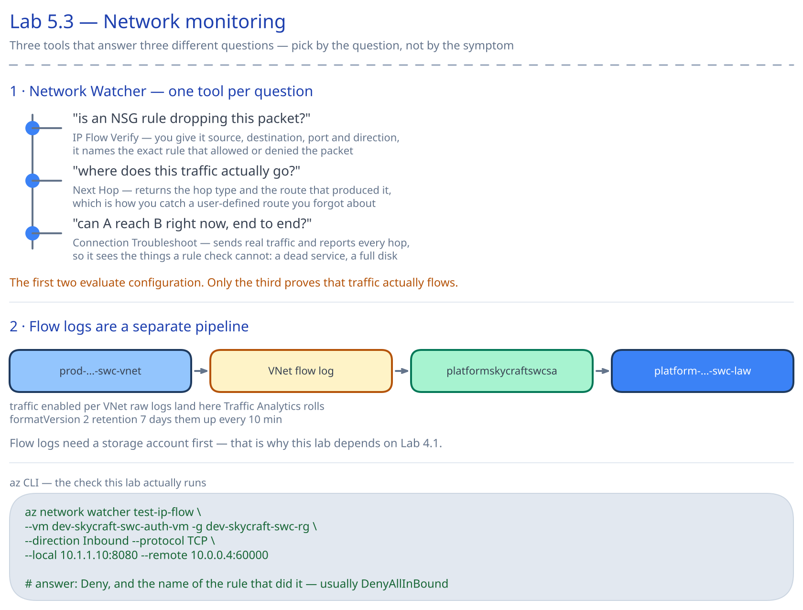

# Lab 5.3: Network Monitoring & Troubleshooting (1.5 hours)

## 🎯 Learning Objectives

By completing this lab, you will:

- Enable and configure **Azure Network Watcher**
- Use **IP Flow Verify** to identify NSG blocks
- Use **Next Hop** to troubleshoot routing issues
- Run **Connection Troubleshooter** for end-to-end connectivity checks
- Generate a **Network Topology** diagram automatically
- Enable a **VNet flow log** with **Traffic Analytics** on the production VNet
- Create a **Connection Monitor** that probes hub-to-spoke SSH continuously

---

## 🏗️ Architecture Overview

[Description]: Network Watcher is a regional service that provides tools to monitor, diagnose, and view metrics and logs for resources in an Azure virtual network.

<picture>
  <source media="(prefers-color-scheme: dark)" srcset="images/lab-5.3-architecture.dark.svg">
  <source media="(prefers-color-scheme: light)" srcset="images/lab-5.3-architecture.svg">
  
</picture>

---

## 📋 Real-World Scenario

**Situation**: Users are reporting that they cannot reach the development world server on port 8080. Khadgar suspects that a recently applied Network Security Group (NSG) rule is blocking the traffic, or perhaps a custom route is sending packets to the wrong gateway. Instead of manually inspecting dozens of rules, he needs to use Network Watcher to pinpoint the exact failure point.

**Your Task**: Use Network Watcher to verify if traffic on port 8080 is allowed to the development VM, confirm correctly routed traffic with Next Hop, and run an end-to-end connection check between the Hub and the Spoke. Then make the visibility permanent: record every flow on the production VNet with a flow log feeding Traffic Analytics, and keep a Connection Monitor probing the hub-to-spoke SSH path every five minutes so the next outage is on a dashboard before a user reports it.

---

## ⏱️ Estimated Time: 1.5 hours

- **Section 1**: Network Watcher Fundamentals (15 min)
- **Section 2**: IP Flow Verify (15 min)
- **Section 3**: Next Hop & Topology (15 min)
- **Section 4**: Connection Troubleshooter (15 min)
- **Section 5**: VNet Flow Log & Traffic Analytics (15 min)
- **Section 6**: Connection Monitor (15 min)

---

## ✅ Prerequisites

Before starting this lab:

- [ ] Completed **Lab 2.1: Virtual Networks** (`prod-skycraft-swc-vnet` is the flow log target; the dev VNet hosts the VMs)
- [ ] Completed **Lab 2.2: Secure Access** (NSGs must exist for IP Flow Verify to have rules to report)
- [ ] Completed **Lab 3.2: Virtual Machines** (`dev-skycraft-swc-auth-vm` and `dev-skycraft-swc-world-vm` must be running - the Connection Monitor needs two distinct VMs; `prod-skycraft-swc-auth-vm` is used as the source when it exists, and `dev-skycraft-swc-world-vm` in a dev-only environment, the default of Lab 3.2)
- [ ] Completed **Lab 4.1: Storage Accounts** (`platformskycraftswcsa` must exist for flow log storage)
- [ ] Completed **Lab 5.1: Azure Monitor** (`platform-skycraft-swc-law` Log Analytics Workspace must exist for Traffic Analytics and Connection Monitor output)
- [ ] Network Watcher `NetworkWatcher_swedencentral` in `NetworkWatcherRG`, and `NetworkWatcherRG` carries the four SkyCraft tags (Lab 2.1, Step 2.1.14; `Deploy-Bicep.ps1` enables the watcher if missing)

These are the same checks `scripts/Deploy-Bicep.ps1` performs before it deploys anything - the cheapest chain that satisfies them is 1.2 → 2.1 → 2.3 → 3.2 (dev) → 4.1 `-All` → 5.1 → 5.2 → 5.3. If Lab 4.1 had to use another name than `platformskycraftswcsa` (storage account names are unique across Azure), pass it to `Deploy-Bicep.ps1` as `-PlatformSaName`.

**If you did Lab 1.3**, its policies are still in force. `Enforce-Project-Tag` refuses every resource without `Project` = `SkyCraft`, and this lab makes Azure create three you cannot tag yourself: the Network Watcher agent on each endpoint VM, the connection monitor (its wizard has no Tags tab) and the `NWTA-*` data collection endpoint and rule that Traffic Analytics adds. Each one passes only because `Inherit-Project-Tag` (Lab 1.3, Step 1.3.8) copies `Project` from its resource group. Before you start, check that **Policy** → under **Authoring**, **Assignments** lists `Inherit-Project-Tag`, and that `dev-skycraft-swc-rg`, `NetworkWatcherRG` and `platform-skycraft-swc-rg` (and `prod-skycraft-swc-rg` if you use the prod VM) carry `Project` = `SkyCraft` on their **Tags** page. See Troubleshooting, Issue 5 if a create is refused.

---

## 📖 Section 1: Network Watcher Fundamentals (15 min)

### What is Network Watcher?

**Azure Network Watcher** provides tools to monitor, diagnose, view metrics, and enable or disable logs for resources in an Azure virtual network. It is designed to monitor and repair the network health of IaaS (Infrastructure-as-a-Service) products.

> [!NOTE]
> Azure enables Network Watcher for a region when the first virtual network appears there, by creating `NetworkWatcher_<region>` in `NetworkWatcherRG`. Under Lab 1.3's policies that automatic create is refused, which is why Lab 2.1 (Step 2.1.14) has you create the tagged group and the watcher yourself.

In the Azure Portal, search **Network Watcher** and open it: the page is titled **Networking monitoring & management | Network Watcher**. Its left menu folds the tools of this lab into collapsed groups: **Network diagnostics** (IP flow verify, Next hop, Connection troubleshoot), **Monitoring** (Topology, Connection monitor) and **Logs** (Flow logs). Expand a group if it is collapsed.

---

## 📖 Section 2: IP Flow Verify (15 min)

### Step 5.3.1: Check for NSG Blocks

1. In the search box at the top, type **Network Watcher** and open it (**Networking monitoring & management | Network Watcher**).
2. In the left menu, under **Network diagnostics** (expand it if it is collapsed), click **IP flow verify**.
3. Select the VM and its network interface:
   - **Select virtual machine**: `dev-skycraft-swc-auth-vm`
   - **Network interface**: the VM's only network interface
4. Configure the check: <!-- confirm in Portal pass: field labels Protocol, Direction, Local port, Remote IP address, Remote port -->
   - **Protocol**: **TCP**
   - **Direction**: **Inbound**
   - **Local port**: `8080`
   - **Remote IP address**: `8.8.8.8` (an example external IP)
   - **Remote port**: `443`
5. Click **Verify IP flow**.

**Expected Result**: The tool returns **Access denied** and names the NSG rule that decided it, `DenyAllInBound`: no rule of Lab 2.2's NSG allows port 8080 from the internet.

---

## 📖 Section 3: Next Hop & Topology (15 min)

### Step 5.3.2: Verify Routing

1. In Network Watcher, in the left menu, under **Network diagnostics**, click **Next hop**. <!-- confirm in Portal pass: Next hop sits under Network diagnostics -->
2. **Virtual machine**: `prod-skycraft-swc-auth-vm`.
   - **Fallback** - if only the dev environment exists (the default of Lab 3.2): pick `dev-skycraft-swc-world-vm` instead.
3. **Source IP address**: leave the value the Portal fills in (the VM's private IP).
4. **Destination IP address**: `1.1.1.1` (a public DNS resolver).
5. Click **Next hop**.

**Expected Result**: The tool returns **Internet** as the next hop type, from either VM. Traffic to a private IP in the hub would return **VNetPeering**, and to a private IP in the same VNet **VirtualNetwork**.

### Step 5.3.3: Visualize Topology

1. In Network Watcher, in the left menu, under **Monitoring** (expand it if it is collapsed), click **Topology**. The page opens on a world map; there is no resource group field and no **View topology** button.
2. Click the **Scope** chip and open **Resource Groups** in the pane. If **Select All** is checked, clear it, then select only `dev-skycraft-swc-rg`. Close the list and click **Save**.
3. The map can open scrolled to the Americas. Click **Zoom to Fit** on the map, then the expand button on the **Sweden Central** region card. <!-- confirm in Portal pass: the 2026-10-16 pass of this lab called the button Fit to screen, Lab 2.1's pass of 2026-10-26 Zoom to Fit -->
4. Click **+** on `dev-skycraft-swc-vnet` to show its subnets, then **+** on `AuthSubnet` to show the VM in it.

**Expected Result**: The map shows `dev-skycraft-swc-vnet` with its subnets, the VMs inside them, and the peering to the hub VNet.

---

## 📖 Section 4: Connection Troubleshooter (15 min)

### Step 5.3.4: End-to-End Check

1. In Network Watcher, in the left menu, under **Network diagnostics**, click **Connection troubleshoot**. <!-- confirm in Portal pass: Connection troubleshoot sits under Network diagnostics -->
2. **Source**: <!-- confirm in Portal pass: field labels Source type, Virtual machine, Destination type, Destination port -->
   - **Source type**: **Virtual machine**
   - **Virtual machine**: `prod-skycraft-swc-auth-vm` *(if Lab 3.2 prod environment was deployed)*
   - **Fallback** - if only the dev environment exists: use `dev-skycraft-swc-world-vm` as source
3. **Destination**:
   - **Destination type**: **Select a virtual machine**
   - **Virtual machine**: `dev-skycraft-swc-auth-vm`
4. **Probe settings**: **Protocol** **TCP**, **Destination port** `22` (SSH).
5. **Diagnostic tests**: leave the defaults checked (**Connectivity**, **NSG diagnostic**, **Next hop**, **Port scanner**).
6. Click **Run diagnostic tests**.

**Expected Result**: After about 20 seconds the tool shows a result table, not a hop-by-hop list: **Connectivity test**, **Outbound NSG diagnostic**, **Inbound NSG diagnostic**, **Next hop** and **Destination port accessible**. With the dev fallback source, **Connectivity test** reports **Reachable**: both VMs share `dev-skycraft-swc-vnet`. With the prod source it reports unreachable, for the reason Step 5.3.6 explains. Source and destination must be two distinct VMs; neither needs the Network Watcher agent for this one-off test.

---

## 📖 Section 5: VNet Flow Log & Traffic Analytics (15 min)

### What is a VNet flow log?

The tools above answer a question you already have. A **flow log** records every flow through a virtual network - source, destination, port, protocol, allowed or denied, bytes - as JSON in a storage account, so you can answer the questions you have not asked yet. **Traffic Analytics** reads those logs into a Log Analytics workspace every 10 minutes and turns them into top talkers, blocked flows and cross-VNet traffic maps.

> [!NOTE]
> **SkyCraft Choice**: VNet flow logs, not NSG flow logs. NSG flow logs were retired for new deployments in 2025 and only see traffic that passes an NSG; a VNet flow log sees every flow in `prod-skycraft-swc-vnet`, including subnets with no NSG attached. Retention is 7 days: long enough to investigate an incident, short enough that the storage cost stays negligible.

### Step 5.3.5: Create the flow log

The flow log is a child of the regional Network Watcher `NetworkWatcher_swedencentral` in `NetworkWatcherRG`, not of the VNet, which is why it lives in that resource group.

Under Lab 1.3's policies, enabling Traffic Analytics makes Azure create a data collection endpoint and rule, `NWTA-<workspace-guid>...`, in the workspace's group `platform-skycraft-swc-rg`, without tags. They are accepted only because `Inherit-Project-Tag` copies `Project` = `SkyCraft` from that group (see Prerequisites). If the create fails with `TARequestDisallowedByPolicy`, see Troubleshooting, Issue 4.

#### Azure Portal

1. In **Network Watcher**, in the left menu, under **Logs** (expand it if it is collapsed), click **Flow logs** → **+ Create**.
2. Under the **Basics** tab (there is no flow log type to choose; the target decides it):
   - Click **+ Add virtual networks**, select `prod-skycraft-swc-vnet` (region **Sweden Central**) and confirm the selection. <!-- confirm in Portal pass: label of the picker's confirm button --> The flow log is created in the region of its target, Sweden Central.
   - The VNet appears in a table with an editable **Name** cell, pre-filled with a name built from the VNet and its group. Replace it with `prod-skycraft-swc-vnet-flowlog`.
   - **Storage account**: `platformskycraftswcsa`
   - **Retention days**: `7` (the field appears only after you pick the storage account, empty and required)
3. Under the **Analytics** tab (VNet flow logs are always format version 2; there is no version field):
   - **Enable traffic analytics**: checked
   - **Traffic analytics processing interval**: **Every 10 mins** (the wizard defaults to **Every 1 hour**) <!-- confirm in Portal pass: label of the 10-minute option -->
   - **Log Analytics workspace**: `platform-skycraft-swc-law`
4. Under the **Tags** tab: `Project = SkyCraft`, `Environment = Production`, `CostCenter = MSDN`, `Owner = <your name>`.
5. Click **Review + create** → **Create**.

#### Azure CLI

`--storage-account` and `--workspace` take full resource IDs here: given a bare name, the CLI looks for it in `--resource-group` (the VNet's group), but both live in `platform-skycraft-swc-rg`.

```azurecli
SA=$(az storage account show -g platform-skycraft-swc-rg -n platformskycraftswcsa --query id -o tsv)
LAW=$(az monitor log-analytics workspace show -g platform-skycraft-swc-rg -n platform-skycraft-swc-law --query id -o tsv)

az network watcher flow-log create \
  --name prod-skycraft-swc-vnet-flowlog \
  --location swedencentral \
  --vnet prod-skycraft-swc-vnet \
  --resource-group prod-skycraft-swc-rg \
  --storage-account "$SA" \
  --enabled true \
  --format JSON --log-version 2 \
  --retention 7 \
  --traffic-analytics true \
  --workspace "$LAW" \
  --interval 10 \
  --tags Project=SkyCraft Environment=Production CostCenter=MSDN Owner="<your name>"
```

#### Azure PowerShell

```powershell
$nw   = Get-AzNetworkWatcher -Location swedencentral
$vnet = Get-AzVirtualNetwork -Name prod-skycraft-swc-vnet -ResourceGroupName prod-skycraft-swc-rg
$sa   = Get-AzStorageAccount -Name platformskycraftswcsa -ResourceGroupName platform-skycraft-swc-rg
$law  = Get-AzOperationalInsightsWorkspace -Name platform-skycraft-swc-law -ResourceGroupName platform-skycraft-swc-rg

New-AzNetworkWatcherFlowLog -NetworkWatcher $nw -Name prod-skycraft-swc-vnet-flowlog `
  -TargetResourceId $vnet.Id -StorageId $sa.Id -Enabled $true `
  -FormatType Json -FormatVersion 2 -EnableRetention $true -RetentionPolicyDays 7 `
  -EnableTrafficAnalytics -TrafficAnalyticsWorkspaceId $law.ResourceId -TrafficAnalyticsInterval 10 `
  -Tag @{ Project = 'SkyCraft'; Environment = 'Production'; CostCenter = 'MSDN'; Owner = '<your name>' }
```

**Expected Result**: The deployment ends **Succeeded**, and `prod-skycraft-swc-vnet-flowlog` shows **Enabled** under Flow logs with `prod-skycraft-swc-vnet` as its target. A deployment that ends *Conflict* leaves the flow log in the **Failed** state, recording nothing: see Troubleshooting, Issue 4. After 10-20 minutes, **Traffic Analytics** in Network Watcher shows the first flows between the hub and the spokes.

---

## 📖 Section 6: Connection Monitor (15 min)

### What is Connection Monitor?

**Connection Troubleshoot** (Section 4) is a one-off probe. **Connection Monitor** runs the same probe on a schedule from an agent on the source VM, records reachability, latency and the hop-by-hop path to a Log Analytics workspace, and can alert when checks fail. The lab creates one monitor, `skycraft-hub-spoke-cm`, that probes SSH from the production spoke VM (or, in a dev-only environment, the dev world VM) to the development auth server every five minutes.

### Step 5.3.6: Create the Connection Monitor

Both endpoint VMs need the Network Watcher agent, a VM extension, and no earlier lab installs it: creating a monitor with an agent-less VM endpoint fails with `NetworkWatcherVmExtensionNotInstalled`. Each path installs it differently. Under Lab 1.3's policies each ends with the agent tagged `Project` = `SkyCraft`, the tag `Remove-LabResource.ps1` selects on when it removes the agent again (without Lab 1.3, the Portal's agent stays untagged and the cleanup leaves it):

| Path | Agent extension | How it gets `Project` = `SkyCraft` |
| ---- | --------------- | ---------------------------------- |
| Azure Portal | `AzureNetworkWatcherExtension`, installed by the wizard when you add a VM endpoint | `Inherit-Project-Tag` copies it from the VM's resource group (the wizard has no tags field for it) |
| Azure CLI, Azure PowerShell, `Deploy-Bicep.ps1` | `NetworkWatcherAgentLinux`, installed before the monitor | Set in the install request |

A VM takes one Network Watcher agent, so the CLI and PowerShell blocks skip a VM that already has one, whatever its name.

The monitor itself lives in `NetworkWatcherRG`. The Portal wizard has no Tags tab: the monitor is created with the `Project` tag `Inherit-Project-Tag` copies from `NetworkWatcherRG`, and you add the other three tags right after (item 7). The CLI and PowerShell paths set all four tags in the create request.

#### Azure Portal

1. In **Network Watcher**, in the left menu, under **Monitoring** (expand it if it is collapsed), click **Connection monitor**. Click **+ Create**, which opens a menu, and choose **Manual Create** (not *Auto Create (Preview)*).
2. Under the **Basics** tab:
   - **Connection Monitor Name**: `skycraft-hub-spoke-cm`
   - **Subscription**: yours
   - **Region**: **Sweden Central** (the wizard defaults to East US; the region picks the Network Watcher, `Test-Lab.ps1` looks under `NetworkWatcher_swedencentral`, and Lab 1.3's `Restrict-Azure-Regions` refuses East US)
   - **Workspace configuration**: select **Custom Workspace**, not **Default (Recommended)**, which sends the results to a default workspace instead of the lab's, then **Subscription**: yours and **Workspace**: `platform-skycraft-swc-law`. The list can preselect another workspace, for example one an earlier lab left in `dev-skycraft-swc-rg`: change it. <!-- confirm in Portal pass: whether the workspace radio sits on Basics or on its own tab, and its field labels -->
3. Under the **Test groups** tab, click **+ Add test group**:
   - **Test group name**: `hub-spoke-ssh`
   - **+ Add sources** → **Azure endpoints** → select `prod-skycraft-swc-auth-vm` → **Add endpoints** <!-- confirm in Portal pass: endpoint picker labels Azure endpoints and Add endpoints -->
     - **Fallback** - if only the dev environment exists: pick `dev-skycraft-swc-world-vm` instead (the deployment script makes the same substitution)
   - The source endpoint is named after its VM. Click the **Edit** link under it and rename it `prod-auth-source`.
   - **+ Add destinations** → **Azure endpoints** → select `dev-skycraft-swc-auth-vm` → **Add endpoints**
   - Click the **Edit** link under the destination endpoint and rename it `dev-auth-destination` (`Test-Lab.ps1` looks the destination up by this name).
   - **Add Test configuration** → **New configuration**. A new configuration starts as HTTP, port 80, every 30 seconds; change it to: <!-- confirm in Portal pass: labels of the test configuration fields -->
     - **Test configuration name**: `tcp-22-every-5m`
     - **Protocol**: **TCP**
     - **Destination port**: `22`
     - **Listen on port**: unchecked
     - **Disable traceroute**: unchecked
     - **Test Frequency**: **Every 5 minutes**
     - **Checks failed (%)**: `10`
     - **Round trip time (ms)**: `100`
   - **Add Test configuration** → **Add Test Group**
4. Under the **Create alert** tab, leave **Create alert** unchecked. <!-- confirm in Portal pass: the Create alert tab -->
5. Click **Review + create** → **Create**. When you add the VM endpoints, the wizard enables the Network Watcher agent on any VM without one, so the deployment can take a few minutes. If it fails, read the reason under the notification bell (the page itself shows none) and see Troubleshooting, Issue 5. Do not use **Redeploy** on the failed monitor.
6. Back on **Connection monitor**, `skycraft-hub-spoke-cm` appears in **Sweden Central**.
7. Add the other three tags, which `Test-Lab.ps1` checks (`CostCenter`) and the cost reports use. In the search box at the top, type **Resource groups**, open `NetworkWatcherRG`, check **Show hidden types**, click `skycraft-hub-spoke-cm`, then **Tags**. `Project` = `SkyCraft` is already there. Add `Environment` = `Production`, `CostCenter` = `MSDN` and `Owner` = `<your name>`, then click **Apply**. <!-- confirm in Portal pass: the connection monitor is listed in NetworkWatcherRG and has a Tags page -->

   If the monitor is not listed there, set the same tags from Cloud Shell (PowerShell):

   ```powershell
   Update-AzTag -ResourceId (Get-AzNetworkWatcherConnectionMonitor -Location swedencentral -Name skycraft-hub-spoke-cm).Id `
     -Tag @{ Project = 'SkyCraft'; Environment = 'Production'; CostCenter = 'MSDN'; Owner = '<your name>' } -Operation Merge
   ```

#### Azure CLI

```azurecli
# Falls back to the dev world VM when the prod environment does not exist
SRC=$(az vm show -g prod-skycraft-swc-rg -n prod-skycraft-swc-auth-vm --query id -o tsv 2>/dev/null) ||
  SRC=$(az vm show -g dev-skycraft-swc-rg -n dev-skycraft-swc-world-vm --query id -o tsv)
DST=$(az vm show -g dev-skycraft-swc-rg -n dev-skycraft-swc-auth-vm --query id -o tsv)

# Tag set in the install request: az vm extension set has no tags option
for VM in "$SRC" "$DST"; do
  [ -n "$(az vm extension list --ids "$VM" --query "[?publisher=='Microsoft.Azure.NetworkWatcher'].name" -o tsv)" ] && continue
  az resource create --id "$VM/extensions/NetworkWatcherAgentLinux" --is-full-object --properties '{
    "location": "swedencentral",
    "tags": { "Project": "SkyCraft" },
    "properties": { "publisher": "Microsoft.Azure.NetworkWatcher", "type": "NetworkWatcherAgentLinux", "typeHandlerVersion": "1.4", "autoUpgradeMinorVersion": true }
  }'
done

az network watcher connection-monitor create \
  --name skycraft-hub-spoke-cm \
  --location swedencentral \
  --endpoint-source-name prod-auth-source --endpoint-source-type AzureVM \
  --endpoint-source-resource-id "$SRC" \
  --endpoint-dest-name dev-auth-destination --endpoint-dest-type AzureVM \
  --endpoint-dest-resource-id "$DST" \
  --test-config-name tcp-22-every-5m \
  --protocol Tcp --tcp-port 22 --frequency 300 \
  --threshold-failed-percent 10 --threshold-round-trip-time 100 \
  --test-group-name hub-spoke-ssh \
  --workspace-ids $(az monitor log-analytics workspace show -g platform-skycraft-swc-rg -n platform-skycraft-swc-law --query id -o tsv) \
  --tags Project=SkyCraft Environment=Production CostCenter=MSDN Owner="<your name>"
```

#### Azure PowerShell

```powershell
$nw  = Get-AzNetworkWatcher -Location swedencentral
# Falls back to the dev world VM when the prod environment does not exist
$src = (Get-AzVM -Name prod-skycraft-swc-auth-vm -ResourceGroupName prod-skycraft-swc-rg -ErrorAction SilentlyContinue) ??
       (Get-AzVM -Name dev-skycraft-swc-world-vm -ResourceGroupName dev-skycraft-swc-rg)
$dst = Get-AzVM -Name dev-skycraft-swc-auth-vm  -ResourceGroupName dev-skycraft-swc-rg
$law = Get-AzOperationalInsightsWorkspace -Name platform-skycraft-swc-law -ResourceGroupName platform-skycraft-swc-rg

# New-AzResource, not Set-AzVMExtension (no -Tag): the cleanup selects on the tag
foreach ($vm in $src, $dst) {
  if (Get-AzVMExtension -ResourceGroupName $vm.ResourceGroupName -VMName $vm.Name |
      Where-Object Publisher -eq 'Microsoft.Azure.NetworkWatcher') { continue }
  New-AzResource -ResourceId "$($vm.Id)/extensions/NetworkWatcherAgentLinux" -Location $vm.Location -ApiVersion 2024-07-01 `
    -Properties @{ publisher = 'Microsoft.Azure.NetworkWatcher'; type = 'NetworkWatcherAgentLinux'; typeHandlerVersion = '1.4'; autoUpgradeMinorVersion = $true } `
    -Tag @{ Project = 'SkyCraft' } -Force
}

$srcEp = New-AzNetworkWatcherConnectionMonitorEndpointObject -Name prod-auth-source     -AzureVM -ResourceId $src.Id
$dstEp = New-AzNetworkWatcherConnectionMonitorEndpointObject -Name dev-auth-destination -AzureVM -ResourceId $dst.Id
$tcp   = New-AzNetworkWatcherConnectionMonitorProtocolConfigurationObject -TcpProtocol -Port 22
$cfg   = New-AzNetworkWatcherConnectionMonitorTestConfigurationObject -Name tcp-22-every-5m -TestFrequencySec 300 `
           -ProtocolConfiguration $tcp -SuccessThresholdChecksFailedPercent 10 -SuccessThresholdRoundTripTimeMs 100
$grp   = New-AzNetworkWatcherConnectionMonitorTestGroupObject -Name hub-spoke-ssh -TestConfiguration $cfg -Source $srcEp -Destination $dstEp
$out   = New-AzNetworkWatcherConnectionMonitorOutputObject -WorkspaceResourceId $law.ResourceId

New-AzNetworkWatcherConnectionMonitor -NetworkWatcher $nw -Name skycraft-hub-spoke-cm -TestGroup $grp -Output $out `
  -Tag @{ Project = 'SkyCraft'; Environment = 'Production'; CostCenter = 'MSDN'; Owner = '<your name>' }
```

**Expected Result**: `skycraft-hub-spoke-cm` appears under Connection monitor with monitoring status **Running** and carries the four tags, both endpoint VMs list a Network Watcher agent with `Project` = `SkyCraft`, and `NWConnectionMonitorTestResult` in `platform-skycraft-swc-law` starts receiving rows within about 10 minutes. What `hub-spoke-ssh` reports depends on the source:

- **Dev fallback source** (`dev-skycraft-swc-world-vm`): **Pass** - source and destination share `dev-skycraft-swc-vnet`.
- **Production source** (`prod-skycraft-swc-auth-vm`): **Fail**. The prod and dev spokes are each peered only to the hub, and VNet peering is not transitive, so traffic to the dev `AuthSubnet` (`10.1.1.0/24`) matches the system route `10.0.0.0/8 → None` and is dropped. Confirm it with **Next hop** (Step 5.3.2) from `prod-skycraft-swc-auth-vm` to the private IP of `dev-skycraft-swc-auth-vm`: this is the monitor doing its job, not a broken lab. Issue #178 tracks the route the lab should provide.

**Preview - the AVM module call the Bicep path makes** (`bicep/main.bicep`; version pinned in `docs/bicep-standards.md` §4.4). Both resources of this lab are children of the Network Watcher module:

```bicep
module modNetworkWatcher 'br/public:avm/res/network/network-watcher:0.5.1' = {
  name: 'network-monitoring-deployment'
  scope: resourceGroup('NetworkWatcherRG')
  params: {
    name: 'NetworkWatcher_swedencentral'        // re-declares the auto-provisioned watcher (idempotent)
    flowLogs: [ { name: 'prod-skycraft-swc-vnet-flowlog', targetResourceId: parProdVnetResourceId, formatVersion: 2, retentionInDays: 7, workspaceResourceId: parWorkspaceResourceId, trafficAnalyticsInterval: 10, ... } ]
    connectionMonitors: [ { name: 'skycraft-hub-spoke-cm', endpoints: [...], testConfigurations: [...], testGroups: [...], workspaceResourceId: parWorkspaceResourceId } ]
  }
}
```

---

## ✅ Lab Checklist

- [ ] Network Watcher verified as active in Sweden Central
- [ ] IP Flow Verify used to check port 8080 access
- [ ] Next Hop checked for external connectivity
- [ ] VNet Topology generated and inspected
- [ ] Connection Troubleshooter used between two VMs
- [ ] Flow log `prod-skycraft-swc-vnet-flowlog` enabled on `prod-skycraft-swc-vnet` with Traffic Analytics every 10 minutes
- [ ] Connection Monitor `skycraft-hub-spoke-cm` running the `hub-spoke-ssh` test group

**For detailed verification**, see [lab-checklist-5.3.md](lab-checklist-5.3.md)

---

## 🔧 Troubleshooting

### Issue 1: No network watcher for Sweden Central

**Symptom**: **Networking monitoring & management | Network Watcher** shows "No network watchers to display", or none in **Sweden Central**, and the tools of this lab offer no VM to select.

**Root Cause**: Azure creates `NetworkWatcher_swedencentral` in `NetworkWatcherRG` on its own when the first VNet appears in the region, but Lab 1.3's `Require-Environment-Tag-RG` refuses the untagged group it would create.

**Solution**:

- Create `NetworkWatcherRG` with the four SkyCraft tags and then the watcher, as in Lab 2.1, Step 2.1.14 (items 2-4), or run `scripts/Deploy-Bicep.ps1`, which enables the watcher if it is missing.

### Issue 2: Test-Lab.ps1 fails on the flow log or the Connection Monitor although the portal steps succeeded

**Symptom**: `Flow log 'prod-skycraft-swc-vnet-flowlog' exists`, `Connection Monitor 'skycraft-hub-spoke-cm' exists` or one of the tag checks reports FAIL.

**Root Cause**: The validation script looks the resources up **by name** under `NetworkWatcher_swedencentral` in `NetworkWatcherRG`, and the destination endpoint by the name `dev-auth-destination`. A flow log, monitor or endpoint created under a different name, or a monitor without the `Project = SkyCraft` and `CostCenter = MSDN` tags, fails the check. The Portal wizard creates the monitor with `Project` only, inherited from `NetworkWatcherRG`.

**Solution**:

- Use the exact names from Steps 5.3.5 and 5.3.6, or run `scripts/Deploy-Bicep.ps1`, which is idempotent and produces the same resources.
- Add the monitor's other tags as in Step 5.3.6, item 7.

### Issue 3: Connection Monitor shows "Agent not installed" on an endpoint

**Symptom**: The test group stays **Indeterminate** and the endpoint carries a warning.

**Root Cause**: Connection Monitor probes from the Network Watcher agent VM extension, and no earlier lab installs it - Lab 3.2's VMs come without it. The Portal wizard installs it, but that install fails when the VM is deallocated or the policy refuses it (Issue 5).

**Solution**:

- Start the VM, then install the agent with the loop at the top of the Step 5.3.6 CLI or PowerShell block, or re-run `Deploy-Bicep.ps1`, which installs it before creating the monitor.

### Issue 4: Enabling Traffic Analytics fails with `TARequestDisallowedByPolicy`

**Symptom**: Creating the flow log (Step 5.3.5, any path) ends *Conflict* with *The enablement of Traffic Analytics is blocked due to the user's policy restrictions: "RequestDisallowedByPolicy ..." (Code: TARequestDisallowedByPolicy)*, and the flow log is left in the **Failed** state. The message names Lab 1.3's `Enforce-Project-Tag` assignment: its id ends in `policyAssignments/Enforce-Project-Tag` when Lab 1.3 was deployed with Bicep or its scripts, and in a generated id when the assignment was made in the Portal. The Activity Log of `platform-skycraft-swc-rg` shows the denied `dataCollectionEndpoints/write` for `NWTA-<workspace-guid>...`.

**Root Cause**: When Traffic Analytics is enabled it creates its own data collection endpoint and rule, `NWTA-<workspace-guid>...`, in the workspace's resource group (`platform-skycraft-swc-rg`), without tags. `Enforce-Project-Tag` refuses them unless `Inherit-Project-Tag` has added `Project` from the group first. That fails when `Inherit-Project-Tag` is not assigned (Lab 1.3 done before it gained that assignment), was assigned only minutes ago, or `platform-skycraft-swc-rg` has no `Project` tag.

**Solution**:

- Check that **Policy** → under **Authoring**, **Assignments** lists `Inherit-Project-Tag` with **Tag Name** `Project`. If it is missing, assign it as in Lab 1.3, Step 1.3.8, and wait about ten minutes. Do not delete `Enforce-Project-Tag`: Lab 1.3's `Test-Lab.ps1` checks it.
- Check that `platform-skycraft-swc-rg` carries `Project` = `SkyCraft` on its **Tags** page.
- Delete the Failed flow log (under **Logs**, **Flow logs**, select `prod-skycraft-swc-vnet-flowlog` → **Delete**) and create it again with Step 5.3.5. <!-- confirm in Portal pass: Delete on the Flow logs list -->

### Issue 5: Creating the Connection Monitor fails with no reason on the page

**Symptom**: **Create** in Step 5.3.6 ends with a failed deployment, and the page gives no reason. Under the notification bell, or in the Activity Log, a write is refused with `RequestDisallowedByPolicy` and "All resources must be tagged with Project=SkyCraft": first for the agent extension `AzureNetworkWatcherExtension` on a VM, or for `skycraft-hub-spoke-cm` itself. **Redeploy** on the failed monitor opens an *Edit Connection Monitor* blade with an empty, greyed name and Region East US.

**Root Cause**: The wizard creates the agent and the monitor without tags. Lab 1.3's `Enforce-Project-Tag` accepts them only when `Inherit-Project-Tag` copies `Project` from their resource group: the VM's group for the agent, `NetworkWatcherRG` for the monitor. A group without `Project` (Azure creates `NetworkWatcherRG` untagged), or a missing `Inherit-Project-Tag`, leaves nothing to copy.

**Solution**:

- Check the tags of `NetworkWatcherRG` and of the VMs' groups, and the `Inherit-Project-Tag` assignment, as in the Prerequisites; Lab 1.3, Troubleshooting Issue 7 covers the same refusal for any resource.
- Do not use **Redeploy**: delete the failed monitor if it is listed, then start again with **+ Create** → **Manual Create**.
- Or install the agent first with the loop of the Step 5.3.6 PowerShell block, then run the wizard again.

---

## 🎓 Knowledge Check

1. **When would you use IP Flow Verify instead of just looking at NSG rules?**
   <details>
     <summary>**Click to see the answer**</summary>

   **Answer**: When there are multiple NSGs applied (at both subnet and NIC levels) or complex rule sets. IP Flow Verify simulates the traffic and identifies exactly which rule is winning.
   </details>

2. **Does Network Watcher cost anything?**
   <details>
     <summary>**Click to see the answer**</summary>

   **Answer**: Most diagnostic tools (IP Flow, Next Hop) are free. Only logs (VNet flow logs, Traffic Analytics) and Packet Captures incur costs based on data volume.
   </details>

3. **Connection Troubleshoot and Connection Monitor both test `prod-skycraft-swc-auth-vm` → `dev-skycraft-swc-auth-vm` on port 22. When do you need the monitor?**
   <details>
     <summary>**Click to see the answer**</summary>

   **Answer**: Connection Troubleshoot is a single probe you run when you already suspect a problem. Connection Monitor repeats the probe every five minutes from an agent on the source VM, stores the results in Log Analytics, and can raise an alert - it catches the outage that happens at 03:00 and tells you when it started.
   </details>

4. **Why is the flow log created under `NetworkWatcherRG` rather than next to `prod-skycraft-swc-vnet` in `prod-skycraft-swc-rg`?**
   <details>
     <summary>**Click to see the answer**</summary>

   **Answer**: A flow log is a child resource of the regional Network Watcher, not of its target. Network Watcher is one Azure-provisioned instance per region, so every flow log and connection monitor in Sweden Central lives under `NetworkWatcher_swedencentral`, whichever VNet it records.
   </details>

---

## 📚 Additional Resources

- [Network Watcher Overview](https://learn.microsoft.com/en-us/azure/network-watcher/network-watcher-monitoring-overview)
- [IP Flow Verify Documentation](https://learn.microsoft.com/en-us/azure/network-watcher/network-watcher-ip-flow-verify-overview)
- [VNet Flow Logs](https://learn.microsoft.com/en-us/azure/network-watcher/vnet-flow-logs-overview)
- [Traffic Analytics](https://learn.microsoft.com/en-us/azure/network-watcher/traffic-analytics)
- [Connection Troubleshoot](https://learn.microsoft.com/en-us/azure/network-watcher/network-watcher-connectivity-overview)
- [Connection Monitor](https://learn.microsoft.com/en-us/azure/network-watcher/connection-monitor-overview)

---

## 📌 Module Navigation

[Lab 5.2 Business Continuity ←](../5.2-business-continuity/lab-guide-5.2.md) | [Back to Module 5 Index](../README.md)

---

## 📝 Lab Summary

**What You Accomplished:**

✅ Verified Network Watcher is enabled for Sweden Central
✅ Used IP Flow Verify to identify NSG rule behavior
✅ Checked routing with Next Hop diagnostic tool
✅ Generated network topology visualization
✅ Ran end-to-end Connection Troubleshooter between VMs
✅ Enabled a VNet flow log with Traffic Analytics on the production VNet
✅ Created a Connection Monitor probing hub-to-spoke SSH every 5 minutes

**Infrastructure Deployed:**

| Resource                         | Type                              | Resource Group    | Notes                                                                     |
| -------------------------------- | --------------------------------- | ----------------- | ------------------------------------------------------------------------- |
| `NetworkWatcher_swedencentral`   | Network Watcher                   | `NetworkWatcherRG` | Azure-provisioned per region; re-declared with the SkyCraft tags          |
| `prod-skycraft-swc-vnet-flowlog` | Flow log (VNet)                   | `NetworkWatcherRG` | Target `prod-skycraft-swc-vnet`, v2, 7-day retention, Traffic Analytics 10 min |
| `skycraft-hub-spoke-cm`          | Connection Monitor                | `NetworkWatcherRG` | `hub-spoke-ssh` → `tcp-22-every-5m`, output to `platform-skycraft-swc-law` |
| Network Watcher agent            | VM extension on both endpoint VMs | `dev-skycraft-swc-rg` / `prod-skycraft-swc-rg` | `AzureNetworkWatcherExtension` from the Portal wizard, or `NetworkWatcherAgentLinux` from the CLI, PowerShell and `Deploy-Bicep.ps1`; tagged `Project = SkyCraft`; removed by `Remove-LabResource.ps1`, except on a VM that is not running, where Azure refuses the change and the cleanup leaves it (harmless, deleted with the VM) |

**Time Spent**: ~1.5 hours

**Congratulations!** You have completed Module 5: Monitor and Maintain Azure Resources.
